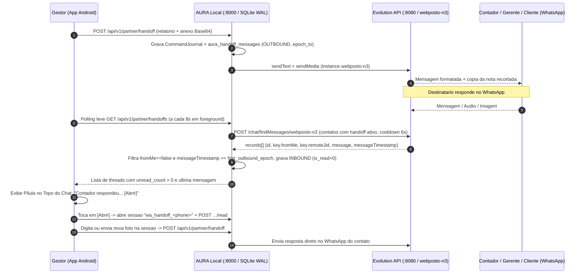

# Apendice Tecnico: Sessoes Dedicadas de Retorno WhatsApp & Fronteira Real do Motor Fiscal (Web vs. PDV Local)

> [!IMPORTANT]
> **Objetivo deste Documento (Guia Executavel para Agentes de Codigo):**
> Este apendice especifica o fluxo ponta a ponta, a logica de correlacao, a sincronizacao ativa com a Evolution API v2, os contratos de API, o esquema de persistencia (SQLite WAL + Room Android), os componentes de interface Jetpack Compose, a fronteira estrita do Motor Fiscal (Entrada no Banco Web vs. Saida PDV no Banco Local `:5433`) e os criterios de validacao para execucao autonoma por um agente de desenvolvimento.
>
> **Regra de Conformidade:** ZERO travessoes Unicode neste documento, codigos ou testes gerados a partir dele. Utilizar apenas hifens comuns (`-`), dois pontos (`:`) ou parenteses.

---

## 1. Contexto Operacional e Descobertas de Infraestrutura Ao Vivo

### 1.1. Problema 1: Retorno de Conversas WhatsApp (Sem Poluir nem Rolar o Chat Principal)
- Quando o gestor dispara um encaminhamento pelo app Android (ex.: enviar relatorio de DANFE e foto recortada para o Contador, ou alerta de estoque para o Gerente de Pista via `POST /api/v1/partner/handoff`), o chat analitico com a AURA continua evoluindo com novas consultas.
- Atualizar apenas o card antigo onde o botao foi clicado torna a leitura inviavel porque o card sobe e exige rolagem massiva no historico.
- **Solucao Adotada (2 Camadas):**
  1. **Pilula Flutuante de Alerta no Topo do Chat Atual (`HandoffReplyTopBanner`):** aparece sobre o chat ativo sempre que chegar uma resposta nova de qualquer contato, independente de quanto a conversa principal tenha rolado, com botao **`Abrir`** de 1 toque.
  2. **Sessao Dedicada por Contato na Aba `Retornos WhatsApp` (`wa_handoff_<phone>`):** cada contato acionado ganha uma sessao separada no Historico de Conversas (separado por abas: `Analises AURA` | `Retornos WhatsApp`), onde o gestor visualiza o relatorio e a miniatura da nota que enviou, le todas as respostas do destinatario e responde diretamente da sessao para o WhatsApp daquele contato via Evolution API.

### 1.2. Descoberta Critica de Rede: Como Capturar Respostas sem Alterar o Webhook do Painel CRM
- **Fato Auditado na Instancia `webposto-n3` (`GET /webhook/find/webposto-n3` em `100.89.108.95:8080`):**
  - A Evolution API v2 possui **uma unica URL de webhook por instancia**, que ja esta configurada e ativa apontando para o Painel WhatsApp CRM: `http://host.docker.internal:3000/api/webhooks/whatsapp` (`events: ["MESSAGES_UPSERT"]`).
  - Portanto, depender exclusivamente de um webhook direto da Evolution API para `:8000` nao funcionaria sem sobrescrever o webhook do Painel CRM ou alterar o codigo do servidor `:3000`.
- **Arquitetura Dual-Sync (Pull Ativo na Evolution API + Push Passivo via Webhook):**
  1. **Pull Ativo Autonomo (`sync_evolution_inbound_for_active_threads`):**
     - A AURA Local (`:8000`) consulta diretamente a API REST da Evolution (`POST {EVOLUTION_API_URL}/chat/findMessages/{EVOLUTION_INSTANCE}`) apenas para os telefones que possuem handoff ativo nas ultimas 72 horas (com cache/cooldown de `6 segundos`).
     - Isso garante que qualquer resposta do Contador, Gerente ou Fornecedor apareca no App Android de forma **100% autonoma**, sem tocar na configuracao de webhook do Painel CRM!
  2. **Push Passivo (`POST /api/v1/partner/handoff-reply`):**
     - Continua disponivel para receber eventos encaminhados em tempo real pelo Painel CRM (`:3000`) ou por webhooks futuros.

### 1.3. Problema 2: Fronteira Estrita do Motor Fiscal (Banco Web vs. Banco Local `:5433`)
- **Regra Real do Ambiente WebPosto / Posto:**
  - **Notas Fiscais de Entrada (Compras / Fornecedores / Modelo 55):** ficam armazenadas **exclusivamente no Banco Web** da retaguarda, ao qual a AURA Local **nao possui acesso SQL**.
  - **Notas Fiscais de Saida / PDV (Cupons NFC-e / Modelo 65 de pista e conveniencia):** ficam armazenadas no **Banco Local PostgreSQL (`:5433`)**, acessivel em modo leitura (`aura_service_ro`).
- **Implicacao Direta no Motor Fiscal:**
  - Toda auditoria de nota de entrada (foto com recorte nos Olhos da AURA, codigo de barras 44 digitos, PDF ou XML NF-e) deve ser **100% autossuficiente sobre o documento capturado** e sobre as regras deterministicas de `core/fiscal_engine.py`, gravando pendencias no `CommandJournal` local (`SQLite WAL`) e gerando orientacoes de correcao para o WebPosto Web.
  - Consultas ao banco PostgreSQL `:5433` ficam restritas a notas/cupons emitidos no PDV de saida (NFC-e / CF-e) e dados operacionais locais da pista.

---

## 2. Visao Geral do Fluxo Completo (Diagrama E2E)



---

## 3. Especificacao da Fronteira Fiscal (Entrada Web vs. PDV Local)

### 3.1. Matriz de Decisao do Motor Fiscal (`core/fiscal_engine.py`, `core/tools.py`, `core/aura_engine.py`)

| Tipo de Documento / Pergunta | Origem no ERP Real | Acesso AURA Local (`:5433`) | Pipeline Obrigatorio da AURA |
| :--- | :--- | :---: | :--- |
| **NF-e Entrada (Mod. 55 / Compra / Fornecedor / DANFE / XML / PDF)** | **Banco Web (Sem acesso)** | **PROIBIDO consultar notas de entrada no DB local** | 1. Validar chave 44 digitos (`decompor_chave_acesso`, `validar_chave_acesso`)<br>2. Se houver XML, auditar via `auditar_documento_xml`<br>3. Validar somatorio de itens x `vProd` (W07-10), `vNF` (W16-10), NCM/CST monofasico (`LC 192/2022` - CST 61 diesel/gasolina, proibicao em etanol hidratado), PIS/COFINS monofasico (`CST 04`)<br>4. Consultar base de solucoes WebPosto via `webposto_rag` (`pilar="fiscal_tributario_sefaz"`)<br>5. Permitir gravar pendencia no `CommandJournal` local + enviar ao Contador via WhatsApp |
| **NFC-e / Cupom Saida PDV (Mod. 65 / Pista / Conveniencia)** | **Banco Local (`:5433`)** | **PERMITIDO (Read-Only)** | 1. Decompor chave 44 digitos se informada<br>2. Consultar registros locais de venda/cupom no PostgreSQL `:5433` quando o gestor pedir conferencia de emissao de pista<br>3. Aplicar regras SEFAZ/ACBr (`Rejeicao 375`, `531`, `535`, `629`, `958`, `959`, `960`) |

### 3.2. Regras de Implementacao no Motor Fiscal e Scanner Android
- **Arquivos envolvidos:**
  - `Aura Assistance Android/app/src/main/java/com/example/aurapostoassitance/data/vision/AuraVisionNpuScanner.kt`
  - `core/tools.py` (`auditar_documento_ou_chave_fiscal`)
  - `core/aura_engine.py` (instrucao de sistema / roteamento fiscal)
  - `core/partner_api.py` (`partner_quick_action_endpoint`)
- **Detalhamento:**
  1. Em `AuraVisionNpuScanner.scanXmlUri()`, quando um arquivo XML NF-e for lido, anexar ao final do `promptForAura` o trecho XML original (ou reconstruido com `<nfeProc><NFe><infNFe ...>...</infNFe></NFe></nfeProc>` limitado a 6.000 caracteres) para que `core/tools.py:auditar_documento_ou_chave_fiscal` acione `auditar_documento_xml()` deterministicamente.
  2. Em `core/aura_engine.py`, reforcar na diretiva fiscal: *"Notas fiscais de entrada (compra de mercadorias/combustiveis, Modelo 55) ficam exclusivamente no banco Web; nunca tente buscar notas de entrada no banco PostgreSQL local (:5433). Audite 100% com base nos dados extraidos do documento/XML/chave e nas regras da SEFAZ. Apenas cupons de saida emitidos no PDV (NFC-e Modelo 65) residem no banco local."*
  3. Em `core/partner_api.py` (`partner_quick_action_endpoint`), quando `action_type` contiver `"FISCAL"` ou `"PENDENCIA"`, gravar explicitamente os parametros (`chave_acesso`, `numero_nf`, `resumo_divergencia`, `fornecedor`) no `CommandJournal` com status `COMPLETED` e recibo rastreavel.

---

## 4. Especificacao do Backend Python (`ia-banco-local`)

### 4.1. Normalizacao Canonica de Telefone e Variantes JID (`normalize_whatsapp_phone` & `whatsapp_jid_candidates`)
- No Brasil, o WhatsApp (Baileys / Evolution API) armazena alguns numeros antigos de celular sem o nono digito (`55` + `DDD` + `8 digitos` = 12 digitos) e outros com o nono digito (`55` + `DDD` + `9 digitos` = 13 digitos).
- Implementar em `core/command_journal.py`:
  1. `normalize_whatsapp_phone(raw_phone: str) -> str`:
     - Remove `@s.whatsapp.net`, `@c.us`, `:device` e caracteres nao numericos.
     - Se tiver `10` ou `11` digitos, prefixa `"55"`.
  2. `phone_match_key(raw_phone: str) -> str`:
     - Retorna `DDD + ultimos 8 digitos` (10 digitos finais) para numeros brasileiros (`len >= 10`), garantindo que `5527999227721` e `552799227721` resolvam para a **mesma thread**!
  3. `whatsapp_jid_candidates(norm_phone: str) -> list[str]`:
     - Para um numero BR de 13 digitos (`55` + DDD + `9` + 8 digitos), retorna `["55DD9XXXXXXXX@s.whatsapp.net", "55DDXXXXXXXX@s.whatsapp.net"]`.
     - Para 12 digitos (`55` + DDD + 8 digitos), retorna `["55DDXXXXXXXX@s.whatsapp.net", "55DD9XXXXXXXX@s.whatsapp.net"]`.

### 4.2. Esquema SQLite WAL `aura_handoff_messages` (`core/command_journal.py`)
- Adicionar no metodo `_init_schema()` de `AuraCommandJournal`:

```sql
CREATE TABLE IF NOT EXISTS aura_handoff_messages (
    message_id TEXT PRIMARY KEY,
    thread_phone TEXT NOT NULL,
    match_key TEXT NOT NULL,
    contact_name TEXT,
    role_label TEXT,
    station_id TEXT NOT NULL DEFAULT 'posto_01',
    command_key TEXT,
    direction TEXT NOT NULL,          -- 'OUTBOUND' | 'INBOUND'
    sender_label TEXT NOT NULL,
    message_text TEXT NOT NULL,
    has_media INTEGER NOT NULL DEFAULT 0,
    media_caption TEXT,
    source TEXT NOT NULL DEFAULT 'android_handoff',
    external_msg_id TEXT,
    epoch_ts INTEGER NOT NULL,
    is_read INTEGER NOT NULL DEFAULT 0,
    created_at TEXT NOT NULL
);

CREATE INDEX IF NOT EXISTS idx_handoff_thread_epoch
    ON aura_handoff_messages(thread_phone, epoch_ts ASC);

CREATE INDEX IF NOT EXISTS idx_handoff_match_key
    ON aura_handoff_messages(match_key, epoch_ts DESC);

CREATE UNIQUE INDEX IF NOT EXISTS idx_handoff_external_msg_id
    ON aura_handoff_messages(external_msg_id)
    WHERE external_msg_id IS NOT NULL;
```

- **Metodos em `AuraCommandJournal`:**
  1. `record_handoff_message(...) -> dict[str, Any]`:
     - Verifica primeiro se ja existe thread para o mesmo `match_key`; se existir, reutiliza o `thread_phone`, `contact_name` (se nao informado) e `role_label` daquela thread para nunca duplicar sessoes por diferenca do 9o digito.
     - Se `external_msg_id` ja existir no banco, retorna o registro existente sem duplicar (`already_exists=True`).
  2. `find_active_handoff_contact(raw_phone: str, lookback_hours: int = 72) -> dict[str, Any] | None`:
     - Busca pelo `match_key` se houve pelo menos 1 mensagem `OUTBOUND` nas ultimas `lookback_hours` horas, retornando `thread_phone`, `contact_name`, `role_label`, `first_outbound_epoch` e `last_command_key`.
  3. `list_active_outbound_threads(lookback_hours: int = 72) -> list[dict[str, Any]]`:
     - Retorna as threads que possuem envio `OUTBOUND` recente (com `thread_phone`, `contact_name`, `role_label`, `first_outbound_epoch`) para alimentar o sincronizador ativo da Evolution API.
  4. `list_handoff_threads(limit: int = 30) -> list[dict[str, Any]]`:
     - Retorna a lista de threads ordenadas por `last_epoch_ts DESC`, incluindo `unread_count` (`SUM(CASE WHEN direction='INBOUND' AND is_read=0 THEN 1 ELSE 0 END)`) e a lista de `messages` da thread.
  5. `mark_handoff_thread_read(raw_phone: str) -> int`:
     - Marca `is_read = 1` para todas as mensagens `INBOUND` daquele `match_key`.

### 4.3. Sincronizador Ativo Evolution API (`sync_inbound_messages_from_evolution` em `core/webhooks.py`)
- Implementar funcao assincrona em `core/webhooks.py` com controle de cooldown em memoria (`_last_evolution_sync_ts: float = 0.0`, intervalo minimo `6.0` segundos):
  1. Chama `journal.list_active_outbound_threads(lookback_hours=72)`. Se vazio, retorna imediatamente (`0ms`).
  2. Para cada thread ativa (ate 5 threads recentes):
     - Consulta `POST {EVOLUTION_API_URL}/chat/findMessages/{EVOLUTION_INSTANCE}` com cabecalho `{"apikey": EVOLUTION_API_KEY}` e body:
       `{"where": {"key": {"remoteJid": jid}}, "limit": 15}` (testando os JIDs de `whatsapp_jid_candidates(thread_phone)`).
     - Percorre `response["messages"]["records"]`:
       - Filtra estritamente:
         - `record.get("key", {}).get("fromMe") is False`
         - `int(record.get("messageTimestamp") or 0) >= int(thread["first_outbound_epoch"]) - 5`
       - Extrai o texto de `record["message"]`:
         - `conversation`
         - `extendedTextMessage.text`
         - `imageMessage.caption` (ou `"[Imagem recebida no WhatsApp]"`)
         - `documentMessage.caption` / `documentMessage.fileName` (ou `"[Documento recebido no WhatsApp]"`)
         - `audioMessage` -> `"[Audio recebido no WhatsApp]"`
       - Grava via `journal.record_handoff_message(..., direction="INBOUND", external_msg_id=record["key"]["id"], epoch_ts=int(record["messageTimestamp"]), is_read=0)`.

### 4.4. Endpoints em `core/partner_api.py`
1. **`POST /api/v1/partner/handoff` (`partner_handoff_endpoint`):**
   - Adicionar campo opcional `role_label: str | None = Field(default=None)` em `PartnerHandoffRequest`.
   - Ao enviar mensagem (e midia opcional), registrar em `journal.record_handoff_message(...)` com `direction="OUTBOUND"`, `is_read=1`, `has_media=media_sent`.
   - Retornar tambem `session_id = f"wa_handoff_{norm_phone}"` e `thread_phone = norm_phone`.
2. **`POST /api/v1/partner/handoff-reply`:**
   - Suporta payload direto do Painel CRM (`phone`, `message_text`, `external_msg_id`) e payload webhook bruto `MESSAGES_UPSERT` da Evolution API.
   - Correlaciona com `journal.find_active_handoff_contact(phone)` e grava como `INBOUND` (`is_read=0`).
3. **`GET /api/v1/partner/handoffs`:**
   - Parametro opcional `sync_evolution: bool = Query(default=True)`.
   - Quando `sync_evolution=True`, chama `await sync_inbound_messages_from_evolution(journal)` antes de retornar `journal.list_handoff_threads()`.
4. **`POST /api/v1/partner/handoffs/{phone}/read`:**
   - Marca todas as mensagens `INBOUND` da thread como lidas (`is_read=1`).

---

## 5. Especificacao do App Android (`Aura Assistance Android`)

### 5.1. Persistencia da Miniatura do Documento por Thread (`ChatViewModel.kt`)
- Quando o gestor envia um handoff com anexo (`includeAttachment == true` e `cachedHandoffDocFile.exists()`):
  - Copiar `cachedHandoffDocFile` para `File(cacheDir, "vision_scans/handoff_${normPhone}_${System.currentTimeMillis()}.jpg")`.
  - Na sessao dedicada `wa_handoff_<normPhone>`, salvar a mensagem enviada pelo usuario com `envelopeJson` do tipo `user_vision_card` apontando `previewPath` para essa copia dedicada, garantindo que a miniatura da nota enviada permaneca visivel na conversa do Contador mesmo se outras notas forem escaneadas depois!

### 5.2. Uso dos Olhos da AURA Dentro de uma Sessao `wa_handoff_<phone>`
- Se o gestor estiver com uma sessao `wa_handoff_<phone>` aberta e tocar no botao da camera (**Olhos da AURA**), apos recortar e ler a foto:
  - Em `ChatViewModel.sendScannedDocument(telemetry)`:
    - Se `_currentSessionId.value.startsWith("wa_handoff_")`, em vez de enviar apenas para o chat analitico, envia o resumo extraido + a imagem recortada em anexo diretamente para o WhatsApp daquele contato via `dispatchPartnerHandoff` e registra o card visual na sessao `wa_handoff_<phone>`!

### 5.3. Polling Leve, Pilula Flutuante no Topo e Abas de Sessao (`ChatViewModel.kt` & `ChatScreen.kt`)
1. **Polling em Foreground (`ChatViewModel.kt`):**
   - Loop a cada `8.000ms` chamando `apiService.getHandoffThreads()`.
   - Sincroniza cada thread como `ChatSessionEntity(sessionId = "wa_handoff_${thread.thread_phone}", title = "📲 ${thread.role_label ?: "WhatsApp"} • ${thread.contact_name}")` e insere novas mensagens no `ChatDao` (usando `id = "wa_msg_${msg.message_id}"` com `OnConflictStrategy.IGNORE` ou preservando `previewPath` local nas mensagens `OUTBOUND`).
   - Guarda um `mutableSetOf<String>()` (`notifiedInboundMessageIds`): quando chegar uma mensagem `INBOUND` com `unread_count > 0` cujo `message_id` ainda nao foi alertado e a sessao ativa nao for aquela thread, popula `_incomingHandoffAlert.value = IncomingHandoffAlert(...)`.
2. **Pilula Flutuante no Topo (`HandoffReplyTopBanner` em `ChatScreen.kt`):**
   - Renderizada logo abaixo do `ChatHeader` com `AnimatedVisibility`.
   - Exibe: `💬 {roleLabel}: {contactName} respondeu`, previa da mensagem (`maxLines = 1`), botao **`Abrir`** (chama `viewModel.openHandoffThread(alert.sessionId, alert.phone)`) e botao `X` (`viewModel.dismissIncomingHandoffAlert()`).
3. **Modal de Historico com 2 Abas (`Analises AURA` | `Retornos WhatsApp`):**
   - Na abertura de `showSessionsSheet`:
     - Seletor horizontal de 2 abas no topo:
       - Aba 0: **`Analises AURA`** (filtra `!it.sessionId.startsWith("wa_handoff_")`).
       - Aba 1: **`Retornos WhatsApp`** com badge verde exibindo `totalUnreadHandoffs` quando `> 0`.
     - Cada item na aba `Retornos WhatsApp` exibe o nome/cargo, telefone, previa da ultima mensagem e badge de nao lidas (`unread_count`).
4. **Barra de Contexto e Resposta Direta na Sessao `wa_handoff_<phone>`:**
   - Quando `currentSessionId.startsWith("wa_handoff_")`:
     - Exibe barra superior compacta abaixo do `ChatHeader`: `"Canal Direto WhatsApp • {Nome} ({Telefone})"` com botao **`Voltar p/ AURA`** (que carrega a sessao `"default"`).
     - Qualquer mensagem enviada no `Composer` (sem prefixo `@aura`) chama `sendDirectWhatsAppReply(text)` -> `POST /api/v1/partner/handoff`, enviando direto ao WhatsApp do contato!
     - Se comecar com `@aura `, consulta a IA AURA normalmente dentro da propria sessao para ajudar a redigir ou tirar duvida.

---

## 6. Roteiro de Execucao em 5 Etapas e Validacao

1. **Etapa 1 (`core/command_journal.py`):** implementar `normalize_whatsapp_phone`, `phone_match_key`, `whatsapp_jid_candidates`, tabela `aura_handoff_messages` e metodos `record_handoff_message`, `find_active_handoff_contact`, `list_active_outbound_threads`, `list_handoff_threads`, `mark_handoff_thread_read`.
2. **Etapa 2 (`core/webhooks.py` & `core/partner_api.py`):** implementar `sync_inbound_messages_from_evolution`, atualizar `POST /api/v1/partner/handoff`, criar `POST /api/v1/partner/handoff-reply`, `GET /api/v1/partner/handoffs` e `POST /api/v1/partner/handoffs/{phone}/read`, e persistir pendencias fiscais em `partner_quick_action_endpoint`.
3. **Etapa 3 (`core/aura_engine.py` & `AuraVisionNpuScanner.kt`):** blindar diretiva fiscal (Entrada = Banco Web / Documento capturado; Saida PDV = Banco Local `:5433`) e incluir XML limpo no prompt de `scanXmlUri` para `auditar_documento_xml`.
4. **Etapa 4 (`AuraApiService.kt`, `ChatViewModel.kt`, `ChatScreen.kt`):** adicionar DTOs/rotas de handoff threads, polling de 8s, sincronizacao Room, `HandoffReplyTopBanner`, abas `Analises AURA` | `Retornos WhatsApp` e envio direto de texto/foto na sessao `wa_handoff_<phone>`.
5. **Etapa 5 (Testes e Deploy Local):**
   - Criar `tests/unit/test_handoff_threads.py` testando:
     - Criacao de thread `OUTBOUND`;
     - Correlacao com e sem 9o digito (`phone_match_key`);
     - Sincronizacao `findMessages` da Evolution API com filtro temporal `messageTimestamp >= first_outbound_epoch` e `fromMe == False`;
     - Ingestao via `POST /api/v1/partner/handoff-reply` e bloqueio de numeros sem handoff ativo;
     - Contagem de nao lidas (`unread_count`) e limpeza via `POST /api/v1/partner/handoffs/{phone}/read`.
   - Executar `pytest -q tests/unit/test_handoff_threads.py tests/unit/test_partner_api.py tests/unit/test_fiscal_engine.py`.
   - Compilar `.\gradlew assembleDebug` e instalar via `adb install -r` no dispositivo.
