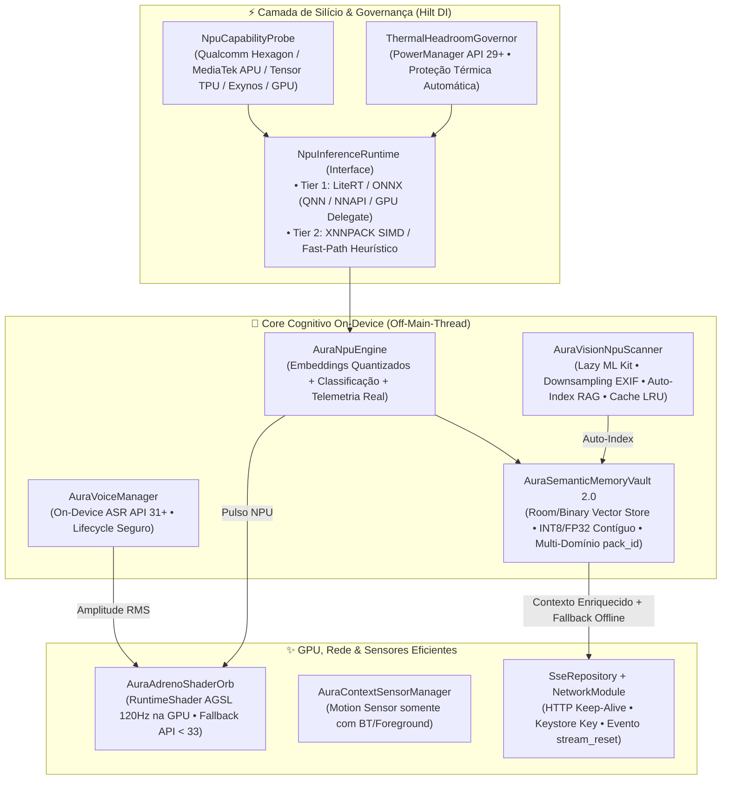

# Plano de Evolução do Core NPU & Eficiência — Aura Assistance Android

> **Status:** CONCLUÍDO & VALIDADO (**Opção A — LiteRT `1.4.0` + Delegates QNN/NNAPI/GPU**, `testDebugUnitTest` + `assembleDebug` OK).  
> **Escopo:** `ia-banco-local/Aura Assistance Android`

---

## 1. Objetivo & Diagnóstico Arquitetural

Este plano detalha os pontos de melhoria estruturais no core do **Aura Assistance Android** para evoluir o aplicativo de uma camada de heurísticas em CPU que *simula* telemetria NPU para um **motor híbrido Edge-AI genuinamente acelerado por NPU/GPU**, com máxima eficiência energética, baixa latência e conformidade integral com as invariantes do `GEMINI.md`.

### Diagnóstico do Estado Atual (Auditoria do Código)

| Módulo / Arquivo | Situação Atual Auditada | Impacto / Gargalo |
| :--- | :--- | :--- |
| `data/npu/AuraNpuEngine.kt` | Detecta `SM7435`/`qcom` via `Build.*`, marca `isHardwareAccelerated = true` **incondicionalmente** (L178), mas `classifyIntent()` (L186) e `computeDenseEmbedding()` (L243) rodam 100% em CPU/JVM com `contains()` e `hashCode()`. Recompila `Regex` a cada chamada e faz `inferenceCount++` sem atomicidade. | **Zero uso real de NPU**; telemetria imprecisa em aparelhos sem NPU; sem governança térmica (`ThermalHeadroom`); suporte limitado fora de `SM7435`. |
| `data/local/memory/AuraSemanticMemoryVault.kt` | `init { loadFromDisk() }` executa I/O síncrono na criação do singleton (Main Thread); `indexMemory()` serializa até 500 vetores em JSON+CSV no disco a cada escrita; `searchMemories()` tem *race condition* e roda no Main Thread em `ChatViewModel.kt` (L582–L586). Além disso, **os resultados do RAG nunca são injetados no prompt/contexto** (só aparecem no badge de raciocínio). | Travamento de UI (*jank*) na inicialização e no envio de mensagens; RAG local subaproveitado; segmento `"postos_redes"` hardcoded (quebra Multi-Domínio `pack_id`). |
| `data/vision/AuraVisionNpuScanner.kt` | Inicializa clientes ML Kit no construtor do singleton; lê fotos de galeria em resolução nativa (até 200MP no `garnet`) sem *downsampling* prévio; não indexa documentos escaneados no `AuraSemanticMemoryVault`; cache `vision_scans/` cresce sem limpeza LRU. | Pressão de RAM/GC e latência extra no upload para NPU/GPU; aumento progressivo de armazenamento em cache. |
| `data/audio/AuraVoiceManager.kt` | Usa `SpeechRecognizer.createSpeechRecognizer()` (dependente de rede) em vez de `createOnDeviceSpeechRecognizer()` (NPU/on-device API 31+). Além disso, `ChatViewModel.kt` (L1149–L1152) chama `voiceManager.release()` no `onCleared()`, **destruindo o singleton global** de TTS/STT ao sair do Chat. | Latência de rede na voz e bug crítico que quebra TTS/Voz no Dashboard e AssistOverlay após sair do Chat. |
| `ui/components/AuraAdrenoShaderOrb.kt` | Apenas delega para `AuraLivingOrb` (Compose Canvas em CPU); o `RuntimeShader` AGSL na GPU Adreno 710 não está implementado. | CPU desenha animações contínuas em vez de descarregar na GPU a 60/120Hz. |
| `data/sensors/AuraContextSensorManager.kt` | Registra `Sensor.TYPE_LINEAR_ACCELERATION` no `init` do `@Singleton` e **nunca desregistra**. | **Dreno contínuo de bateria** mesmo em segundo plano ou com tela desligada. |
| `di/NetworkModule.kt` & `data/remote/SseRepository.kt` | Força `Connection: close` (desabilita HTTP Keep-Alive), hardcoda `"aura-partner-default-key"` (viola `GEMINI.md` §4) e não trata o evento SSE `stream_reset` (viola `GEMINI.md` §4). | +50–150ms por requisição sobre Tailscale/LAN; risco de texto duplicado em retentativas SSE; chave hardcoded. |

---

## 2. Arquitetura Proposta (Core NPU-First)



---

## 3. Decisão Arquitetural Aprovada (Protocolo HiC)

> [!IMPORTANT]
> **Runtime NPU Escolhido: Opção A — Core Híbrido com LiteRT (`com.google.ai.edge.litert`) + Delegates QNN / NNAPI / GPU**
> - Dependências aprovadas para a Fase 1 (quando a execução for autorizada): `com.google.ai.edge.litert:litert` + `litert-gpu` / `litert-api` (~3–5MB no APK) encapsulados atrás da interface `NpuInferenceRuntime` injetada via Hilt.
> - Permite executar modelos `.tflite` quantizados (`INT8`/`FP16`) diretamente na **Hexagon NPU / Adreno GPU** (e em qualquer NPU Android moderna: Tensor, Dimensity, Exynos), com *fallback* determinístico automático enquanto o modelo `.tflite` ainda não estiver baixado no dispositivo.
> - **Distribuição de Modelos:** Download sob demanda (*On-Demand Asset Sync* via servidor AURA local `:8000` ou cache local em `filesDir/npu_models/`) + cache de compilação de grafo em `codeCacheDir/npu_cache`, mantendo o APK leve para build e deploy via ADB.

---

## 4. Mudanças Propostas por Fase

### Fase 1 — Motor NPU Real, Probing Multi-Silício & Governança Térmica (`data/npu/`)

- **[NEW] `data/npu/NpuCapabilityProbe.kt`**
  - Introspecção real de hardware multi-fabricante via `Build.SOC_MANUFACTURER` e `Build.SOC_MODEL` (API 31+): Qualcomm Hexagon (`SM*`/`QCM*`), MediaTek APU (`MT*`), Google Tensor (`GS*`/`Tensor`), Samsung Exynos (`S5E*`).
  - Verifica disponibilidade de delegates NNAPI/QNN/Vulkan/GPU e monitora `PowerManager.getThermalHeadroom(10)` (API 29+) + `currentThermalStatus`.
  - Expõe `NpuHardwareProfile` honesto (`hasDedicatedNpu`, `recommendedDelegate`, `thermalHeadroom`, `maxRecommendedThreads`).
- **[NEW] `data/npu/NpuInferenceRuntime.kt` + `di/NpuModule.kt`**
  - Desacopla o motor de inferência via Hilt (mantendo 100% de testabilidade em `testDebugUnitTest`).
  - **Tier 1 (Opção A ou B):** Carrega modelo quantizado `.tflite`/`.onnx` em `Dispatchers.Default`, seleciona delegate ótimo (`QNN`/`NNAPI` -> `GPU` -> `XNNPACK`), habilita cache de compilação de grafo em `context.codeCacheDir/npu_cache` (reduz *cold-start* da NPU de ~800ms para <30ms).
  - **Tier 2 (Fast-Path / Fallback):** Projeção vetorial determinística otimizada com *stopwords* PT-BR, *stemming* leve, matrizes pré-alocadas e zero alocação de `Regex` no *hot path*.
  - **Governança Térmica:** Se `thermalStatus >= THERMAL_STATUS_MODERATE`, reduz automaticamente para modo econômico para evitar *throttling* no painel do carro.
- **[MODIFY] `data/npu/AuraNpuEngine.kt`**
  - Injetar `NpuCapabilityProbe` e `NpuInferenceRuntime`.
  - Corrigir `isHardwareAccelerated` para refletir o delegate real ativo (não `true` fixo).
  - Substituir `inferenceCount++` por `AtomicInteger` e `_hardwareStatus.update { ... }`.
  - Pré-compilar `REGEX_WHITESPACE` e `REGEX_COMBINING_MARKS` em `companion object`.
  - Expandir `NpuHardwareStatus` com `delegateType: String`, `thermalState: String` e `modelLoaded: Boolean`.

---

### Fase 2 — Memória Vetorial On-Device 2.0 & Fechamento do Loop RAG (`data/local/memory/` & `ui/chat/`)

- **[MODIFY] `data/local/memory/AuraSemanticMemoryVault.kt`**
  - **Zero I/O na Main Thread:** Mover `loadFromDisk()` e `saveToDisk()` para `CoroutineScope(SupervisorJob() + Dispatchers.IO)` interno com *debounce* de gravação e sincronização via `Mutex` / `ReentrantReadWriteLock`.
  - **Armazenamento Binário Compacto + Busca Vetorial Rápida:** Substituir `embeddingCsv: String` por persistência binária (`DataOutputStream` / `ByteBuffer` `FloatArray` ou `INT8` quantizado), reduzindo armazenamento e carga em ~85%, com matriz contígua em RAM (`FloatArray`) cache-friendly.
  - **Multi-Domínio (`pack_id`):** Remover suposição fixa de `"postos_redes"` e filtrar/indexar sempre pelo segmento/`pack_id` ativo.
- **[MODIFY] `ui/chat/ChatViewModel.kt`**
  - Executar `npuEngine.classifyIntent()` e `memoryVault.searchMemories()` em `withContext(Dispatchers.Default)`.
  - **Fechar o Loop do RAG Local:**
    1. **Online:** enviar top-2 episódios relevantes (`similarity >= 0.45f`) como contexto estruturado leve no payload SSE (`edge_rag_context` + `npu_intent_hint`).
    2. **Offline Resiliente:** compor a resposta combinando snapshot do `AuraOfflineVault` (do segmento ativo) + memórias vetoriais recuperadas pelo RAG local.
  - **Corrigir Bug Crítico de Ciclo de Vida (L1151):** Remover `voiceManager.release()` de `ChatViewModel.onCleared()`, substituindo por `voiceManager.stopListening()` / `stopSpeaking()` para não destruir o singleton `AuraVoiceManager`.

---

### Fase 3 — Visão NPU Otimizada & Voz On-Device API 31+ (`data/vision/` & `data/audio/`)

- **[MODIFY] `data/vision/AuraVisionNpuScanner.kt`**
  - **Lazy Initialization:** Converter `recognizer` e `barcodeScanner` para `by lazy`.
  - **Pré-processamento Inteligente:** Em `scanImageUri()`, decodificar com `inSampleSize` para no máximo `1920px` respeitando orientação EXIF antes de passar ao `InputImage` (acelera OCR+Barcode em 2x–3x e reduz pressão de RAM).
  - **Auto-Indexação no RAG Local:** Indexar automaticamente resumo compacto de documentos escaneados no `AuraSemanticMemoryVault` em `Dispatchers.IO`.
  - **Telemetria Honesta & Cache LRU:** Usar `npuEngine.hardwareStatus.value.activeAccelerator` no resumo e manter apenas os últimos 20 arquivos em `cacheDir/vision_scans`.
- **[MODIFY] `data/audio/AuraVoiceManager.kt`**
  - **On-Device ASR (API 31+):** Verificar `SpeechRecognizer.isOnDeviceRecognitionAvailable(context)` e priorizar `SpeechRecognizer.createOnDeviceSpeechRecognizer(context)` + `EXTRA_PREFER_OFFLINE = true`, com fallback transparente para `createSpeechRecognizer(context)`.

---

### Fase 4 — Shader AGSL Real na GPU Adreno (`ui/components/`)

- **[MODIFY] `ui/components/AuraAdrenoShaderOrb.kt`**
  - Implementar **Fragment Shader AGSL nativo** (`android.graphics.RuntimeShader` + `ShaderBrush` para API 33+):
    - Uniforms: `uResolution`, `uTime`, `uAmplitude` (`voiceRms`), `uNpuPulse` (atividade NPU), `uPrimaryColor` (paleta Obsidian Aurora).
    - Renderização via `Modifier.drawWithCache` para zero alocação por frame a 120Hz na GPU Adreno 710.
    - Fallback automático para `AuraLivingOrb` em API 26–32.

---

### Fase 5 — Eficiência Energética, Rede & Invariantes `GEMINI.md` (`data/sensors/`, `data/remote/`, `di/`)

- **[MODIFY] `data/sensors/AuraContextSensorManager.kt`**
  - **Eliminar Dreno de Bateria:** Registrar `TYPE_LINEAR_ACCELERATION` somente quando houver dispositivo de áudio Bluetooth/USB conectado (`isCarOrBluetoothConnected == true`) ou demanda ativa de UI, desregistrando imediatamente via `unregisterMotionSensor()` ao desconectar.
- **[MODIFY] `data/remote/SseEvent.kt`, `data/remote/SseRepository.kt` & `ui/chat/ChatViewModel.kt`**
  - **Invariante SSE `stream_reset` (`GEMINI.md` §4):** Adicionar `object StreamReset : SseEvent()`, emitir em `chunkType == "stream_reset"` e limpar `currentAuraText = ""` / `currentEnvelope = null` no `ChatViewModel` antes de retomar o stream.
  - Suportar envio opcional de `edge_context` (intenção NPU + memórias RAG) e `pack_id` dinâmico em `streamChat()`.
- **[MODIFY] `di/NetworkModule.kt`**
  - Remover `.header("Connection", "close")` para reativar **HTTP Keep-Alive / Connection Pool** do OkHttp.
  - Substituir chave hardcoded `"aura-partner-default-key"` por leitura via `ServerConfig` / Android Keystore.

---

## 5. Plano de Verificação

### Testes Automatizados
Executar na raiz de `Aura Assistance Android`:

```powershell
.\gradlew.bat testDebugUnitTest
.\gradlew.bat assembleDebug
```

Testes unitários a adicionar em `app/src/test/java/com/example/aurapostoassitance/`:
1. `AuraNpuEngineTest.kt` — classificação, normalização, concorrência (`AtomicInteger`), fallback determinístico e telemetria real de delegate.
2. `AuraSemanticMemoryVaultTest.kt` — serialização binária, busca cossenoidal top-K, isolamento por `pack_id` e thread-safety.
3. `SseStreamResetTest.kt` — limpeza de buffer parcial ao receber `stream_reset`.

### Validação Manual no Dispositivo (`garnet` / SM7435 via ADB)
1. Instalar APK debug (`adb install -r app/build/outputs/apk/debug/app-debug.apk`).
2. Conferir telemetria real de silício (`delegateType`, `thermalState`, latência) no `DashboardScreen`.
3. Validar **Chat + RAG Local** (online e offline) sem travamentos de UI.
4. Validar **Voz** entrando e saindo do Chat e usando Dashboard/AssistOverlay (confirmando correção do `voiceManager.release()`).
5. Conferir via `adb shell dumpsys sensorservice` que o acelerômetro não permanece ativo sem Bluetooth conectado.
6. Validar visualmente o **Shader AGSL** a 120Hz no `DashboardScreen` e `AuraAssistActivity`.
