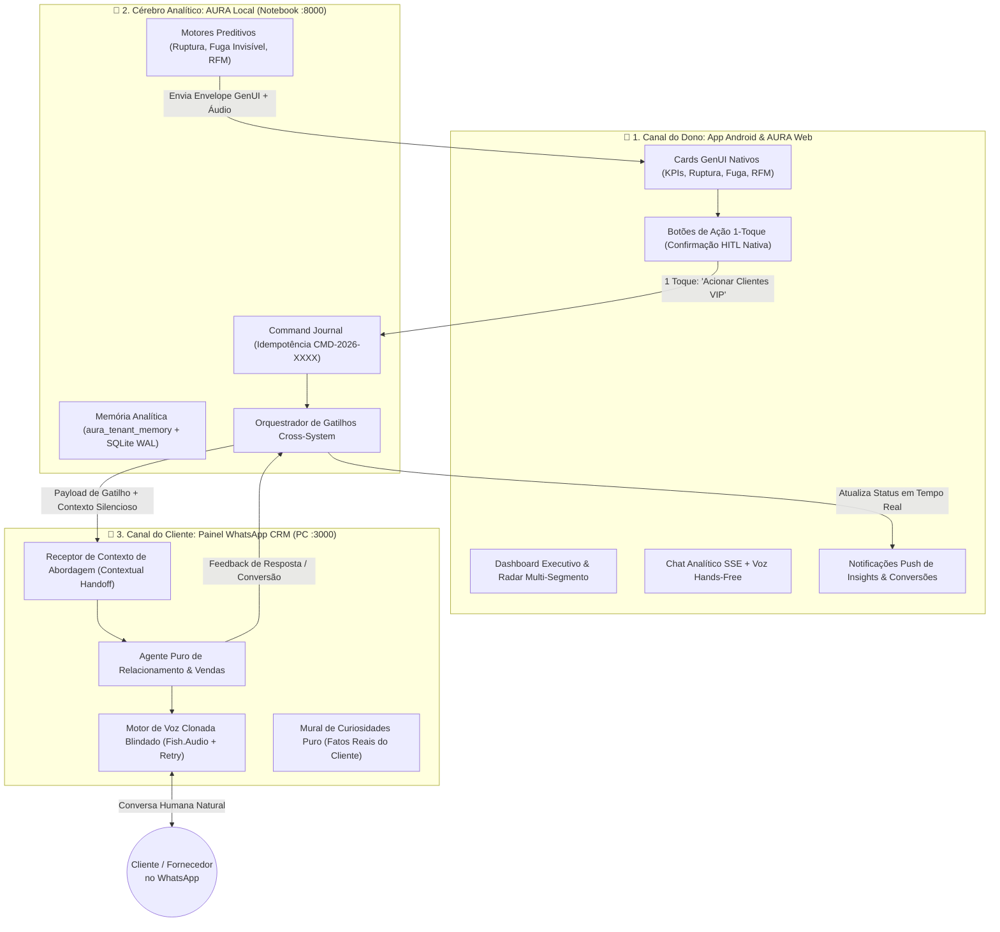

# Roadmap de Integração 2.0: Tríade AURA (App Android + AURA Local/Web + WhatsApp CRM)

> [!IMPORTANT]
> **Princípio Arquitetural Central — Separação de Cérebros, Vozes e Canais (Dual-Brain Architecture):**
> - **No WhatsApp (`Painel WhatsApp CRM`):** O foco passa a ser **100% Atendimento, Relacionamento e Vendas com Clientes Reais**, operando com a **sua Voz Clonada (Fish.Audio)**, conversa fluida e memória de relacionamento limpa (sem poluição de relatórios internos ou menus `1, 2, 3`).
> - **No App Android (`Aura Assistance Android`) e AURA Web:** Opera o seu **Assessor Pessoal e Sócio Consultor de Bolso**, conectado diretamente à **AURA Local (Notebook :8000)** via Streaming SSE, Cards Visuais Nativos (**GenUI**), Voz Hands-Free e **Gatilhos Inteligentes de 1 Toque**.

---

## 1. Visão Geral do Fluxo Contínuo e Contextual (Closed-Loop Cross-System)

---

## 2. Por Que Esta Arquitetura é Superior (Zero Regressão + Salto Tecnológico)

| Dimensão | Modelo Anterior (Tudo no WhatsApp) | Novo Modelo (Tríade App Android + AURA Local + WhatsApp CRM) |
| :--- | :--- | :--- |
| **Papel do WhatsApp** | Misturava atendimento de clientes com relatórios de BI para o dono | **100% dedicado a Atendimento e Relacionamento** com clientes usando sua **Voz Clonada** |
| **Experiência do Dono** | Textos longos no WhatsApp e respostas digitando `1, 2, 3` | **App Android Nativo (`Aura Assistance Android`)** com gráficos GenUI, cards interativos, áudio nativo e botões de 1 toque |
| **Isolamento de Memória** | Simulações de BI poluíam o `contact_facts` do WhatsApp (*Memory Bleed*) | **Isolamento Estrito:** `contact_facts` guarda apenas o cliente; `aura_tenant_memory` guarda a inteligência da empresa |
| **Gatilhos de Ação** | Limitados a comandos numéricos de texto | **Gatilhos Inteligentes com Contexto (*Contextual Handoff*):** 1 toque no App Android inicia um atendimento contextualizado no WhatsApp |
| **Aproveitamento de Código** | — | **100% reaproveitado:** todos os motores preditivos criados na AURA Local passam a abastecer o App Android e a AURA Web |

---

## 3. Plano de Execução em 4 Fases (Foco Principal: App Android + Continuidade de Fluxo)

### 🛡️ Fase 1: Purificação e Blindagem do Painel WhatsApp (Foco 100% Atendimento & Voz Clonada)
**Objetivo:** Devolver ao Painel WhatsApp a sua máxima inteligência conversacional de relacionamento e garantir que a sua voz clonada nunca falhe.

1. **Limpeza e Isolamento Estrito do Mural (`contact_facts`):**
   - Remover imediatamente os fatos fictícios de teste (*"Rede Alvorada"*, *"pico de sexta-feira"*) do seu número no Supabase.
   - Bloquear em `src/app/api/aura/events/route.ts` qualquer gravação de textos de diagnóstico de BI dentro da tabela `contact_facts` dos contatos.
2. **Desacoplamento do Fluxo de Resposta (`autonomous-responder.ts`):**
   - Garantir que todas as mensagens e áudios recebidos no WhatsApp sejam processados pelo **Cérebro de Atendimento e Relacionamento** (com RAG da base de conhecimento, histórico real da conversa e tom natural/humano).
   - O WhatsApp deixa de interceptar números `1, 2, 3` ou consultar o endpoint analítico de posto durante conversas normais.
3. **Blindagem da Voz Clonada (`src/lib/audio/synthesizer.ts`):**
   - Aumentar o timeout da **Fish.Audio** de `10s` para `25s` e implementar **1 retry automático** antes de qualquer fallback, garantindo que a sua voz clonada configurada seja sempre entregue com fidelidade.

---

### 📱 Fase 2: Acoplamento Total da Super-Inteligência ao App Android (`Aura Assistance Android`)
**Objetivo:** Fazer o App Android (que já possui Jetpack Compose, SSE e blocos GenUI) consumir diretamente os novos motores preditivos da AURA Local no Notebook (`100.77.164.17:8000`).

1. **Expansão da API e Repositório Android (`AuraApiService.kt`):**
   - Conectar o App Android aos endpoints universais já prontos na AURA Local:
     - `GET /api/v1/partner/segments/{segment}/baseline` (Telemetria consolidada de Ruptura, Fuga Invisível e RFM);
     - `POST /api/v1/partner/morning-briefing` (Briefing Executivo Matinal com roteiro oral para o `AuraVoiceManager.kt`);
     - `POST /api/v1/partner/quick-actions` (Execução de ações com recibo `CMD-2026-XXXX`).
2. **Envelopes GenUI Preditivos Nativos (`GenUiModels.kt` & `core/partner_api.py`):**
   - Configurar a AURA Local para devolver os diagnósticos de **Previsão de Ruptura**, **Auditoria de Fuga Invisível (R$/mês)** e **Lote Anti-Churn RFM** já formatados no padrão `GenUiCard` do App Android (`KpiGrid`, `AlertCallout`, `Comparison`, `Ranking` e `GenUiAction`).
3. **Evolução da `DashboardScreen.kt` no App Android:**
   - Adicionar no topo da `DashboardScreen.kt`:
     - Card **Briefing Matinal Voice-First (Modo Sócio)** com botão `▶️ Ouvir Resumo do Dia` direto no celular;
     - Atalhos rápidos universais: **Previsão de Ruptura & Autonomia**, **Detector de Fuga Invisível**, **Reativação VIP (Anti-Churn)** e **Conciliação Operacional**.

---

### 🔗 Fase 3: Ponte de Continuidade com Contexto (*Contextual Handoff*: App Android ➔ AURA Local ➔ WhatsApp CRM)
**Objetivo:** Criar os gatilhos inteligentes onde uma decisão tomada pelo dono no **App Android da AURA** comanda uma ação de atendimento contextualizada no **Painel WhatsApp**.

1. **Botões de Gatilho Cross-System nos Cards do App Android (`GenUiAction`):**
   - Quando a AURA exibir um insight no App Android (ex: *"Clientes VIP ausentes"* ou *"Ruptura de estoque em 22h"*), o card apresentará botões de ação direta:
     - `[💬 Acionar Atendimento VIP no WhatsApp]`
     - `[📦 Solicitar Cotação ao Fornecedor via WhatsApp]`
     - `[📢 Alinhar Meta com Equipe]`
2. **Protocolo de *Contextual Handoff* (`POST /api/aura/handoff` no Painel WhatsApp):**
   - Quando você confirmar o botão no App Android (no modal nativo de Confirmação HITL do `GenUiViews.kt`), a AURA Local dispara uma ordem para o Painel WhatsApp contendo:
     - Quem abordar (`phone`, `contactName`);
     - Qual mensagem inicial enviar (com **sua Voz Clonada** ou texto personalizado);
     - **`sessionHandoffContext` (O Segredo da Continuidade):** Uma instrução temporária de contexto vinculada àquela conversa (ex: *"Motivo do contato ativo: oferecemos condição especial no produto X porque o cliente está há 35 dias sem comprar"*).
   - **Resultado:** Quando o cliente responder *"Opa, tenho interesse, como funciona?"*, o **Agente de Atendimento do WhatsApp** lê o `sessionHandoffContext` e continua a conversa com perfeição, sabendo exatamente o que acabou de oferecer!

---

### 🔔 Fase 4: Feedback Loop em Tempo Real (WhatsApp CRM ➔ AURA Local ➔ App Android)
**Objetivo:** Fechar o ciclo para que o dono acompanhe o resultado no App Android sem precisar abrir o WhatsApp de atendimento.

1. **Feed de Insights & Execuções no App Android:**
   - Assim que o Painel WhatsApp executa o disparo ou quando o cliente responde positivamente no WhatsApp, o Painel notifica a AURA Local (`POST /api/v1/partner/handoff-status`), que atualiza o status da ordem `CMD-2026-XXXX` no **App Android** e na **AURA Web**.

---

## 4. Ordem de Implementação Sugerida

1. **Sprint A (Imediata):** Executar a **Fase 1** no Painel WhatsApp (limpar fatos poluídos do seu número, blindar o timeout/retry da sua voz clonada na Fish.Audio e deixar o WhatsApp 100% focado em atendimento puro).
2. **Sprint B:** Executar a **Fase 2** na AURA Local + App Android (`Aura Assistance Android`), conectando os cards `GenUiCard` preditivos, o Briefing de Voz e os novos atalhos na `DashboardScreen.kt` e `ChatViewModel.kt`.
3. **Sprint C:** Executar as **Fases 3 e 4**, ativando o *Contextual Handoff* para que os botões clicados no App Android disparem atendimentos inteligentes e contextualizados no Painel WhatsApp.
