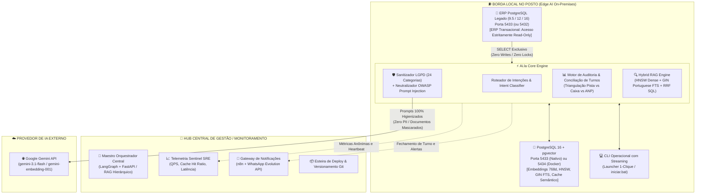
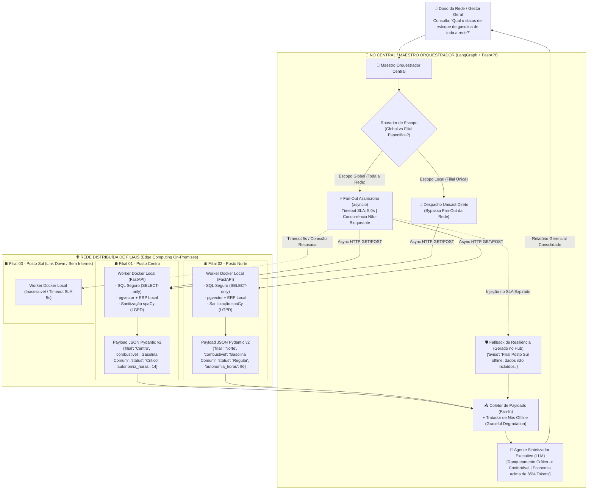
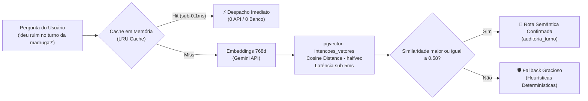
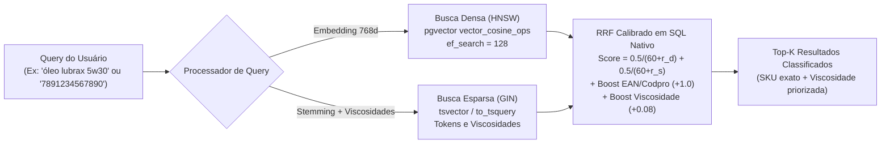
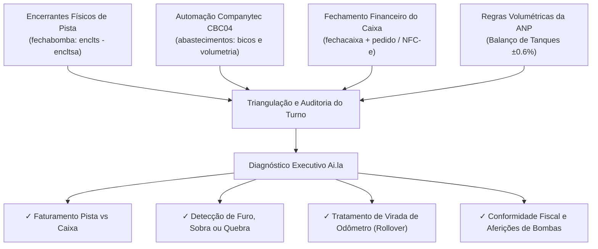
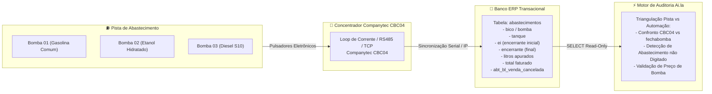

# ⛽ AURA : Inteligência Artificial Operacional e Cockpit de Prontidão para Postos de Combustíveis & PDV

<div align="center">

[](https://www.python.org/)
[](https://www.postgresql.org/)
[](https://github.com/pgvector/pgvector)
[](https://ai.google.dev/)
[](https://www.docker.com/)
[](#blindagem-lgpd)
[](#conciliacao-turnos)
[](#automação-companytec-cbc04)
[](#app-mobile-nativo-android)
[](#arquitetura-sentinel-aura-missao-critica)
[](#arquitetura-sentinel-aura-missao-critica)
[](#hub-apis-publicas)
[](#validação-e-testes-automatizados)

**Edge AI On-Premises para Operação de Pista, Gestão de Turnos, Catálogo Inteligente e Observabilidade de Postos e Redes de Varejo.**

[Topologia Arquitetural](#topologia-e-arquitetura-do-sistema) •
[RAG Multi-Filial](#arquitetura-multi-filial) •
[Pilares e Princípios](#princípios-arquiteturais) •
[Recursos e Módulos](#módulos-e-capacidades-do-sistema) •
[Fórmulas e Concatenações](#fórmulas-e-concatenações-de-dados) •
[Automação CBC04](#automação-companytec-cbc04) •
[App Android Nativo](#app-mobile-nativo-android) •
[Arquitetura Sentinel-AURA](#arquitetura-sentinel-aura-missao-critica) •
[Hub APIs Públicas (ANP/BACEN)](#hub-apis-publicas) •
[Mapeador Multi-ERP YAML](#mapeador-declarativo-multi-erp) •
[PWA Modo Pista & Voz](#pwa-modo-pista) •
[Início Rápido](#guia-de-inicialização-rápida) •
[Estrutura de Pastas](#estrutura-do-projeto) •
[Roadmap de Fases](#roadmap-de-evolução) •
[Validação e Testes](#validação-e-testes-automatizados)

</div>

---

## 📌 Visão Geral do Produto: AURA (Assistente de Prontidão)

A **AURA** (antigo Ai.la) é a **Assistente de Prontidão Executiva e Gerente Supervisora de Postos de Combustíveis e Lojas de Conveniência**, com foco absoluto em **chat inteligente sob demanda e suporte à tomada de decisão rápida**.

> 💡 **Conceito de Uso ("Mobile-First On-Demand"):**  
> *"Tirou o celular do bolso na correria da pista ou da retaguarda, precisou de uma tomada de decisão rápida, perguntou pra AURA, a AURA iluminou com diagnósticos diretos, insights visuais/gráficos inline e cálculos matemáticos comprovados, e o gestor tomou a decisão na hora."*

### 🧭 Demarcação Tática: AURA vs ERP vs SENTINEL
* **Não é um ERP nem dashboard estático de telas:** O posto já possui ERP legado consolidado para telas e relatórios estáticos. A AURA consulta e calcula sob demanda.
* **Não é um painel SRE de TI:** O **Sentinel** já cuida da engenharia de confiabilidade de TI e infraestrutura de forma autônoma.
* **AURA é a Gerente Supervisora do Posto:** Foco total no **negócio, faturamento, estoques, tanques, quebras de caixa, conformidade ANP e loja de conveniência**, com anatomia executiva de resposta em 3 passos:
  1. **🚨 Diagnóstico Direto no Topo** (1 linha com status e ícone claro);
  2. **🔢 Números e Cálculos Comprovados** (litros, faturamento R$, quebras, comparativos matemáticos);
  3. **👉 Ação Recomendada para Decisão** (o que o gestor deve fazer imediatamente).

Construído sobre o princípio inegociável de que **o posto não pode parar e nenhum dado de cliente ou faturamento pode vazar**, o sistema executa inferência híbrida na borda local, integrando o banco transacional legado do posto (**ERP em PostgreSQL 9.5 a 16**) a um mecanismo de banco vetorial (**PostgreSQL 16 com `pgvector`**) e aos modelos de última geração **Google Gemini (3.1 Flash / 768d Embeddings)**.

Com processamento local, sanitização LGPD em tempo de execução e interface Mobile-First, a AURA entrega:
1. **Auditoria de Pista e Fechamento de Turno em Segundos** com conciliação automática de encerrantes físicos, automação de bombas **Companytec CBC04**, aferições, quebras/sobras de caixa e regras de conformidade da **ANP (Agência Nacional do Petróleo)**.
2. **Previsão de Esgotamento de Tanques (Run-Out Forecast)** com autonomia em horas, espaço livre (ullage) e sugestão de compras em múltiplos de compartimento de carreta (5k/10k/15k).
3. **Livro de Movimentação de Combustíveis (LMC Oficial ANP Portaria 26/1992)** com régua visual de tolerância ($\pm 0.6\%$) e balanço volumétrico.
4. **Inteligência de Vendas Cruzadas na Conveniência (Market Basket Analysis)** com identificação de combos, cálculo de Lift/Confiança e scripts persuasivos de balcão para os caixas.
5. **Busca Semântica & Lexical Híbrida (HNSW + GIN FTS + RRF)** no catálogo de conveniência e lubrificantes (<80ms).
6. **Blindagem LGPD & OWASP GenAI 2026** com expurgo estrito de 24 categorias de PII antes de qualquer interação externa.
7. **Custo de Nuvem Quase Zero** através de cache semântico com vetor de meia precisão (`halfvec`) e execução on-premises.

---

<a id="topologia-e-arquitetura-do-sistema"></a>
## 🏛️ Topologia e Arquitetura do Sistema

O ecossistema adota uma **Topologia Híbrida de Borda (Edge AI On-Premises + Hub Central de Gestão)**:



---

<a id="arquitetura-multi-filial"></a>
### 🌐 Arquitetura de Rede Multi-Filial: RAG Hierárquico Distribuído & MapReduce (Fan-Out / Fan-In)

Para grupos econômicos e redes de postos, o Ai.la adota uma arquitetura distribuída de **RAG Hierárquico Multi-Agente baseada no paradigma MapReduce**. Em vez de sincronizar massas de dados transacionais para a nuvem ou transferir textos livres volumosos entre instâncias, o sistema distribui a execução analítica para contêineres Docker locais e sintetiza apenas payloads JSON compactados:



#### Mecânica Operacional do Fluxo MapReduce:
1. **O Maestro Central (Roteamento & Fan-Out Assíncrono):** Avalia se a consulta do usuário tem escopo local (uma filial) ou global (toda a rede). Em consultas globais, utiliza Python `asyncio` (`asyncio.gather`) e requisições HTTP assíncronas para disparar simultaneamente a requisição para os endpoints/IPs dos contêineres Docker de todas as filiais.
2. **Edge Workers nos Contêineres Docker (Processamento na Borda):** Cada filial processa a consulta localmente em SQL seguro e estritamente read-only (`SELECT`-only, sem locks), consultando seu `pgvector` local (porta 5434) e banco ERP local (porta 5432/5433). As lógicas de negócio e sanitização de dados (`CentralLogSanitizer` / spaCy) são aplicadas diretamente no nó de borda.
3. **Retorno Enxuto Pydantic (Economia de >85% de Tokens):** A borda **não gera texto natural prolixo**. Retorna um payload JSON compacto e validado com schema Pydantic v2 (ex: `{"filial": "Posto Centro", "combustivel": "Gasolina Comum", "status": "Critico", "autonomia_horas": 14}`).
4. **Resiliência e Degradação Graciosa (Graceful Degradation):** Com SLA rígido de **5.0 segundos de timeout**, eventuais falhas de conectividade de postos individuais não travam a resposta da rede. Os postos online são agregados normalmente e os nós inacessíveis recebem a flag `{"aviso": "Filial Posto Sul offline, dados não incluídos."}` sem crash.
5. **Agente Sintetizador (Fan-In e Parecer Executivo):** O Maestro coleta todos os JSONs (Fan-In) e passa o bloco estruturado para o Agente LLM Sintetizador. O modelo ranqueia as unidades da mais crítica para a mais confortável e entrega um relatório gerencial consolidado de alto valor decisório para a diretoria da rede (em texto formatado ou áudio via WhatsApp).

---

<a id="princípios-arquiteturais"></a>
## 💎 Princípios Arquiteturais

### 1. Estratégia Zero-Disruption no ERP Legado
* **O Desafio:** Postos operam com ERPs legados consolidados (rodando em PostgreSQL 9.5, 10 ou 12 no Windows). Atualizar a versão do banco do ERP é inviável e causaria paradas críticas nas bombas e na emissão de NFC-e/SAT.
* **A Solução:** O ERP do posto permanece 100% intocado na porta padrão (`5433` ou `5432`). O Ai.la provisiona uma instância dedicada e isolada de **PostgreSQL 16 com `pgvector` em Docker na porta `5434`**.
* **Isolamento de Conexão Estritamente Read-Only:** A inteligência artificial conecta-se ao ERP exclusivamente com privilégios de `SELECT`. O sistema **jamais executa `INSERT`, `UPDATE`, `DELETE` ou `ALTER TABLE`**, e nunca adquire travas de escrita (*table locks*) nas tabelas vitais (`abastecimentos`, `fechabomba`, `fechacaixa`, `produtos`, `pedido`).

### 2. Edge AI com Privacidade e Custo Mínimo
* Todas as buscas no catálogo, conciliações matemáticas de turno, cruzamentos contábeis e vetorizações ocorrem no processador e na memória do hardware local.
* Redução drástica de chamadas à nuvem via **Cache Semântico Vetorial em PostgreSQL (`halfvec`)**: perguntas frequentes retornam respostas em ~300ms a custo zero de tokens.

### 3. Isolamento Contextual Multi-Posto (Tenant Isolation)
* Cada filial ou posto parceiro opera sua base vetorial isolada (`posto_ai` ou `posto_{tenant_id}`).
* Preços de combustíveis, políticas comerciais, cadastros de frentistas e margens de lucro nunca são compartilhados ou mesclados entre postos.

---

<a id="módulos-e-capacidades-do-sistema"></a>
## 🚀 Módulos e Capacidades do Sistema

<a id="roteador-semantico"></a>
### 🔀 0. Roteador Semântico Vetorial (Semantic Intent Router com pgvector)

O módulo [`SemanticRouter`](./core/semantic_router.py) substitui classificações rígidas baseadas exclusivamente em expressões regulares por roteamento semântico de alta precisão em **PostgreSQL 16 + pgvector**, com busca vetorial de cosseno sub-5ms em representações densas de 768 dimensões (`halfvec`):



#### Capacidades Chave do Roteador Semântico:
* **Tabela Dedicada `intencoes_vetores`:** Armazena exemplares vetoriais das 11 rotas operacionais canônicas do sistema: `auditoria_turno`, `previsao_tanques`, `desempenho_pista_frentistas`, `lmc_anp`, `conveniencia_vendas_cruzadas`, `vendas_analitico`, `estoque_posicao`, `clientes_ranking`, `sre_metricas`, `dados_filial` e `catalogo_produtos`.
* **Imunidade a Variações Coloquiais e Gírias:** Compreende perfeitamente frases como *"deu ruim no fechamento?"*, *"vai faltar gasosa no fim de semana?"*, *"os frentista renderam bem?"*, *"o que vende junto com café?"* e *"tem bico lerdo na bomba 2?"*.
* **Cache em Memória de Duplo Nível:** Respostas a perguntas recorrentes ou idênticas despachadas em `< 0.01ms`.
* **Latência de Busca Vetorial pgvector:** Execução da consulta vetorial SQL em `< 3.5ms` com índice HNSW.
* **Degradação Graciosa:** Se a similaridade for inferior a 0.58 ou houver indisponibilidade momentânea da rede, aciona automaticamente as regras determinísticas sem interromper a operação.

---

<a id="busca-hibrida"></a>
### 🔍 1. Mecanismo de Busca Híbrida: Dual Retrieval + Native RRF Calibrado

O motor [`HybridRAGEngine`](./core/rag_engine.py) combina busca vetorial densa com busca textual esparsa utilizando uma única transação SQL no PostgreSQL 16 com **Reciprocal Rank Fusion (RRF) Calibrado**:



#### Calibração do RRF & Otimizações:
* **Boost Imediato de Código de Barras / Código de Produto (+1.0):** Leituras de Código de Barras (EAN-13, EAN-8) ou códigos de produtos (`codpro`) recebem elevação prioritária imediata para a 1ª posição do ranking.
* **Priorização de Viscosidades de Lubrificantes (+0.08):** Filtros inteligentes detectam viscosidades automotivas (`0W20`, `5W30`, `5W40`, `10W40`, `15W40`, `20W50`) e asseguram que um óleo com viscosidade exata tenha precedência absoluta sobre produtos de outras especificações.
* **Tuning dos Índices HNSW:** Configurado com `m = 16`, `ef_construction = 128` e `ef_search = 128` para máxima precisão e recall.
* **Change Data Capture (CDC) via Delta Hashing MD5:** Armazenamento da coluna `hash_md5` em `produtos_vetores`. O pipeline (`scripts/index_produtos.py` e `scripts/sync_daemon.py`) calcula o hash do produto no ERP e **só gera novo embedding na API Gemini se houver alteração real no cadastro**, economizando **> 95% do consumo de API**.


<a id="conciliacao-turnos"></a>
### 📊 2. Motor de Conciliação de Turnos & Auditoria de Pista

O módulo [`PostoTools.auditar_fechamento_turno`](./core/tools.py) realiza a triangulação contábil e operacional completa entre os diferentes registros do posto:



#### Regras de Negócio e Cálculos Auditados:
* **Fórmula Física do Encerrante:**

$$
\text{Volume Bruto} = \text{Encerrante Final} - \text{Encerrante Inicial}
$$

$$
\text{Volume Faturado} = \max(0, \text{Volume Bruto} - \text{Litros de Aferição})
$$

* **Tratamento de Virada de Odômetro (Rollover):**
  Identifica automaticamente quando o totalizador físico do bico atinge o limite do relógio (99.999, 999.999 ou 9.999.999 litros) e recomeça do zero, sem acusar furos falsos:

$$
\text{Volume Rollover} = (\text{Limite} - \text{Encerrante Inicial}) + \text{Encerrante Final} - \text{Aferição}
$$

* **Tolerância Volumétrica ANP:**
  Monitora a variação física entre o estoque contábil e a medição dos tanques dentro da faixa de conformidade oficial de **±0.6%**.
* **Status Auditados do Turno:** `CONCILIADO_COM_SUCESSO`, `DIVERGENCIA_DETECTADA`, `DIVERGENCIA_CRITICA`, `TURNO_EM_ANDAMENTO`, `SEM_MOVIMENTO`.

---

<a id="blindagem-lgpd"></a>
### 🛡️ 3. Blindagem LGPD & Segurança OWASP GenAI

O módulo [`CentralLogSanitizer`](./core/sanitizer.py) executa higienização determinística com **24 categorias de proteção de dados sensíveis e segurança**:

| Categoria | Regra de Detecção / Validação | Padrão / Marcador |
| :--- | :--- | :--- |
| **CPF** | Regex contextual + validação matemática de dígitos verificadores da Receita Federal | `[REDACTED:CPF]` ou `123.***.***-45` |
| **CNPJ** | Padrão numérico clássico e novo padrão alfanumérico 2026 | `[REDACTED:CNPJ]` |
| **Placas de Veículos** | Padrão clássico brasileiro (`ABC-1234`) e Padrão Mercosul (`ABC1D23`) | `[REDACTED:PLACA]` |
| **Cartões de Crédito / TEF** | Formatos TEF e bandeiras de 13 a 16 dígitos com separadores | `[REDACTED:CREDIT_CARD]` |
| **Chaves de Acesso SEFAZ** | 44 dígitos com validação algorítmica de DV SEFAZ módulo 11 (NF-e/NFC-e) | `[REDACTED:FISCAL_ACCESS_KEY]` |
| **Telefones e Fidelidade** | Telefones fixos, móveis, WhatsApp, KMV, Premmia, ShellBox | `[REDACTED:PHONE]` |
| **Senhas e Credenciais** | Connection strings, strings SQL, JSONs, cabeçalhos e variáveis | `[REDACTED:PASSWORD]` |
| **Tokens e Chaves de API** | Bearer, JWTs, Google AIza, AWS AKIA, OpenAI sk- | `[REDACTED:TOKEN]` |
| **Certificados Digitais** | Blocos PEM de certificados A1/A3 e chaves privadas | `[REDACTED:CERTIFICATE]` |
| **OWASP Prompt Injection** | Detecção de jailbreaks, tentativas de override e injeções de SQL | `[NEUTRALIZED_PROMPT_INJECTION_OWASP_ACS]` |
| **Vocabulário de Posto (NLP)** | Reconhecimento de entidades via spaCy: `abastecimentos`, `fechabomba`, `CBC04` | *Entidades preservadas com valor contábil intacto* |

---

<a id="automação-companytec-cbc04"></a>
### 🎛️ 4. Integração com Concentrador Companytec CBC04

O Ai.la audita diretamente os dados emitidos pelo concentrador de pista **Companytec CBC04** (e compatíveis CBC02 / CBC06), que interliga eletronicamente as bombas de combustível ao ERP:



#### Capacidades da Auditoria da Automação CBC04:
1. **Leitura Ponto-a-Ponto dos Pulsadores:** Coleta de `ei` (encerrante inicial do bico) e `encerrante` (encerrante final) registrados diretamente pelo hardware a cada desarme do bico, com precisão de milésimos de litro.
2. **Identificação de Abastecimentos Fantasmas:** Alerta imediato caso a automação CBC04 tenha registrado fluxo volumétrico mas o operador não tenha lançado os encerrantes no fechamento (`PENDENTE_ENCERRANTE`).
3. **Filtro de Desvios e Cancelamentos:** Expurgo automático de abastecimentos cancelados em pista (`abt_bl_venda_cancelada IS NOT TRUE`), evitando distorções contábeis.
4. **Detecção de Divergências de Preço de Bomba:** Compara o valor faturado por litro na pista com o preço vigente no cadastro de produtos do ERP, identificando frentistas vendendo com preço desatualizado ou divergente.

---

<a id="fórmulas-e-concatenações-de-dados"></a>
### 📐 5. Fórmulas Matemáticas, Previsões & Concatenações de Dados

O Ai.la substitui achismos empíricos por **modelagem matemática e estatística rigorosa**. Abaixo estão formalizadas as formulações contábeis, físicas e preditivas executadas pelo núcleo em tempo real:

#### A. Triangulação de Turnos e Conciliação Contábil-Física
Confronta o faturamento físico dos bicos, as declarações financeiras de caixa e a telemetria da automação:

* **Volume Faturado por Bico ($V_{\text{fat}}$):**

$$
V_{\text{bruto}} = \text{Enclts} - \text{Encltsa}
$$

$$
V_{\text{fat}} = \max(0, V_{\text{bruto}} - \text{Qtdeaf})
$$

* **Algoritmo de Virada de Odômetro (Rollover Mecânico/Digital):**
Detecta quando o encerrante atinge a capacidade máxima do totalizador ($L_{\text{max}} \in \{10^5, 10^6, 10^7\}$ Litros) e reinicia do zero:

$$
V_{\text{rollover}} = (L_{\text{max}} - \text{Encltsa}) + \text{Enclts} - \text{Qtdeaf}
$$

* **Faturamento Esperado de Pista ($F_{\text{esperado}}$):**

$$
F_{\text{esperado}} = \sum_{b \in \text{Bicos}} (V_{\text{fat}, b} \times P_{\text{unitário}, b})
$$

* **Divergência Contábil de Caixa ($\Delta_{\text{caixa}}$):**

$$
\Delta_{\text{caixa}} = (\text{Dinheiro} + \text{Cartões} + \text{A Prazo} + \text{Convênios}) - F_{\text{esperado}}
$$

* **Balanço Físico de Tanques (Conformidade ANP):**

$$
|\text{Variação Físico-Contábil}| \le 0.006 \times \text{Movimentação Total} \quad (\pm 0.6\%)
$$

---

#### B. Motor Preditivo de Esgotamento de Combustíveis (Run-Out Forecast)
Cruza o histórico de queima da pista com a capacidade volumétrica e o saldo em régua dos tanques:

* **Taxa de Queima Média Diária ($T_{\text{dia}}$) e Horária ($T_{\text{hora}}$):**

$$
T_{\text{dia}} = \frac{\sum_{i=1}^{N} V_{\text{abastecido}, i}}{\Delta \text{Dias Históricos}}, \quad T_{\text{hora}} = \frac{T_{\text{dia}}}{24}
$$

* **Reserva de Segurança Crítica ($15\%$ da Capacidade):**

$$
S_{\text{crítico}} = C_{\text{tanque}} \times 0.15
$$

* **Autonomia Operacional até o Nível Crítico (Dias):**

$$
\text{Autonomia}_{\text{crítica}} = \max\left(0, \frac{S_{\text{atual}} - S_{\text{crítico}}}{T_{\text{dia}}}\right)
$$

* **Autonomia Total de Pista até a Seca Total / Run-Out ($0\text{ Litros}$):**

$$
\text{Autonomia}_{\text{run-out}} = \frac{S_{\text{atual}}}{T_{\text{dia}}} \quad [\text{Dias}] \quad \text{ou} \quad \frac{S_{\text{atual}}}{T_{\text{hora}}} \quad [\text{Horas}]
$$

* **Timestamp Projetado de Esgotamento ($t_{\text{run-out}}$):**

$$
t_{\text{run-out}} = t_{\text{atual}} + \Delta t(\text{Autonomia}_{\text{run-out}})
$$

* **Espaço Livre para Descarga de Carreta (*Ullage* com Teto Anti-Transbordo):**
Impede transbordamentos na pista mesmo em caso de divergência ou saldo negativo no ERP:

$$
\text{Ullage} = \max\left(0, \min(C_{\text{tanque}}, C_{\text{tanque}} - S_{\text{atual}})\right)
$$

* **Sugestão Otimizada de Compra em Múltiplos de Compartimento ($5.000\text{ L}$):**

$$
\text{Compartimentos} = \left\lfloor \frac{\text{Ullage}}{5.000} \right\rfloor
$$

$$
V_{\text{sugerido}} = \text{Compartimentos} \times 5.000\text{ L}
$$

* **Gatilho de Alerta de Fim de Semana:**
Disparado quando $\text{Autonomia}_{\text{run-out}} \le 4.0\text{ dias}$ ou $\text{Autonomia}_{\text{crítica}} \le 1.5\text{ dias}$, prevenindo desabastecimento durante o fechamento dominical das distribuidoras de combustíveis.

---

#### C. Diagnóstico Hidráulico de Vazão & Alerta Preventivo de Filtro
Monitora a velocidade de entrega das bombas para antecipar entupimentos de filtros antes que o cliente reclame:

* **Vazão Real do Bico ($Q$ em $\text{L/min}$):**

$$
Q = \frac{V_{\text{abastecido}} \, [\text{Litros}]}{\Delta t \, [\text{Segundos}]} \times 60
$$

* **Matriz de Diagnóstico Hidráulico (Bombas Comerciais):**

| Faixa de Vazão ($Q$) | Status Operacional | Diagnóstico Físico / Ação Recomendada |
| :--- | :--- | :--- |
| **$Q \ge 35\text{ L/min}$** | `REGULAR_NORMAL` | Fluxo perfeito. Bomba e filtro em condições ideais. |
| **$25 \le Q < 35\text{ L/min}$** | `ALERTA_VAZAO_LENTA` | Saturação inicial do elemento filtrante. Programar troca preventiva. |
| **$Q < 25\text{ L/min}$** | `CRÍTICO_FILTRO_OBSTRUÍDO` | Filtro entupido ou estrangulamento de sucção. Troca imediata necessária. |
| **$Q \ge 60\text{ L/min}$** | `ALTA_VAZAO` | Padrão exclusivo de bicos industriais de Diesel Truck / Alto Fluxo. |
| **$Q \le 15\text{ L/min}$** | `REGULAR_NORMAL_ARLA` | Padrão específico para bombas dosadoras de Arla 32. |

---

#### D. Desempenho Comercial & Conversão de Margem dos Frentistas
Avalia a eficiência de venda dos colaboradores na pista, focando na rentabilidade do negócio:

* **Índice de Conversão de Gasolina Aditivada ($\tau_{\text{aditivada}}$):**

$$
\tau_{\text{aditivada}} = \frac{\sum V_{\text{Gasolina Aditivada}}}{\sum V_{\text{Gasolina Comum}} + \sum V_{\text{Gasolina Aditivada}}} \times 100
$$

* **Índice de Conversão de Diesel S10 ($\tau_{\text{s10}}$):**

$$
\tau_{\text{s10}} = \frac{\sum V_{\text{Diesel S10}}}{\sum V_{\text{Diesel S500}} + \sum V_{\text{Diesel S10}}} \times 100
$$

* **Classificação de Performance Comercial:**
  * $\tau \ge 25\%$: **Excelente** (Alto gerador de margem líquida).
  * $15\% \le \tau < 25\%$: **Padrão Regular**.
  * $\tau < 15\%$: **Baixo Desempenho** (Necessidade de treinamento e incentivo de pista).

* **Ticket Médio por Atendimento:**

$$
\text{Ticket Médio} = \frac{\sum_{\text{turno}} \text{Faturamento do Frentista}}{\text{Qtd Total de Abastecimentos do Frentista}}
$$

---

#### D. Automação do LMC Oficial da ANP (Portaria ANP nº 26/1992)
Auditoria volumétrica diária obrigatória por tanque, conciliando estoque físico de réguas/sondas contra a escrituração contábil:

* **Fechamento Escriturado Contábil ($E_e$):**

$$
E_e = E_a + R - V
$$

Onde:
- $E_a$: Estoque de Abertura apurado no início do dia (L).
- $R$: Recebimentos e descargas de combustível por notas fiscais de compra (L).
- $V$: Vendas totais faturadas e registradas nos bicos no dia (L).
- $E_e$: Estoque Escriturado Contábil no encerramento do dia (L).

* **Estoque Físico Medido ($E_f$):**
Medição diária realizada em régua milimetrada (convertida via tabela oficial de arqueação volumétrica do tanque) ou sonda eletrônica de telemetria Veeder-Root.

* **Variação Volumétrica Absoluta ($\Delta_{\text{litros}}$) e Percentual ($\Delta_{\text{pct}}$):**

$$
\Delta_{\text{litros}} = E_f - E_e
$$

$$
\Delta_{\text{pct}} = \left(\frac{\Delta_{\text{litros}}}{V}\right) \times 100 \quad (\text{para } V > 0)
$$

* **Margem Legal de Tolerância Regulamentar ($\pm 0.6\%$):**

$$
\text{Status ANP} = \begin{cases} \text{CONFORME\_ANP}, & \text{se } |\Delta_{\text{pct}}| \le 0.6\% \\ \text{ALERTA\_FORA\_TOLERANCIA\_ANP}, & \text{se } |\Delta_{\text{pct}}| > 0.6\% \end{cases}
$$

* **Diagnóstico Operacional Preventivo:**
  * **Sobra Volumétrica ($\Delta_{\text{litros}} > 0$):** Se $\le 0.6\%$, expansão volumétrica natural por dilatação térmica; se $> 0.6\%$, alerta para erro de lançamento de descarga de caminhão-tanque ou bicos entregando combustível a menos por desgaste mecânico.
  * **Perda Volumétrica ($\Delta_{\text{litros}} < 0$):** Se $\ge -0.6\%$, quebra natural por evaporação e contração térmica; se $< -0.6\%$, alerta crítico para teste imediato de estanqueidade em tanques e tubulações (risco ambiental de contaminação) e aferição de bicos medidores com medida-padrão de 20 L calibrada pelo INMETRO.

---

#### E. Concatenação de Anomalias de Pista e Defesa Contra Fraudes
Cruzamento temporal e relacional para identificação de irregularidades operacionais:

1. **Abastecimentos Manuais sem Concentrador:**
   $$\text{Venda no PDV} \wedge (\text{Pulso CBC04} = \emptyset) \implies \text{Alerta de Burla de Automação}$$
2. **Micro-Abastecimentos Suspeitos:**
   $$(V < 1.0\text{ Litro}) \vee (\text{Valor} < \text{R\$\,} 5,00) \implies \text{Alerta de Teste Indevido de Bico}$$
3. **Concatenação de Transações Idênticas Consecutivas:**
   Detecta duplicações de venda ou travamentos de bico:
   $$(\text{Valor}_A = \text{Valor}_B) \wedge \left( (\text{Bico}_A = \text{Bico}_B \wedge \Delta t \le 600\text{s}) \vee (\text{Bico}_A \ne \text{Bico}_B \wedge \Delta t \le 120\text{s}) \right)$$

---

#### F. Motor de Inteligência de Conveniência: Market Basket Analysis & Vendas Cruzadas
Mineração estatística de regras de associação (Algoritmo Apriori otimizado) sobre cupons de PDV (`pedido` e `itemped`) para maximizar o ticket médio e rentabilidade da loja de conveniência:

* **Suporte Conjunto da Cesta ($Support(A \cup B)$):**
  Fração do total de transações ($N$) que contêm simultaneamente o item $A$ e o item $B$:

$$
Support(A \cup B) = \frac{\text{Transações}(A \cap B)}{N_{\text{total}}}
$$

* **Confiança da Regra ($Confidence(A \rightarrow B)$):**
  Probabilidade condicional de aquisição do produto $B$ dado que o cliente comprou o produto $A$:

$$
Confidence(A \rightarrow B) = \frac{\text{Transações}(A \cap B)}{\text{Transações}(A)} = \frac{Support(A \cup B)}{Support(A)}
$$

* **Alavancagem / Lift de Sinergia ($Lift(A \rightarrow B)$):**
  Mede quantas vezes mais provável é a compra do produto $B$ na presença do produto $A$ em relação à compra aleatória de $B$:

$$
Lift(A \rightarrow B) = \frac{Confidence(A \rightarrow B)}{Support(B)} = \frac{P(A \cap B)}{P(A) \times P(B)}
$$

* **Matriz de Interpretação do Lift:**

| Faixa de Lift | Grau de Associação | Ação Operacional Recomendada |
| :--- | :--- | :--- |
| **$Lift \ge 2.0$** | **Sinergia Forte (Alta Atração)** | Criação de combo promocional, cross-merchandising de balcão e script de caixa obrigatório. |
| **$1.0 < Lift < 2.0$** | **Sinergia Moderada** | Produtos complementares com atração positiva. Bom para layout de gôndola próximo. |
| **$Lift = 1.0$** | **Independência Estatística** | A compra de $A$ não influencia em nada a compra de $B$. |
| **$Lift < 1.0$** | **Repulsão / Canibalização** | A compra de $A$ diminui a probabilidade de compra de $B$ (itens concorrentes/substitutos). |

* **Convicção Direcional ($Conviction(A \rightarrow B)$):**
  Mensura o grau de dependência da regra em relação a uma coincidência aleatória:

$$
Conviction(A \rightarrow B) = \frac{1 - Support(B)}{1 - Confidence(A \rightarrow B)}
$$

* **Incremento Financeiro do Ticket Médio ($\Delta R\$$) & Scripts de Caixa:**
  Quantifica o ganho marginal direto por transação convertida e fornece scripts acionáveis para o operador de caixa (ex: *"Que tal levar um Pão de Queijo por apenas +R$ 5,50 com seu Café Expresso?"*).

---


---

<a id="app-mobile-nativo-android"></a>
### 📱 6. App Mobile Nativo Android (Jetpack Compose & Obsidian Aurora)

O ecossistema conta com o aplicativo nativo oficial [`Aura Assistance Android`](./Aura%20Assistance%20Android) (localizado no repositório), desenvolvido em **Kotlin, Jetpack Compose, Material 3, Room Database e Dagger Hilt**:

* **Design System Obsidian Aurora:**
  * Modo Noturno puro AMOLED (`#07090E` e `#030407`) de altíssimo contraste e economia de bateria.
  * Tipografia editorial mista: **Newsreader** para métricas e títulos executivos; **Geist** para números, tabelas e interface.
  * Superfícies em vidro translúcido multicamadas (*Glassmorphism*) com destaque especular superior (*top highlight*).
* **Componentes Gráficos Exclusivos:**
  * **Cilindros de Combustível com Líquido Animado (`TankTile`):** Colunas volumétricas com renderização no `Canvas`, animação senoidal suave de fluido, linha de reserva crítica de 15% e cálculo instantâneo de autonomia.
  * **Cockpit de Chat & GenUI Nativo:** Renderização em tempo real de cartões preditivos (Run-Out de Tanques, LMC ANP, Conciliação de Turnos, Vendas Cruzadas) com micro-interações táteis e botões de decisão HITL (*Human-In-The-Loop*).
  * **Composer Flutuante Deluxe:** Barra de digitação com brilho ciano em foco, micro-escala amortecida no botão de envio, carrossel expansível de sugestões rápidas e indicador de raciocínio da IA com status sanitizado.
* **Conectividade de Borda:**
  * Conexão em 1 toque via **Tailscale** (`100.77.164.17:8000`), botão de escaneamento de rede Wi-Fi com efeito radar e campo manual com foco neon.
  * Streaming SSE (*Server-Sent Events*) ultraleve com auto-reconexão e persistência de histórico local em SQLite Room.

---

<a id="arquitetura-sentinel-aura-missao-critica"></a>
### 🛡️ 7. Arquitetura Sentinel-AURA de Missão Crítica para PDV Windows

Para operar com segurança máxima no computador principal do caixa (PDV do posto) sem risco de travamento de hardware ou vazamento de senhas:

```mermaid
flowchart TD
    subgraph PDV["🖥️ COMPUTADOR DO CAIXA / PDV (Windows 10/11 / Windows Server)"]
        direction TB
        
        subgraph SCM["⚙️ Windows Service Control Manager (SCM)"]
            SUPERVISOR["🛡️ AuraSupervisorService<br/>(Processo Guardião Leve - Sessão 0)"]
            WORKER["⚡ AuraWorkerProcess<br/>(Processo Filho Operacional - Uvicorn / FastAPI)"]
            HEARTBEAT["💓 Watchdog IPC de Heartbeat<br/>(Recuperação Sub-2s em Falhas)"]
            SUPERVISOR -->|"Monitora / Auto-Heal"| WORKER
            WORKER <-->|"Ping / Pong a cada 5s"| HEARTBEAT
        end
        
        subgraph VAULT["🔐 Cofre Criptográfico DPAPI (core/identity_vault.py)"]
            DPAPI["Windows Data Protection API<br/>(Criptografia atrelada à máquina local)"]
            SECRETS["Senhas de ERP, PostgreSQL e Chaves de API<br/>(Zero Texto Plano em Disco)"]
            DPAPI <--> SECRETS
        end
        
        subgraph CIRCUIT["⚡ Hardware Circuit Breaker (core/resource_watchdog.py)"]
            HW_MON["Monitor Win32 Nativo via ctypes<br/>(GlobalMemoryStatusEx + GetSystemTimes)"]
            BREAKER{"Uso de CPU ou RAM > 80%?"}
            HW_MON --> BREAKER
            BREAKER -->|"Sim (Circuito Aberto)"| THROTTLE["🛑 Bloqueio Protetor de Queries Pesadas<br/>(Prioriza Emissão de Cupons e Liberação de Bicos)"]
            BREAKER -->|"Não (Circuito Fechado)"| ALLOW["✅ Execução Normal de Ferramentas Analíticas"]
        end

        subgraph OUTBOX["📦 Mensageria Resiliente (core/outbox.py)"]
            SQLITE_WAL["SQLite em Modo WAL Local<br/>(Persist-Before-Send)"]
            RETRY["Exponential Backoff com Jitter<br/>(Zero Perda em Quedas de Internet)"]
            SQLITE_WAL --> RETRY
        end
        
        subgraph NOTIFIER["🔔 Notificador Desktop & In-App (core/desktop_notifier.py)"]
            WTS["WTSSendMessageW<br/>(Projeção Sessão 0 -> Sessão 1)"]
            INAPP["Alertas Proativos In-App no Chat e SSE"]
        end
    end
```



* **Serviço Windows SCM Supervisor-Worker (`core/windows_service.py`):** Arquitetura com separação estrita de processos. O Supervisor opera como guardião residente com footprint mínimo (< 15 MB RAM) e reinicia o Worker em menos de 2 segundos em caso de falha.
* **Cofre Criptográfico DPAPI (`core/identity_vault.py`):** As credenciais de conexão do ERP e chaves de API são cifradas com chaves derivadas do próprio hardware da máquina pelo Windows kernel (`CryptProtectData`), eliminando senhas em arquivos de texto plano.
* **Hardware Circuit Breaker para PDV (`core/resource_watchdog.py`):** Monitoramento contínuo de CPU e memória RAM nativo via `ctypes` sem dependências externas. Se o PDV atingir carga elevada (> 80%), o circuito se abre e adia análises pesadas de conveniência ou LMC para que o operador de caixa nunca enfrente lentidão na emissão de NFC-e.
* **Mensageria Resiliente com Transactional Outbox (`core/outbox.py`):** Mensagens para n8n, WhatsApp e fechamentos de turno são persistidas em SQLite local em modo `WAL` antes de qualquer envio. Se a internet do posto cair, as notificações ficam enfileiradas e são despachadas automaticamente assim que a conexão retornar.
* **Alertas Proativos In-App e Notificador Desktop:** Avisos de quebra de caixa, sangrias pendentes ou tanques críticos exibidos diretamente no console da AURA ou via janelas modais nativas `WTSSendMessageW`.

---

<a id="hub-apis-publicas"></a>
### 🌐 8. Hub de Conectores de Dados Abertos e APIs Públicas Governamentais

A AURA integra um subsistema modular em [`core/integrations/public_data/`](./core/integrations/public_data) que conecta o posto a fontes oficiais do governo brasileiro, com cache relacional local para operação 100% offline durante as consultas:

1. **ANP (Agência Nacional do Petróleo):**
   * Coleta em streaming de séries históricas de preços de combustíveis de revendedores concorrentes por município e bairro.
   * Cálculo estatístico de média municipal, preços mínimo e máximo, mediana e quartis (Q1 e Q3), informando o posicionamento competitivo exato do posto.
2. **CONFAZ (Conselho Nacional de Política Fazendária):**
   * Extração e normalização de Atos COTEPE PMPF (Preço Médio Ponderado ao Consumidor Final) por Unidade Federativa.
   * Auditoria de margens e pautas fiscais de substituição tributária (ICMS-ST).
3. **INMETRO (Instituto Nacional de Metrologia):**
   * Normas da Portaria INMETRO 559/2016 integradas: tolerância metrológica de vazão de bicos (erro máximo admissível de $\pm 100\text{ ml}$ a cada $20\text{ litros}$).
   * Recomendações e botões de agendamento automático de aferições com medida-padrão lacrada.
4. **BACEN (Banco Central do Brasil):**
   * API de Séries Temporais (SGS): Taxa Selic Diária Anualizada (Série 11), Câmbio PTAX Dólar Venda (Série 10813) e Inflação IPCA (Série 433).
   * Cálculo do custo de oportunidade financeiro de carregamento de estoque parado nos tanques.
5. **RAG Normativo Local & Cache em Banco:**
   * Legislação oficial completa (Portaria ANP 26/1992, Resolução ANP 894/2022, Portaria INMETRO 559/2016) indexada com embeddings em `aura_core.aura_conhecimento_vetores`.
   * Tabelas relacionais locais (`aura_core.anp_precos_semanais`, `aura_core.confaz_pmpf`, `aura_core.bacen_series_historicas`) sincronizadas em background via [`scripts/sync_public_data.py`](./scripts/sync_public_data.py).

---

<a id="mapeador-declarativo-multi-erp"></a>
### 🔄 9. Mapeador Declarativo Multi-ERP via YAML (Zero-Code Data Mapper)

Para permitir a instalação imediata da AURA em postos com diferentes softwares de gestão (Linx Postos, Petros, Rezende, Adaptive, etc.) sem alterar o código-fonte da aplicação:

* **Arquitetura Clean Room & AUPS (`core/domain/`):** Isolamento total entre as entidades de inteligência da AURA (*Aura Universal Protocol Schema*) e os bancos relacionais dos ERPs.
* **Mapeamentos Declarativos YAML (`config/erp_mappings/`):**
  * `linx_postos.yaml`: Mapeamento das tabelas e colunas do ERP Linx.
  * `petros.yaml`: Mapeamento para o ERP Petros.
  * `generic_postgres.yaml`: Mapeamento padrão para bancos PostgreSQL de retaguarda.
* **Adaptador `YAMLDataMapperERPAdapter` (`core/adapters/erp/`):**
  * Lê a configuração declarativa e constrói consultas SQL parametrizadas de leitura com proteção rigorosa contra injeção SQL.
  * Converte automaticamente registros físicos para entidades puras do AUPS (`UniversalSaleReceipt`, `UniversalTankReading`, `UniversalDispenserLog`, `UniversalCashierShift`).

---

<a id="pwa-modo-pista"></a>
### 🎙️ 10. PWA Mobile "Modo Pista" com Comandos Rápidos por Voz

* **Progressive Web App Offline-First:** Arquivos `web/manifest.json` e `web/sw.js` com estratégia de cache local sem qualquer dependência de CDNs externas.
* **Modo Pista de Alto Contraste:** Interface com fundo preto absoluto (`#000000`), alvos de toque táteis ampliados (mínimo de 48px) para frentistas e gerentes operando sob luz solar forte ou utilizando luvas de proteção.
* **Entrada Rápida por Voz (Web Speech API):** Botão de microfone dedicado com reconhecimento nativo em português (`pt-BR`) e feedback visual pulsante, permitindo ditar consultas operacionais em movimento na pista.

---

<a id="frontend-typescript-vite"></a>
### 💻 11. Frontend TypeScript, Bundler Vite & Vitrine Interativa

* **Arquitetura Modular TypeScript (`web-frontend/`):** Contratos tipados estaticamente em `web-frontend/src/types/aura-contracts.ts` sincronizados 1:1 com os schemas Pydantic da API.
* **Bundler Vite:** Compilação ultrarrápida, minificação e empacotamento com *tree-shaking*.
* **Vitrine Executiva Interativa (`web/showcase.html`):** Mini-chat interativo, visualização do grafo de raciocínio da IA em tempo real com animação de contorno dinâmico (*edge glow*) e cartões executivos de alto impacto visual.

---
<a id="guia-de-inicialização-rápida"></a>
## ⚡ Guia de Inicialização Rápida

### 0. Instalação Automatizada em 1-Clique para Windows (Recomendado)
Para instalar ou atualizar a AURA em um computador de posto de combustível sem configurações manuais complexas:
1. Clique com o botão direito em [`INSTALAR_POSTO_1_CLIQUE.bat`](./INSTALAR_POSTO_1_CLIQUE.bat) e selecione **"Executar como Administrador"**.
2. O assistente PowerShell ([`scripts/instalar_posto.ps1`](./scripts/instalar_posto.ps1)) cuidará de:
   * Validação dos pré-requisitos de hardware e portas (8000, 5433).
   * Configuração do cofre criptográfico DPAPI do Windows.
   * Registro dos serviços de supervisor e worker no Windows SCM.
   * Criação dos atalhos de inicialização rápida na Área de Trabalho.

### Pré-requisitos
* **Sistema Operacional:** Windows 10/11 ou Windows Server (ambiente nativo dos PDVs).
* **Python:** 3.11 ou 3.12 instalado.
* **Banco de Dados (Modo 100% Nativo Windows):** PostgreSQL 16 instalado localmente na porta `5433` com extensão `pgvector` ativa (sem dependência obrigatória de Docker ou WSL).
* **Banco de Dados (Modo Alternativo Docker):** Caso prefira rodar o `pgvector` em contêiner, Docker Desktop na porta `5434`.
* **Banco ERP do Posto:** PostgreSQL 9.5+ rodando na porta `5433` (ou configurável no `.env`).

### 1. Clonar o Repositório
```powershell
git clone https://github.com/marlonhms/IA-Local.git
cd IA-Local
```

### 2. Configurar o Ambiente Virtual e Dependências
```powershell
python -m venv .venv
.venv\Scripts\activate
pip install -r requirements.txt
```

### 3. Configurar as Variáveis de Ambiente
Copie o arquivo de exemplo e preencha suas credenciais:
```powershell
copy .env.example .env
```

Edite o `.env` com suas configurações:
```ini
# Google Gemini API
GEMINI_API_KEY=sua_chave_gemini_aqui

# Banco ERP Transacional (PostgreSQL Windows)
ERP_DB_HOST=localhost
ERP_DB_PORT=5433
ERP_DB_NAME=posto
ERP_DB_USER=suporte
ERP_DB_PASSWORD=sua_senha_erp

# Banco Vetorial Semântico (PostgreSQL 16 Windows com pgvector na porta 5433)
VECTOR_DB_HOST=localhost
VECTOR_DB_PORT=5433
VECTOR_DB_NAME=posto_ai
VECTOR_DB_USER=postgres
VECTOR_DB_PASSWORD=sua_senha_pgvector

# Modelos Google Gemini
DEFAULT_EMBEDDING_MODEL=models/gemini-embedding-001
DEFAULT_LLM_MODEL=models/gemini-3.1-flash-lite
```

> [!NOTE]
> Caso utilize o contêiner Docker dedicado para o `pgvector`, mantenha `VECTOR_DB_PORT=5434`.

### 4. Inicialização do Banco Vetorial
- **Modo Nativo Windows (Padrão):** O PostgreSQL 16 local já gerencia as bases `posto` e `posto_ai` na porta 5433 com `pgvector`.
- **Modo Docker (Opcional):** Caso prefira isolar em contêiner:
```powershell
docker run -d --name pgvector-posto -p 5434:5432 -e POSTGRES_DB=posto_ai -e POSTGRES_PASSWORD=sua_senha_pgvector pgvector/pgvector:pg16
```

### 5. Iniciar a Aplicação

#### Opção A: Painel Web Próprio da AURA (Cockpit Operacional & Console Cognitivo)
Dê um duplo clique no arquivo [`iniciar_painel.bat`](./iniciar_painel.bat) ou execute no PowerShell:
```powershell
.\iniciar_painel.bat
# ou via Python direto
python server.py
```
*Inicia o servidor local FastAPI com Uvicorn e abre automaticamente o navegador em `http://127.0.0.1:8000`, carregando o Cockpit Operacional da Pista (tanques cilíndricos com simulação de fluido, bicos e frentistas), a Matriz de 11 Gatilhos Analíticos em 1-Clique (0 tokens LLM) e o Console Cognitivo com Streaming SSE.*

> [!TIP]
> Caso o serviço de segundo plano do Windows (`AuraBackendService`) já esteja ativo na porta 8000, tanto o `iniciar_painel.bat` quanto o `python server.py` identificam automaticamente o serviço saudável, evitam conflitos de porta e abrem imediatamente o navegador em `http://127.0.0.1:8000`.

#### Opção B: Launcher CLI 1-Clique (Terminal Interativo)
Dê um duplo clique no arquivo [`iniciar.bat`](./iniciar.bat) ou execute no PowerShell:
```powershell
.\iniciar.bat
# ou
python main.py
```

---

<a id="desenvolvimento-remoto-tailscale"></a>
### 6. Desenvolvimento Remoto via Tailscale (Notebook ↔ PC de Casa)

Se você desenvolve a partir de outra máquina (ex: Computador de Casa) e deseja consumir os bancos de dados que rodam no Notebook:

1. **No Notebook (Servidor de Banco de Dados):**
   Execute o script de liberação do Firewall do Windows (solicita elevação UAC automaticamente):
   ```powershell
   .\liberar_firewall_tailscale.bat
   ```
   *O script libera as portas 5433 (ERP) e 5434 (pgvector) vinculadas ao adaptador Tailscale e à sub-rede (`100.64.0.0/10`), além de garantir que os serviços estejam ativos.*

2. **No PC de Casa (Estação de Desenvolvimento):**
   Clone o repositório, instale as dependências e configure o `.env` apontando para o IP Tailscale ou hostname MagicDNS do Notebook:
   ```ini
   ERP_DB_HOST=100.77.164.17       # ou use o MagicDNS: aura-edge-node01
   ERP_DB_PORT=5433
   VECTOR_DB_HOST=100.77.164.17    # ou use o MagicDNS: aura-edge-node01
   VECTOR_DB_PORT=5434
   ```

3. **Validar a Conectividade de Ponta a Ponta:**
   Execute o script de diagnóstico automatizado (suporta testar via `.env` ou passando o host diretamente):
   ```powershell
   python scripts/test_ponte_tailscale.py
   # Ou testando diretamente via CLI:
   python scripts/test_ponte_tailscale.py aura-edge-node01
   ```

> 📖 **Guia Passo a Passo Completo:** Consulte o [`docs/guia_ponte_desenvolvimento_remoto_tailscale.md`](./docs/guia_ponte_desenvolvimento_remoto_tailscale.md) para o comparativo detalhado entre **Git Clone Local** vs **VS Code Remote Tunnels / SSH**.

---

<a id="estrutura-do-projeto"></a>
## 📁 Estrutura do Projeto

```text
ia-banco-local/
├── .env.example              # Modelo documentado de variáveis de ambiente
├── .gitignore                # Proteção rigorosa contra vazamento de credenciais e dumps
├── requirements.txt          # Dependências do projeto (psycopg2, google-generativeai, spacy, etc.)
├── README.md                 # Documentação técnica e guia do sistema
├── INSTALAR_POSTO_1_CLIQUE.bat # Instalador assistido Windows 1-clique com UAC
├── iniciar.bat               # Launcher operacional Windows 1-clique (Docker + Postgres + CLI)
├── iniciar_painel.bat        # Launcher do Cockpit Web da AURA na porta 8000
├── main.py                   # CLI interativo principal com streaming token-a-token
├── server.py                 # Servidor de API FastAPI + Uvicorn na porta 8000
│
├── Aura Assistance Android/  # 📱 Aplicativo Nativo Android (Jetpack Compose + Room + Hilt)
│   ├── app/src/main/java/    # Código Kotlin, Design System Obsidian Aurora, Telas e GenUI
│   ├── app/src/main/res/     # Tipografia Newsreader, Geist e recursos visuais
│   └── app/src/test/         # Testes unitários JUnit de markup e parsing GenUI
│
├── config/                   # Configurações centralizadas e mapeamentos
│   ├── __init__.py
│   ├── settings.py           # Gestão de credenciais, portas e parâmetros de IA
│   └── erp_mappings/         # Mapeamentos declarativos Zero-Code Multi-ERP (YAML)
│       ├── linx_postos.yaml  # Mapeamento oficial para ERP Linx
│       ├── petros.yaml       # Mapeamento para ERP Petros
│       └── generic_postgres.yaml # Mapeamento padrão PostgreSQL
│
├── core/                     # Núcleo analítico, agêntico e de missão crítica
│   ├── __init__.py
│   ├── aura_engine.py        # Motor orquestrador cognitivo da AURA
│   ├── aura_api.py           # Rotas REST, streaming SSE e endpoints de telemetria
│   ├── rag_engine.py         # Motor HybridRAGEngine (HNSW + FTS GIN + RRF calibrado em SQL)
│   ├── sanitizer.py          # CentralLogSanitizer (LGPD 24 categorias + OWASP GenAI)
│   ├── semantic_router.py    # SemanticRouter (pgvector halfvec 768d + fallback determinístico)
│   ├── db_pool.py            # Connection pool gerenciado thread-safe
│   ├── proactive_daemon.py   # Motor de alertas proativos de pista 24/7 (tanques, caixa, LMC)
│   ├── windows_service.py    # Supervisor-Worker nativo do Windows Service Control Manager (SCM)
│   ├── identity_vault.py     # Cofre criptográfico DPAPI do Windows para credenciais
│   ├── resource_watchdog.py  # Hardware Circuit Breaker Win32 para proteção do PDV de caixa
│   ├── outbox.py             # Transactional Outbox resiliente em SQLite WAL (zero perda)
│   ├── desktop_notifier.py   # Notificador HITL Desktop WTSSendMessageW e In-App
│   ├── watchdog.py           # Sentinela de auto-healing e reciclagem de processos
│   ├── telemetry.py          # Exportador oficial de métricas Prometheus (/metrics)
│   ├── tenancy.py            # Multi-tenancy com Row-Level Security (RLS) PostgreSQL
│   ├── compliance_manager.py # Gestor de consentimento e auditoria LGPD com hash SHA-256
│   ├── tools.py              # PostoTools (Auditoria, CBC04, PDV, LMC, Vendas Cruzadas, Benchmark)
│   ├── adapters/erp/         # Arquitetura Clean Room de adaptadores de ERP
│   │   ├── base.py           # Classe abstrata BaseERPAdapter
│   │   ├── postgres_adapter.py # Adaptador direto PostgreSQL legado
│   │   └── yaml_data_mapper.py # Adaptador declarativo Zero-Code YAML
│   ├── domain/               # AUPS (Aura Universal Protocol Schema) - Entidades puras
│   ├── integrations/public_data/ # Hub de conectores de dados governamentais
│   │   ├── anp_connector.py  # Conector de preços e quartis municipais ANP
│   │   ├── confaz_connector.py # Conector de pautas COTEPE PMPF CONFAZ
│   │   ├── bacen_connector.py # Conector de séries Selic/Dólar/IPCA BACEN SGS
│   │   └── repository.py     # Cache relacional local e RAG normativo oficial
│   └── schemas/              # Contratos Pydantic v2 (GenUI, vouchers, rede, compliance)
│
├── web/                      # Interface Web da AURA, Cockpit Operacional e PWA
│   ├── index.html            # Cockpit gerencial com streaming e componentes GenUI
│   ├── showcase.html         # Vitrine executiva interativa com visual Obsidian de luxo
│   ├── manifest.json         # Manifesto PWA com suporte a Modo Pista
│   └── sw.js                 # Service Worker 100% offline-first
│
├── web-frontend/             # Frontend moderno em TypeScript e bundler Vite
│   ├── src/types/aura-contracts.ts # Contratos TypeScript estáticos alinhados 1:1 à AURA
│   ├── src/api/aura-client.ts # Cliente tipado REST e SSE
│   └── vite.config.ts        # Bundler com tree-shaking e compilação minificada
│
├── scripts/                  # Scripts de automação, manutenção e SRE
│   ├── instalar_posto.ps1    # Assistente de instalação de 1-clique no Windows
│   ├── sync_public_data.py   # Worker de sincronização de dados ANP/CONFAZ/BACEN
│   ├── seed_aura_conhecimento.py # Carga do RAG normativo no pgvector
│   ├── watchdog_sentinel.py  # CLI sentinela autônomo para Windows
│   └── test_*.py             # Suítes de diagnóstico de conectividade e pontes
│
├── tests/unit/               # 🧪 +400 Testes Unitários Automatizados (100% Verdes)
│   ├── test_windows_scm_service.py # Testes do Supervisor-Worker Windows SCM
│   ├── test_identity_vault_dpapi.py # Testes do cofre DPAPI do Windows
│   ├── test_hardware_circuit_breaker.py # Testes do Hardware Circuit Breaker
│   ├── test_transactional_outbox.py # Testes do Transactional Outbox SQLite WAL
│   ├── test_desktop_notifier_wts.py # Testes do notificador WTSSendMessageW
│   ├── test_public_data_connectors.py # Testes dos conectores ANP, CONFAZ e BACEN
│   ├── test_public_data_sync.py # Testes do cache relacional local e sincronização
│   ├── test_ferramentas_cognitivas_publicas.py # Testes das ferramentas cognitivas com dados públicos
│   ├── test_rag_normativo_publico.py # Testes do RAG normativo oficial
│   ├── test_public_data_e2e_api.py # Testes de integração ponta a ponta na API
│   ├── test_yaml_data_mapper.py # Testes do mapeador declarativo multi-ERP
│   ├── test_prometheus_metrics.py # Testes do exportador /metrics e dashboard Grafana
│   ├── test_frontend_typescript_contracts.py # Testes dos contratos estáticos TypeScript
│   ├── test_proactive_daemon.py # Testes do motor de alertas proativos 24/7
│   ├── test_watchdog_sentinel.py # Testes do sentinela de resiliência e auto-healing
│   └── test_pwa_modo_pista.py # Testes do PWA e Modo Pista
│
├── docs/                     # Documentação de arquitetura, manuais e roadmaps
│   ├── roadmap_producao_enterprise.md # Roadmap industrial enterprise (Fases P0 a P3 concluídas)
│   ├── ROADMAP_SENTINEL_AURA.md # Roadmap de missão crítica para PDV (Fases 1 a 5 concluídas)
│   ├── roadmap_integracao_apis_publicas.md # Roadmap de dados abertos (Fases 1 a 5 concluídas)
│   ├── guia_operacional_apis_publicas.md # Manual operacional do revendedor
│   └── roadmap_blindagem_juridica_clean_room.md # Dossiê de arquitetura Clean Room e AUPS
│
└── backups/                  # Diretório protegido para rotinas de backup locais
    └── .gitkeep              # Estrutura mantida no Git (dumps .backup são ignorados)
```

---

<a id="validação-e-testes-automatizados"></a>
## 🧪 Validação e Testes Automatizados

O sistema conta com suítes de testes unitários e de integração de ponta a ponta:

### 1. Testes de Blindagem LGPD e Sanitização
Valida validação de CPFs da Receita Federal, regex de placas Mercosul, ofuscação de cartões TEF, extração de entidades NLP via spaCy e neutralização de injeções OWASP:
```powershell
python scripts/test_sanitizer.py
```
*Resultado: **100% dos testes aprovados**.*

### 2. Testes do Motor de Conciliação de Turnos
Valida o classificador semântico de intenções, normalizadores de data/turno, regras de virada de odômetro, telemetria da Companytec CBC04, tolerância ANP (±0.6%) e triangulação contábil com o ERP:
```powershell
python scripts/test_conciliacao_turno.py
```
*Resultado: **100% dos testes aprovados**.*

### 3. Testes do Motor Preditivo de Esgotamento & Carretas
Valida o cálculo de consumo médio diário/horário, projeção de timestamp de esgotamento (Run-Out), cálculo de espaço livre de descarga (*ullage* anti-transbordo), múltiplos de compartimentos de carreta (5.000 L) e alerta de fim de semana:
```powershell
python scripts/test_previsao_tanques.py
```
*Resultado: **100% dos testes aprovados**.*

### 4. Testes de Auditoria de Pista & Desempenho de Frentistas
Valida o diagnóstico de vazão hidráulica de bicos (L/min), alertas preventivos de filtro de bomba entupido (< 25-30 L/min), ranking de frentistas, taxas de conversão de Gasolina Aditivada e Diesel S10, e detecção de anomalias sem falsos positivos:
```powershell
python scripts/test_desempenho_frentistas.py
```
*Resultado: **100% dos testes aprovados**.*

### 5. Testes do RAG Hierárquico Multi-Filial & MapReduce (Fase 3.5)
Valida contratos Pydantic v2 de rede, simulação de Fan-Out concorrente de 50 filiais com `asyncio`, resiliência com SLA de 5.0s, degradação graciosa para nós offline e economia drástica de tokens (>85%):
```powershell
python scripts/test_rag_hierarquico.py
```
*Resultado: **100% dos testes aprovados (5/5 testes em 5.0s)**.*

### 6. Testes do Roteador Semântico Vetorial & Otimização CDC (Sugestões 1 e 2)
Valida busca vetorial no `intencoes_vetores` (< 5ms), 9 intenções operacionais, cache em memória (< 0.1ms), fallback gracioso, Change Data Capture (CDC via Delta Hashing MD5 com >95% economia de API) e RRF calibrado com boost de código de barras e viscosidade:
```powershell
python scripts/test_semantic_router.py
```
*Resultado: **100% dos testes aprovados**.*

### 7. Testes de Automação do LMC Oficial da ANP (Fase 6.3)
Valida classificação da 10ª intenção `lmc_anp` (heurística e pgvector), não-regressão das 9 rotas anteriores, extração de parâmetros de data/tanque/combustível, fórmulas de fechamento escriturado, cálculo de variações volumétricas nos limites de borda exatos $\pm 0.6\%$, tratamento de zero vendas sem ZeroDivisionError, injeção de descargas customizadas e simulação de alertas regulamentares com recomendações de estanqueidade:
```powershell
python scripts/test_lmc_anp.py
```
*Resultado: **100% dos testes aprovados**.*

### 8. Benchmark de Recuperação Vetorial
Executa comparativo de latência e qualidade entre Busca Densa Pura (HNSW), Busca Esparsa Pura (GIN) e a Fusão Híbrida (RRF):
```powershell
python scripts/benchmark_rag.py
```

### 9. Testes de Market Basket Analysis & Vendas Cruzadas (Fase 6.4)
Valida classificação da 11ª intenção `conveniencia_vendas_cruzadas` (heurística e pgvector), não-regressão das 10 rotas operacionais anteriores, extração inteligente de produtos alvo, formulações de regras de associação (Suporte, Confiança, Lift $\ge 2.0$, Convicção finita), simulação sintética de transações, integração transacional real com o banco ERP (`pedido` e `itemped`) e blindagem LGPD ativa via `sanitize_dict`:
```powershell
python scripts/test_conveniencia_vendas_cruzadas.py
```
*Resultado: **100% dos testes aprovados**.*

### 10. Diagnóstico da Ponte Tailscale (Rede Remota Notebook ↔ PC de Casa)
Valida a conectividade TCP pura de socket dual-stack, autenticação no PostgreSQL 16 ERP (porta 5433), banco vetorial Docker pgvector (porta 5434), presença da extensão `pgvector` e tabelas de embeddings, além de aferir a latência média de rede (SLA < 100ms):
```powershell
# Testa alvos definidos no .env:
python scripts/test_ponte_tailscale.py

# Ou testa um IP/hostname remoto diretamente via CLI:
python scripts/test_ponte_tailscale.py aura-edge-node01
```
*Resultado: **100% aprovado (latência ~50ms no ERP e ~25ms no pgvector, SLA Excelente)**.*

### 11. Testes de Missão Crítica Sentinel-AURA & PDV Shield
Valida a integridade do Supervisor-Worker Windows SCM (`core/windows_service.py`), cofre criptográfico DPAPI (`core/identity_vault.py`), proteção do PDV com Hardware Circuit Breaker (`core/resource_watchdog.py`), Transactional Outbox em SQLite WAL (`core/outbox.py`) e notificador desktop `WTSSendMessageW`:
```powershell
pytest tests/unit/test_windows_scm_service.py tests/unit/test_identity_vault_dpapi.py tests/unit/test_hardware_circuit_breaker.py tests/unit/test_transactional_outbox.py tests/unit/test_desktop_notifier_wts.py -v
```
*Resultado: **100% dos testes aprovados**.*

### 12. Testes de Conectores Governamentais e Cache de APIs Públicas
Valida o download em streaming de dados da ANP com cálculo de quartis e médias municipais, parsing de Atos COTEPE PMPF do CONFAZ, consumo de séries SGS do BACEN (Selic diária, Dólar PTAX, IPCA), proteção de rede via Circuit Breaker e persistência no banco relacional local:
```powershell
pytest tests/unit/test_public_data_connectors.py tests/unit/test_public_data_sync.py tests/unit/test_rag_normativo_publico.py tests/unit/test_ferramentas_cognitivas_publicas.py tests/unit/test_public_data_e2e_api.py -v
```
*Resultado: **100% dos testes aprovados**.*

### 13. Testes do Mapeador Declarativo Multi-ERP YAML & Clean Room
Valida o carregamento e validação de configurações YAML para Linx Postos, Petros e PostgreSQL genérico, a geração de queries parametrizadas anti-SQL injection e o mapeamento para as entidades canônicas do AUPS:
```powershell
pytest tests/unit/test_yaml_data_mapper.py -v
```
*Resultado: **100% dos testes aprovados**.*

### 14. Testes de Contratos Estáticos TypeScript e PWA Mobile
Valida o alinhamento estrito 1:1 entre os schemas Pydantic da AURA e as interfaces TypeScript de `web-frontend/src/types/aura-contracts.ts`, além dos manifestos e service workers do PWA Modo Pista:
```powershell
pytest tests/unit/test_frontend_typescript_contracts.py tests/unit/test_pwa_modo_pista.py tests/unit/test_prometheus_metrics.py -v
```
*Resultado: **100% dos testes aprovados**.*

### 15. Execução Completa da Suíte de Testes Automatizados (+400 Testes)
Executa a totalidade dos testes unitários e de integração do backend:
```powershell
pytest tests/unit/ -v
```
*Resultado: **Mais de 400 testes unitários aprovados com 100% de sucesso**.*

### 16. Testes Unitários do App Nativo Android (JUnit & Kotlin)
Valida a formatação de tags personalizadas de markup (`AuraMarkupFormatter`), tratamento de tolerâncias, cores semânticas e o parser de envelopes GenUI (`GenUiParser`):
```powershell
cd "Aura Assistance Android"
$env:JAVA_HOME = "C:\Program Files\Android\Android Studio\jbr"
.\gradlew.bat testDebugUnitTest --no-daemon
```
*Resultado: **100% dos testes aprovados**.*


---

<a id="roadmap-de-evolução"></a>
## 🗺️ Roadmap de Evolução & Fases do Projeto

O desenvolvimento do **Ai.la** segue um cronograma rigoroso de engenharia focado em entregar valor com zero impacto operacional ao ERP legado:

| Fase | Título & Foco | Status | Entregáveis Principais |
| :---: | :--- | :---: | :--- |
| **Fase 1** | **Blindagem LGPD & Sanitização de Dados** | ✅ Concluída | `core/sanitizer.py`, 24 categorias de PII ofuscadas, testes automatizados 100%. |
| **Fase 2** | **Motor de Conciliação de Turnos & Pista** | ✅ Concluída | Triangulação `fechabomba` <-> `fechacaixa` <-> CBC04, rollover, ANP ±0.6%. |
| **Fase 6.1** | **Previsão de Esgotamento de Tanques (Run-Out)** | ✅ Concluída | Autonomia em horas/dias, projeção de estoque zero, espaço livre (*ullage*), compra em múltiplos de 5.000 L. |
| **Fase 6.2** | **Auditoria de Pista & Desempenho de Frentistas** | ✅ Concluída | Vazão hidráulica (L/min) com alerta de filtro sujo, conversão de aditivada >= 25%, anomalias de pista. |
| **Fase 6.3** | **Automação do LMC Oficial da ANP (Portaria 26/1992)** | ✅ Concluída | Balanço escriturado vs físico, tolerância ±0.6%, diagnóstico de quebras/sobras, 10ª rota semântica. |
| **Fase 6.4** | **Inteligência de Conveniência & Vendas Cruzadas** | ✅ Concluída | Market Basket Analysis, métricas de associação (Suporte, Confiança, Lift >= 2.0, Convicção), scripts de caixa, 11ª rota. |
| **P0 Enterprise** | **Prontidão Imediata para Piloto & Segurança** | ✅ Concluída | Vouchers HMAC parametrizados, expurgo de segredos, connection pool gerenciado (`core/db_pool.py`), frontend offline-first. |
| **P1 Enterprise** | **Robustez de Dados & Blindagem Operacional** | ✅ Concluída | Migrações Alembic (`core/migrations.py`), backup AES-256-GCM (`core/backup_manager.py`), CDC em background (`core/cdc_listener.py`). |
| **P2 Enterprise** | **Multi-Tenancy & Observabilidade SRE** | ✅ Concluída | Multi-tenancy com RLS PostgreSQL (`core/tenancy.py`), exportador Prometheus `/metrics` (`core/telemetry.py`), contratos TypeScript. |
| **P3 Enterprise** | **Autonomia Operacional & Experiência de Borda** | ✅ Concluída | Cockpit nativo de telemetria ultraleve, motor de alertas proativos de pista (`core/proactive_daemon.py`), mapeador multi-ERP YAML, PWA Modo Pista por voz, watchdog auto-healing Windows. |
| **Sentinel-AURA** | **Engenharia de Missão Crítica para PDV** | ✅ Concluída | Serviço Windows SCM Supervisor-Worker, Cofre DPAPI (`core/identity_vault.py`), Hardware Circuit Breaker (`core/resource_watchdog.py`), Notificador HITL Desktop, Transactional Outbox SQLite WAL (`core/outbox.py`). |
| **APIs Públicas** | **Hub de Conectores & Legislação Normativa** | ✅ Concluída | Conectores ANP (preços e quartis), CONFAZ (Atos COTEPE PMPF), INMETRO (Portaria 559/2016), BACEN (SGS Selic/Dólar/IPCA), cache relacional local e RAG normativo oficial. |
| **Aura Mobile** | **Aplicativo Nativo Android Deluxe** | ✅ Concluída | App Android nativo em Kotlin e Jetpack Compose, design system Obsidian Aurora AMOLED, telemetria de tanques com líquido animado, streaming SSE e cartões GenUI HITL. |
| **Fase 6.5+** | **Módulo Fiscal Avançado (Agent SEFAZ)** | 📈 Planejada | Auditoria contínua de NFC-e com Reforma Tributária (IBS/CBS) e conformidade NCM/CEST. |
> *Para o plano detalhado de prontidao industrial e engenharia de missao critica (Fases P0, P1 e P2), consulte o [`docs/roadmap_producao_enterprise.md`](./docs/roadmap_producao_enterprise.md).*  
> *Fase P0 (Go-Live Piloto) homologada: expurgo de segredos hardcoded, vouchers HMAC parametrizados, thread-safety no SemanticRouter, connection pool gerenciado (core/db_pool.py), frontend 100% offline-first e servico nativo Windows via NSSM (`scripts/iniciar_servico_nssm.bat`).*  
> *Para o detalhamento arquitetural dos motores cognitivos e fases de inteligencia analitica, consulte o [`docs/roadmap_aila.md`](./docs/roadmap_aila.md).*  
> *Para a evolucao de UI/UX e design system conversacional, consulte o [`docs/roadmap.md`](./docs/roadmap.md).*

---

<a id="segurança-e-conformidade"></a>
## 🔒 Segurança e Conformidade

1. **Blindagem de Segredos:** O `.gitignore` é configurado para impedir sumariamente o commit de arquivos `.env`, chaves de API, senhas do ERP (`erp_password.txt`) e arquivos de dump (`*.backup`).
2. **Conexões com o ERP:** Operações de consulta utilizam parametrização SQL estrita com `psycopg2`, prevenindo qualquer forma de SQL Injection.
3. **Respeito aos Direitos dos Titulares (LGPD):** Dados pessoais nunca saem da infraestrutura do posto sem ofuscação prévia.

---

## 📄 Licença e Direitos

Projeto desenvolvido para operações inteligentes em postos de combustíveis e varejo de conveniência.  
Distribuído sob licença proprietária. Todos os direitos reservados.
