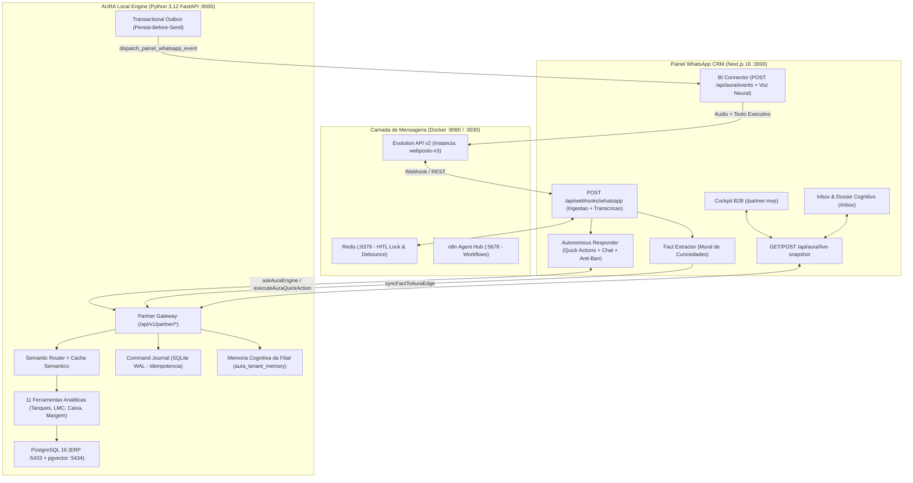

# Manual de Integracao e Operacao: AURA Local + Painel WhatsApp CRM + Evolution API v2

Este documento descreve a arquitetura em sincronia entre o motor **AURA Local** (`G:\Projetos\Aila - pgvector`), o **Painel WhatsApp CRM** (`G:\Projetos\Painel Whatsapp`) e o gateway **Evolution API v2**, detalhando o que cada projeto esta apto a fazer, como os fluxos operam e como manter a operacao diaria.

---

## 1. Visao Geral da Arquitetura Sincronizada



---

## 2. O Que Cada Projeto Esta Apto a Fazer e Como Faz

### A. Motor AURA Local (`G:\Projetos\Aila - pgvector` - Porta `8000`)
**Papel:** Motor cognitivo de borda (Edge AI), auditoria forense de pista, tanques, caixa e conformidade regulatoria (ANP/LMC).

| Capacidade | Como Faz (Implementacao Tecnica) | Arquivos Principais |
| :--- | :--- | :--- |
| **1. Telemetria Instantanea da Estacao (< 30ms)** | Consolida volume vendido (litragem), margem media/litro, mix de gasolina aditivada, conversao de conveniencia, ROI multiplo e alertas ativos da pista sem precisar acionar o LLM. | `core/partner_api.py` (`GET /api/v1/partner/stations/{id}/whatsapp-snapshot`) |
| **2. Chat Analitico Headless para WhatsApp** | Recebe perguntas em linguagem natural, consulta primeiro o **Cache Semantico** (hash de versao dos dados) e aciona o `SemanticRouter` + 11 ferramentas do posto. Remove tags visuais de tela (GenUI/vouchers) entregando texto limpo para celular. | `core/partner_api.py` (`POST /api/v1/partner/chat`) |
| **3. Execucao Idempotente de Quick Actions** | Quando o gestor aprova uma acao no WhatsApp (`1` ou `2`), grava primeiro a intencao no **Command Journal** (SQLite em modo WAL) via `begin_command()` e finaliza com `complete_command()`, evitando duplicidade em caso de reenvio de rede. | `core/partner_api.py` (`POST /api/v1/partner/stations/{id}/quick-action`) e `core/command_journal.py` |
| **4. Disparo Proativo Persist-Before-Send** | Ao detectar anomalia de margem, ruptura de tanque ou fechamento de turno, persiste o evento no `AuraTransactionalOutbox` antes de enviar via HTTP para o Painel CRM. Se o Painel estiver offline, reenfileira com backoff exponencial. | `core/webhooks.py` (`dispatch_painel_whatsapp_event`) e `core/transactional_outbox.py` |
| **5. Memoria Cognitiva por Filial** | Armazena e consulta fatos operacionais, capacidades de tanques, metas e apelidos aprendidos no WhatsApp diretamente na tabela `aura_tenant_memory`, isolados por `tenant_id` e `filial_id`. | `core/partner_api.py` (`POST /memory-sync` e `GET /memory-facts`) e `core/tenant_memory.py` |
| **6. Fallback Resiliente de Banco (ERP -> Staging)** | Conecta ao PostgreSQL do ERP (`5433`) via cofre DPAPI ou senha diaria. Caso o banco do ERP esteja em manutencao ou com senha expirada, comuta automaticamente para a camada de staging sem interromper a operacao. | `config/settings.py` e `core/partner_api.py` |

---

### B. Painel WhatsApp CRM & Aura Echo Hub (`G:\Projetos\Painel Whatsapp` - Porta `3000`)
**Papel:** Hub omnichannel de atendimento WhatsApp, sintese de voz neural, protecao Anti-Ban, trava humana (HITL) e Cockpit Executivo B2B.

| Capacidade | Como Faz (Implementacao Tecnica) | Arquivos Principais |
| :--- | :--- | :--- |
| **1. Ingestao Polimorfica de WhatsApp & Transcricao** | Recebe eventos `MESSAGES_UPSERT` da Evolution API, normaliza JIDs, ignora broadcasts, baixa audios do WhatsApp em Base64 e transcreve automaticamente para texto antes de enviar ao motor de IA. | `src/app/api/webhooks/whatsapp/route.ts` e `src/lib/audio/transcriber.ts` |
| **2. Trava Humana HITL & Anti-Auto-Lock** | Se um operador humano envia mensagem pelo celular ou pelo painel, ativa uma trava de 24h no Redis (`setHitlLock`) silenciando a IA naquela conversa. Mensagens enviadas pelo proprio bot sao marcadas via `registerBotDispatchedMessageId` para nunca travarem o proprio robo. | `src/lib/redis/lock.ts` e `src/lib/ai/autonomous-responder.ts` |
| **3. Debounce Temporal Inteligente (6 segundos)** | Agrupa mensagens enviadas de forma picada pelo usuario no WhatsApp em uma unica janela logica antes de consultar a AURA, economizando tokens e gerando uma resposta unica e coesa. | `src/lib/bot/debounce-engine.ts` |
| **4. Interceptador de Quick Actions e Campanhas** | Detecta respostas curtas do gestor (`1`, `confirmar`, `2`, `silenciar`) roteando direto para o Command Journal da AURA Local. Detecta *"disparar campanha"* acionando o disparo em lote com Spintax e jitter Anti-Ban (45s a 120s). | `src/lib/ai/autonomous-responder.ts` e `src/lib/campaigns/dispatcher.ts` |
| **5. Sintese de Nota de Voz Neural + Card de BI** | Ao receber um alerta da AURA Local em `POST /api/aura/events` (ou sob demanda em `POST /api/aura/live-snapshot`), gera roteiro executivo oral, sintetiza audio via Fish.Audio / Gemini, simula presenca (`recording...`) e envia voz + resumo no WhatsApp. | `src/lib/partner/bi-connector.ts` e `src/lib/audio/synthesizer.ts` |
| **6. Extracao Automatica de Fatos (Mural -> AURA)** | Analisa cada mensagem recebida para extrair preferencias, regras de negocio e prazos, salvando no CRM e sincronizando em background com a memoria cognitiva da estacao na AURA Local. | `src/lib/facts/extractor.ts` e `src/lib/aura/aura-edge-client.ts` |
| **7. Cockpit Visual Ao Vivo (`/partner-mvp`) e Inbox (`/inbox`)** | Exibe no topo do `/partner-mvp` o status em tempo real da AURA Local (Porta 8000), os 4 KPIs da pista, o alerta ativo, as regras retidas e botao de disparo real. No `/inbox`, exibe as regras da estacao ao lado do dossie do contato. | `src/app/partner-mvp/page.tsx`, `src/app/inbox/page.tsx` e `src/app/api/aura/live-snapshot/route.ts` |

---

### C. Camada Evolution API v2 & Containers Docker
- **`n3-evolution-api` (Porta `8080`):** Motor Baileys WhatsApp mantendo a sessao `webposto-n3` conectada (`status: open`) e entregando webhooks em `http://host.docker.internal:3000/api/webhooks/whatsapp`.
- **`n3-evolution-manager-3030` (Porta `3030`):** Painel gerencial de instancias e leitura de QR Code.
- **`n3-evolution-redis` (Porta `6379`):** Controle de locks HITL e fila de debounce em memoria.
- **`n3-evolution-postgres` (Porta `5432`):** Persistencia das sessoes e mensagens da Evolution API.
- **`n3-n8n` (Porta `5678`):** Orquestrador de fluxos externos e agendamentos.

---

## 3. Variaveis de Ambiente Sincronizadas

### Lado AURA Local (`G:\Projetos\Aila - pgvector\.env`)
```env
# Autenticacao mutua com o Painel WhatsApp CRM
AURA_PARTNER_API_KEY=whsec_partner_fuel_bi_2026
PAINEL_WHATSAPP_EVENTS_URL=http://localhost:3000/api/aura/events
PAINEL_WHATSAPP_AURA_KEY=whsec_partner_fuel_bi_2026
PAINEL_WHATSAPP_TENANT_SLUG=partner-fuel-bi
```

### Lado Painel WhatsApp CRM (`G:\Projetos\Painel Whatsapp\.env.local`)
```env
# Evolution API v2 Conectada
NEXT_PUBLIC_EVOLUTION_API_URL=http://localhost:8080
EVOLUTION_API_URL=http://localhost:8080
EVOLUTION_INSTANCE_NAME=webposto-n3
AURA_EVOLUTION_INSTANCE_NAME=webposto-n3

# AURA Edge Local Engine Integration
AURA_EDGE_API_URL=http://127.0.0.1:8000
AURA_PARTNER_API_KEY=whsec_partner_fuel_bi_2026
AURA_DEFAULT_STATION_ID=posto_01
AURA_REQUEST_TIMEOUT_MS=8000
PARTNER_BI_WEBHOOK_SECRET=whsec_partner_fuel_bi_2026
VOICE_REPLY_MODE=always
```

---

## 4. Como Operar e Testar no Dia a Dia

### Inicializacao Unificada (1-Clique)
Execute em qualquer um dos dois projetos:
```bat
iniciar-ecosistema-completo.bat
```
O script:
1. Verifica o Docker Desktop e garante que os 5 containers estejam rodando.
2. Verifica a porta `8000` e sobe o motor AURA Local (`python server.py`) se necessario.
3. Verifica a porta `3000` e sobe o Painel WhatsApp CRM (`npm run dev`) se necessario.
4. Abre o navegador diretamente no Cockpit de Postos (`http://localhost:3000/partner-mvp`).

### Comandos de Verificacao e Qualidade
1. **Rodar Smoke Test E2E Ao Vivo (8 Etapas):**
   Com a AURA Local ativa na porta `8000`:
   ```powershell
   node "G:\Projetos\Painel Whatsapp\scripts\smoke-test-live-integration.mjs"
   ```
2. **Rodar Testes Unitarios do Painel WhatsApp (200 testes):**
   ```powershell
   npm --prefix "G:\Projetos\Painel Whatsapp" test
   ```
3. **Rodar Testes de Integracao da AURA Local (pytest):**
   ```powershell
   pytest -q "G:\Projetos\Aila - pgvector\tests\unit\test_partner_whatsapp_integration.py" "G:\Projetos\Aila - pgvector\tests\unit\test_webhooks.py"
   ```
