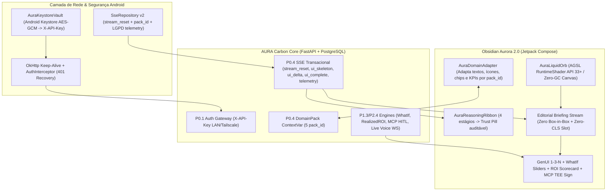

# Auditoria de UI/UX Deluxe & Plano de Evolução (AURA Carbon Android)

**Data da Auditoria:** 2026-11-25
**Repositório / Escopo:** `ia-banco-local/Aura Assistance Android`
**Documentos Base de Contratos:** `docs/AUDITORIA_CARBON_CORE.md` e `docs/AUDITORIA_CARBON_UI.md`
**Identidade Visual Alvo:** **Obsidian Aurora 2.0 (Carbon Deluxe)** — superfície AMOLED profunda (`#07090E` / `#030407`), tipografia editorial `Newsreader` + `Geist` tabular (`tnum`), contenção cromática **85-10-5** (`#22D3EE` Cyan / `#10B981` Emerald / `#8B5CF6` Violet), shaders AGSL nativos e Generative UI Zero-CLS multi-domínio.
**Status:** Plano Estruturado e Sincronizado com o Carbon Core (Aguardando aprovação das decisões HiC para início da Onda 1)

---

## Diagnóstico Executivo (Onde o App Perde Acabamento e Onde Quebra com o Core)

A auditoria do código atual do Android revelou uma base rica em recursos de borda (biometria TEE, NPU/ML Kit, giroscópio, `TankTile` animado, voz hands-free), mas com **6 pontos críticos** que reduzem a percepção de acabamento "deluxe" ou causarão **quebra imediata** assim que o plano `docs/AUDITORIA_CARBON_CORE.md` (P0/P1) entrar em produção:

> [!CAUTION]
> **Riscos Críticos de Sincronia com o Carbon Core:**
> 1. **Quebra Total de Autenticação no Core P0.1 (`di/NetworkModule.kt`, linhas 58-59):** O app hoje hardcoda `.header("X-Partner-Key", "aura-partner-default-key")` e `.header("X-Aura-Key", "aura-partner-default-key")`, não envia `X-API-Key` do Android Keystore e envia `.header("Connection", "close")` (matando Keep-Alive). Quando o P0.1 do Core remover chaves default e exigir `X-API-Key` em LAN/Tailscale, o app receberá `401 Unauthorized` em 100% das rotas.
> 2. **Corrupção de Stream no Core P0.4 (`data/remote/SseEvent.kt` e `SseRepository.kt`, linhas 83-131):** O parser SSE não trata `stream_reset`, `ui_skeleton`, `ui_delta` nem `telemetry`/`cache_hit`. Se o backend acionar fallback de modelo no meio da geração, o chunk cai no `else` e **concatena** texto duplicado/truncado. Além disso, `tenant_id="posto_01"` e `filial_id="59050"` estão hardcoded sem enviar `pack_id`.
> 3. **Widgets Next-Gen do Core P1.3 Ausentes (`ui/genui/GenUiModels.kt` e `GenUiViews.kt`):** Os 3 novos micro-widgets homologados (`WhatIfSimulatorUI`, `RealizedRoiScorecardUI`, `McpActionConfirmationUI`) não possuem parser nem visualização nativa no app.

> [!IMPORTANT]
> **Fricções de UI/UX que Diluem a Sensação "Moderno Deluxe":**
> 1. **Saturação de Iridescência & *Box-in-Box*:** Quase todos os cards usam `SpatialGlassCard(iridescentBorder = true)` com bordas multicoloridas competindo entre si, e `AuraMessage` envolve o texto da IA numa caixa de vidro logo acima do `GenUiCardView` (outra caixa). Na estética flagship (Obsidian Carbon), **85% da tela é silêncio visual** e apenas o elemento protagonista (Orbe ativo, alerta crítico ou Micro-Widget GenUI) recebe destaque luminoso.
> 2. **Telemetria Falsa/Mockada + Cabeçalho Inchado:** `AuraDynamicIsland` exibe números fictícios hardcoded (`"T-01: 18%"`, `"42.8k L"`, `"LMC ±0.18%"`) tanto no Dashboard quanto no Chat; o `PulseStatItem` exibe textos estáticos (`"100% Ativos"`, `"Monitorada"`); e o `ChatHeader` acumula 5 ícones + Dynamic Island + 2 abas (~160dp de altura), roubando quase 1/4 da tela antes da primeira mensagem.
> 3. **Bug de Seleção de Segmento & Jargão Fixo de Posto:** Em `ui/dashboard/DashboardScreen.kt` (linhas 385-400), `val isSelected = segment.key == selectedSegment` é calculado e **nunca passado** ao `AuraChip` (todos os chips parecem iguais), e as chaves (`postos_redes`, `varejo`...) divergem dos `pack_id` reais do Core (`fuel_convenience`, `pharmacy_health`, `retail_supermarket`, `autocenter_parts`, `wholesale_distribution`).
> 4. **Shader do Orbe & GC Pressure:** `AuraAdrenoShaderOrb` apenas delega para `AuraLivingOrb` ignorando `activeColor`, e `AuraLivingOrb` aloca novos `Path()` e `ArrayList` 120 vezes por segundo a 60fps em vez de usar **AGSL `RuntimeShader`** nativo no Android 13+ (API 33+).

---

## Arquitetura Alvo (Sincronia Core ↔ Web Carbon UI ↔ Android Deluxe)



---

## Decisões Arquiteturais Pendentes (Protocolo HiC)

> [!IMPORTANT]
> **Pontos para homologação antes da execução:**
> 1. **Armazenamento da `X-API-Key` sem novas dependências Gradle:** Implementar `AuraKeystoreVault` usando diretamente `java.security.KeyStore ("AndroidKeyStore")` + `javax.crypto.Cipher` (AES/GCM/NoPadding) sobre `SharedPreferences` — zero novas bibliotecas Gradle e 100% compatível com `minSdk 26`.
> 2. **Telemetria de Silício ("Qualcomm TEE / NPU") no Dashboard:** Mover o card técnico de hardware do topo do "Pulso Executivo" para um **badge discreto clicável no header** (que abre um Bottom Sheet de Diagnóstico NPU/TEE & Rede sob demanda), liberando a área nobre para KPIs executivos reais.
> 3. **Ritmo de Execução:** Iniciar pela **Onda 1 (P0)** + **Onda 2 (P1 Visual Deluxe)**, seguindo depois para **Onda 3 (GenUI 1-3-N + Widgets P1.3)** e **Onda 4 (Voz Full-Duplex + Widget Home)**.

---

## Plano de Execução em 4 Ondas Priorizadas

---

### Onda 1 (P0) — Sincronia Crítica com Carbon Core (Segurança, SSE & Multi-Domínio)

#### `[NEW]` `app/src/main/java/com/example/aurapostoassitance/data/security/AuraKeystoreVault.kt`
- Cofre nativo usando `AndroidKeyStore` (AES-256-GCM) para gravar e ler `api_key`, `tenant_id`, `filial_id` e `active_pack_id` sem expor segredos em texto claro nem adicionar dependências externas.

#### `[MODIFY]` `app/src/main/java/com/example/aurapostoassitance/di/NetworkModule.kt`
- Remover `.header("X-Partner-Key", "aura-partner-default-key")`, `.header("X-Aura-Key", "aura-partner-default-key")` e `.header("Connection", "close")`.
- Injetar `X-API-Key` (e `Authorization: Bearer`) dinamicamente via `AuraKeystoreVault` quando configurada.
- Habilitar `ConnectionPool(5, 5, TimeUnit.MINUTES)` para HTTP Keep-Alive real sobre Tailscale/LAN.
- Emitir evento reativo de `401 Unauthorized` para um `AuthSessionBus` (exibindo bottom sheet executivo de reconexão em vez de falha silenciosa).

#### `[MODIFY]` `app/src/main/java/com/example/aurapostoassitance/ui/setup/SetupScreen.kt`
- Substituir o círculo estático `"A"` pelo `AuraLivingOrb` vivo e remover o texto fixo `"do Posto"` / `"Conectar ao Posto"`.
- Adicionar campo estilizado `X-API-Key` (com toggle mostrar/ocultar) e botão **"Parear via QR Code"** reutilizando `libs.mlkit.barcode.scanning` já presente no projeto (lendo payload JSON `{host, api_key, tenant_id, pack_id}` gerado pelo painel web).

#### `[MODIFY]` `data/remote/SseEvent.kt`, `data/remote/SseRepository.kt` e `ui/chat/ChatViewModel.kt`
- Expandir `SseEvent` com:
  ```kotlin
  sealed class SseEvent {
      data class StageUpdate(val stage: ReasoningStage, val label: String) : SseEvent()
      data class TextDelta(val text: String) : SseEvent()
      data class StreamReset(val reason: String?) : SseEvent()
      data class UiSkeleton(val toolCallId: String, val componentName: String, val title: String?) : SseEvent()
      data class UiDelta(val toolCallId: String, val partialJson: String) : SseEvent()
      data class UiComplete(val envelopeJson: String) : SseEvent()
      data class Telemetry(val ttftMs: Long?, val totalMs: Long?, val piiRedactedCount: Int, val source: String, val cacheHit: Boolean) : SseEvent()
      data class Error(val message: String) : SseEvent()
      object Done : SseEvent()
  }
  ```
- Em `SseRepository`: enviar `pack_id`, `tenant_id` e `filial_id` reais do `ServerConfig`/`AuraKeystoreVault`; tratar explicitamente `"stream_reset"`, `"ui_skeleton"`, `"ui_delta"`, `"cache_hit"` e `"telemetry"`; remover fallback `"Executando ferramenta do posto..."`.
- Em `ChatViewModel.kt`: ao receber `SseEvent.StreamReset`, zerar o texto parcial da mensagem em streaming (sem destruir o item da lista) e atualizar o `AuraReasoningRibbon` para `"Recalibrando síntese com modelo de contingência..."`.

---

### Onda 2 (P1 Core UX) — Acabamento Visual Deluxe "Obsidian Aurora 2.0" & AGSL Shader

#### `[MODIFY]` `ui/theme/Color.kt`, `ui/theme/Type.kt`, `ui/theme/Theme.kt` e `MainActivity.kt`
- **Tokens Carbon Canônicos:** Remover paleta legada (`Purple80`, `Pink80`, etc.), alinhar `StatusWarning = Color(0xFFF59E0B)`, `StatusDanger = Color(0xFFF43F5E)` e `BorderHairline = Color(0x12FFFFFF)` (7% branco) + `SurfaceGlass1 = Color(0xC20C111C)` para paridade exata com `docs/AUDITORIA_CARBON_UI.md`.
- **Tipografia Tabular & Mono:** Adicionar `AuraTypographyExt.kpiHero` (`GeistFamily`, `fontSize = 28.sp`, `fontWeight = FontWeight.Bold`, `fontFeatureSettings = "tnum"`, `letterSpacing = (-0.6).sp`) e `AuraTypographyExt.monoAudit` (`FontFamily.Monospace`, `fontFeatureSettings = "tnum"`).
- **Edge-to-Edge Verdadeiro (Android 15 / SDK 35):** Remover `window.statusBarColor` e `window.navigationBarColor` depreciados em `Theme.kt` e configurar `enableEdgeToEdge(statusBarStyle = SystemBarStyle.dark(Color.TRANSPARENT), navigationBarStyle = SystemBarStyle.dark(Color.TRANSPARENT))` em `MainActivity.kt`.

#### `[MODIFY]` `ui/components/AuraAdrenoShaderOrb.kt` e `ui/components/AuraComponents.kt`
- **Orbe de Plasma Líquido com AGSL `RuntimeShader` (API 33+):** Implementar shader AGSL procedural (campo metaball/plasma iridescente com iluminação Fresnel, reativo a `uTime`, `uRms` e `uStateColor` — Cyan em escuta, Violet em síntese, Emerald em conformidade, Rose em alerta), rodando 100% na GPU a 60–120 FPS com **zero alocação de memória por frame**.
- **Fallback Zero-GC (API 26–32):** Otimizar `AuraLivingOrb` em `Canvas` reutilizando `remember { Path() }` e `FloatArray` pré-alocado (`path.reset()`), eliminando as 120 alocações/s atuais e respeitando `activeColor`.
- **Regra de Contenção 85-10-5 em `SpatialGlassCard`:** Alterar default `iridescentBorder: Boolean = false` (borda hairline sutil `BorderHairline` + top highlight especular de `1dp`), ativando `LiquidIridescentBorderBrush` apenas quando `glowActive == true` ou explicitamente no card protagonista.
- **Corrigir `AuraChip` para suportar estado `selected: Boolean`:** Adicionar parâmetro `selected: Boolean = false` com transição suave de fundo (`accentColor.copy(alpha = 0.16f)`), borda (`accentColor.copy(alpha = 0.65f)`) e dot ativo.

#### `[NEW]` `app/src/main/java/com/example/aurapostoassitance/ui/domain/AuraDomainAdapter.kt`
- Adaptador visual multi-vertical (equivalente nativo do `web/js/aura-domain-adapter.js` da Carbon UI) mapeando os 5 `pack_id` oficiais do Core:
  - `fuel_convenience` (Postos & Conveniência)
  - `pharmacy_health` (Farmácias & Saúde — Curva A, PBM, SNGPC)
  - `retail_supermarket` (Supermercados & Varejo — Ruptura Gôndola, Perecíveis, Margem)
  - `autocenter_parts` (Autocentros & Peças — Giro SKU, OS, Viscosidade)
  - `wholesale_distribution` (Atacado & Distribuição — Estoque D+N, Rotas, Inadimplência)
- Fornece dinamicamente: subtítulo da unidade, placeholder do composer, 4 sugestões do `EmptyState`, rótulo da aba de recursos no `AuraBottomGlassDock` (`Tanques` -> `Estoque` fora de `fuel_convenience`), triggers do Dashboard e texto do botão de compliance (`ANP` -> `SNGPC` / `Fiscal`).

#### `[MODIFY]` `ui/dashboard/DashboardScreen.kt` e `ui/dashboard/DashboardViewModel.kt`
- **TopBar Honesta e Limpa:** Conectar o badge do header ao estado real de conectividade (`Online • Tailscale` / `Online • LAN` / `Modo Offline • Vault`) + chip compacto de Telemetria NPU/TEE clicável (abre Bottom Sheet SRE sob demanda, liberando o topo do Dashboard).
- **Seletor de Segmentos Funcional:** Passar `selected = isSelected` ao `AuraChip`, sincronizar os itens com os 5 `pack_id` do Core e persistir o `pack_id` escolhido.
- **Fim da Telemetria Mockada:** Conectar `AuraDynamicIsland` e a faixa de KPIs do Pulso ao endpoint real `/api/v1/aura/zero-click-feed` (com fallback transparente `"Aguardando telemetria ao vivo"` em vez de números fictícios `"T-01: 18%"` / `"42.8k L"`).
- **Hierarquia Visual Deluxe:** Aplicar borda sutil nos cards de triggers (2x2), reservar iridescência/glow apenas para o Card de Briefing Matinal quando em reprodução, e usar o `AuraDomainAdapter` para adaptar os triggers e chips rápidos ao `pack_id` ativo.

#### `[MODIFY]` `ui/chat/ChatScreen.kt`
- **Cabeçalho Compacto (~160dp → ~96dp):**
  - Consolidar `ChatHeader` para 3 ações claras: *Voltar*, *Voz* (com estado vivo), *Menu/Hub* (com badge de não lidos), removendo a duplicação do `AuraDynamicIsland` mockado no topo do chat.
  - Transformar as abas `Análises AURA | Gatilhos WhatsApp` em um **Segmented Control** cápsula elegante (`34dp`) com indicador deslizante animado.
- **Editorial Briefing Stream (Fim do *Box-in-Box*):**
  - Em `AuraMessage`: remover o container `LiquidGlassSurfaceBrush` com borda iridescente em volta do `MarkdownText`. O texto flui diretamente sobre o canvas Obsidian com guia vertical sutil (`2dp` à esquerda apenas durante streaming ou citação), deixando o **`GenUiCardView` como único card de vidro protagonista**.
  - Em `EmptyState`: substituir `AuraAvatar` estático pelo `AuraLivingOrb(sizeDp = 72.dp)` vivo e adaptar saudação/sugestões ao `pack_id` ativo.
  - Em `UserBubble`: pílula direita compacta (`ObsidianHigh.copy(alpha = 0.72f)`, borda `BorderHairline`), limpa e elegante.

---

### Onda 3 (P1 GenUI & Transparência) — `AuraReasoningRibbon`, Zero-CLS e Widgets Core P1.3

#### `[NEW]` `app/src/main/java/com/example/aurapostoassitance/ui/components/AuraReasoningRibbon.kt`
- Substitui `AuraReasoningAccordion` e `ThinkingIndicator` por um componente unificado de **28dp**:
  - **Durante o streaming:** Micro-stepper horizontal animado em 4 estágios semânticos:
    1. `LGPD` (`#10B981`): `"Filtro LGPD & PII Ativo"` (atualiza para `"LGPD: N mascarados"`).
    2. `Dados` (`#22D3EE`): `"SQL Read-Only • <Tool>"` ou `"Cache Semântico Local"`.
    3. `Motor` (`#10B981`): `"Cálculo Python Auditado"`.
    4. `Síntese` (`#8B5CF6`): `"Sintetizando recomendação..."` (ou pulso `#22D3EE` em `stream_reset`).
  - **Após `Done`:** Contrai suavemente (`animateContentSize`) numa **Trust Pill** compacta ao lado do selo `AURA`:
    ```text
    ✓ SQL Read-Only · Determinístico · LGPD (2) · 680ms ▾
    ```
  - **1 toque na Trust Pill:** Expande o painel de linhagem com etapas, TTFT, latência total e contagem de PII mascarados (sem jargão fixo `"ANP"` fora de `fuel_convenience`).

#### `[MODIFY]` `ui/genui/GenUiModels.kt`, `ui/genui/GenUiViews.kt` e `data/remote/AuraApiService.kt`
- **Injeção Zero-CLS:** Quando `SseEvent.UiSkeleton` chegar, reservar imediatamente um `GenUiSkeletonSlot` (`heightIn(min = 180.dp)`) com `ShimmerBox` estrutural no `AuraMessage`; quando `UiComplete` chegar, realizar `Crossfade(tween(200))` in-place sem salto de scroll.
- **Hierarquia 1-3-N:**
  - Promover o 1º KPI de `KpiGrid` (quando `kpis.size >= 3` ou marcado como hero) para um **Hero Verdict KPI** (`28.sp` tabular `tnum`, badge de variação, micro-barra comparativa) seguido de até 3 supporting KPIs em linha com divisores sutis (`1dp` vertical) — eliminando a grade de sub-caixas pesadas.
  - **Confirmação Inline 2-Passos + Biometria TEE:** Para `action.requiresConfirmation || action.isDestructive`, transformar o próprio botão em confirmação inline (`[Confirmar com Biometria] [Cancelar]` com timeout de 6s) em vez de abrir `Dialog` com texto hardcoded `"na rede do posto"`.
- **3 Novos Micro-Widgets Nativos (Paridade Core P1.3 / P2.4):**
  1. `GenUiBlock.WhatIfSimulator` (`WhatIfSimulatorUI` / `ElasticityBatchSimulatorUI`):
     - Sliders táteis nativos (`Delta Preço %`, `Delta Volume %`, `Lote/Prazo`) com háptica por passo, debounce `180ms` chamando `POST /api/v1/aura/what-if/simulate` (via `AuraApiService.kt`) + cálculo local imediato offline, Hero KPI de **Delta Lucro Mensal (`R$`)** e gráfico comparativo Canvas nativo (Base `#22D3EE` vs Simulado `#8B5CF6`).
  2. `GenUiBlock.RealizedRoiScorecard` (`RealizedRoiScorecardUI`):
     - Hero KPI de **ROI Realizado (`R$` e múltiplo `Nx`)** em `#10B981`, tríade (*Vazamentos Estancados*, *Ganho Margem/Mix*, *Taxa de Captura %*) e timeline compacta dos últimos *Action Vouchers* executados.
  3. `GenUiBlock.McpActionConfirmation` (`McpActionConfirmationUI`):
     - Cartão HITL com escopo (*Sistema Alvo*, *Operação*, *Reversibilidade*), diff monoespaçado `Antes -> Depois`, barra de contagem regressiva do TTL e CTA de assinatura biométrica TEE (`ActionVoucher` HMAC).

---

### Onda 4 (P2 Next-Gen) — Voz Imersiva Full-Duplex & Polimento de Ecossistema

#### `[MODIFY]` `ui/components/AuraComponents.kt` (`AuraVoiceOrbSheet`)
- Evoluir o sheet de voz para um **Modo Imersivo Full-Screen/High-Sheet AMOLED (`#030407`)** com `AuraLiquidOrb` AGSL de `180.dp` no centro, transcrição editorial ao vivo em `Newsreader`, anel de espectro de voz suave e gesto de *barge-in* (toque em qualquer lugar do orbe interrompe a fala e volta a ouvir instantaneamente), pronto para plugar no `WS /api/v1/voice/live` (P2.4 do Core).

#### `[MODIFY]` `ui/assist/AuraAssistActivity.kt`, `widget/AuraPulseWidgetProvider.kt` e `res/layout/widget_aura_pulse.xml`
- Remover hardcode `"postos_redes"` em `AuraAssistActivity` e `AuraPulseWidgetProvider`, consumindo o `pack_id` ativo do `AuraKeystoreVault`/`ServerConfig`.
- Atualizar `widget_aura_pulse.xml` e `AuraPulseWidgetProvider` para exibir o resumo real do último snapshot sincronizado e status de conexão (removendo o texto fixo `"SNAPDRAGON 7S NPU"`), na paleta `#07090E` + `#22D3EE`.

---

## Matriz Resumo de Priorização e Sincronia com o Core

| Onda | Escopo Android | Dependência / Sincronia Core | Critério Objetivo de Saída (Gate) |
| :---: | :--- | :--- | :--- |
| **Onda 1 (P0)** | `AuraKeystoreVault` (`X-API-Key`), OkHttp Keep-Alive, Setup + QR Code, `SseRepository` v2 (`stream_reset`, `pack_id`, `ui_skeleton`, `telemetry`) | `AUDITORIA_CARBON_CORE.md` **P0.1** e **P0.4** | Zero `aura-partner-default-key` no app; auth `X-API-Key` funcional em LAN/Tailscale; `stream_reset` limpa buffer sem duplicar texto; testes unitários SSE verdes. |
| **Onda 2 (P1 UX)** | Tokens Carbon Obsidian (`#07090E`), Contenção 85-10-5, Tipografia `tnum`, Edge-to-Edge SDK 35, Orbe AGSL `RuntimeShader` + Canvas Zero-GC, `AuraDomainAdapter`, Dashboard & Chat limpos | `AUDITORIA_CARBON_CORE.md` **P0.4** (DomainPacks) e `AUDITORIA_CARBON_UI.md` **P1-UI1/P1-UI5** | Zero números mockados no `AuraDynamicIsland`; seletor de segmentos destacando `pack_id` ativo; `ChatHeader` < 100dp; Editorial Stream sem *box-in-box*; 60fps sem GC churn no Orbe. |
| **Onda 3 (P1 GenUI)** | `AuraReasoningRibbon` + *Trust Pill*, Slot Zero-CLS (`ui_skeleton` -> `ui_complete`), Hierarquia 1-3-N, Confirmação inline TEE, `WhatIfSimulatorCard`, `RealizedRoiScorecardCard`, `McpActionConfirmationCard` | `AUDITORIA_CARBON_CORE.md` **P0.3** (LGPD), **P1.3** e **P2.4** | Zero salto de layout na chegada do card GenUI; Trust Pill exibindo fonte/LGPD/latência; 3 novos widgets parseados e renderizados com testes unitários verdes. |
| **Onda 4 (P2 Next-Gen)** | `AuraVoiceOrbSheet` imersivo AMOLED pronto para `WS /api/v1/voice/live`, `AuraAssistActivity` e `AuraPulseWidget` multi-domínio | `AUDITORIA_CARBON_CORE.md` **P2.4** | Assist overlay e widget sincronizados ao `pack_id` ativo; `assembleDebug` e `testDebugUnitTest` 100% verdes. |

---

## Plano de Verificação

### Testes Automatizados
```powershell
cd "c:\Users\Marlon\Documents\Agent PC\ia-banco-local\Aura Assistance Android"
.\gradlew.bat testDebugUnitTest
.\gradlew.bat assembleDebug
```
- **Novos testes unitários em `app/src/test/`:**
  - `SseParserTest.kt`: valida parsing de `stream_reset`, `ui_skeleton`, `ui_delta`, `ui_complete`, `cache_hit` e `telemetry` (contagem LGPD).
  - `GenUiParserNextGenTest.kt`: valida parsing de `WhatIfSimulatorUI`, `RealizedRoiScorecardUI` e `McpActionConfirmationUI` e zero vazamento de nomes técnicos `render_*UI`.
  - `AuraDomainAdapterTest.kt`: valida adaptação de textos/triggers/ícones para os 5 `pack_id` oficiais do Core.
- **Auditoria Estática de Segredos e Hardcodes:**
  ```powershell
  Select-String -Path "Aura Assistance Android\app\src\main\java\**\*.kt" -Pattern "aura-partner-default-key|T-01: 18%|42\.8k L"
  ```
  - Deve retornar **zero ocorrências**.

### Verificação Manual
1. **Pareamento & Auth (P0.1):** Configurar IP LAN/Tailscale + `X-API-Key` na `SetupScreen` (manual ou QR Code) e confirmar autenticação sem `401`; testar remoção da chave e validar o fluxo de re-autenticação.
2. **Streaming Transacional & `AuraReasoningRibbon`:** Enviar pergunta no Chat, observar os 4 estágios (`LGPD` → `SQL Read-Only` → `Cálculo Python` → `Síntese`) contraindo na *Trust Pill*, ausência de salto de scroll (Zero-CLS) na hidratação do card GenUI e limpeza limpa em `stream_reset`.
3. **Acabamento Visual Obsidian Aurora 2.0:** Verificar edge-to-edge real sem barras sólidas, fluidez 60fps do Orbe AGSL (Android 13+) e Canvas (API < 33), alinhamento tabular (`tnum`) nos KPIs 1-3-N, interatividade dos sliders `WhatIfSimulatorCard` e troca dinâmica entre os 5 `pack_id` no Dashboard e no Chat.
