# Auditoria Arquitetural Completa & Plano de Acao Executavel (AURA Carbon Core)

**Data da Auditoria:** 2026-11-24
**Repositorio Auditado:** `ia-banco-local`
**Status:** Auditoria Concluida e Decisoes Arquiteturais Homologadas (Aguardando inicio programado da Fase P0)

## Contexto e Premissas Avaliadas

Esta auditoria avaliou integralmente o repositorio `ia-banco-local` sob as seis premissas arquiteturais da plataforma AURA:
1. **Plataforma Domain-Agnostic** orientada a *Domain Packs* declarativos (AUDS);
2. **Operacao Local-First / Hibrida** com resiliencia offline e baixo footprint de CPU/RAM (zero GPU local);
3. **FastAPI + PostgreSQL 16 / pgvector** (HNSW `halfvec(768)` + FTS + SQLite WAL auxiliar);
4. **Sanitizacao LGPD / PII com spaCy** e defesa contra Prompt Injection (OWASP GenAI);
5. **Calculos Deterministicos fora da LLM** (Python puro auditavel antes da sintese verbal);
6. **Generative UI (GenUI)** sobre catalogo fechado de componentes (`SecureComponentRegistry`).

> [!CAUTION]
> **Resumo Executivo de Risco Imediato (Top 5 Achados P0):**
> 1. **Seguranca / DB & Auth:** Credencial literal `"364768"` hardcoded e *Dual-Role Fallback* para a role privilegiada `suporte` em `core/db_pool.py` (linhas 133-151), somados a chaves default estaticas em `config/settings.py` (linhas 95-135) e `AURA_ENFORCE_ADMIN_AUTH="0"` por padrao em `core/aura_api.py` (linhas 196-228).
> 2. **Vazamento Cross-Tenant no Cache Semantico e RAG:** `perguntas_cache` em `core/rag_engine.py` (linhas 117-168) nao filtra `tenant_id`, `filial_id`, `pack_id` nem possui TTL; alem disso, o limiar `max_score < 0.008` em `core/rag_engine.py` (linhas 974-975) e matematicamente inatingivel (`0.5 / 61 = 0.00819 > 0.008`), desativando a trava de `evidencia_insuficiente`.
> 3. **Lacuna Critica de LGPD no spaCy:** `SpacyLogNLPProcessor` em `core/sanitizer.py` (linhas 627-796) nunca extrai nem mascara entidades `PER`/`LOC` (nomes de clientes, operadores, medicos ou enderecos), degrada silenciosamente para `spacy.blank("pt")` e possui detector de Prompt Injection apenas em ingles (`core/sanitizer.py`, linhas 191-198).
> 4. **Bloqueio de Event Loop Assincrono e Duplicacao de Stream:** `self.router.route(...)` faz chamada HTTP sincrona de embedding + `psycopg2` sob `RLock` direto na corrotina `ask_stream` (`core/aura_engine.py`, linha 5752), congelando o worker FastAPI; e o loop de `FALLBACK_MODELS` (`core/aura_engine.py`, linhas 6048-6120) reemite `DELTA` do zero apos stream truncada, corrompendo a resposta na UI.
> 5. **Falso Desacoplamento de Domain Packs:** `AuraEngine` (`6.407` linhas) possui **zero** chamadas a `domain_pack_loader`, enquanto `PostoTools` (`9.573` linhas) abre `13` conexoes diretas `get_erp_connection()` com SQL legado de posto, travando a ativacao real dos packs `pharmacy_health`, `retail_supermarket`, `autocenter_parts` e `wholesale_distribution`.

---

## Mapa Arquitetural Atual vs. Arquitetura Alvo (Carbon Core)

```mermaid
flowchart TD
    subgraph Atual["Estado Atual (Acoplamento Hibrido)"]
        UI["Web SPA / Voice WS / Partner API"] --> API["core/aura_api.py (Auth opcional por default)"]
        API --> ENG["core/aura_engine.py (6.4k linhas - 0 refs DomainPack)"]
        ENG -->|"Sync bloqueante no event loop"| SR["core/semantic_router.py (RLock + conn propria)"]
        ENG --> PT["core/tools.py (9.5k linhas - 13x get_erp_connection)"]
        PT -->|"Bypass do BaseERPAdapter"| PG_ERP[("PostgreSQL ERP: posto (Fallback p/ suporte)")]
        ENG --> RAG["core/rag_engine.py (Cache s/ tenant_id e s/ TTL)"]
        RAG --> PG_VEC[("PostgreSQL pgvector: posto_ai")]
        DP["config/domain_packs/*.yaml (5 packs)"] -.->|"Isolado / Subutilizado"| SR
    end

    subgraph Alvo["Arquitetura Alvo (Carbon Core Domain-Agnostic)"]
        UI2["Web SPA / Live Voice / MCP / Partner"] --> GW["API Gateway Hardened (Local Session Token + LAN API Key)"]
        GW --> CTX["Tenant & Pack ContextVars (tenant_id, filial_id, pack_id)"]
        CTX --> ORCH["Agnostic Orchestrator (Async Router + Stream Buffer Guard)"]
        ORCH --> PACK["DomainPack Runtime Registry (Prompts, Intents, Tolerances, Vocab)"]
        ORCH --> UTOOLS["Universal Deterministic Engines (AUDS Entities Only)"]
        UTOOLS --> ADAPTER["BaseERPAdapter / YAMLDataMapper + AST SQL Guard"]
        ADAPTER -->|"Somente aura_service_ro + Index-Safe SQL"| PG_ERP2[("ERP DB Read-Only")]
        ORCH --> HRAG["Partitioned Hybrid RAG (Tenant+Pack Cache + True Min-Score)"]
        HRAG --> PG_VEC2[("pgvector RLS Enforced")]
    end
```



---

## Pilar 1: Desacoplamento e Escala (Domain-Agnostic vs. Vazamento de Nicho)

### Evidencias Quantitativas Levantadas no Codigo
- **`core/aura_engine.py` (323 KB, 6.407 linhas):** `0` referencias a `domain_pack_loader` ou `active_domain_pack`. Saudacoes, mensagens de retry (`core/aura_engine.py`, linhas 5725-5746), titulos executivos (`CANONICAL_EXECUTIVE_TITLES`, linhas 1495-1505) e formatadores deterministicos assumem exclusivamente `"posto ou loja de conveniencia"`.
- **`core/tools.py` (9.573 linhas):** Possui `13` chamadas diretas a `get_erp_connection()` com queries SQL acopladas ao schema fisico (`abastecimentos`, `fechabomba`, `fechacaixa`, `codpro IN ('00001'..'00005')`, `nompro ILIKE '%GASOLINA%'`), consumindo apenas `6` referencias a entidades universais contra dezenas de tabelas legadas.
- **`core/domain/` (Split-Brain de Dominio):** Coexistem entidades agnosticas em `core/domain/universal_entities.py` (`UniversalInventoryNode`, `UniversalDispensingUnit`) e modulos especificos de combustiveis dentro do nucleo (`core/domain/pumps.py`, `core/domain/tanks.py`).
- **`core/domain/domain_pack_loader.py` (Mutabilidade Global):** `_ACTIVE_PACK` (linhas 180-208) usa variavel global de processo. Em execucao multi-tenant (ex.: um cliente `pharmacy_health` e outro `fuel_convenience` no mesmo worker), ha *race condition* imediata entre requisicoes.
- **Vazamento em Prompts, Sanitizador, RAG e FinOps:**
  - `core/prompts/system_prompts.py` (linhas 24-120) injeta `"POSTO PILOTO MODELO"`, `"caminhao parado na pista"` e `"NFC-e Modelo 65 de pista"` em todas as verticais.
  - `core/sanitizer.py` (linhas 209-275) fixa `POSTO_VOCABULARY` (`Companytec`, `CBC04`, `fechabomba`) e palavras-chave de compressao (`ABASTECIMENTO`) no nucleo LGPD.
  - `core/rag_engine.py` (linhas 38-41, 763, 957) aplica `VISCOSITY_REGEX` (`0W20`, `15W40`), `broad_terms = {"webposto", "posto"}` e fallback hardcoded para `core.webposto_rag`.
  - `core/token_budget.py` (linha 291) fixa `vertical_pack: str = "fuel_convenience"` como default estatico, e `core/partner_api.py` (linhas 63-71) restringe `RECOGNIZED_RAW_TABLES` a tabelas de posto (`tanques`, `fechabomba`, `medicaotanques`).

### Classificacao de Prioridade - Pilar 1
- **[P0-D1]** Migrar `active_domain_pack` de singleton global para `ContextVar` acoplado ao `TenantContext` e injetar `DomainPackConfig` no `AuraEngine`, `SemanticRouter` (incluindo indexacao vetorial de `specific_intents` por `pack_id`) e `system_prompts.py`.
- **[P1-D2]** Extrair a logica SQL de `PostoTools` para um *Vertical Cartridge* (`core/packs/fuel_convenience/`) e fazer as tools universais operarem estritamente sobre `BaseERPAdapter` + entidades AUDS (`UniversalSaleReceipt`, `UniversalInventoryNode`, `UniversalCashierShift`).
- **[P2-D3]** Externalizar `POSTO_VOCABULARY` (`core/sanitizer.py`) e `VISCOSITY_REGEX` (`core/rag_engine.py`) para secoes opcionais `nlp_entities` e `lexical_boosts` nos arquivos `config/domain_packs/*.yaml`.

---

## Pilar 2: Inteligencia, Determinismo, RAG/pgvector e Latencia

### Achados de Precisao, Determinismo e Performance
1. **[P0-I1] Bloqueio do Event Loop Assincrono no Roteamento (`ask_stream`):**
   - Em `core/aura_engine.py` (linha 5752), `self.router.route(pergunta_efetiva)` roda de forma **sincrona** dentro de `async def ask_stream`.
   - Internamente, `SemanticRouter` mantem uma unica conexao `psycopg2` protegida por `threading.RLock()` (`core/semantic_router.py`, linhas 1233-1319) fora do `db_pool` e dispara `genai.embed_content` sincrono (ate `2.5s`). Sob 5+ usuarios simultaneos ou durante sessoes `WS /api/v1/voice/live`, isso trava todos os coroutines daquele worker Uvicorn.
2. **[P0-I2] Corrupcao de Resposta no Fallback de Streaming e Falta de Guardrail Numerico Online:**
   - Em `core/aura_engine.py` (linhas 6048-6120), os chunks `AuraChunkType.DELTA` sao enviados imediatamente ao cliente durante a iteracao do modelo primario. Se o stream corta no caractere `120` (`stream_interrompida=True` ou `frase_truncada=True`), o laco passa para `FALLBACK_MODELS[1]` e transmite uma **segunda resposta inteira concatenada** ao texto parcial ja exibido na tela, sem evento `stream_reset`.
   - Alem disso, embora `evals/evaluators.py` possua verificador de fidelidade numerica offline, o fluxo online nao valida se os numeros gerados pela LLM divergem dos valores deterministicos em `resultado_bruto` antes do evento `DONE`.
3. **[P0-I3] Tres Falhas Matematicas/Estruturais no `HybridRAGEngine` (`core/rag_engine.py`):**
   - **Cache Semantico Cego a Tenant, Filial, Pack e Tempo (linhas 117-168):** `SELECT ... FROM perguntas_cache ORDER BY pergunta_vetor <=> %s::halfvec LIMIT 1` retorna respostas cacheadas de **outro tenant/filial** ou com precos/estoques defasados indefinidamente (sem TTL nem invalidacao por escrita/sync).
   - **Trava `evidencia_insuficiente` Inoperante (linhas 861-975):** Com `dense_weight=0.5` e constante RRF `k=60`, o 1o colocado de `dense_search` recebe no minimo `0.5 * (1 / (60 + 1)) = 0.008197`. Como a checagem na linha 975 e `max_score < 0.008`, **qualquer** consulta que retorne ao menos 1 linha (mesmo com `cosine_similarity = 0.10`!) jamais ativa `evidencia_insuficiente = True`.
   - **Degradacao do Indice HNSW no `dense_search` (linhas 799-814):** A subquery `dense_search` aplica `ROW_NUMBER() OVER (ORDER BY CASE WHEN breadcrumb ILIKE '%pdv%' ... END ASC, embedding <=> %s::halfvec ASC)` **sem** `ORDER BY embedding <=> %s::halfvec LIMIT 30` externo apoiado no indice, impedindo o uso otimo do indice HNSW em top-K direto e rebaixando chunks altamente relevantes apenas por nao conterem `"pdv"` no titulo.
4. **[P1-I4] Distorcao Assimetrica de Embeddings no `SemanticRouter` + SDK Depreciado:**
   - `core/semantic_router.py` (linha 1445) indexa `"Intencao: {id} | Pergunta Tipica: {frase}"`, poluindo o vetor com o rotulo textual da classe e obrigando `confidence_threshold = 0.58` (linha 1224), o que gera falsos positivos contornados por *patches* regex manuais (`SCOPED TOOLING` em `core/aura_engine.py`, linhas 5754-5770).
   - Todo o repositorio ainda importa `google.generativeai` (pacote oficialmente encerrado, emitindo `FutureWarning` nos runs de CI) e recria `genai.GenerativeModel(m_name)` a cada requisicao.
5. **[P1-I5] Desalinhamento de Catalogo GenUI Backend vs. Frontend & Latencia Sequencial:**
   - Os componentes das Fases 2, 3 e 5 (`RealizedRoiScorecardUI`, `WhatIfSimulatorUI`, `McpActionConfirmationUI`) nao estao registrados em `GENUI_COMPONENT_REGISTRY_MAP` (`core/aura_engine.py`, linhas 1620-1855) nem em `web/js/aura-genui-widgets.js`, caindo no card de bloqueio OWASP LLM03 no navegador.
   - Em `ask_stream`, leitura de historico (`format_history_for_prompt`), sanitizacao e carregamento de dados cadastrais da filial rodam em serie apos a tool; paralelizar a busca de historico/metadados de sessao com o roteamento/tool via `asyncio.gather` reduz `40ms-120ms` do TTFT.

---

## Pilar 3: Seguranca, LGPD e Banco de Dados

### 3.1 Seguranca de Credenciais, Banco Read-Only e Contratos da API Gateway
- **[P0-S1] Credencial Hardcoded e Escalada Silenciosa para `suporte` (`core/db_pool.py`, linhas 133-151; `config/settings.py`, linhas 165-173):**
  - `service_ro_pass = "364768"` esta exposto em texto claro no codigo-fonte.
  - `_build_role_candidates` tenta `("suporte", primary_password)` se `aura_service_ro` falhar, violando a garantia contratual Clean Room de conectar ao ERP exclusivamente com role de leitura restrita.
  - `DB_VECTOR_CONFIG` usa `suporte` por padrao e nao define `statement_timeout` nem `lock_timeout` em `VECTOR_DB_DRIVER_OPTIONS`.
- **[P0-S2] Autenticacao Desligada por Padrao, Segredos Default e Escopo Aberto no Partner Gateway:**
  - `verify_admin_auth` (`core/aura_api.py`, linhas 196-228) tem `AURA_ENFORCE_ADMIN_AUTH="0"` como default, deixando endpoints administrativos e `WS /api/v1/voice/live` (que consome cota paga da Gemini Live API) abertos na rede local `0.0.0.0:8000`.
  - `config/settings.py` (linhas 95-135) fornece segredos previsiveis (`"aura_secret_admin_key_2026"`, `"aura_voucher_hmac_secret_v1"`, `"aura-partner-default-key"`, `"whsec_partner_fuel_bi_2026"`), permitindo forjar *Action Vouchers* HMAC caso o `.env` nao sobrescreva `AURA_VOUCHER_SECRET`.
  - `verify_partner_auth` (`core/partner_api.py`, linhas 1035-1048) compara chaves com `in` (vulneravel a *timing attack*, sem `hmac.compare_digest`), aceita 6 chaves diferentes como equivalentes e **nao amarra a API key a uma lista de `station_id` autorizados** (qualquer parceiro autenticado consegue ler/sobrescrever qualquer `station_id`). Alem disso, `RawSyncPayload` (`extra="allow"`, sem limite de linhas/bytes) expoe a API a exaustao de memoria/disco (DoS).

### 3.2 Camada LGPD / PII e Prompt Injection (`core/sanitizer.py`)
- **[P0-S3] Ausencia de NER (`PER`/`LOC`) no Pipeline spaCy e Vazamento de Nomes Proprios:**
  - `CentralLogSanitizer.sanitize_text` (`core/sanitizer.py`, linhas 294-563) usa exclusivamente expressoes regulares; `SpacyLogNLPProcessor` (linhas 627-765) nao inspeciona `doc.ents` e cai silenciosamente em `spacy.blank("pt")` porque o modelo `pt_core_news_sm` nao consta no setup/empacotamento. Nomes completos de clientes, frentistas e pacientes/medicos (em cenarios de farmacia) sao enviados em claro ao Gemini.
  - `_PROMPT_INJECTION_PATTERN` (linhas 191-198) so reconhece ataques em ingles (`ignore previous instructions`), ignorando injecoes em portugues gravadas em campos livres do ERP (`observacoes`, `ven_tx_motivo_cancelamento`).
  - No streaming (`ask_stream` em `core/aura_engine.py`, linha 6099), chunks `DELTA` saem direto para o cliente sem janela deslizante de sanitizacao de saida.

### 3.3 Gargalos em Queries Read-Only, RLS e Validacao Lexical de SQL
- **[P1-S4] Anti-Padroes de Indice SQL em Tabelas Milionarias (`TRIM` e `ILIKE '%...%'`):**
  - Em `core/adapters/erp/postgres_local_adapter.py` (linhas 229-232):
    ```sql
    LEFT JOIN itemped i ON TRIM(i.pedido) = TRIM(p.codi)
    LEFT JOIN produtos pr ON TRIM(pr.codpro) = TRIM(i.codpec)
    ```
    O uso de `TRIM()` nos dois lados do `JOIN` anula completamente os indices B-Tree primarios/estrangeiros do PostgreSQL, forcando *Seq Scan + Hash Join* em `itemped` e estourando `statement_timeout=4000ms` em bases reais volumosas.
- **[P1-S5] Bypass de RLS no Fallback Vetorial e Validador Lexical SQL Desconectado:**
  - `HybridRAGEngine._get_connection` (`core/rag_engine.py`, linhas 94-104) faz fallback para `psycopg2.connect(**self.db_config)` sem chamar `inject_rls_filial_context` / `inject_rls_tenant_context` se o pool falhar, e interpola `ef`, `dense_weight` e `sparse_weight` via f-string SQL (linha 237).
  - `validate_sql_filial_isolation` (`core/tenancy.py`, linhas 305-360) nao e chamado automaticamente pelos adaptadores/pools, exige `WHERE codfilial = %s` por regex simples (falhando em CTEs legitimas ou permitindo funcoes perigosas de leitura como `pg_sleep`, `lo_import`, `dblink` ou *dollar-quoting* `$$`).

---

## Pilar 4: Plano de Acao Executavel (P0, P1 e P2)

> [!IMPORTANT]
> **Decisao Arquitetural Homologada para P0.1 (Zero-Friction Local-First + LAN Hardening):**
> Para manter o fluxo local-first sem atrito para o operador na maquina local e blindar a porta `0.0.0.0:8000` contra acessos indevidos na rede local (LAN), o `AuraBackendService` utilizara **token de sessao de mesma origem injetado automaticamente (cookie `HttpOnly; SameSite=Strict` ou meta-token efemero por boot) exclusivamente para acessos originados em `localhost` (`127.0.0.1` / `::1`)**, enquanto **qualquer requisicao HTTP ou WebSocket originada de IPs externos na LAN exigira obrigatoriamente `X-API-Key` (ou `Authorization: Bearer`) valida**, retornando `401 Unauthorized` / `WS_1008_POLICY_VIOLATION` caso ausente.

### Fase P0 (Critico - Seguranca, Isolamento Multi-Tenant, LGPD e Estabilidade Async)

#### P0.1 - Hardening de Credenciais, Fim do Fallback `suporte` no ERP e Auth Hibrida (Token Localhost + API Key na LAN)
- **Arquivos Tocados:**
  - `core/db_pool.py`
  - `config/settings.py`
  - `core/aura_api.py`
  - `core/partner_api.py`
  - `core/voice_live_bridge.py`
  - `web/js/aura-api.js` (leitura automatica de cabecalho/cookie de sessao de mesma origem caso necessario)
- **Mudancas Tecnicas:**
  - Remover senha literal `"364768"` e remover fallback para `suporte` em `_build_role_candidates` no pool do ERP (`ERP_ALLOW_SUPORTE_FALLBACK=0` por padrao; conexoes ao ERP exigem `aura_service_ro` + `default_transaction_read_only=on`). Adicionar `statement_timeout=5000` e `lock_timeout=1500` em `VECTOR_DB_DRIVER_OPTIONS`.
  - Gerar segredo efemero criptografico (`secrets.token_urlsafe(32)`) no boot caso `AURA_VOUCHER_SECRET` / `AURA_API_KEY` nao estejam definidos fora de ambiente `CI`/`PYTEST_CURRENT_TEST`, bloqueando chaves default conhecidas em producao.
  - Implementar politica de autenticacao dual em `verify_admin_auth` e `_authorize_websocket`:
    1. Se `request.client.host in ("127.0.0.1", "::1", "localhost")`: emitir cookie `HttpOnly; SameSite=Strict` (`aura_local_session`) ao servir `/` (`serve_dashboard`) e validar esse token de mesma origem (com protecao anti-CSRF/Origin check contra *DNS rebinding* ou sites externos acessando `127.0.0.1:8000` pelo navegador do operador!).
    2. Se `request.client.host` for externo (LAN / Tailscale / WAN): exigir estritamente `X-API-Key` ou `Authorization: Bearer` comparada com `hmac.compare_digest`.
  - Em `verify_partner_auth`, usar `hmac.compare_digest`, separar chaves de Admin vs. Partner, validar mapa opcional `PARTNER_STATION_ACL` (chave -> estacoes permitidas) e impor limites `max_length` / maximo de `10.000` registros por request em `RawSyncPayload`.
- **Risco de Regressao:** **Medio** (garantir que testes `TestClient` com host `"testclient"` em `PYTEST_CURRENT_TEST`/`CI` e o WebView local funcionem sem friccao, mantendo bloqueio estrito para IPs de rede e origens cruzadas).
- **Criterio Objetivo de Validacao:**
  - `pytest tests/unit/test_zero_click_cockpit_and_security.py tests/unit/test_action_vouchers.py tests/unit/test_voice_live_bridge.py -v` 100% verde.
  - Novo teste `tests/unit/test_carbon_p0_security.py` provando: (a) zero ocorrencia de `"364768"` no repo; (b) `_build_role_candidates` nunca inclui `suporte` por padrao; (c) acesso LAN simulado (`192.168.1.50`) sem `X-API-Key` recebe `401`, enquanto sessao `127.0.0.1` com cookie de mesma origem recebe `200`, e `127.0.0.1` com `Origin: https://evil.example` recebe `403`/`401`; (d) `RawSyncPayload` acima do limite retorna `413`/`422`; (e) parceiro fora do ACL da estacao recebe `403`.

---

#### P0.2 - Particionamento Multi-Tenant + TTL no Cache Semantico e Correcao Matematica do RAG (`pgvector`)
- **Arquivos Tocados:**
  - `core/rag_engine.py`
  - `core/migrations.py`
- **Mudancas Tecnicas:**
  - Adicionar colunas `tenant_id`, `filial_id`, `pack_id` e `created_at` em `perguntas_cache` (com migracao idempotente) e filtrar obrigatoriamente `WHERE tenant_id = %s AND filial_id = %s AND pack_id = %s AND created_at >= NOW() - INTERVAL '%s seconds'` (TTL configuravel, default `900s` para catalogo/precos e `86400s` para manuais estaticos).
  - Corrigir a query `dense_search` em `core/rag_engine.py` (linhas 794-815): executar primeiro a busca HNSW pura (`ORDER BY embedding <=> %s::halfvec ASC LIMIT 50`) com filtro `vertical_pack` e limiar `1 - (embedding <=> %s::halfvec) >= 0.62`, aplicando boost de breadcrumb apenas no score de fusao RRF externo.
  - Corrigir `evidencia_insuficiente` (`core/rag_engine.py`, linhas 974-975) combinando `max_cosine < 0.62 AND max_fts_score < 0.05` em vez do limiar RRF morto `< 0.008`, parametrizar `ef`/`weights` com validacao numerica estrita e remover o fallback `psycopg2.connect` sem contexto RLS em `_get_connection`.
- **Risco de Regressao:** **Medio-Baixo** (manter defaults retrocompativeis na assinatura de `check_semantic_cache` e `save_semantic_cache`).
- **Criterio Objetivo de Validacao:**
  - Novo teste `tests/unit/test_carbon_p0_rag_isolation.py` provando que cache gravado por `tenant_a` nunca e retornado para `tenant_b`, entradas expiradas por TTL sao ignoradas, `evidencia_insuficiente=True` dispara para resultados com `cosine=0.25`, e `EXPLAIN` em `dense_search` usa `Index Scan using ... hnsw`.

---

#### P0.3 - Sanitizacao LGPD Real com NER (`PER`/`LOC`) em spaCy + Anti-Prompt-Injection PT-BR + Guard de Saida
- **Arquivos Tocados:**
  - `core/sanitizer.py`
  - `core/aura_engine.py`
- **Mudancas Tecnicas:**
  - Integrar extracao NER (`PER`/`PERSON` -> `[REDACTED:PERSON]`, `LOC` sensivel contextualizado com logradouro/numero -> `[REDACTED:ADDRESS]`) ao `DataSanitizer` / `CentralLogSanitizer` quando `pt_core_news_sm` estiver disponivel, somada a heuristica deterministica contextual em PT-BR para ambientes sem o modelo (`(?:cliente|operador|frentista|motorista|paciente|medico|dr\.?|sra?\.?)\s+[A-ZÁÉÍÓÚÂÊÔÃÕÇ][a-záéíóúâêôãõç]+(?:\s+(?:da|de|do|dos|e|[A-ZÁÉÍÓÚÂÊÔÃÕÇ][a-záéíóúâêôãõç]+)){1,4}` com *allowlist* de termos tecnicos/marcas/produtos) e alerta de telemetria caso `pt_core_news_sm` nao esteja instalado.
  - Expandir `_PROMPT_INJECTION_PATTERN` com padroes completos em Portugues (`ignore/desconsidere/esqueca todas as instrucoes/regras anteriores`, `atue como/voce agora e administrador/sistema/sem restricoes`, `modo desenvolvedor/jailbreak`).
  - Adicionar *sliding-window buffer* leve (ex.: janela de 48 chars retida na fronteira de tokens) em `ask_stream` para mascarar PII acidental ou tags de marca antes de emitir `AuraChunkType.DELTA`.
- **Risco de Regressao:** **Medio** (evitar falso-positivo em nomes de produtos ou postos da ANP aplicando `allowlist` de prefixos empresariais `POSTO`, `AUTO POSTO`, `REVENDA`, `LTDA`, `SHELL`, `IPIRANGA`, `VIBRA`).
- **Criterio Objetivo de Validacao:**
  - Suite de testes de sanitizacao + `python scripts/run_ai_evals.py --mode mock` (`safety_violations=0`) + novos casos em `tests/unit/test_carbon_p0_lgpd.py` validando redacao de nomes de clientes/operadores em PT-BR, preservacao de razoes sociais da ANP e bloqueio de prompt injection em portugues.

---

#### P0.4 - Desbloqueio Async do `SemanticRouter`, Transacionalidade no Fallback de Stream e DomainPack via `ContextVar`
- **Arquivos Tocados:**
  - `core/domain/domain_pack_loader.py`
  - `core/semantic_router.py`
  - `core/aura_engine.py`
  - `core/prompts/system_prompts.py`
- **Mudancas Tecnicas:**
  - Substituir global `_ACTIVE_PACK` em `domain_pack_loader.py` por `contextvars.ContextVar`, resolvendo automaticamente o pack ativo do tenant na requisicao e parametrizando `system_prompts.py` + saudacoes de `aura_engine.py` com `pack.pack_name` e `pack.vocabulary`.
  - Migrar `SemanticRouter._get_connection()` para usar `get_vector_connection()` do `db_pool` (eliminando a conexao unica serializada por `RLock`) e executar `await asyncio.to_thread(self.router.route, pergunta_efetiva)` em paralelo (`asyncio.gather`) com `self.session_memory.format_history_for_prompt` em `ask_stream`.
  - Corrigir o fallback de `FALLBACK_MODELS` em `ask_stream`: reter buffer inicial ate confirmar abertura integra ou emitir evento explicito `AuraChunkType.STREAM_RESET` caso o modelo primario aborte no meio, evitando texto duplicado/truncado na UI, e anexar auditoria deterministica pos-geracao (`evaluate_numeric_fidelity` leve sobre `resultado_bruto`).
- **Risco de Regressao:** **Baixo-Medio**.
- **Criterio Objetivo de Validacao:**
  - Teste concorrente `asyncio.gather` com 20 requisicoes misturando `pack_id="pharmacy_health"` e `pack_id="fuel_convenience"` verificando zero *cross-talk* de `ContextVar`, latencia de event loop < `10ms` durante mock de embedding lento (`500ms`), e ausencia de texto duplicado quando `FALLBACK_MODELS[0]` lanca `TimeoutError` apos 50 chars.

---

### Fase P1 (Alto Impacto - Desacoplamento de Tools, Performance SQL ERP, SDK GenAI e GenUI)

#### P1.1 - Extracao das Tools de Nicho para Cartucho Vertical e Padronizacao via `BaseERPAdapter`
- **Arquivos Tocados:**
  - `[NEW] core/packs/fuel_convenience/tools.py`
  - `core/tools.py`
  - `core/aura_engine.py`
- **Mudancas Tecnicas:**
  - Introduzir `DomainToolRegistry` no nucleo agnostico onde `AuraEngine` despacha intencoes universais (`auditoria_turno_caixa`, `previsao_runout_estoque`, `market_basket_cross_sell`, `simular_cenario_what_if`) sobre `BaseERPAdapter` + entidades AUDS, delegando intencoes exclusivas de posto (`lmc_anp`, `vazao_bicos`, `benchmark_anp`) ao cartucho `core/packs/fuel_convenience/`, mantendo `PostoTools` como fachada retrocompativel.
  - Indexar `DomainPackConfig.specific_intents` na tabela `intencoes_vetores` com coluna `pack_id` e embebendo apenas a frase limpa (`frase`, sem prefixo `"Intencao: ..."`), elevando o `confidence_threshold` de `0.58` para `0.72`.
- **Risco de Regressao:** **Medio** (`PostoTools` preserva assinaturas publicas delegando aos novos modulos).
- **Criterio Objetivo de Validacao:**
  - `pytest tests/unit/test_auds_domain_packs.py tests/unit/test_semantic_router*.py -v` + novo teste instanciando `AuraEngine` com `pack_id="pharmacy_health"` + `MockERPAdapter` respondendo `conformidade_sngpc_anvisa` e `fechamento_caixa_pbm` sem tocar em nenhuma tabela de posto.

---

#### P1.2 - Eliminacao de Full-Table Scans (`TRIM` Joins) e Interceptor Lexical/AST SQL Read-Only
- **Arquivos Tocados:**
  - `core/adapters/erp/postgres_local_adapter.py`
  - `core/adapters/erp/yaml_data_mapper.py`
  - `core/tenancy.py`
  - `core/tools.py`
- **Mudancas Tecnicas:**
  - Substituir `LEFT JOIN itemped i ON TRIM(i.pedido) = TRIM(p.codi)` e `TRIM(pr.codpro) = TRIM(i.codpec)` por juncoes *SARGable* preservadoras de indice B-Tree (`i.pedido = p.codi` / `i.pedido IN (SELECT p.codi FROM sub_pedidos)` sem aplicar `TRIM()` sobre a coluna indexada de `itemped`).
  - Conectar um validador lexical read-only central (`assert_readonly_safe_sql`) em `PostgresLocalERPAdapter._execute_query` e `YAMLDataMapperERPAdapter`, bloqueando multiplos statements, *dollar-quoting* (`$$`), comentarios evasivos e funcoes de sistema/rede (`pg_sleep`, `dblink`, `pg_read_file`, `lo_import`, `COPY`, DDL/DML).
- **Risco de Regressao:** **Medio** (validar equivalencia de resultados em colunas `CHAR(n)` com *padding* convertendo apenas o lado do filtro/CTE pequeno).
- **Criterio Objetivo de Validacao:**
  - `EXPLAIN` no PostgreSQL local comprovando `Index Scan` em `itemped` e `produtos` (zero `Seq Scan` em `itemped`), latencia < `50ms` em `get_recent_sales`, e 100% de passagem nos testes de adaptadores ERP e `test_tenancy*`.

---

#### P1.3 - Migracao do SDK `google-generativeai` (EOL) para `google-genai` Unificado + Registro Completo dos Widgets GenUI Next-Gen
- **Arquivos Tocados:**
  - `requirements.txt`
  - `config/settings.py`
  - `[NEW] core/llm_client.py`
  - `core/aura_engine.py`
  - `core/rag_engine.py`
  - `core/semantic_router.py`
  - `web/js/aura-genui-widgets.js`
- **Mudancas Tecnicas:**
  - Criar cliente unificado singleton `core/llm_client.py` baseado no SDK oficial `google-genai` (`genai.Client(api_key=...)` com pool HTTP persistente `httpx` reutilizavel, eliminando handshake TLS repetido a cada embedding/chat e eliminando os `450` warnings de deprecacao no CI).
  - Registrar `WhatIfSimulatorUI`, `RealizedRoiScorecardUI` e `McpActionConfirmationUI` tanto em `GENUI_COMPONENT_REGISTRY_MAP` (`core/aura_engine.py`) quanto no `SecureComponentRegistry` do frontend (`web/js/aura-genui-widgets.js`).
- **Risco de Regressao:** **Medio** (manter shim fino de compatibilidade para mocks legados nos testes unitarios).
- **Criterio Objetivo de Validacao:**
  - Zero `FutureWarning` de `google.generativeai` no `pytest tests/unit -v`, reducao mensuravel de latencia de embedding por reuso Keep-Alive, e renderizacao visual sem fallback OWASP LLM03 para os 3 novos cards GenUI.

---

### Fase P2 (Refinamento - Observabilidade, Higiene Arquitetural e UX Full-Duplex)

- **[P2.1] Migracao FastAPI `@app.on_event` para `lifespan` Async Context Manager (`core/aura_api.py`, linhas 2700-2712):** Elimina os `DeprecationWarning` do FastAPI/Starlette e garante fechamento deterministico de `db_pool`, `OutcomeTracker`, `AuraCausalGraph` e conexoes MCP no shutdown.
- **[P2.2] Externalizacao Declarativa de Vocabulario NLP e Boosts Lexicos por Pack:** Mover `POSTO_VOCABULARY` (`core/sanitizer.py`) e `VISCOSITY_REGEX` (`core/rag_engine.py`) para os YAMLs em `config/domain_packs/`, permitindo boosts especificos por vertical (ex.: principio ativo/DCB e dosagem `mg/ml` em `pharmacy_health`; viscosidade SAE em `autocenter_parts`/`fuel_convenience`).
- **[P2.3] Conector ANP Resiliente a Mudanca da API CKAN (`401` em `dados.gov.br`):** Atualizar `core/integrations/public_data/anp_connector.py` para usar os endpoints diretos de arquivos abertos CSV do portal `gov.br/anp` (`shpc/dsan`) alem do CKAN legado que hoje retorna HTTP `401` sem chave.
- **[P2.4] Integracao Frontend Web das Fases Next-Gen (`web/js/`):** Conectar `AudioWorklet` PCM 16 kHz / 24 kHz em `web/js/aura-voice.js` ao `WS /api/v1/voice/live` e expor sliders interativos para `POST /api/v1/aura/what-if/simulate`.

---

## Matriz Resumo de Priorizacao e Execucao

| ID | Prioridade | Pilar | Escopo Resumido | Risco |
| :--- | :---: | :--- | :--- | :---: |
| **P0.1** | **P0** | Seguranca / Gateway | Fim do fallback `suporte`/senha fixa + Token de Sessao Mesma-Origem (`localhost`) + `X-API-Key` obrigatoria na LAN + ACL/Limites Partner | Medio |
| **P0.2** | **P0** | RAG / Multi-Tenant | Cache semantico particionado (`tenant_id`, `filial_id`, `pack_id`, TTL) + HNSW top-K puro + trava real `evidencia_insuficiente` | Medio-Baixo |
| **P0.3** | **P0** | LGPD / OWASP | NER real (`PER`/`LOC`) no spaCy com allowlist PJ + Anti-Prompt-Injection em PT-BR + sliding-window output guard no SSE | Medio |
| **P0.4** | **P0** | Core / Latencia | `DomainPack` em `ContextVar` + `SemanticRouter` via `db_pool` e `asyncio.to_thread` + protecao contra duplicacao em `FALLBACK_MODELS` | Baixo-Medio |
| **P1.1** | **P1** | Desacoplamento | `DomainToolRegistry` + extracao `core/packs/fuel_convenience/` + indexacao vetorial de `specific_intents` limpos (`threshold=0.72`) | Medio |
| **P1.2** | **P1** | Banco Read-Only | Eliminacao de `TRIM()` em joins de `itemped`/`produtos` + validador lexical central `assert_readonly_safe_sql` | Medio |
| **P1.3** | **P1** | SDK IA / GenUI | Migracao `google-generativeai` -> `google-genai` com Keep-Alive + registro de `WhatIfSimulatorUI` / `RealizedRoiScorecardUI` / `McpActionConfirmationUI` | Medio |
| **P2.1-P2.4** | **P2** | Refinamento | FastAPI `lifespan`, vocabulario NLP/RAG nos YAMLs, URL direta ANP `gov.br` e widgets AudioWorklet/Sliders no painel web | Baixo |
