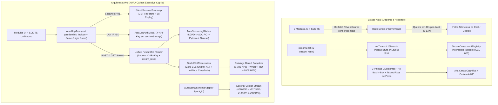
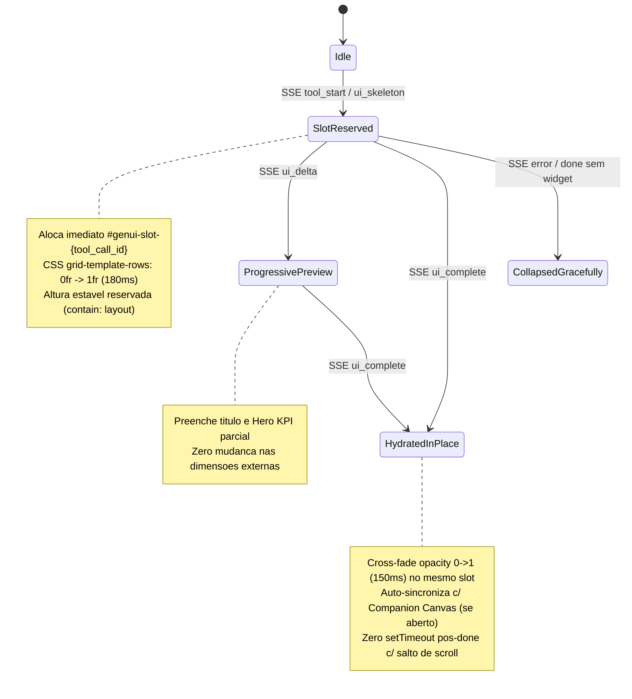

# Auditoria de Produto, Design System & Arquitetura Frontend GenUI (AURA Carbon UI)

**Data da Auditoria:** 2026-11-24
**Repositorio Auditado:** `ia-banco-local` (Escopo Exclusivo Frontend: `web/` e `web-frontend/`)
**Documento Base de Contratos:** `docs/AUDITORIA_CARBON_CORE.md` (Homologado)
**Papel da Auditoria:** Staff Product Designer & Arquiteto de Frontend Especialista em Generative UI Executiva
**Status:** Especificacao Arquitetural Homologada para Execucao pelo **Gemini 4 Neon** (Zero codigo alterado nesta etapa)

---

## Contexto, Premissas e Identidade Visual Alvo

Esta auditoria inspecionou integralmente a camada de apresentacao, transporte HTTP/SSE, gestao de estado, micro-widgets GenUI, ergonomia cognitiva e contratos TypeScript da AURA (`web/index.html`, `web/showcase.html`, `web/sw.js`, `web/manifest.json`, `web/css/aura.css`, os 18 modulos em `web/js/*.js` e os 3 modulos em `web-frontend/src/`), alinhando-a estritamente as decisoes homologadas em `docs/AUDITORIA_CARBON_CORE.md`:

1. **Alinhamento Estrito ao P0.1 (Zero-Friction Local-First + LAN Hardening):** Sessao `HttpOnly; SameSite=Strict` (`aura_local_session`) + validacao de `Origin` em `localhost` (`127.0.0.1` / `::1`) e exigencia estrita de `X-API-Key` / `Authorization: Bearer` para acessos originados em IPs da LAN (`192.168.x.x`).
2. **Alinhamento ao P0.3 & P0.4 (LGPD spaCy NER, `DomainPack` via `ContextVar` e Transacionalidade SSE):** Suporte no cliente ao evento `AuraChunkType.STREAM_RESET`, exibicao nao-intrusiva de protecao LGPD e desacoplamento visual de jargoes fixos de combustiveis para suportar as 5 verticais (`fuel_convenience`, `pharmacy_health`, `retail_supermarket`, `autocenter_parts`, `wholesale_distribution`).
3. **Alinhamento ao P1.3 & P2.4 (Catalogo Fechado GenUI Next-Gen & UX Full-Duplex):** Registro seguro de `WhatIfSimulatorUI`, `RealizedRoiScorecardUI` e `McpActionConfirmationUI` no `SecureComponentRegistry` (`OWASP LLM03`), sliders reativos para `POST /api/v1/aura/what-if/simulate` e `AudioWorklet` PCM para `WS /api/v1/voice/live`.
4. **Padrao Visual Carbon Obsidian:** Superficie profunda **Obsidian (`#07090E`)** com glassmorphism sutil de baixa carga cognitiva e semantica cromatica disciplinada em **Cyan (`#22D3EE`)**, **Emerald (`#10B981`)** e **Violet (`#8B5CF6`)**, preservando 100% de operacao offline-first (zero CDNs externas) e 60+ FPS em hardware modesto (`GPU Guard`).

> [!CAUTION]
> **Resumo Executivo de Risco Imediato no Frontend (Top 5 Achados Criticos):**
> 1. **Quebra Total de Sessao e Streaming sob P0.1 (`51` chamadas sem `credentials: "include"`):** Existem `43` chamadas `fetch`/`EventSource` em `web/js/*.js` (sendo `23` chamadas avulsas que contornam `window.auraApi`) e `8` em `web-frontend/src/api/aura-client.ts` sem `credentials: "include"`. Alem disso, `EventSource` nativo (`aura-api.js:692` e `aura-client.ts:153`) nao aceita cabecalho `X-API-Key` na LAN, e qualquer restart do `AuraBackendService` invalida o segredo efemero sem mecanismo de bootstrap automatico no cliente.
> 2. **Corrupcao Visual em Fallback de Modelos (`stream_reset` inexistente) + Erro de Compilacao TS:** Nem `aura-api.js`, nem `aura-contracts.ts`, nem `aura-chat.js` tratam `chunk_type === "stream_reset"` previsto no P0.4, concatenando respostas truncadas. Adicionalmente, `web-frontend/src/api/aura-client.ts` (linha 219) referencia `this.config.operatorId` (propriedade inexistente na classe), quebrando `tsc --noEmit`.
> 3. **Salto Abrupto de Layout (CLS) na Hidratacao GenUI:** `handleUISkeleton` (`web/js/aura-chat.js`, linhas 922-941) deixou de alocar o slot geometrico `.genui-skeleton-slot` no DOM; em seguida, `handleDoneReconciliation` (linhas 709-739) usa `setTimeout(..., 160)` apos o termino do texto para remover `.hidden` de `#${containerId}-tool-card`, empurrando abruptamente o feed de leitura.
> 4. **Bloqueio Falso-Positivo `OWASP LLM03` e Poluicao em Micro-Widgets:** Os widgets `WhatIfSimulatorUI`, `RealizedRoiScorecardUI` e `McpActionConfirmationUI` (alem de 6 titulos mapeados em `aura-chat.js:1769-1788`) nao estao registrados em `web/js/aura-genui-widgets.js`, caindo no card ambar de bloqueio `[AURA-SEC-003]`. Paralelamente, `BaseGenUIWidget.getDefaultActionsHtml()` (linhas 253-310) injeta botoes default de *"reposicao de combustivel"* em qualquer dominio.
> 5. **Fragmentacao Cromatica ("Split-Brain" de 3 Paletas), 4 Camadas de *Box-in-Box* e Colisao `Alt+P`:** Coexistem 3 conjuntos divergentes de cores entre `index.html`, `aura.css` (dois blocos `:root`) e `aura-orb.js`; o chat empilha 4 bordas aninhadas dentro de `max-w-4xl`; e o atalho `Alt+P` aciona ao mesmo tempo o **Companion Canvas** (`aura-aux-panel.js:225`) e o **Modo Pista `#000000`** (`aura-app.js:783`).

---

## Arquitetura Frontend Atual vs. Arquitetura Alvo (Carbon UI)



---

## 1. Compatibilidade de Sessao, Origin, LAN Auth e Streaming (P0)

### 1.1 Inventario Completo de Requisicoes Auditadas no Frontend

A inspecao exaustiva identificou **51 pontos de chamada de rede** em **9 arquivos**, todos desprovidos de `credentials: "include"`:

| Arquivo | Linhas Auditadas | Tipo / Quantidade | Problema Identificado sob P0.1 / P0.4 |
| :--- | :--- | :---: | :--- |
| `web/js/aura-api.js` | `20, 29, 42, 162, 437, 475, 496, 503, 520, 532, 545, 561, 574, 594, 606, 624, 653, 663, 674, 692` | `18x fetch`, `1x sendBeacon`, `1x EventSource` | Zero `credentials: "include"`; apenas linha `622` envia `X-API-Key`; `EventSource` na linha `692` impede auth por header na LAN; sem suporte a `stream_reset`. |
| `web/js/aura-chat.js` | `143` | `1x fetch` direto | Bypass de `auraApi` em `GET /api/v1/aura/sessions/${this.sessionId}` sem cookie/header LAN. |
| `web/js/aura-cockpit.js` | `46, 48, 151` | `3x fetch` diretos | Bypass em `zero-click-feed` (tentativa dupla de rota) e `POST /api/v1/aura/directives/dispatch`. |
| `web/js/aura-genui-widgets.js` | `724` | `1x fetch` direto | Fallback manual para `POST /api/v1/aura/actions/execute` sem `credentials` nem `X-API-Key`. |
| `web/js/aura-history-drawer.js` | `499, 721, 747, 761, 769` | `5x fetch` diretos | Listagem e `DELETE` de sessoes sem `credentials: "include"` nem tratamento de `401`. |
| `web/js/aura-security-architecture.js` | `54, 56` | `2x fetch` diretos | Bypass em `/api/v1/aura/security/telemetry` sem credenciais de sessao. |
| `web/js/aura-telemetry.js` | `165, 166, 266-270, 573, 802, 822, 836, 851` | `11x fetch` diretos | Leituras SRE e mutacoes administrativas (`token-budget/policy`, `memory/tenant`) falharao com `401` assim que `AURA_ENFORCE_ADMIN_AUTH="1"` entrar em vigor no P0.1. |
| `web/js/aura-voice.js` | `438` | `1x fetch` direto | Upload `Blob` em `POST /api/v1/aura/voice/transcribe` sem `credentials: "include"` e sem `X-API-Key`. |
| `web-frontend/src/api/aura-client.ts` | `87, 107, 119, 131, 153, 185, 198, 213, 230` | `8x fetch`, `1x EventSource` | Sem `credentials: "include"`; `streamChat` usa `GET EventSource` legado (expondo `query` na URL); erro de compilacao na linha `219` (`this.config.operatorId`). |

### 1.2 Armadilhas Tecnicas do Fluxo P0.1 e Solucoes Arquiteturais Obrigatorias

1. ** Isolamento Cross-Site entre `localhost` e `127.0.0.1` (`SameSite=Strict` + `Origin`):**
   - Navegadores tratam `http://localhost:8000` e `http://127.0.0.1:8000` como *sites distintos* (*schemeful same-site*). Se o operador abrir `http://localhost:8000` mas `baseUrl` estiver configurado como `http://127.0.0.1:8000`, o cookie `aura_local_session` (`SameSite=Strict`) **jamais sera enviado** pelo navegador e o cabecalho `Origin: http://localhost:8000` sera rejeitado pelo backend em `127.0.0.1:8000`.
   - **Regra Arquitetural:** Em `AuraApiClient`, `baseUrl` deve permanecer estritamente vazio (`""`, URLs relativas a mesma origem `window.location.origin`) sempre que a pagina for servida por HTTP/HTTPS no proprio host. Caso um `baseUrl` explicito aponte para loopback divergente (`localhost` vs `127.0.0.1`), normaliza-lo automaticamente para `""`.

2. **Bootstrap Silencioso de Sessao em `401` Local (Resiliencia a Reboot do Servico e PWA Cache):**
   - No P0.1, o `AuraBackendService` gera segredo efemero a cada boot e emite `Set-Cookie: aura_local_session=...; HttpOnly; SameSite=Strict` ao servir `GET /`. Se o backend reiniciar enquanto a aba da SPA estiver aberta (ou se o Service Worker `sw.js` entregar o shell em reconexao), a proxima chamada `/api/v1/...` ou `streamChat` recebera `401 Unauthorized`.
   - **Regra Arquitetural:** Implementar `ensureLocalSessionBootstrap()` dentro de `AuraApiClient`:
     - Ao receber `401` em host loopback (`window.location.hostname` em `["127.0.0.1", "::1", "localhost"]`), executar 1 unica vez `await fetch("/", { method: "GET", credentials: "include", cache: "no-store", headers: { "Accept": "text/html" } })` sob *mutex* de promessa compartilhada (`this._bootstrapPromise`, evitando *thundering herd* quando Cockpit dispara 6 chamadas em paralelo) e repetir transparentemente a requisicao original (incluindo a abertura do `POST /api/v1/aura/chat` antes do primeiro chunk SSE).

3. **Autenticacao em Terminais LAN (`192.168.x.x` / Tailscale) & Fim do `EventSource` Nativo:**
   - Quando acessado por um tablet de pista ou notebook gerencial na LAN (`!isLoopbackHost()`), o P0.1 exige `X-API-Key` ou `Authorization: Bearer`.
   - Como `new EventSource(url)` **nao permite enviar headers HTTP customizados**, `subscribeProactiveStream` (`aura-api.js:692`) e `AuraApiClient.streamChat` (`aura-client.ts:153`) quebrarao inevitavelmente na LAN.
   - **Regra Arquitetural:**
     - Substituir `EventSource` em `subscribeProactiveStream` e `aura-client.ts` por leitor assincrono baseado em `fetch(url, { method, credentials: "include", headers: this.buildHeaders({ Accept: "text/event-stream" }), signal })` + `ReadableStreamDefaultReader` com backoff exponencial (`1s -> 2s -> 5s -> 15s`, pausando quando `document.hidden === true` ou em `401` ate autenticacao).
     - Armazenar a chave LAN prioritariamente em `sessionStorage.getItem("aura_lan_api_key")` (com opcao explicita *"Lembrar neste terminal confiavel"* em `localStorage`), e exibir um modal executivo `AuraLanAuthModal` (sem `window.prompt` ou `alert`) sempre que um host nao-loopback retornar `401`.
     - Em `reportTelemetry` (`aura-api.js:487`), usar `navigator.sendBeacon` **somente** em loopback (onde o cookie `SameSite=Strict` viaja nativamente no beacon same-origin); na LAN, usar diretamente o fallback `fetch(..., { keepalive: true, credentials: "include", headers: this.buildHeaders() })` para incluir `X-API-Key`.

4. **Transacionalidade de Streaming com `stream_reset` (Alinhamento P0.4):**
   - No parser SSE de `aura-api.js` (`dispatchChunk`) e nos contratos de `aura-contracts.ts`:
     - Reconhecer `effectiveEvent === "stream_reset" || chunkData.chunk_type === "stream_reset"`.
     - Acionar callback dedicado `onStreamReset(chunkData)` que, em `aura-chat.js`, zera `fullResponseText = ""`, limpa eventuais fragmentos em `fragmentBuffer`, substitui suavemente o conteudo parcial de `#${containerId}-text` sem destruir a bolha nem causar *flicker*, e atualiza a faixa de raciocinio para *"Recalibrando sintese com modelo de contingencia..."*.

5. **Ajustes em `web/sw.js`, `web-frontend/vite.config.ts` e Bloqueio `file://`:**
   - Em `web/sw.js` (linhas 82-124): preservar `credentials: "include"` nas requisicoes de navegacao `/` e ignorar interceptacao sintetica em streams `/api/v1/aura/chat` e `/api/v1/aura/proactive/stream` (`if (request.headers.get("accept")?.includes("text/event-stream")) return;`), deixando o navegador gerenciar o stream SSE nativamente sem bufferizacao intermediaria do Service Worker. Atualizar `CACHE_NAME` para `'aura-pwa-v19'`.
   - Em `web-frontend/vite.config.ts` (linhas 23-32): configurar no proxy dev local `headers: { Origin: "http://127.0.0.1:8000" }` para `/api` e adicionar rota de bootstrap `/__aura_session_bootstrap` -> `http://127.0.0.1:8000/` apenas durante `vite dev`.
   - Em `web/index.html` (linhas 77-83): se `window.location.protocol === "file:"`, renderizar aviso executivo orientando abrir `http://127.0.0.1:8000` (ja que `Origin: null` e cookies `HttpOnly` sao incompativeis por design de seguranca).

---

## 2. Diagnostico Visual e Cognitivo: De Chat Generico a Copiloto Operacional Executivo

### 2.1 Unificacao do Design System "Carbon Obsidian" (Fim da Tripla Paleta)

Atualmente ha conflito direto entre 3 definicoes de cores:
- `web/index.html` (`tailwind.config`, linhas 34-53): `auraCyan: #06b6d4`, `auraPurple: #7c3aed`.
- `web/css/aura.css` (bloco 1, linhas 44-58 vs bloco 2, linhas 66-85): `--bg-deep: #07090e` vs `--aura-bg: #080c12`; `--cyan-main: #06b6d4` vs `--aura-accent: #35d4e4`; `--emerald-main: #10b981` vs `--aura-success: #4dcca0`; `--purple-main: #7c3aed` vs `--aura-ai: #a994ff`.
- `web/manifest.json` (linha 9) e `web/index.html` (linha 9): `theme_color: "#06b6d4"` (barra de titulo azul vibrante destoando do fundo escuro).

#### Tabela Canonica de Design Tokens (AURA Carbon UI)

| Token CSS Canonico | Valor Hex / RGBA | Papel Semantico Estrito (Baixa Carga Cognitiva) |
| :--- | :--- | :--- |
| `--carbon-obsidian` | `#07090E` | Canvas base profundo da aplicacao, `theme-color` PWA e fundo do feed editorial. |
| `--carbon-surface-1` | `rgba(12, 17, 28, 0.76)` | Superficie primaria de paineis glassmorphism (`blur(16px) saturate(140%)`). |
| `--carbon-surface-2` | `rgba(17, 24, 39, 0.88)` | Cards interativos, composer flutuante, modais e Companion Canvas. |
| `--carbon-border-subtle` | `rgba(255, 255, 255, 0.07)` | Bordas estruturais silenciosas (1px) c/ `inset 0 1px 0 rgba(255,255,255,0.04)`. |
| `--carbon-cyan` | `#22D3EE` | **Dados Deterministicos, SQL Read-Only, Telemetria, Foco Acessivel e Navegacao.** |
| `--carbon-emerald` | `#10B981` | **Conformidade Regulatoria, Saldo/ROI Positivo, Voucher Homologado e Escudo LGPD.** |
| `--carbon-violet` | `#8B5CF6` | **Raciocinio Cognitivo da IA, Sintese Executiva, Simulacao What-If e Predicao.** |
| `--carbon-amber` | `#F59E0B` | **Atencao Preventiva** (ex.: autonomia `< 24h`, turno parcial em andamento, meta 80%). |
| `--carbon-rose` | `#F43F5E` | **Excecao Critica / Risco Financeiro** (ex.: ruptura `< 15%`, quebra de caixa, erro). |

**Regra de Contencao Cromatica (Regra 85-10-5):** `85%` da area de tela permanece em tons neutros Obsidian/Slate (`#07090E`, `#0C111C`, texto `#F1F5F9` / `#94A3B8`), `10%` em superficies glass sutis e apenas `5%` nos acentos luminosos (`#22D3EE`, `#10B981`, `#8B5CF6`), reservando cores vibrantes exclusivamente para **estados acionaveis, desvios de KPI e rastros cognitivos**.

### 2.2 Arquitetura Espacial de Copiloto Executivo (Eliminacao dos 4 Niveis de *Box-in-Box*)

1. **Desencaixotamento do Console (`#view-console` e `#chat-feed-container`):**
   - **Problema atual (`web/index.html`, linhas 1006-1035):** O console fica confinado em `max-w-3xl lg:max-w-4xl` com `#chat-feed-container.glass-panel` criando uma moldura pesada ao redor das mensagens; cada resposta cria `.chat-bubble-aura` (outra moldura), que contem `.aux-companion-portal-card` (terceira moldura), que expande `.genui-hydrated-card` (quarta moldura).
   - **Solucao Carbon UI:**
     - Ampliar o container util do workspace para `max-w-5xl` em modo focado (e `min(96vw, 1760px)` com Companion Canvas aberto em `>= 1240px`).
     - Remover `.glass-panel` e borda externa de `#chat-feed-container`: as mensagens fluem diretamente sobre o fundo `#07090E`.
     - **Pergunta do Operador:** Pilula alinhada a direita compacta (`bg-white/[0.04] border border-white/[0.08] rounded-2xl px-4 py-2.5`), sem cabecalho repetitivo `"OPERADOR • HH:MM"` ocupando uma linha inteira com `border-b` (`aura-chat.js:1576-1582`).
     - **Resposta da AURA (Briefing Editorial):** Layout aberto estilo relatorio executivo (sem caixa pesada ao redor do texto; apenas guia vertical sutil ou cabecalho limpo com `AuraOrb` `22px` + `AuraReasoningRibbon`), deixando que **apenas o Micro-Widget GenUI** seja um card `.glass-panel` protagonista! Isso elimina 3 camadas redundantes de bordas de uma so vez.

2. **Executive Context Bar & Desacoplamento de Nicho (`AuraDomainThemeAdapter`):**
   - **Problema atual:** `index.html` exibe estaticamente `"Gerente Supervisora do Posto"` (linha 6), `"Menu Executivo do Posto"` (linha 105), `"ANALISE TECNICA REVENDA"` (linhas 459, 511) e cards fixos `"16 Bicos"` / `"180.000 L"` (linhas 738-756).
   - **Solucao Carbon UI:** Criar `web/js/aura-domain-adapter.js` que consome o `pack_id` retornado por `/api/v1/aura/stations` ou `/api/v1/aura/health` (padrao retrocompativel `fuel_convenience`) e adapta dinamicamente:
     - Titulo da unidade, rotulos de navegacao da sidebar, placeholders do composer (`#chat-input-text`) e os 3 indicadores do `WelcomeCockpit` (ex.: em `pharmacy_health`: *Ruptura Curva A*, *Fechamento PBM/Caixa*, *Conformidade SNGPC*; em `fuel_convenience`: *Reserva de Tanques*, *Conciliacao do Turno*, *Conformidade LMC*).

3. **Higiene de Interacao e Atalhos:**
   - **Desfazer colisao `Alt+P`:** Remover o listener `Alt+P` de `initModoPista()` em `web/js/aura-app.js` (linhas 783-795), substituindo por `Alt+Shift+M`, mantendo `Alt+P` exclusivo para o Companion Canvas (`web/js/aura-aux-panel.js:225`).
   - **Unificar classe CSS do Modo Alto Contraste:** Padronizar `body.modo-pista` em `web/css/aura.css` (corrigindo as regras orfas `body.modo-pista-active` das linhas 3973-3999).
   - **Eliminar `alert()` e `confirm()` nativos:** Substituir os `3` `alert()` de `web/js/aura-compliance.js` (linhas 319, 326, 367) e os `2` `window.confirm()` de `web/js/aura-history-drawer.js` (linhas 711, 738) por `window.auraFx.showToast(...)` e um popover assincrono `window.auraFx.confirmAction({ title, message, confirmLabel, variant: "danger" })`.
   - **Limpeza do Header Superior:** Reduzir a densidade da pílula de tokens (`#btn-header-token-tracking`, `index.html:533-550`) para exibir apenas indicador compacto de saude orcamentaria (barra + `%` ou `R$`), movendo o detalhamento `"Economia ~R$ 0,00"` e contadores brutos para o popover/modal de Telemetria SRE.

---

## 3. Evolucao da Generative UI (Micro-Widgets): KPIs, 1-Clique e Injecao Zero-CLS

### 3.1 Arquitetura de Injecao Assincrona Sem Layout Shift (`GenUISlotReservation`)



- **Correcao Cirurgica em `web/js/aura-chat.js`:**
  1. Restaurar em `handleUISkeleton(containerId, skeletonData)` (linhas 922-941) a alocacao imediata de um container `#genui-slot-${toolCallId}` dentro de `#${containerId}-tool-card` usando wrapper CSS Grid (`display: grid; grid-template-rows: 1fr; transition: grid-template-rows 180ms cubic-bezier(0.16, 1, 0.3, 1)`) com altura minima calibrada (`min-height: 88px` para o *Portal/Summary Card* no Desktop; `min-height: 210px` para o *Inline Decision Card* no Mobile).
  2. Remover o `setTimeout(..., 160)` pos-`done` em `handleDoneReconciliation` (linhas 709-739) que segurava `pendingGenUIEnvelope` escondido e causava salto de layout no fim da leitura. Quando `ui_complete` chegar, hidratar diretamente dentro do `#genui-slot-${toolCallId}` ja reservado via `requestAnimationFrame`, mantendo ancoragem de scroll estavel (`overflow-anchor: auto` no feed).
  3. Se o **Companion Canvas** (`auraAuxPanel.isOpen`) ja estiver aberto no Desktop (`>= 1240px`), atualizar automaticamente o artefato ativo ao receber `ui_complete` (sem exigir que o executivo clique repetidamente em `"Explorar no Canvas ->"` a cada pergunta da mesma investigacao).

### 3.2 Anatomia Padronizada de Micro-Widgets Executivos (Hierarquia 1-3-N)

Todos os micro-widgets em `web/js/aura-genui-widgets.js` (atuais e novos) devem seguir a anatomia **1-3-N** para leitura em menos de 3 segundos:

1. **Header Limpo de Contexto (Sem IDs Tecnicos):**
   - Remover a exibicao de `this.toolCallId.substring(0, 14)` (`call_...`) do cabecalho visivel ao executivo (manter apenas em `data-tool-call-id` no DOM e na aba tecnica `Ctrl+Alt+T`).
   - Exibir: Insignia Semantica + Titulo Executivo em Portugues + Badge de Status/Confianca (`Conforme`, `Atencao`, `Critico` ou `Confianca 94%`).
2. **Camada 1 - Hero Verdict KPI (`1` protagonista):**
   - Um unico indicador norteador em destaque (`font-mono text-2xl sm:text-3xl font-bold tabular-nums tracking-tight`), acompanhado de variacao percentual/financeira (`+R$ 4.280` em `#10B981` ou `-R$ 612` em `#F43F5E`), *bullet gauge* ou micro-barra comparativa CSS (meta vs realizado) e 1 frase BLUF (*Bottom Line Up Front*) de ate 2 linhas.
3. **Camada 2 - Supporting Triad (`ate 3` KPIs secundarios) + Evidencias sob Demanda:**
   - Ate 3 metricas de apoio separadas por divisores sutis (`divide-x divide-white/[0.06]`), sem sub-caixas pesadas.
   - Tabelas extensas (> 5 linhas), memorias de calculo e listas de regras conformes permanecem colapsadas em `<details>` ou projetadas na aba *Tabela de Dados* do Companion Canvas.
4. **Camada 3 - Barra de Acoes Contextuais 1-Clique + Voucher Auditado:**
   - **Maximo de 1 CTA Primario** (`bg-emerald-500 text-slate-950` para aprovacao/homologacao segura ou `bg-cyan-400 text-slate-950` para simulacao/inspecao) + **1 a 2 CTAs Secundarios** (`ghost`/`outline`, ex.: `Projetar no Canvas`, `Simular What-If`).
   - **Confirmacao Inline Anti-Acidente para Mutacoes Criticas:** Quando `action.is_destructive === true` ou `action.requires_confirmation === true`, o 1o clique transforma o proprio botao em um * inline two-step confirm* (`[Confirmar Envio ERP] [Cancelar]` por 5s) sem abrir modal pesado.
   - **Remocao do Fallback Enganoso:** Em `BaseGenUIWidget.getDefaultActionsHtml()` (`aura-genui-widgets.js:253-310`), remover os botoes default fixos de `"reposicao de combustivel"`. Se `actions` vier vazio, exibir apenas a acao universal de inspecao `Explorar Detalhes no Canvas` (`action_type: "inspection"`).

### 3.3 Novos Micro-Widgets Obrigatorios no `SecureComponentRegistry` (Alinhamento P1.3 & P2.4)

Registrar em `web/js/aura-genui-widgets.js` e tipar em `web-frontend/src/types/aura-contracts.ts`:

1. **`WhatIfSimulatorUI` (`render_WhatIfSimulatorUI` / aliases: `WhatIfSimulatorWidget`, `ElasticityBatchSimulatorUI`, `render_ElasticityBatchSimulatorUI`):**
   - **Proposito:** Simulador interativo de elasticidade preco-volume-margem e tamanho de lote de compra.
   - **UX Executiva:** Exibe Hero KPI de **Impacto no Lucro Liquido Mensal (`Delta R$`)**, comparativo *Cenario Base vs. Simulado* em barras horizontais duplas (`Cyan` vs `Violet`), sliders tateis de `Delta Preco (%)` / `Delta Volume (%)` / `Prazo/Lote` com *debounce* de `180ms` conectados a `POST /api/v1/aura/what-if/simulate` (com fallback matematico local imediato se offline) e CTA 1-clique `"Aplicar Pauta Simulada"`.
2. **`RealizedRoiScorecardUI` (`render_RealizedRoiScorecardUI` / aliases: `RealizedRoiScorecardWidget`):**
   - **Proposito:** Fechamento do loop *Outcome Tracker* confrontando **Impacto Projetado vs. Impacto Financeiro Realizado em R$** das decisoes tomadas com a AURA.
   - **UX Executiva:** Hero KPI de **ROI Liquido Acumulado (`R$` e multiplo `Nx`)** em `#10B981`, triade *Vazamentos Estancados*, *Ganho de Margem/Mix* e *Taxa de Captura (%)*, linha do tempo compacta das ultimas acoes auditadas com *Action Voucher* e CTA `"Exportar Relatorio Executivo"`.
3. **`McpActionConfirmationUI` (`render_McpActionConfirmationUI` / aliases: `McpActionConfirmationWidget`):**
   - **Proposito:** Card de governanca Human-in-the-Loop (HITL) para acoes externas via conectores MCP / Outbox ERP.
   - **UX Executiva:** Destaque de escopo da mutacao (*Sistema Alvo*, *Operacao*, *Reversibilidade* e *TTL da Proposta*), diff resumido `Antes -> Depois` em `Geist Mono`, trava automatica de expiracao (`AuraStateManager.isStale`) e aprovacao em 1-clique com selo criptografico HMAC (`ActionVoucher`).
4. **Aliases de Cobertura Total:** Mapear `FinancialErosionUI` -> `MarginAnalysisUI`, `MarginWaterfallUI` -> `MarginAnalysisUI`, `DeadCapitalOpportunityUI` -> `MacroeconomicInventoryCostUI`, `PumpPerformanceUI` -> `PosAuditRadarUI` e `SRETelemetryUI` -> `GenerativeModularCardUI` (eliminando 100% dos disparos acidentais de `[AURA-SEC-003]` para componentes legitimos do backend).

---

## 4. Transparencia do Raciocinio da IA (`AuraReasoningRibbon`)

### 4.1 Problema da Experiencia Atual

Hoje a transparencia cognitiva sofre dois extremos opostos:
- **Durante o streaming:** Uma unica pilula generica (`#${containerId}-cognitive-chip`) inicia sempre dizendo `"Consultando automacao da pista..."` (`aura-chat.js:684, 1610`), sem refletir sanitizacao LGPD nem diferenciar SQL Read-Only de cache semantico, e **desaparece completamente** no fim (`finalizeCognitiveStep` adiciona `.hidden` na linha 1921).
- **Apos o streaming:** O rodape `#${containerId}-telemetry` (`aura-chat.js:6141-6172`) despeja texto corrido (`Resposta em 720ms • Motor: Gemini 3.1 Flash • ⚡ 450 tokens (~R$ 0,01 • Meta: 3%) • LGPD: 2 dados protegidos`), misturando metricas internas de FinOps com confianca de dados.

### 4.2 Design do `AuraReasoningRibbon` (Tempo Real + Selo Auditavel Colapsavel)

Substituir `#${containerId}-cognitive-chip`, `#${containerId}-intent-chip`, `#${containerId}-tool-chip` e `#${containerId}-telemetry` por um componente unico, silencioso e elegante de **28px de altura** no topo do briefing da AURA:

#### A. Durante o Processamento (Pipeline Ao Vivo em 4 Estagios Claros)
A faixa exibe micro-passos horizontais com transicao suave de opacidade e ponto luminoso ativo (`6px`):

1. **`[Escudo LGPD]` (`#10B981`):** Ativo imediatamente no envio (`0ms`). Exibe `"Filtro LGPD & PII Ativo"` (atualizando para `"LGPD: N dados mascarados"` se o chunk/telemetria informar redacao spaCy NER do P0.3).
2. **`[Fonte Read-Only]` (`#22D3EE`):** Em `intent` / `tool_start` / `cache_hit`, exibe o rotulo contextual neutro ao dominio:
   - Se `cache_hit`: `"Cache Semantico Local (0 tokens)"`.
   - Se `tool_start`: `"SQL Read-Only • ${displayName}"` (sem jargao fixo de pista quando fora de `fuel_convenience`).
3. **`[Motor Deterministico]` (`#10B981`):** Em `tool_result` / `ui_skeleton`, exibe `"Calculo Python Auditado"` - comunicando ao executivo que os KPIs vieram de aritmetica deterministica e **nao** de estimativa livre da LLM.
4. **`[Sintese Executiva]` (`#8B5CF6`):** No primeiro `delta` textual, exibe `"Sintetizando recomendacao..."` (e em caso de `stream_reset` do P0.4, pulsa brevemente em `#22D3EE`: `"Recalibrando modelo de contingencia..."`).

#### B. Apos a Conclusao (`done` -> *Compact Trust Pill* Expansivel)
Ao encerrar o stream, o stepper nao some nem polui o rodape: ele se contrai suavemente em uma unica **Trust Pill** discreta ao lado do nome `AURA`:

```text
[✓ SQL Read-Only · Calculo Deterministico · LGPD Ativa (2) · 680ms ▾]
```

- **Zero poluicao na leitura:** O executivo ve instantaneamente que o numero e confiavel, auditavel, rapido e protegido pela LGPD.
- **Inspecao sob demanda (1 clique no `▾`):** Desdobra um micro-painel inline (`bg-white/[0.02] border border-white/[0.06] rounded-xl p-2.5 text-[11px] font-mono`) contendo:
  - Ferramenta / Intencao executada e origem (`PostgreSQL Read-Only` vs `Cache Semantico`);
  - Latencia `TTFT` e `Total E2E`;
  - Quantidade de entidades PII mascaradas pelo `DataSanitizer`;
  - Consumo de tokens (apenas discreto aqui dentro) e link direto `"Abrir Linhagem & Regras no Canvas ->"` (abrindo a aba `audit` do `AuraAuxPanel`).

---

## 5. Backlog Tecnico Priorizado (P0, P1, P2) e Ordem de Execucao para o Gemini 4 Neon

### Fase P0 - Compatibilidade de Sessao P0.1, Governanca de Rede e Integridade de Stream

#### [P0-UI1] Transporte Centralizado `AuraHttpTransport` (`credentials: "include"`, Same-Origin Guard, Bootstrap `401` e LAN Auth)
- **Arquivos a Modificar / Criar:**
  - `[MODIFY] web/js/aura-api.js`
  - `[NEW] web/js/aura-lan-auth.js` (ou modulo integrado em `aura-api.js` exportando `AuraLanAuthModal`)
  - `[MODIFY] web/index.html` (inclusao de script se separado + banner defensivo para `file://`)
  - `[MODIFY] web/sw.js`
- **Escopo Exato:**
  - Criar metodo base `AuraApiClient.prototype.request(path, options = {})` e `streamSse(path, options = {})` garantindo em **100%** das chamadas:
    1. Normalizacao de `this.baseUrl` para `""` quando em loopback (`localhost` / `127.0.0.1` / `::1`), preservando envio de cookie `SameSite=Strict` e `Origin` identico.
    2. `credentials: options.credentials || "include"` em todos os `fetch`.
    3. Injecao automatica de `X-API-Key` a partir de `sessionStorage.getItem("aura_lan_api_key") || localStorage.getItem("aura_api_key")` quando presente.
    4. Interceptor `401`: em loopback, executa `ensureLocalSessionBootstrap()` (`GET /` com `credentials: "include", cache: "no-store"`) sob promessa deduplicada e faz 1 replay automatico; em IP de LAN, abre `AuraLanAuthModal` em estilo Carbon Obsidian e enfileira ou permite reexecutar a acao apos autenticar.
  - Migrar `subscribeProactiveStream` (`aura-api.js:689-724`) de `new EventSource(url)` para `streamSse("/api/v1/aura/proactive/stream", { method: "GET", ... })` com `AbortController` e backoff exponencial.
  - Ajustar `reportTelemetry` (`aura-api.js:487-513`) para usar `sendBeacon` apenas em loopback sem chave customizada e `fetch(..., { keepalive: true, credentials: "include" })` na LAN.
  - Adicionar métodos faltantes no `AuraApiClient` para eliminar chamadas orfas nos demais modulos: `getSessionHistory(sessionId)`, `listSessions(limit)`, `deleteSession(sessionId)`, `clearAllSessions()`, `getZeroClickFeed(forceRefresh)`, `dispatchDirective(payload)`, `getSecurityTelemetry()`, `getTokenBudget()`, `updateTokenBudgetPolicy(payload)`, `listTenantMemories()`, `createTenantMemory(payload)`, `reviewTenantMemory(factId, action)`, `deleteTenantMemory(factId)`, `transcribeVoice(audioBlob, mimeType)` e `simulateWhatIf(payload)`.
  - Em `web/sw.js`: nao interceptar requisicoes com `Accept: text/event-stream` e atualizar `CACHE_NAME = "aura-pwa-v19"`.

#### [P0-UI2] Eliminacao Total dos `23` `fetch` Avulsos (Bypass Zero)
- **Arquivos a Modificar:**
  - `[MODIFY] web/js/aura-chat.js` (linha 143 -> `window.auraApi.getSessionHistory`)
  - `[MODIFY] web/js/aura-cockpit.js` (linhas 46-48 -> `window.auraApi.getZeroClickFeed`; linha 151 -> `window.auraApi.dispatchDirective`)
  - `[MODIFY] web/js/aura-genui-widgets.js` (linhas 719-757 -> usar sempre `window.auraApi.executeAction` ou `request`)
  - `[MODIFY] web/js/aura-history-drawer.js` (linhas 499, 721, 747, 761, 769 -> `window.auraApi.listSessions` / `deleteSession` / `clearAllSessions`)
  - `[MODIFY] web/js/aura-security-architecture.js` (linhas 54-56 -> `window.auraApi.getSecurityTelemetry`)
  - `[MODIFY] web/js/aura-telemetry.js` (linhas 165-166, 266-270, 573, 802-855 -> metodos `window.auraApi.*`)
  - `[MODIFY] web/js/aura-voice.js` (linha 438 -> `window.auraApi.transcribeVoice`)

#### [P0-UI3] Tratamento de `AuraChunkType.STREAM_RESET` + Correcao do SDK TypeScript e Proxy Vite
- **Arquivos a Modificar:**
  - `[MODIFY] web-frontend/src/types/aura-contracts.ts`
  - `[MODIFY] web-frontend/src/api/aura-client.ts`
  - `[MODIFY] web-frontend/vite.config.ts`
  - `[MODIFY] web/js/aura-api.js`
  - `[MODIFY] web/js/aura-chat.js`
- **Escopo Exato:**
  - Adicionar `"stream_reset"` e `"proactive_alert"` na union `AuraChunkType` em `aura-contracts.ts`.
  - Corrigir o bug de compilacao `this.config.operatorId` -> `this.operatorId` em `aura-client.ts:219`, adicionar `credentials: "include"` em todos os `fetch` de `aura-client.ts`, e converter `streamChat` de `EventSource` `GET` para `POST /api/v1/aura/chat` com `ReadableStream` + `AbortController` (paridade 1:1 com `web/js/aura-api.js`).
  - Implementar `onStreamReset` em `aura-api.js` e `aura-chat.js` limpando `fullResponseText` e buffer parcial do DOM quando o backend acionar fallback de LLM no meio da geracao.
  - Configurar `headers: { Origin: "http://127.0.0.1:8000" }` no proxy de desenvolvimento em `vite.config.ts`.

---

### Fase P1 - Padrao Visual Carbon Obsidian, GenUI Zero-CLS, Catalogo P1.3 e `AuraReasoningRibbon`

#### [P1-UI1] Consolidacao de Design Tokens Obsidian (`#07090E`) e Ergonomia Executiva
- **Arquivos a Modificar / Criar:**
  - `[MODIFY] web/css/aura.css`
  - `[MODIFY] web/index.html`
  - `[MODIFY] web/showcase.html`
  - `[MODIFY] web/manifest.json`
  - `[MODIFY] web/js/aura-app.js`
  - `[MODIFY] web/js/aura-fx.js`
  - `[MODIFY] web/js/aura-compliance.js`
  - `[MODIFY] web/js/aura-history-drawer.js`
- **Escopo Exato:**
  - Unificar os dois blocos `:root` de `web/css/aura.css` e o `tailwind.config` de `index.html`/`showcase.html` na paleta oficial Obsidian (`#07090E`), Cyan (`#22D3EE`), Emerald (`#10B981`) e Violet (`#8B5CF6`), atualizando `<meta name="theme-color" content="#07090E">` e `manifest.json`.
  - Refatorar `#view-console` e `#chat-feed-container` para o padrao **Editorial Briefing Stream** (removendo o caixote `.glass-panel` externo do feed e reduzindo os 4 niveis de *box-in-box* para 1 unico card no micro-widget).
  - Corrigir a colisao `Alt+P` (`aura-app.js:783` muda para `Alt+Shift+M`), alinhar `body.modo-pista` no CSS e substituir todos os `alert()` / `window.confirm()` por `auraFx.showToast` e `auraFx.confirmAction`.

#### [P1-UI2] `AuraReasoningRibbon` (Transparencia em Tempo Real SQL, Determinismo Python e LGPD)
- **Arquivos a Modificar / Criar:**
  - `[NEW] web/js/aura-reasoning-ribbon.js` (ou classe dedicada integrada em `aura-chat.js` + estilos em `aura.css`)
  - `[MODIFY] web/js/aura-chat.js`
  - `[MODIFY] web/css/aura.css`
- **Escopo Exato:**
  - Implementar o stepper horizontal de `28px` em tempo real (`Filtro LGPD` -> `SQL Read-Only / Cache` -> `Calculo Python` -> `Sintese Executiva`) e sua contracao pos-`done` na **Trust Pill** clicavel (`✓ SQL Read-Only · Calculo Deterministico · LGPD (N) · Xms ▾`), aposentando o rodape poluido de `updateTelemetryBadge` e os textos fixos `"Consultando automacao da pista..."`.

#### [P1-UI3] Injecao Assincrona Zero-CLS (`GenUISlotReservation`) e Sincronizacao Fluida com Canvas
- **Arquivos a Modificar:**
  - `[MODIFY] web/js/aura-chat.js`
  - `[MODIFY] web/js/aura-aux-panel.js`
  - `[MODIFY] web/css/aura.css`
- **Escopo Exato:**
  - Alocar slot geometrico estavel em `handleUISkeleton` / `updateToolStartStatus`, hidratar `ui_delta` progressivamente sem mutar dimensoes externas, remover o `setTimeout(..., 160)` pos-`done` que causava salto vertical e hidratar `ui_complete` *in-place* com cross-fade suave + auto-sync no Companion Canvas quando aberto.

#### [P1-UI4] Novos Micro-Widgets GenUI (`WhatIfSimulatorUI`, `RealizedRoiScorecardUI`, `McpActionConfirmationUI`) e Hierarquia 1-3-N
- **Arquivos a Modificar:**
  - `[MODIFY] web/js/aura-genui-widgets.js`
  - `[MODIFY] web-frontend/src/types/aura-contracts.ts`
- **Escopo Exato:**
  - Implementar e registrar no `SecureComponentRegistry` os 3 novos micro-widgets homologados no P1.3 (`WhatIfSimulatorUI`, `RealizedRoiScorecardUI`, `McpActionConfirmationUI`) + todos os aliases pendentes (`FinancialErosionUI`, `MarginWaterfallUI`, `DeadCapitalOpportunityUI`, `ElasticityBatchSimulatorUI`, `PumpPerformanceUI`, `SRETelemetryUI`).
  - Padronizar a hierarquia **1-3-N** (1 Hero KPI `28px` tabular + ate 3 KPIs secundarios + 1 CTA primario contextual com confirmacao inline 2-passos para acoes destrutivas), ocultar `tool_call_id` do cabecalho executivo e limpar `BaseGenUIWidget.getDefaultActionsHtml()` de acoes fixas de combustivel.

#### [P1-UI5] Adaptador Visual Multi-Vertical (`AuraDomainThemeAdapter`)
- **Arquivos a Criar / Modificar:**
  - `[NEW] web/js/aura-domain-adapter.js`
  - `[MODIFY] web/js/aura-welcome-cockpit.js`
  - `[MODIFY] web/js/aura-cockpit.js`
  - `[MODIFY] web/index.html`
- **Escopo Exato:**
  - Parametrizar rotulos de unidade, placeholders do composer, chips de sugestao inicial e os 3 KPIs do `AuraWelcomeCockpit` de acordo com o `pack_id` ativo da sessao/estacao (`fuel_convenience` como default completo preservado, destravando `pharmacy_health`, `retail_supermarket`, `autocenter_parts` e `wholesale_distribution`).

---

### Fase P2 - Voz Live Full-Duplex (`AudioWorklet`), Simulacao Interativa What-If e Polimento Avancado

#### [P2-UI1] Streaming Bidirecional `AudioWorklet` PCM no `WS /api/v1/voice/live`
- **Arquivos a Criar / Modificar:**
  - `[NEW] web/js/aura-audio-worklet.js`
  - `[MODIFY] web/js/aura-voice.js`
  - `[MODIFY] web/js/aura-orb.js`
  - `[MODIFY] web/sw.js` (inclusao do worklet no `PRECACHE_ASSETS`)
- **Escopo Exato:**
  - Conectar `AuraVoiceController` ao endpoint `WS /api/v1/voice/live` (respeitando sessao `aura_local_session` em `localhost` e token/query de autorizacao homologado na LAN), capturando PCM 16 kHz mono via `AudioWorkletNode` e reproduzindo audio 24 kHz da AURA com *barge-in* instantaneo e modulacao RMS real no `AuraOrb` a 60 FPS (mantendo Web Speech API + `/api/v1/aura/voice/transcribe` como fallback automatico).

#### [P2-UI2] Acoplamento Ao Vivo dos Sliders `WhatIfSimulatorUI` e Graficos Sparkline Nativos no Canvas
- **Arquivos a Modificar:**
  - `[MODIFY] web/js/aura-genui-widgets.js`
  - `[MODIFY] web/js/aura-aux-panel.js`
- **Escopo Exato:**
  - Conectar os sliders interativos de `WhatIfSimulatorUI` ao endpoint deterministico `POST /api/v1/aura/what-if/simulate` (com debounce de `180ms`, *AbortController* por arrasto e curva visual de sensibilidade renderizada em `<canvas>`/SVG nativo zero-lib no Companion Canvas).

---

## Ordem Recomendada de Execucao para o Gemini 4 Neon

Para garantir risco minimo de regressao e validacao incremental limpa, o **Gemini 4 Neon** deve executar o backlog exatamente nas **4 Ondas Sequenciais** abaixo:

| Onda | Escopo Agrupado | Dependencia no Backend (`AUDITORIA_CARBON_CORE.md`) | Criterio Objetivo de Saida (Gate de Qualidade) |
| :---: | :--- | :--- | :--- |
| **Onda 1 (P0)** | `P0-UI1` + `P0-UI2` + `P0-UI3` (Transporte `credentials: "include"`, Fim de `EventSource` e `fetch` avulsos, Bootstrap `401`, `AuraLanAuthModal`, `stream_reset`, Fix TS) | Alinhado ao **P0.1** e **P0.4** | Zero `fetch(` fora de `aura-api.js` / `aura-client.ts`; `npm --prefix web-frontend run build` 100% verde (`tsc --noEmit` sem erros); streaming SSE + replay `401` local + modal LAN + `stream_reset` validados. |
| **Onda 2 (P1 Core UX)** | `P1-UI1` + `P1-UI2` + `P1-UI3` (Tokens Obsidian `#07090E`, Desencaixotamento Editorial, Fix `Alt+P`, `AuraReasoningRibbon` e `GenUISlotReservation` Zero-CLS) | Alinhado ao **P0.3** (contagem LGPD) | Paleta unificada em `:root` + Tailwind; CLS `< 0.01` durante hidratacao SSE; `Alt+P` abre apenas o Canvas; `AuraReasoningRibbon` transita pelos 4 estagios e contrai em *Trust Pill*; zero `alert()`/`confirm()`. |
| **Onda 3 (P1 GenUI & Packs)** | `P1-UI4` + `P1-UI5` (`WhatIfSimulatorUI`, `RealizedRoiScorecardUI`, `McpActionConfirmationUI`, Hierarquia 1-3-N, Aliases `SecureComponentRegistry` e `AuraDomainThemeAdapter`) | Alinhado ao **P0.4** (DomainPacks) e **P1.3** | Zero cards ambar `[AURA-SEC-003]` para os widgets do catalogo; `BaseGenUIWidget` sem acoes fixas de combustivel; troca de `pack_id` adapta saudacao, sidebar e `WelcomeCockpit` sem quebrar `fuel_convenience`. |
| **Onda 4 (P2 Next-Gen)** | `P2-UI1` + `P2-UI2` (`AudioWorklet` Live Voice `WS /api/v1/voice/live` + Sliders What-If em tempo real no Canvas) | Alinhado ao **P2.4** | Sessao de voz bidirecional com *barge-in* e fallback automatico; sliders recalculam margem/volume em `< 200ms` sem travar a thread principal. |

---

## Comandos de Verificacao Recomendados para a Fase de Implementacao (Gemini 4 Neon)

1. **Auditoria Estatica de Governanca de Rede e Zero Travessoes:**
   ```powershell
   # Deve retornar apenas aura-api.js, sw.js e aura-client.ts:
   Select-String -Path "web/js/*.js", "web-frontend/src/**/*.ts" -Pattern "\bfetch\s*\(|new\s+EventSource"
   ```
2. **Typecheck Estrito & Build do SDK Frontend TypeScript:**
   ```powershell
   npm --prefix web-frontend run build
   ```
3. **Suite Automatizada de Contratos GenUI, Seguranca e Zero-Click:**
   ```powershell
   pytest tests/unit/test_zero_click_cockpit_and_security.py tests/unit/test_action_vouchers.py -v
   ```
4. **Checklist Visual & Cognitivo no Navegador (`http://127.0.0.1:8000`):**
   - Verificar em *DevTools -> Network* que `POST /api/v1/aura/chat` e `/api/v1/aura/proactive/stream` enviam `Cookie: aura_local_session=...` (`credentials: "include"`), renovam sessao automaticamente se o backend reiniciar, e solicitam `X-API-Key` quando abertos pelo IP da placa de rede local (`http://192.168.x.x:8000`).
   - Confirmar fundo `#07090E`, acentos `#22D3EE` / `#10B981` / `#8B5CF6`, ausencia de salto de scroll ao hidratar cards GenUI (`CLS = 0`), operacao isolada de `Alt+P` (Canvas) vs `Alt+Shift+M` (Modo Alto Contraste) e `GPU Guard` a 60 FPS cravados.
