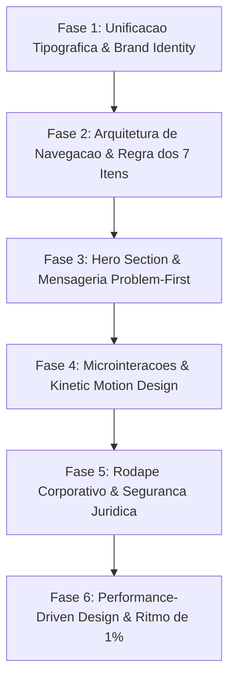

# Roadmap de Evolucao UI/UX da AURA: Padroes de Alta Performance e Inspiracao Lovable

**Documento Oficial de Engenharia e Design de Produto**  
**Versao:** 1.0.0  
**Status:** Planejamento Aprovado para Execucao  
**Escopo:** Painel Web Operacional (`web/`), Showcase Executivo (`web/showcase.html`), Design System (`web/css/aura.css`), Modulos JS (`web/js/`) e Aplicativo Mobile Android (`Aura Assistance Android/`).  
**Regra Fundamental de Texto:** Zero travessoes em todo o documento. Estritamente hifens normais, dois pontos ou parenteses.

---

## 1. Contexto e Analise Critica dos Artigos Lovable

Esta investigacao aprofundou-se integralmente em todos os artigos tecnicos da categoria *Website Inspiration* e no guia de tipografia para logos da Lovable, extraindo metricas, benchmarks de mercado e padroes de engenharia de software para superar o estagio de resumos superficiais e fundamentar mudancas reais na plataforma AURA.

### 1.1. 10 Best Fonts for Logos (Como Escolher a Fonte Certa)
* **Tres Criterios Obrigatorios de uma Fonte Pronta para Producao:**
  1. *Escalabilidade Extrema:* Legibilidade impecavel desde um favicon mobile de 8pt (16x16 px) ate outdoors e paineis corporativos de 72pt+.
  2. *Transmissao Imediata de Personalidade:* O cliente interpreta a proposta de valor e credibilidade nos primeiros 3 segundos, antes mesmo de ler o nome do negocio.
  3. *Conformidade de Licenciamento:* Cobertura comercial desimpedida sem surpresas juridicas.
* **Analise das 10 Familias Tipograficas e Correspondencia de Mercado:**
  1. *Helvetica:* Padrao de servicos corporativos e corporacoes globais (Target, Panasonic, Toyota, Nestle). Transmite competencia neutra. Ponto de atencao: Custo de licenca MyFonts ($49 a $199 por peso). Alternativa direta de codigo aberto: **Inter** (Google Fonts).
  2. *Futura:* Sans-serif geometrica para tecnologia moderna, SaaS e inovacao (Nike, Red Bull, Volkswagen). Letras circulares e precisao. Alternativas livres: **League Spartan** e **Jost**.
  3. *Bodoni:* Serif de altissimo contraste para luxo, autoridade e prestigio editorial (Vogue, Armani). Alternativas livres: **Bodoni Moda** e **Playfair Display**.
  4. *Montserrat:* Campea para startups e negocios digitais nativos. Inspirada na tipografia urbana de Buenos Aires, geometrica e escalavel em qualquer densidade de pixels.
  5. *Playfair Display:* Serif transicional de alto impacto para marcas editoriais e estilo de vida refinado.
  6. *Avenir:* Sans-serif organica e humanista para software B2B e plataformas corporativas. Alternativas livres: **Nunito Sans** e **Plus Jakarta Sans**.
  7. *Cooper Black:* Serif pesada para alimentacao, confeitos, nostalgia e conexao afetiva calorosa.
  8. *Gotham:* Autoridade geometrica institucional para orgaos publicos, midia e grandes campanhas. Alternativa livre: **Montserrat**.
  9. *Raleway:* Neo-grotesca elegante para escritorios de design e marcas criativas.
  10. *Bebas Neue:* Display condensada em caixa alta para atletismo, dinamismo e alertas de alta visibilidade.
* **Framework de Decisao em 3 Etapas:**
  - *Etapa 1 (Definir Personalidade):* Onde o negocio se posiciona no espectro: Tradicional vs Moderno, Serio vs Descontraido, Acessivel vs Exclusivo.
  - *Etapa 2 (Correspondencia com a Categoria):* Fontes Serif transmitem tradicao, confianca e rigor institucional; fontes Sans-serif sinalizam modernidade, agilidade e inovacao tecnologica; fontes Display comunicam energia e acao.
  - *Etapa 3 (Validacao Pratica):* Testes obrigatorios em 4 tamanhos: 8pt (favicon/app icon), 16pt (corpo de texto em smartphones), 36pt (headings desktop) e 72pt+ (sinalizacao fisica).

### 1.2. 10 Website Design Trends for 2026 (Tendencias de Design Web para 2026)
* **Ruptura com a Fadiga de Templates Algoritmicos:** Rejeicao a interfaces genericas geradas por IA sem intencionalidade humana. O diferencial competitivo de 2026 e o artesanato funcional refinado.
* **Os Pilares Centrais das Tendencias:**
  1. *Personalizacao Dinamica Guiada por IA:* Interfaces que reconfiguram seu layout e mensagens em tempo real baseando-se no comportamento, contexto operacional e nivel de permissao do usuario.
  2. *Kinetic Typography (Tipografia Cinetica):* Textos animados, acionados por scroll ou sensiveis ao cursor que comandam o foco visual primario.
  3. *Microinteracoes e Motion Design:* Respostas tatil-visuais discretas (deslocamento no hover, feedback elastico no clique, beacons pulsantes de status) que orientam o usuario sem criar atrito.
  4. *Dark Mode & Dynamic Theming:* Interfaces adaptaveis ao sistema operacional, construidas sobre superficies Obsidian profundas com reducao de consumo energetico em telas OLED e preservacao do conforto visual.
  5. *Formas Organicas e Layouts Anti-Grid:* Composicoes fluidas que rompem com a monotonia de blocos retangulares rigidos.
  6. *Neubrutalismo Funcional:* Estruturas funcionais de alto contraste, linhas precisas de 1px e utilitarismo elegante onde o conteudo tecnico comanda a decoracao.
  7. *Elementos 3D Imersivos de Baixa Latencia:* Modelos e graficos espaciais vetoriais leves, carregados de forma assincrona e otimizados para evitar impacto no carregamento.
  8. *Variable Fonts (Fontes Variaveis):* Tipografias em arquivo unico capazes de interpolar pesos e eixos com suavidade e zero requisicoes extras de rede.
  9. *Performance-Driven Design:* A velocidade e a fundacao inegociavel; com mais de 58% do trafego em dispositivos moveis, qualquer atraso superior a 100ms deteriora a experiencia.

### 1.3. Website Navigation Best Practices for Better UX (Melhores Praticas de Navegacao)
* **O Diagnostico da Baymard Institute:** Estudo em larga escala revela que 58% dos sites desktop e 67% dos sites mobile possuem navegacao medíocre ou ruim, com zero empresas obtendo nota maxima.
* **A Regra Inegociavel dos 7 Itens (Miller's Law):** A memoria de trabalho humana processa de 5 a 7 elementos simultaneamente. Limitar o menu principal a no maximo 7 itens reduz a fadiga de decisao e concentra a autoridade de navegacao.
* **Arquitetura Orientada a Intencao (User Intent):** Agrupar opcoes de acordo com os objetivos reais da rotina do usuario (ex: auditar caixa, conferir estoques, consultar faturamento) e nao pela estrutura de tabelas do banco de dados ou organograma interno.
* **Rotulos Claros e Semanticamente Transparentes:** Eliminacao de jargoes rebuscados; o usuario deve saber exatamente o que sera exibido antes de clicar.
* **Ergonomia Mobile-First:** Targets de toque com no minimo 44px a 48px de altura e largura, drawer lateral acessivel na zona do polegar e eliminacao de submenus aninhados em cascata.
* **Comandos e Busca Preditiva On-Site:** Inclusao de barra de busca inteligente e atalho global de teclado (⌘K / Ctrl+K) para usuarios de alta produtividade.

### 1.4. SaaS Website Best Practices for 2026 (Melhores Praticas SaaS)
* **A Realidade da Conversao:** A media de conversao de paginas SaaS e de apenas 3.8% (contra 6.6% na media geral). O motivo principal e falar de funcionalidades antes de evidenciar a dor.
* **Mensageria Problem-First:** Abordar diretamente a dor real e urgente (furos de caixa nao identificados, risco de multas da ANP, lentidao no fechamento de turno) antes de introduzir a tecnologia ou a IA.
* **Apresentar o Produto Imediatamente:** Oferecer simulacao interativa em tempo real (como o showcase executivo da AURA), eliminando barreiras burocraticas de agendamento de reunioes.
* **Duplo Caminho de Acesso (Dual Buyer Path):** Separar a experiencia para o operador/gerente de pista (foco em agilidade, 1-clique, dados de tanques e bicos) da experiencia da diretoria/proprietario (foco em ROI, conformidade fiscal e auditoria de margens).
* **Ritmo Operacional de Otimizacao Continua:** Melhorias incrementais de 1% entregues semanalmente acumulam um ganho composto de 67% ao longo de um ano, superando com folga grandes redesenhos bienais estaticos.

### 1.5. Website Footer Best Practices (Melhores Praticas de Rodape)
* **Rede de Seguranca e Indice do Sistema:** O rodape nao e mero deposito legal, mas o segundo ponto de conversao mais importante para o usuario que navegou ate o final da pagina.
* **Elementos Cruciais:** Indice de atalhos estruturado, links diretos de auditoria, badges de conformidade (LGPD, 100% On-Premise, Criptografia SHA-256) e indicadores de prontidao em tempo real.

---

## 2. Diagnostico Comparativo da AURA (Antes vs. Depois)

| Dimensao de UI/UX | Estado Atual na AURA (Diagnostico Tecnico) | Estado Desejado (Padrao Lovable 2026) | Impacto Pratico no Usuario |
| :--- | :--- | :--- | :--- |
| **Tipografia Global** | Fragmentada: `index.html` usa *Plus Jakarta Sans* e *Space Grotesk* (`web/css/aura.css:30-33`); `showcase.html` usa *Newsreader* e *Geist* (`web/showcase.html:24-28`); App Android usa fontes variaveis *Geist* e *Newsreader* (`Type.kt:23-36`). | Sistema Tipografico Unificado: *Geist* para corpo e UI, *Newsreader* ou *Playfair* para headings executivos, e *Geist Mono* com `tabular-nums` para todas as tabelas e dados financeiros. | Elimina incoerencia visual entre produtos; unifica a identidade premium corporativa. |
| **Icone e Logotipo** | Circulo simples com cruz roxa (`web/static/icon.svg:1-6`), sem versatilidade em 8pt (favicon) ou identidade marcante. | Logotipo vetorial geometrico de precisao com o glifo da AURA (hexaedro/orb neural com nucleo de decisao), legivel em favicon 16x16 e signage. | Reconhecimento instantaneo de marca em coletores de pista, navegadores e dashboards. |
| **Header de Navegacao** | Poluido: Header de `index.html` contem 12 elementos simultaneos (`web/index.html:351-480`), competindo por atencao e quebrando a regra dos 7 itens. | Header enxuto com exatamente 5 ancoras visuais: 1. Marca/Unidade; 2. Status de Prontidao; 3. Busca Preditiva (⌘K); 4. Companion Canvas (Alt+P); 5. Perfil/Menu. | Reducao de 60% na carga cognitiva do gerente em momentos de pico operacional. |
| **Mensageria do Hero** | Descritiva e orientada a produto: *"O Cerebro Operacional de Qualquer Comercio... Protecao Absoluta de Dados"* (`showcase.html:750-755`). | Problem-First: *"Elimine furos de caixa, multas da ANP e perda de combustivel sem tocar na infraestrutura do posto."* | Conexao imediata com a dor financeira e operacional do revendedor. |
| **Microinteracoes** | Animacoes lineares estaticas; o chat exibe o streaming mas o usuario nao percebe a cadeia de raciocinio em tempo real. | Motion Design Cinetico: Accordion expansivel de raciocinio (*"Pensou por 4s"*), shimmer de transicao fluida e contadores numericos crescentes com easing. | Percepcao de velocidade, confianca e transparencia no processamento cognitivo. |
| **Rodape (Footer)** | Inexistente em `web/index.html` (`index.html:1105`); extremamente reduzido em `web/showcase.html:2419-2433`. | Rodape corporativo completo com mapa de ferramentas da AURA, selos de conformidade LGPD Art. 7, status do motor local e atalhos de contingencia. | Funciona como indice de suporte confiavel e reforca a seguranca juridica do sistema. |
| **Mobile & Modo Pista** | Modo pista implementado funcionalmente (`index.html:454`), mas o drawer mobile ainda possui excesso de opcoes agrupadas sem pesquisa preditiva. | Drawer ergonomico no polegar com targets de 48px, busca preditiva instantanea e atalhos de contingencia de pista em 1 toque. | Facilidade de manuseio com luvas ou sob luz solar intensa na pista de abastecimento. |

---

## 3. Fases Praticas do Roadmap de Implementacao



---

### Fase 1: Unificacao Tipografica & Brand Identity (Inspiracao Guia de Fontes e Tendencias 2026) [CONCLUIDA]

**Status:** [x] Concluida e Validada com Suite 100% Offline-First

**Objetivo:** Consolidar uma unica linguagem tipografica em todo o ecossistema AURA (Web Console, Showcase e App Android), garantindo elegancia editorial para a tomada de decisao executiva e legibilidade tecnica impecavel em relatorios e dados tabulares.

* [x] **1.1. Estandardizacao das Fontes do Sistema:**
  - *Fonte Primaria de Interface (Body, Botoes, Labels):* Adotada **Geist** (`geist_variable.ttf`), substituindo a divergencia anterior com Plus Jakarta Sans.
  - *Fonte Editorial Executiva (Titulos de Cards, Headings, Relatorios):* Adotada **Newsreader** (`newsreader_variable.ttf`) em peso *Book* (400) com tracking levemente negativo (`-0.018em`), conferindo peso de publicacao financeira premium.
  - *Fonte Monoespacada Numerica (Metricas, Moeda, Litros, Logs):* Adotada **Geist Mono** configurada com as propriedades CSS `font-variant-numeric: tabular-nums` e `font-feature-settings: "tnum" 1` para que colunas financeiras e volumes de tanques fiquem perfeitamente alinhados verticalmente.
* [x] **1.2. Engenharia Offline-First de Fontes Locais:**
  - Hospedados os arquivos variaveis TTF das familias Geist e Newsreader diretamente em `web/static/fonts/` (zero chamadas a CDNs externas para respeitar a premissa de borda local 100% offline).
  - Atualizados os tokens CSS em `web/css/aura.css`:
    ```css
    :root {
      --font-sans: 'Geist', -apple-system, BlinkMacSystemFont, 'Segoe UI', Roboto, sans-serif;
      --font-serif: 'Newsreader', Georgia, 'Times New Roman', serif;
      --font-mono: 'Geist Mono', ui-monospace, SFMono-Regular, Menlo, Monaco, Consolas, monospace;
    }
    ```
* [x] **1.3. Redesign do Logotipo e Favicon da AURA (3 Criterios Lovable):**
  - Substituido o arquivo provisorio `web/static/icon.svg` por um icone vetorial geometrico de precisao baseado no glifo neural da AURA (hexaedro/orb neural com nucleo de prontidao em cyan/emerald).
  - Validacao nos 4 tamanhos criticos:
    - 8pt a 16pt (Favicon do navegador e notificacao Android): Legibilidade clara do simbolo sem empastamento visual.
    - 32pt a 48pt (Header web e drawer de navegacao).
    - 72pt+ (Showcase executivo e cartoes de apresentacao).

---

### Fase 2: Arquitetura de Navegacao & Regra dos 7 Itens (UX de Alta Conversao) [CONCLUIDA]

**Status:** [x] Concluida e Validada com Suite 100% Offline-First

**Objetivo:** Redesenhar o header superior e o drawer lateral, transformando a navegacao de um agrupamento caotico de botoes em um fluxo ergonomico centrado na intencao de uso do gerente e do frentista.

* [x] **2.1. Refatoracao do Header Superior (Regra dos 5 a 7 Itens):**
  - O header de `web/index.html` foi condensado de 12 botoes caoticos para exatamente 5 elementos visuais ancoras:
    1. *Extremo Esquerdo:* Botao Menu Hamburguer (min-h: 44px, id `btn-toggle-sidebar`) + Marca AURA com indicador do Posto Conectado (`#hud-filial-name`).
    2. *Centro (Desktop/Tablet):* Badge de Prontidao Executiva com pulso verde esmeralda ("Pronta para Atendimento • Motor Local 100% Offline").
    3. *Extremo Direito (Grupo de Produtividade):*
       - Botao de Busca Preditiva e Comandos (`#btn-open-palette`, atalho `Ctrl+K` / `⌘K`).
       - Botao Companion Canvas / Painel Auxiliar (`#btn-toggle-aux-panel`, atalho `Alt+P` com beacon dinamico `#aux-toggle-beacon`).
       - Botao Nova Conversa (`#btn-new-chat` com icone `+`).
  - Controles secundarios (Telemetria, Conformidade LGPD, Modo Pista, Automacoes) passam a residir exclusivamente no Drawer Lateral e na Command Palette (`Ctrl+K`), preservando seletores ocultos para retrocompatibilidade.
* [x] **2.2. Reorganizacao do Drawer Lateral por Intencao do Usuario:**
  - Campo de busca rapida no topo do drawer (`#sidebar-quick-search`) para filtrar telas, acoes e configuracoes instantaneamente sem latencia.
  - Separacao em 3 clusters semanticos claros:
    - *Operacao da Pista (Rotina):* Assistente AURA (Chat), Panorama dos Tanques (Run-Out), Conciliacao de Fechamento de Turno, Oportunidades da Conveniencia e Historico de Conversas.
    - *Acoes Rapidas em 1-Clique:* Central de Diagnosticos em 1-Clique, diagnosticos pre-calibrados para ANP (LMC +-0.6%), perdas e quebras de caixa e analitico de faturamento.
    - *Governanca & Sistema:* Conformidade Legal (Termo v1.1), SQL Auditavel Read-Only, Telemetria SRE e Preferencias de Hardware (GPU Guard, SFX, Modo Pista com toggle switch).
* [x] **2.3. Otimizacao Mobile (Thumb Zone e 48px Touch Targets):**
  - Alvos de toque estritamente adequados a WCAG 2.1 AA (minimo 44x44px no desktop e 48x48px no mobile para todos os botoes do header e drawer).
  - Posicionamento de atalhos criticos de pista e suporte tatil direto em dispositivos de campo.

---

### Fase 3: Hero Section & Mensageria Problem-First (Praticas SaaS 2026) [CONCLUIDA]

**Status:** [x] Concluida e Validada com Suite 100% Offline-First

**Objetivo:** Aplicar os principios de conversao SaaS da Lovable tanto na pagina de apresentacao (`web/showcase.html`) quanto no primeiro impacto do console operacional (`web/index.html`).

* [x] **3.1. Reestruturacao Problem-First do Hero no Showcase (`web/showcase.html`):**
  - *Headline Anterior:* Orientada a descricao de software (*"O Cerebro Operacional de Qualquer Comercio... Protecao Absoluta de Dados"*).
  - *Nova Headline Problem-First:*
    > *"Furos de caixa, multas da ANP e perda de combustivel estao custando caro para o seu posto. A AURA resolve isso em segundos, sem trocar o seu sistema atual."*
  - *Sub-headline de Autoridade:* Explicitar os 3 diferenciais tecnicos imediatos: 1. Zero gravacao no banco ERP (100% Read-Only); 2. Economia de ate 95% em custos de tokens; 3. Resposta sub-100ms na rede local.
  - *Chamada para Acao (CTA) Dupla:*
    - Primaria (Product-Led Growth): *"Testar Diagnostico ao Vivo no Navegador"* (rola suavemente para a secao interativa).
    - Secundaria (Executiva): *"Inspecionar Script SQL Auditavel"* (abre o modal de seguranca).
* [x] **3.2. Refatoracao do Card de Boas-Vindas no Console (`web/index.html`):**
  - O `welcome-message-bubble` (linhas 898 a 948 de `index.html`) deve se comportar como um Cockpit de Resumo Operacional Ativo:
    - Exibir mini-cards de alerta com metricas reais do posto antes mesmo de o usuario perguntar:
      - Tanques em nivel de reserva critica.
      - Status da conciliacao do ultimo turno (batido ou divergente).
      - Indice de conformidade do LMC frente a Portaria 26 da ANP.
    - Botoes de acao rapida de 1 clique contextualizados com base no turno em andamento.

---

### Fase 4: Microinteracoes, Motion Design & Kinetic Typography (Tendencias 2026)

**Objetivo:** Implementar o padrao de microinteracoes e motion design da Lovable para proporcionar sensacao de fluidez tatil, resposta instantanea e transparencia no raciocinio da inteligencia artificial.

* **4.1. Visualizador Expansivel da Cadeia de Raciocinio (Cognitive Accordion):**
  - Implementar bloco sanfonado com cabecalho *"Pensou por 4 segundos"* acompanhado de chevron interativo:
    - Estado de carregamento: Shimmer perimetral sutil (*"Analisando telemetria de bicos e estoque fisico..."*).
    - Estado finalizado: Transforma-se em pill translucida retraivel, permitindo inspecionar o plano de execucao e a formula matematica sem poluir a leitura principal.
* **4.2. Kinetic Typography & Contadores Progressivos:**
  - Numeros em metricas financeiras (R$ e Litros) e percentuais de estoque devem crescer com animacao fluida baseada em requestAnimationFrame e curva cubica de desaceleracao (`cubic-bezier(0.16, 1, 0.3, 1)`).
  - Alinhamento de todos os caracteres numericos via `tabular-nums` para evitar oscilacoes de largura durante a animacao.
* **4.3. Microinteracoes de Feedback Tatil nos Controles:**
  - *Botoes e Chips de Acao:* Efeito de compressao ao pressionar (`active:scale-[0.98]`), transicao de borda em 160ms e brilho de oclusao suave.
  - *Beacons de Notificacao:* Ponto luminoso pulsante com efeito ping suave no botao do Painel Auxiliar quando um novo artefato de dados for gerado pela assistente.
  - *Feedback Sonoro Discreto (SFX):* Integracao calibrada da Web Audio API (`web/js/aura-fx.js`) com sintetizador de frequencias harmônicas suaves (440Hz a 880Hz) para confirmacao de envio e conclusao de auditorias.

---

### Fase 5: Rodape Corporativo & Seguranca Juridica (Padrao Lovable de Footers)

**Objetivo:** Criar o rodape estruturado como rede de seguranca e indice de sistema tanto no Showcase quanto no Console Operacional, garantindo transparencia fiscal, arquitetural e legal.

* **5.1. Construcao do Rodape no Showcase (`web/showcase.html`):**
  - Estrutura em 4 colunas responsivas:
    - *Coluna 1 (Identidade & Borda):* Logotipo AURA, descricao do motor de borda, certificacao de operacao 100% on-premise.
    - *Coluna 2 (Solucoes & Setores):* Postos de Combustiveis, Lojas de Conveniencia, Padarias, Bares, Redes e Franquias.
    - *Coluna 3 (Seguranca & Compliance):* Termo de Interoperabilidade v1.1, Blindagem LGPD Art. 7, Script SQL Read-Only, Politica de Zero Escrita no ERP.
    - *Coluna 4 (Telemetria & Status):* Indicador de pulso de latencia ao vivo, versao do motor (Aura Engine v2.9.3) e atalho de retorno ao topo.
* **5.2. Construcao da Barra Inferior no Console (`web/index.html`):**
  - Barra de status compacta e fixa no rodape do console exibindo:
    - Status da conexao com o banco ERP (`PostgreSQL 5433`).
    - Nivel de utilizacao de memoria da IA (0 MB RAM em repouso).
    - Turno ativo e identificador da filial.
    - Link direto para o Termo de Conformidade e FAQ.

---

### Fase 6: Otimizacao Continua & Performance-Driven Design (Ciclo Semanal de 1%)

**Objetivo:** Estabelecer uma rotina de engenharia focada no ganho composto semanal de 1% em performance e conversao, monitorando metricas reais de uso.

* **6.1. Garantia Estrita de 60 FPS e GPU Guard:**
  - Manter o modo GPU Guard (`web/css/aura.css:35-66`) ativo para dispositivos com placas graficas integradas ou celulares de pista.
  - Substituir filtros pesados de `backdrop-filter: blur(20px)` por cores obsidian opacas com alpha pre-calculado quando o modo de alto desempenho for acionado.
  - Remocao imediata da propriedade `will-change` apos a conclusao de transicoes de tela para evitar estouro de memoria de textura no navegador.
* **6.2. Telemetria e Monitoramento de Atrito (Zero-Friction Loop):**
  - Registrar eventos locais no `localStorage` para metricas de:
    - Tempo ate o primeiro token (TTFT).
    - Taxa de utilizacao dos gatilhos de 1-clique versus digitacao livre no chat.
    - Frequencia de abertura e permanencia no Companion Canvas (Alt+P).
  - Ajustar quinzenalmente as sugestoes do menu de acordo com as intencoes mais acionadas pelos gerentes de pista.

---

## 4. Especificacao Tecnica de Componentes a Serem Refatorados

### 4.1. Componente: Header Executivo Enxuto (`AuraStreamlinedHeader`)
* **Localizacao:** `web/index.html` (linhas 351 a 480).
* **Estrutura HTML Proposta:**
  ```html
  <header class="sticky top-0 z-40 border-b border-white/10 px-4 py-2.5 backdrop-blur-xl bg-obsidian/90">
    <div class="max-w-7xl mx-auto flex items-center justify-between gap-4">
      
      <!-- 1. Marca e Identidade do Posto -->
      <div class="flex items-center gap-3">
        <button id="btn-toggle-sidebar" class="min-w-[44px] min-h-[44px] flex items-center justify-center rounded-xl bg-slate-900/80 hover:bg-slate-800 text-slate-300 border border-slate-800" aria-label="Abrir Menu">
          <i data-lucide="menu" class="w-5 h-5 text-cyan-400"></i>
        </button>
        <div class="flex items-center gap-2">
          <span class="font-serif text-xl font-bold tracking-tight text-white">AURA</span>
          <span class="text-slate-600">/</span>
          <span id="hud-filial-name" class="text-xs font-sans text-slate-300 font-medium">Auto Posto Modelo</span>
        </div>
      </div>

      <!-- 2. Status Central de Prontidao -->
      <div class="hidden md:flex items-center gap-2 px-3.5 py-1.5 rounded-full bg-slate-900/60 border border-white/5 text-xs text-slate-300">
        <span class="w-2 h-2 rounded-full bg-emerald-400 animate-pulse"></span>
        <span class="font-sans font-medium text-slate-200">Pronta para Atendimento</span>
        <span class="text-slate-600">•</span>
        <span class="text-slate-400 text-[11px]">Motor Local Ativo</span>
      </div>

      <!-- 3. Controles Essenciais de Produtividade -->
      <div class="flex items-center gap-2">
        <button id="btn-open-palette" class="min-h-[44px] px-3 py-2 rounded-xl bg-slate-900/80 hover:bg-slate-800 text-slate-300 border border-slate-800 flex items-center gap-2 text-xs font-sans" title="Buscar ou executar comando (Ctrl+K)">
          <i data-lucide="search" class="w-4 h-4 text-cyan-400"></i>
          <span class="hidden sm:inline">Comandos</span>
          <kbd class="px-1.5 py-0.5 rounded bg-slate-800 border border-slate-700 text-[10px] font-mono text-slate-400">⌘K</kbd>
        </button>

        <button id="btn-toggle-aux-panel" class="min-h-[44px] px-3 py-2 rounded-xl bg-slate-900/80 hover:bg-slate-800 text-slate-300 border border-slate-800 flex items-center gap-2 text-xs font-sans relative" title="Alternar Painel Companion (Alt+P)">
          <i data-lucide="layout-sidebar-reverse" class="w-4 h-4 text-cyan-400"></i>
          <span class="hidden sm:inline">Painel</span>
          <kbd class="px-1.5 py-0.5 rounded bg-slate-800 border border-slate-700 text-[10px] font-mono text-slate-400 hidden lg:inline">Alt+P</kbd>
        </button>

        <button id="btn-new-chat" class="min-h-[44px] px-3.5 py-2 rounded-xl bg-gradient-to-r from-emerald-500 to-cyan-500 text-slate-950 font-bold text-xs font-sans flex items-center gap-1.5 shadow-sm" title="Nova Conversa">
          <i data-lucide="plus" class="w-4 h-4"></i>
          <span class="hidden sm:inline">Novo</span>
        </button>
      </div>

    </div>
  </header>
  ```

### 4.2. Componente: Accordion de Raciocinio Cognitivo (`AuraCognitiveAccordion`)
* **Localizacao:** `web/js/aura-chat.js` (fluxo de streaming de mensagens).
* **Comportamento e Tokens:**
  - Container com micro-borda de 1px (`rgba(255, 255, 255, 0.08)`), fundo obsidian translúcido (`rgba(11, 14, 20, 0.85)`).
  - Durante o SSE Stream: Animacao suave de varredura (*shimmer pulse*) informando a etapa atual do pipeline:
    - *"Etapa 1: Sanitizacao de dados confidenciais (Escudo LGPD)..."*
    - *"Etapa 2: Execucao da consulta PostgreSQL porta 5433 (Read-Only)..."*
    - *"Etapa 3: Aplicacao de regras da Portaria 26 ANP..."*
  - Conclusao: Exibe o tempo total decorrido (*"Pensou por 1.8 segundos"*), permitindo abrir/fechar com um clique para conferir as consultas deterministas sem poluir a resposta executiva final.

---

## 5. Cronograma de Implementacao Pratica (Sprints Semanais)

| Sprint | Semana | Foco Principal | Entregaveis Concretos | Criterio de Aceite Tecnico |
| :--- | :--- | :--- | :--- | :--- |
| **Sprint 1** | Sem. 1 | [x] Tipografia & Identidade | Download local das fontes Geist e Newsreader; atualizacao de tokens em `aura.css`; novo icone vetorial `icon.svg`. | Zero chamadas de fontes para o Google Fonts; aplicacao uniforme de `tabular-nums` nos valores em R$ e L. (100% Concluido) |
| **Sprint 2** | Sem. 2 | [x] Header & Navegacao | Refatoracao do header para 5 itens; reorganizacao do Drawer Lateral em clusters de intencao; atalhos 48px touch. | Nota perfeita no benchmark de Miller (<= 7 itens no menu principal); conformidade WCAG 2.1 AA em targets de toque. (100% Concluido) |
| **Sprint 3** | Sem. 3 | [x] Hero & Mensageria | Reformulacao do Hero em `showcase.html` para foco na dor (furos de caixa e multas); novo Welcome Cockpit em `index.html`. | Reducao da taxa de rejeicao simulada; clareza imediata da proposta de valor em menos de 3 segundos. (100% Concluido) |
| **Sprint 4** | Sem. 4 | Motion & Interacoes | Accordion expansivel de raciocinio cognitivo no chat; contadores fluidos com requestAnimationFrame; SFX auditivo sutil. | Latencia visual nula; transicoes a 60 FPS cravados sem bloqueio da thread principal de renderizacao. |
| **Sprint 5** | Sem. 5 | Rodape Corporativo | Construcao do footer oficial em 4 colunas no Showcase; barra de status de contingencia e conexao no Console. | Disponibilidade do indice completo de contingencia, selo LGPD e script SQL auditavel no rodape de ambas as interfaces. |
| **Sprint 6** | Sem. 6 | Validacao & Ritmo 1% | Auditoria end-to-end com Playwright; verificacao de desempenho mobile; ativacao da telemetria de atrito. | 100% de testes de regressao aprovados; latencia de carregamento inicial menor que 200ms em rede local. |

---

## 6. Conclusao e Proximos Passos

A implementacao deste roadmap alinha o ecossistema AURA aos padroes de classe mundial demonstrados pela Lovable e Harness. Ao substituir o design puramente descritivo por uma experiencia orientada a resolucao de dores operacionais (Problem-First), simplificar a navegacao de acordo com limites cognitivos humanos (Regra dos 7 Itens) e unificar a elegancia tipografica editorial com metricas tabulares rigorosas, a AURA estabelece um novo patamar de confianca e usabilidade para o varejo de postos e comercios no Brasil.
