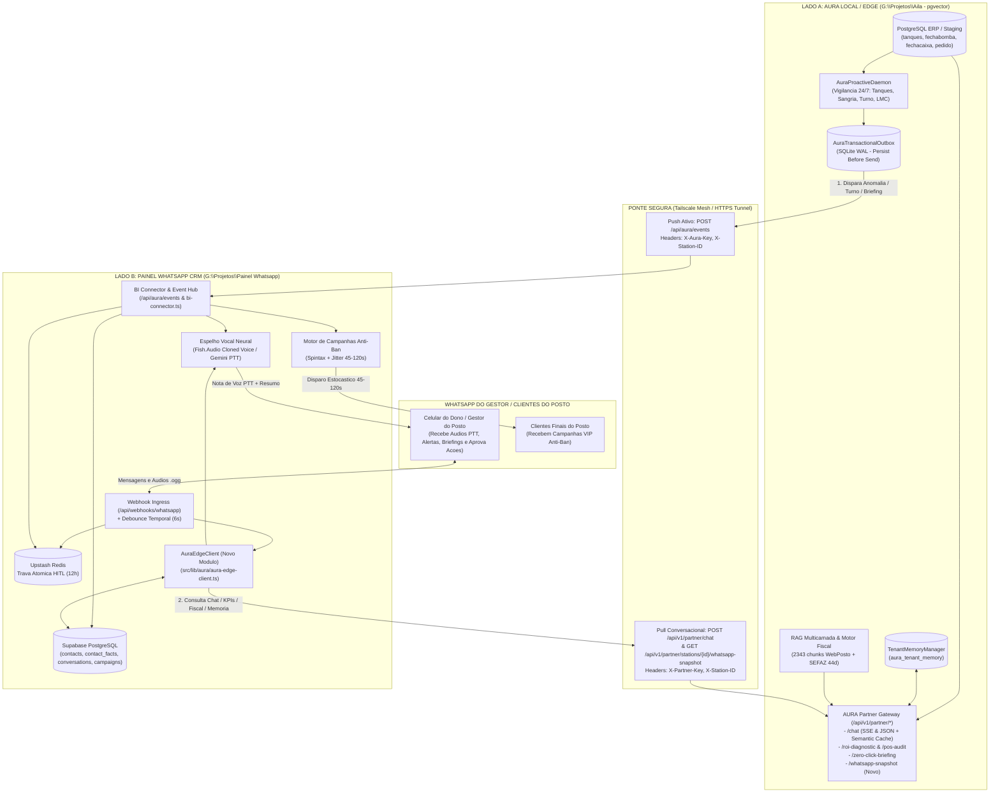

# ARQUITETURA DE INTEGRACAO SIMBIOTICA: AURA LOCAL + PAINEL WHATSAPP CRM
## Guia Estrategico e Especificacao Tecnica Ponta a Ponta (Edge Intelligence + Omnichannel CRM)

> **Status:** Especificacao Arquitetural e Plano de Execucao  
> **Projetos Envolvidos:**  
> - **Lado A (Cérebro Analitico, Fiscal e Operacional de Borda):** `G:\Projetos\Aila - pgvector` (AURA Local / Edge Engine)  
> - **Lado B (Cérebro Relacional, Voz Neural, HITL e Campanhas):** `G:\Projetos\Painel Whatsapp` (Painel WhatsApp CRM)  
> **Regra de Estilo:** Zero travessoes Unicode em todo o documento (compatibilidade estrita com CI/CD da AURA).

---

## 1. DIAGNOSTICO REAL DOS DOIS PROJETOS: POR QUE UNIR OS DOIS MUDA O JOGO?

Ao inspecionar o codigo-fonte atual das duas pastas, fica claro que os dois sistemas foram construidos com capacidades altamente complementares, mas hoje ainda operam separados por uma camada de simulacao (mocks) de um lado e disparos unilaterais do outro.

### 1.1 O que a AURA Local (`G:\Projetos\Aila - pgvector`) ja faz com excelencia:
1. **Leitura Direta do Chao de Loja (ERP / Staging Isolado):** Conecta-se ao banco PostgreSQL do posto (ou recebe lotes via `POST /api/v1/partner/stations/{station_id}/raw-sync` em `core/partner_api.py`), validando leis fisicas (capacidade nominal de tanques, encerrantes de bombas) e mapeando entidades universais (`tanques`, `fechabomba`, `fechacaixa`, `pedido`, `itemped`).
2. **Motores Deterministicos de Alta Precisao (Zero Alucinacao):**
   - **Calculadora de ROI e Vazamento Financeiro (`/roi-diagnostic` e `core/retail_roi_engine.py`):** Mede em Reais (R$) a perda mensal por variacao volumetrica (LMC), cancelamentos suspeitos no PDV, quebras de caixa, arbitragem de compra de carreta e custo SELIC de estoque parado.
   - **Radar de Anomalias de PDV + Escudo Trabalhista (`/pos-audit`):** Calcula o **Z-Score estatistico** de cancelamentos de cupons por operador de caixa e audita conformidade com o **Art. 462 da CLT** para descontos de quebras.
   - **Briefing Matinal Zero-Click (`/zero-click-briefing`):** Consolida faturamento, volume, tanques criticos e risco de multa ANP (Lei 9.847/99).
   - **Motor Fiscal SEFAZ & RAG Multicamada (`core/fiscal_engine.py` + `core/rag_engine.py`):** Audita chaves de 44 digitos, ICMS Monofasico, PIS/COFINS, SPED e consulta 2.343 chunks procedurais em FTS5/pgvector.
3. **Sentinela Proativa 24/7 (`core/proactive_daemon.py`) + Outbox Resiliente (`core/outbox.py`):**
   - Vigia autonomamente **Tanques Criticos** (< 24h de autonomia ou < 20% de volume, sugerindo pedido em bocas de 5.000L), **Sangrias Pendentes** (caixa > R$ 1.500 sem sangria ha > 45 min), **Fechamento de Turno** e **Conformidade LMC ANP** (> 0,6%).
   - Garante entrega *at-least-once* via **Transactional Outbox em SQLite WAL** com deduplicacao por `idempotency_key` e backoff exponencial.
4. **Memoria Auditavel por Filial (`core/tenant_memory.py`):** Armazena apelidos de produtos, rotinas operacionais e regras especificas de cada posto (`aura_tenant_memory`).

### 1.2 O que o Painel WhatsApp (`G:\Projetos\Painel Whatsapp`) ja faz com excelencia:
1. **Orquestracao Conversacional Humana (`src/lib/ai/autonomous-responder.ts`):**
   - **Debounce Temporal de 6s (`message_buffer`):** Agrupa rajadas de mensagens curtas enviadas pelo cliente antes de acionar a IA.
   - **Trava Atomica HITL de Duplo Ponto (`src/lib/redis/lock.ts`):** Detecta intervencao humana (`fromMe: true`), trava a IA no Upstash Redis por 12h (< 15ms) e evita que o robo atropele o consultor humano.
   - **Espelho Vocal Neural (`src/lib/audio/synthesizer.ts` + `transcriber.ts`):** Transcreve audios `.ogg` recebidos e responde com notas de voz nativas (`ptt: true`) usando **voz clonada (Fish.Audio / Gemini)** e simulacao realista de `"gravando audio..."` / `"digitando..."`.
2. **Mural de Curiosidades Cognitivo (`contact_facts` em `src/lib/facts/extractor.ts`):**
   - Extrai fatos comerciais e comportamentais da conversa (`Dor / Necessidade`, `Preferencia`, `Prazo & Timing`, `Objecao Comercial`, `Perfil do Negocio`) e exibe em tempo real no Inbox de 3 colunas via Supabase Realtime.
3. **Motor de Campanhas com Protecao Anti-Ban (`src/lib/campaigns/engine.ts`):**
   - Dispara campanhas segmentadas com **Spintax Generativo** (`{Ola|Fala} {{nome}}`) + **Jitter Estocastico de 45s a 120s** + controle de aquecimento de chip.
4. **Hub de Eventos B2B e Isolamento Multi-Tenant (`src/lib/partner/bi-connector.ts` e `src/lib/tenants/registry.ts`):**
   - Possui rotas prontas (`POST /api/aura/events` e `POST /api/v1/partner/bi-events`) e separa rigorosamente o tenant pessoal (`marlon-core`, protegido por `sanitizer.ts`) dos tenants corporativos/parceiros (`partner-fuel-bi`, `aura-business`).

### 1.3 O Gap Atual (O que impede a produtividade maxima hoje):
- **No lado do Painel WhatsApp:** Em `src/lib/ai/autonomous-responder.ts` (linhas 791-803) e `src/lib/partner/b2b-showroom.ts` (linhas 692-839), quando um gestor de posto pergunta sobre seus numeros no WhatsApp, o sistema responde com textos fixos/simulados (`PARTNER_BI_DEMO_PRESETS` / *"19.200 litros rodados..."*) em vez de consultar o `partner_router` real da AURA Local.
- **No lado da AURA Local:** Em `core/webhooks.py` e `core/proactive_daemon.py`, os alertas proativos sao enviados como texto estatico direto para a Evolution API ou n8n, sem passar pelo Hub do Painel WhatsApp (ignorando a Trava HITL, sem sintese de voz clonada, sem alimentar o Mural de Curiosidades e sem criar campanhas automaticas de recuperacao de vendas).

---

## 2. AS 5 SINERGIAS ORIGINAIS QUE TORNAM O PROJETO UNICO NO MERCADO

Para que a integracao nao seja apenas "mais um chatbot que consulta banco", a arquitetura deve operar em **Circuito Fechado (Closed-Loop Intelligence)** atraves de 5 fluxos de alto valor:

### Sinergia 1: Loop "Detect-to-Cash" (Da Anomalia no ERP para Voz + Campanha Anti-Ban no WhatsApp)
- **O Problema Real:** Sistemas de BI tradicionais mostram um grafico vermelho dizendo que a venda de Gasolina Aditivada ou o ticket medio da conveniencia caiu 12%. O dono do posto olha o grafico (quando abre o sistema) e nao faz nada por falta de tempo.
- **A Solucao Integrada:**
  1. A **AURA Local** detecta a anomalia real nos dados do ERP (queda de mix, estoque parado com custo SELIC alto, ou ociosidade de horario) e envia o evento estruturado via `AuraTransactionalOutbox` para `POST /api/aura/events` no **Painel WhatsApp**.
  2. O **Painel WhatsApp** verifica se nao ha conversa humana ativa (**Trava HITL**).
  3. O **Painel WhatsApp** envia ao dono do posto uma **Nota de Voz (PTT)** com a voz clonada do consultor/AURA explicando o desvio com os numeros reais daquele posto + um resumo executivo em texto.
  4. **O Pulo do Gato:** No mesmo instante, o Painel WhatsApp ja deixa pre-criada na tabela `campaigns` uma campanha segmentada com **Spintax + Jitter Anti-Ban (45-120s)** para os clientes finais do posto e pergunta ao gestor no proprio WhatsApp:
     > *"Ja deixei pronta a campanha VIP de reativacao para 120 clientes cadastrados com intervalo anti-ban. Responda 1 para eu disparar agora."*

### Sinergia 2: Pull Conversacional Hibrido (Debounce 6s + Voz no WhatsApp -> Cérebro Deterministico na AURA)
- Quando o dono do posto manda 3 mensagens seguidas ou um audio de 40 segundos no WhatsApp perguntando:
  *"Como foi o fechamento do primeiro turno? Teve quebra de caixa? E quantos litros ainda tem no tanque de Diesel S10?"*
- O **Painel WhatsApp** consolida as mensagens na janela de **6 segundos (Debounce)**, transcreve o audio, identifica a qual `station_id` aquele telefone pertence e chama a **AURA Local** (`POST /api/v1/partner/chat` ou `GET /api/v1/partner/stations/{id}/whatsapp-snapshot`).
- A **AURA Local** responde em milissegundos (usando o **Cache Semantico particionado por `data_version_hash`** ou consultando as ferramentas SQL read-only) com os numeros exatos e auditados.
- O **Painel WhatsApp** devolve a resposta ao gestor em texto formatado ou em audio natural (`ptt: true`) se o gestor perguntou por audio (**Espelho Vocal**).

### Sinergia 3: "Conversational Action Vouchers" (Aprovacao Executiva Direto pelo WhatsApp)
- A AURA Local possui geracao de `ActionVoucher` assinado com HMAC-SHA256 e `AuraCommandJournal` (`core/command_journal.py`).
- Quando a AURA detecta **Tanque Critico** (ex: Etanol com 16h de autonomia, sugestao de compra de 2 bocas de 5.000L = 10.000L) ou **Sangria Pendente** (Caixa 02 com R$ 2.450 em especie ha 65 min), o alerta enviado pelo WhatsApp inclui opcoes rapidas numeradas:
  - `Responda 1`: Registrar ordem de pedido de 10.000L no Command Journal / Notificar financeiro.
  - `Responda 2`: Pausar alerta deste tanque por 6 horas (Snooze no `AuraProactiveDaemon`).
- O dono do posto resolve a operacao em 3 segundos pelo celular sem precisar abrir computador ou VPN.

### Sinergia 4: Fusao Bidirecional de Memoria Cognitiva (`contact_facts` <-> `aura_tenant_memory`)
- O Painel WhatsApp extrai fatos das conversas no WhatsApp (`src/lib/facts/extractor.ts`) e os salva em `contact_facts`.
- A AURA Local possui `TenantMemoryManager` (`core/tenant_memory.py`) que injeta regras e apelidos do posto (`apelido_produto`, `rotina_operacional`, `preferencia_gestor`, `regra_posto`) no topo do prompt da IA.
- **Como se integram:** Quando o dono do posto diz no WhatsApp *"Aqui no posto a gente chama a Gasolina Aditivada de V-Power e o fechamento do turno da manha e sempre as 14h"*, o extrator do Painel WhatsApp envia esse fato para a AURA Local gravar em `aura_tenant_memory`. Da proxima vez que o gestor perguntar *"Quanto vendeu de V-Power no turno da manha?"*, TANTO o WhatsApp QUANTO o Cockpit Web/Android da AURA saberao exatamente o que fazer!

### Sinergia 5: Auditoria Fiscal e Suporte Operacional por Foto/XML/Audio no WhatsApp
- O gerente de pista ou caixa tem uma duvida no meio do expediente (ex: *"Como faco carta de correcao no WebPosto?"* ou *"Deu rejeicao SEFAZ na nota, qual o CST monofasico do Diesel?"*).
- Ele manda um audio no WhatsApp. O Painel WhatsApp roteia a pergunta para o motor RAG da AURA Local (`core/webposto_rag.py` + `core/fiscal_engine.py` + `core/prompts/fiscal_knowledge_cards.py`), que busca nos **2.343 chunks oficiais da base de conhecimento** e nos **Cartoes Fiscais Deterministicos**, devolvendo o passo a passo limpo no WhatsApp e gerando ate o parecer pronto para enviar ao contador!

---

## 3. TOPOLOGIA E FLUXO DE DADOS DA INTEGRACAO



---

## 4. O QUE DEVE SER FEITO DO LADO DA AURA LOCAL (`G:\Projetos\Aila - pgvector`)

A AURA Local ja possui 85% da infraestrutura pronta em `core/partner_api.py`, `core/outbox.py`, `core/proactive_daemon.py` e `core/webhooks.py`. Precisamos implementar **4 entregas cirurgicas e isoladas**:

### 4.1 Entrega A1: Conector de Saida para o Hub do Painel WhatsApp (`core/webhooks.py` e `core/proactive_daemon.py`)
Atualmente, `core/webhooks.py` envia mensagens diretamente para a Evolution API (`dispatch_whatsapp_evolution`) ou para um webhook generico do n8n (`dispatch_n8n_webhook`).
**O que fazer:**
1. Adicionar no `.env` e em `config/settings.py` as variaveis:
   - `PAINEL_WHATSAPP_EVENTS_URL` (ex: `http://localhost:3000/api/aura/events` ou URL via Tailscale/Vercel)
   - `PAINEL_WHATSAPP_AURA_KEY` (chave compartilhada enviada no header `X-Aura-Key` / `X-Tenant-Key`)
   - `PAINEL_WHATSAPP_TENANT_SLUG` (ex: `partner-fuel-bi`)
2. Criar em `core/webhooks.py` a funcao `dispatch_painel_whatsapp_event()`:
   - Utiliza obrigatoriamente a **`AuraTransactionalOutbox` (`core/outbox.py`)** para gravar o evento em SQLite WAL antes do envio (`Persist-Before-Send`), garantindo que nenhum alerta de tanque critico, sangria ou fechamento de turno se perca se o Painel WhatsApp estiver reiniciando.
   - Converte os payloads nativos da AURA (`AlertaTanquePayload`, `AlertaSangriaPayload`, `TurnoResumoPayload`, `AlertaLMCCompliancePayload`) para o formato enriquecido aceito por `POST /api/aura/events` do Painel WhatsApp, adicionando o bloco `auraRawContext` com os numeros exatos e o `voucher_id` para acao rapida.

**Contrato JSON enviado pela AURA Local para `POST /api/aura/events`:**
```json
{
  "eventType": "ANOMALIA_OPERACIONAL_ESTOQUE",
  "rawAuraEvent": "TANQUE_CRITICO",
  "segment": "postos_redes",
  "tenantSlug": "partner-fuel-bi",
  "companyName": "Posto Alvorada - Filial 01",
  "stationCode": "posto_01",
  "clientName": "Marlon Gestor",
  "clientPhone": "5511999999999",
  "severity": "critical",
  "autoSynthesizeVoice": true,
  "autoDispatchWhatsApp": true,
  "autoCreateCampaign": false,
  "metrics": {
    "periodo": "Monitoramento em Tempo Real (Sentinela AURA)",
    "indicadorPrincipal": "Autonomia Critica - Tanque 02 (Diesel S10)",
    "variacaoPct": -82.0,
    "detalheOperacional": "Volume atual em 2.700 L (18% da capacidade de 15.000 L). Autonomia estimada em 11,5 horas. Sugestao deterministica: programar pedido de 2 compartimentos de 5.000 L (10.000 L)."
  },
  "auraActionVoucher": {
    "voucher_id": "vch_9f8a7b6c",
    "action_type": "PROGRAMAR_PEDIDO_COMBUSTIVEL",
    "quick_reply_options": [
      {"key": "1", "label": "Confirmar pedido de 10.000 L (2 bocas de 5k)"},
      {"key": "2", "label": "Silenciar alerta deste tanque por 6h"}
    ]
  }
}
```

### 4.2 Entrega A2: Endpoint Unificado `whatsapp-snapshot` em `core/partner_api.py`
No Painel WhatsApp, a funcao `queryStationLiveKpis()` (`src/lib/partner/bi-connector.ts`) faz um `GET` esperando um JSON consolidado com os KPIs em tempo real do posto para injetar no System Prompt do WhatsApp em menos de 3,5 segundos.
**O que fazer em `core/partner_api.py`:**
Criar a rota `GET /api/v1/partner/stations/{station_id}/whatsapp-snapshot` (autenticada via `X-Partner-Key` ou `X-Tenant-Key`) que combina em **uma unica resposta ultra-rapida (< 30ms)**:
- Dados do `generate_morning_briefing_payload()` (faturamento do dia, litragem total, tanques criticos, status LMC ANP).
- Resumo do `compute_station_roi_diagnostic()` (vazamento mensal estimado em R$ e principal gargalo).
- Resumo do `audit_pos_and_cashier_anomalies()` (se ha operador com Z-Score >= 2.0 em cancelamentos de PDV).
- Campos compativeis diretamente com a interface `LiveStationKpiSnapshot` do Painel WhatsApp (`stationCode`, `stationName`, `litragemDia`, `margemMediaLitro`, `mixAditivadaPct`, `conversaoConvenienciaPct`, `alertaAtivo`, `recomendacaoConsultiva`), alem do bloco detalhado `detailedTelemetry`.

### 4.3 Entrega A3: Sincronizacao de Memoria Cognitiva (`POST /api/v1/partner/stations/{station_id}/memory-sync`)
**O que fazer em `core/partner_api.py`:**
Expor um endpoint que recebe fatos extraidos pelo Mural de Curiosidades do Painel WhatsApp (`contact_facts`) e os registra no `TenantMemoryManager` (`core/tenant_memory.py`):
- Mapeia categorias do WhatsApp para categorias da AURA:
  - Apelidos de combustiveis/produtos ditos no WhatsApp -> `apelido_produto`
  - Horarios de turno, regras de sangria ou rotinas -> `rotina_operacional`
  - Preferencias de relatorio do dono do posto -> `preferencia_gestor`
- Também permite `GET /api/v1/partner/stations/{station_id}/memory-facts` para que o Painel WhatsApp exiba na 3a coluna do Inbox os fatos aprendidos no Cockpit local da AURA.

### 4.4 Entrega A4: Processador de Respostas Rapidas de Vouchers (`POST /api/v1/partner/stations/{station_id}/quick-action`)
**O que fazer em `core/partner_api.py`:**
Quando a AURA envia um alerta proativo ao WhatsApp com opcoes (`1` para aprovar acao/pedido, `2` para silenciar alerta por cooldown), e o gestor responde `"1"` ou `"2"` no WhatsApp:
- O Painel WhatsApp encaminha para `POST /api/v1/partner/stations/{station_id}/quick-action`.
- A AURA Local executa a acao no `AuraCommandJournal` ou aplica o snooze no `_cooldown_cache` do `AuraProactiveDaemon` e devolve a confirmacao auditada.

---

## 5. O QUE DEVE SER FEITO DO LADO DO PAINEL WHATSAPP (`G:\Projetos\Painel Whatsapp`)

No lado do Next.js 16 (`G:\Projetos\Painel Whatsapp`), toda a interface, o Debounce de 6s, a Trava HITL no Redis, o sintetizador de voz e o motor de campanhas ja estao prontos. Precisamos fazer **4 conectores cirurgicos** para substituir os mocks de showroom pela inteligencia real da AURA Local:

### 5.1 Entrega W1: Criar o Cliente Oficial `src/lib/aura/aura-edge-client.ts`
Criar um modulo TypeScript dedicado e isolado para comunicacao com a AURA Local:
- **Configuracao via `.env.local`:**
  ```env
  AURA_EDGE_API_URL=http://100.77.164.17:8000
  AURA_PARTNER_API_KEY=aura-partner-default-key
  AURA_DEFAULT_STATION_ID=posto_01
  AURA_REQUEST_TIMEOUT_MS=8000
  ```
- **Funcoes do `AuraEdgeClient`:**
  1. `askAuraEngine(params: { query: string; stationId: string; sessionId: string; tenantId?: string; context?: Record<string, unknown> })`:
     - Faz `POST {AURA_EDGE_API_URL}/api/v1/partner/chat` com `stream: false` (para resposta sincrona limpa no WhatsApp) ou consome os eventos SSE `delta`/`done`.
     - Envia os headers `X-Partner-Key` e `X-Station-ID`.
     - Retorna `{ ok, responseText, intent, confidence, cacheHit, dataVersionHash }`.
     - Possui retry com backoff curto e Circuit Breaker (se a AURA Local estiver desligada, retorna `ok: false` em < 3s sem travar o webhook do WhatsApp).
  2. `getAuraStationSnapshot(stationId: string)`:
     - Consulta `GET {AURA_EDGE_API_URL}/api/v1/partner/stations/{stationId}/whatsapp-snapshot` (ou combina `/zero-click-briefing` + `/roi-diagnostic` + `/pos-audit`).
  3. `executeAuraQuickAction(params: { stationId: string; voucherId: string; optionKey: string; actorPhone: string })`:
     - Executa `POST {AURA_EDGE_API_URL}/api/v1/partner/stations/{stationId}/quick-action`.
  4. `syncFactToAuraEdge(params: { stationId: string; category: string; fact: string; confidence: number })`:
     - Envia novos fatos operacionais extraidos no WhatsApp para `POST {AURA_EDGE_API_URL}/api/v1/partner/stations/{stationId}/memory-sync`.

### 5.2 Entrega W2: Conectar `src/lib/ai/autonomous-responder.ts` e `src/lib/partner/b2b-showroom.ts` ao Motor Real da AURA
Atualmente, em `src/lib/ai/autonomous-responder.ts` (linhas 791-803 e 1070-1082):
```ts
if (isPartnerTenant) {
  const partnerReply = await generatePartnerShowroomReply(...)
}
```
**O que fazer:**
1. Resolver o `stationId` do contato que mandou a mensagem no WhatsApp (lendo `contact.metadata.station_id` no Supabase ou usando `AURA_DEFAULT_STATION_ID` = `posto_01`).
2. Antes de cair no `generatePartnerShowroomReply()` (que usa presets de demonstracao), chamar **`auraEdgeClient.askAuraEngine()`** passando:
   - `query`: o texto consolidado pelo Debounce de 6s (ou a transcricao do audio `.ogg`).
   - `stationId`: o posto vinculado ao contato.
   - `context`: os fatos do Mural de Curiosidades (`facts`) daquele gestor + o perfil cognitivo.
3. **Formatacao Inteligente para Voz vs. Texto:**
   - Se a AURA Local responder (ex: um relatorio detalhado de tanques, LMC, fechamento de caixa ou orientacao fiscal SEFAZ) e o cliente tiver mandado **Texto**, envia a resposta completa formatada para WhatsApp.
   - Se o cliente tiver mandado **Audio (`mediaType === 'audio'`)**, passa o retorno real da AURA por um sumarizador oral rapido (3 a 4 frases naturais sem markdown pesado) para que o `synthesizeSpeech()` gere uma nota de voz PTT fluida com os numeros reais da AURA, e opcionalmente envia os detalhes numericos em texto logo abaixo!
4. **Fallback Gracioso:** Se a AURA Local estiver offline (ex: computador de borda desligado), o sistema faz fallback transparente para o `generatePartnerShowroomReply()` enriquecido com o ultimo snapshot salvo em `bi_partner_events` no Supabase!

### 5.3 Entrega W3: Blindar `ingestPartnerBiEvent()` (`src/lib/partner/bi-connector.ts`) com Trava HITL e Dados Reais da AURA
Em `src/lib/partner/bi-connector.ts` (linhas 333-372), quando um evento chega em `/api/aura/events` ou `/api/v1/partner/bi-events` com `autoDispatchWhatsApp: true`, ele dispara direto no `evolutionClient` sem checar se o operador humano esta no meio de uma conversa com aquele cliente!
**O que fazer:**
1. **Checagem HITL Obrigatoria no Push Proativo:**
   - Antes de chamar `evolutionClient.sendWhatsAppAudio()` ou `sendTextMessage()`, verificar `await isHitlLocked(cleanPhone)`.
   - Se estiver travado por humano (`isHitlLocked === true`), **nao** interromper a conversa no WhatsApp! Em vez disso, gravar o diagnostico da AURA como uma **Nota Interna / Sugestao de Co-Pilot** no Inbox e atualizar o `contact_facts` para que o atendente humano veja o alerta em tempo real na tela e decida quando falar com o cliente.
2. **Preservar Diagnosticos Reais da AURA Local:**
   - Se o payload recebido em `/api/aura/events` trouxer o campo `auraRawContext` ou textos ja calculados pela AURA Local (como numeros exatos de litros no tanque, valor exato de sangria pendente no Caixa X, Z-Score do operador Y), usar esses valores exatos no `oralVoiceScript` e no `whatsappExecutiveText` em vez de sobrescreve-los com os textos genericos de `processPartnerBiEvent()`.
3. **Registrar o Disparo Proativo no Historico do Chat (`messages`):**
   - Hoje, quando `bi-connector.ts` envia um alerta pelo `evolutionClient`, ele grava em `bi_partner_events`, mas nao insere a mensagem na tabela `messages` da `conversation` daquele contato no Supabase (e nao registra o `whatsapp_message_id` no `registerBotDispatchedMessageId()`).
   - **Correcao Critica:** Sempre chamar `registerBotDispatchedMessageId(wamId)` ao disparar um alerta da AURA pelo `bi-connector.ts`! Caso contrario, quando a Evolution API devolver o webhook `messages.upsert` com `fromMe: true` daquele alerta da AURA, o webhook vai achar que foi um humano digitando no celular e vai ativar a Trava HITL de 12 horas por engano! (Isso e um achado arquitetural critico no codigo atual).

### 5.4 Entrega W4: Sincronizar Extrator de Fatos (`src/lib/facts/extractor.ts`) com a Memoria da AURA Local
Quando `extractFactsFromConversation()` extrair fatos de um contato pertencente ao tenant da AURA (`partner-fuel-bi` / `aura-business`), disparar de forma assincrona (non-blocking) o `auraEdgeClient.syncFactToAuraEdge()` para que a AURA Local tambem aprenda a regra ou preferencia daquele gestor.

---

## 6. DESCOBERTA CRITICA DE ENGENHARIA (BUG PREVENTIVO IDENTIFICADO NA ANALISE)

Durante a leitura cruzada de `G:\Projetos\Painel Whatsapp\src\lib\partner\bi-connector.ts` (linhas 346-358) e `G:\Projetos\Painel Whatsapp\src\app\api\webhooks\whatsapp\route.ts`, identificamos um comportamento que precisa ser tratado na integracao:

1. No Painel WhatsApp, qualquer mensagem enviada pela instancia da Evolution API gera um evento de retorno `messages.upsert` com `key.fromMe = true`.
2. O `autonomous-responder.ts` evita que as proprias respostas do bot acionem a trava humana chamando `registerBotDispatchedMessageId(dispatchedWamId)` (linhas 880 e 897).
3. Porem, quando `bi-connector.ts` (chamado por `/api/aura/events` ou `/api/v1/partner/bi-events`) envia um audio ou texto proativo da AURA no WhatsApp (linhas 346-358), ele **nao** chama `registerBotDispatchedMessageId(sendTextRes.data?.key?.id)`.
4. **Consequencia:** Assim que a AURA manda um alerta proativo de tanque critico ou fechamento de turno, a Evolution API notifica `fromMe: true`, o webhook acha que foi um humano que pegou o celular e **bloqueia a IA por 12 horas no Redis (`hitl:lock:{phone}`)**! Quando o dono do posto responde ao alerta 1 minuto depois perguntando *"Qual o volume exato dos outros tanques?"*, a IA fica muda porque foi travada pelo proprio alerta proativo!
5. **Solucao na Entrega W3:** Em `bi-connector.ts`, capturar `sendAudioRes.data?.key?.id` e `sendTextRes.data?.key?.id`, chamar `registerBotDispatchedMessageId()` para ambos e gravar a mensagem na tabela `messages` com `sender_type: 'bot'`. Assim, o alerta da AURA aparece na tela do Inbox em tempo real e o dono do posto pode continuar conversando com a AURA imediatamente!

---

## 7. MATRIZ DE CASOS DE USO PRODUTIVOS (COMO O SISTEMA FUNCIONARA NA PRATICA)

| # | Gatilho / Cenario | O que a AURA Local faz (`Aila - pgvector`) | O que o Painel WhatsApp faz (`Painel Whatsapp`) | Resultado para o Gestor / Posto |
| :- | :--- | :--- | :--- | :--- |
| **1** | **Briefing Matinal Zero-Click (07:00h)** | `AuraProactiveDaemon` consolida faturamento de ontem, margem, status LMC ANP e tanques criticos e enfileira na `Outbox`. | Recebe em `/api/aura/events`, checa HITL, gera audio de 35s na voz clonada do consultor + card texto e registra no chat. | Gestor acorda, ouve no WhatsApp o resumo executivo do posto a caminho do trabalho e ja pode tirar duvidas respondendo o audio. |
| **2** | **Alerta de Sangria / Risco de Assalto** | Detecta Caixa 01 com R$ 2.800 em dinheiro sem sangria ha 55 min. Envia evento `SANGRIA_PENDENTE` (`severity: critical`). | Envia alerta prioritario no WhatsApp do gerente/dono com opcao rapida: *"Responda 1 apos realizar a sangria"*. | Reduz exposicao financeira na pista em tempo real e registra conformidade no Command Journal. |
| **3** | **Ruptura / Tanque Critico** | Detecta Diesel S10 com 14h de autonomia (2.100L) e calcula pedido ideal de 2 bocas de 5.000L (10.000L). | Envia audio curto + texto executivo com `voucher_id`. Se o gestor responder `"1"`, confirma a programacao na AURA. | Evita tanque seco no posto e perda de clientes frotistas sem o dono precisar abrir planilhas. |
| **4** | **Queda de Giro / Margem -> Campanha Automatica** | `compute_station_roi_diagnostic` ou BI detecta queda de 14% na venda de Aditivada ou Conveniencia na semana. | Envia diagnostico ao dono e **cria automaticamente** uma campanha no modulo `campaigns` com Spintax + Jitter 45-120s. | O dono responde *"Pode disparar"* no WhatsApp e o Painel inicia os envios anti-ban para os clientes do posto para recuperar a venda no mesmo dia. |
| **5** | **Pergunta Livre por Audio ou Texto no WhatsApp** | Recebe `POST /api/v1/partner/chat` da ponte, consulta ERP / Cache Semantico / Base Fiscal SEFAZ / Confluence RAG. | Agrupa mensagens no Debounce de 6s, transcreve audio `.ogg`, consulta a AURA Local e responde em texto ou voz clonada PTT. | O WhatsApp vira um "Gerente Financeiro, Fiscal e Operacional 24/7" respondendo com dados 100% reais do banco do posto. |
| **6** | **Anomalia de Cancelamento no Caixa (Z-Score)** | `/pos-audit` detecta Operador 104 com Z-Score de 2.8 em cancelamentos de cupons e alerta sobre regra do Art. 462 CLT. | Registra no Mural de Curiosidades (`Seguranca & Compliance`) e envia alerta privado e discreto ao dono do posto. | Estanca vazamento de caixa (fraude/erro operacional) protegendo o posto contra passivo trabalhista. |

---

## 8. VARIAVEIS DE AMBIENTE NECESSARIAS EM CADA PROJETO

### 8.1 No arquivo `.env` da AURA Local (`G:\Projetos\Aila - pgvector\.env`)
```env
# Chave de autenticacao do Partner API Gateway da AURA
AURA_PARTNER_API_KEY=aura-partner-secret-2026

# Ponte de Saida (Push) para o Painel WhatsApp CRM
PAINEL_WHATSAPP_EVENTS_URL=http://localhost:3000/api/aura/events
PAINEL_WHATSAPP_AURA_KEY=whsec_partner_fuel_bi_2026
PAINEL_WHATSAPP_TENANT_SLUG=partner-fuel-bi
WHATSAPP_MANAGER_PHONE=5511999999999
```

### 8.2 No arquivo `.env.local` do Painel WhatsApp (`G:\Projetos\Painel Whatsapp\.env.local`)
```env
# Ponte de Entrada e Consulta (Pull) na AURA Local (Localhost ou IP Tailscale 100.x.y.z)
AURA_EDGE_API_URL=http://127.0.0.1:8000
AURA_PARTNER_API_KEY=aura-partner-secret-2026
AURA_DEFAULT_STATION_ID=posto_01
AURA_REQUEST_TIMEOUT_MS=8000

# Segredo de validacao dos Webhooks vindos da AURA Local
PARTNER_BI_WEBHOOK_SECRET=whsec_partner_fuel_bi_2026
PARTNER_LOCAL_BI_API_URL=http://127.0.0.1:8000/api/v1/partner/stations/posto_01/whatsapp-snapshot
```

---

## 9. ROTEIRO DE EXECUCAO PASSO A PASSO (ORDEM RECOMENDADA)

Para implementar sem quebrar nenhum teste existente nos dois projetos (mantendo 100% de compatibilidade e fallback seguro):

### Fase 1: Ponte de Leitura e Chat Real (Pull: Painel WhatsApp -> AURA Local)
1. **[AURA Local]** Adicionar o endpoint `GET /api/v1/partner/stations/{station_id}/whatsapp-snapshot` em `core/partner_api.py` retornando o objeto `LiveStationKpiSnapshot` enriquecido com dados reais do staging/ERP (`tanques`, `fechacaixa`, `roi-diagnostic`, `pos-audit`).
2. **[Painel WhatsApp]** Criar `src/lib/aura/aura-edge-client.ts` com `askAuraEngine()` e `getAuraStationSnapshot()`.
3. **[Painel WhatsApp]** Atualizar `src/lib/partner/bi-connector.ts` (`queryStationLiveKpis`) e `src/lib/ai/autonomous-responder.ts` para consultar a AURA Local em tempo real quando o tenant for de parceria/AURA, mantendo o showroom estatico apenas como fallback se a AURA Local estiver inacessivel.

### Fase 2: Ponte Proativa Resiliente e Correcao de Auto-Lock HITL (Push: AURA Local -> Painel WhatsApp)
1. **[Painel WhatsApp]** Corrigir `src/lib/partner/bi-connector.ts` (`ingestPartnerBiEvent`) para:
   - Verificar `isHitlLocked(cleanPhone)` antes de enviar mensagens automaticas no WhatsApp.
   - Chamar `registerBotDispatchedMessageId(wamId)` ao despachar audio/texto pela Evolution API (evitando que o proprio alerta da AURA trave o bot por 12h).
   - Inserir a mensagem enviada na tabela `messages` do Supabase para aparecer ao vivo na tela do Inbox.
2. **[AURA Local]** Adicionar `dispatch_painel_whatsapp_event()` em `core/webhooks.py` integrado com a `AuraTransactionalOutbox` (`core/outbox.py`) e conecta-lo aos gatilhos do `AuraProactiveDaemon` (`core/proactive_daemon.py`).

### Fase 3: Acoes Rapidas no WhatsApp (Vouchers) e Campanhas Engatilhadas
1. **[AURA Local]** Criar `POST /api/v1/partner/stations/{station_id}/quick-action` em `core/partner_api.py` para processar respostas `"1"` ou `"2"` do gestor no WhatsApp (confirmacao de pedido de combustivel, ciencia de sangria, snooze de alerta).
2. **[Painel WhatsApp]** No `autonomous-responder.ts`, detectar respostas rapidas a alertas recentes da AURA (ou comando *"disparar campanha"*) para acionar o `executeAuraQuickAction()` ou ativar a campanha criada na tabela `campaigns`.

### Fase 4: Sincronizacao Bidirecional de Memoria Cognitiva e Testes E2E
1. **[AURA Local]** Expor `POST /api/v1/partner/stations/{station_id}/memory-sync` em `core/partner_api.py` conectado ao `TenantMemoryManager` (`core/tenant_memory.py`).
2. **[Painel WhatsApp]** Conectar `src/lib/facts/extractor.ts` para sincronizar fatos operacionais extraidos no WhatsApp com a memoria local da AURA.
3. **[Ambos]** Executar bateria de testes integrados validando o fluxo completo: *Evento na AURA -> Outbox -> Painel WhatsApp -> Audio PTT + Texto -> Resposta do Gestor no WhatsApp -> Debounce 6s -> Consulta Real na AURA -> Resposta Auditada*.
