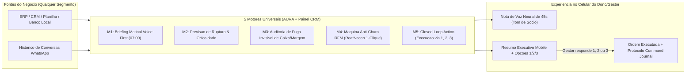

# Plano de Implementacao: Ecossistema Universal de Super-Inteligencia Executiva (AURA + Painel CRM)

> **Posicionamento do Produto (PoC & MVP Comercial):**  
> Transformar a integracao **AURA Engine + Painel WhatsApp CRM** em um **"Socio Consultor Autonomo via WhatsApp"** agnostico de segmento, capaz de operar em **qualquer negocio** (Lojas de Varejo, Escritorios Contabeis/Juridicos, Clinicas, E-commerce, Distribuidoras e Postos) gerando **Lucro Liquido, Prevencao de Perdas e Economia de Tempo**.

---

## 1. Arquitetura Universal: Motor Central + Adaptadores de Segmento (Domain Packs)

Para que o sistema nunca fique preso a um unico nicho, toda a inteligencia opera sobre **5 Abstracoes Universais de Negocio**, que sao traduzidas automaticamente conforme o perfil da empresa (`segment`):

| Conceito Universal | Loja / Varejo (`varejo`) | Escritorio / Servicos (`saas_b2b` / `saude_clinicas`) | Distribuidora / Logistica (`logistica`) | Postos & Conveniencia (`postos_redes`) |
| :--- | :--- | :--- | :--- | :--- |
| **1. Recurso Critico (Run-Out / Capacidade)** | Estoque de produtos Curva A (giro rapido) | Horas tecnicas / Agenda de atendimento disponivel | Frota disponivel / Estoque de centro de distribuicao | Nivel de tanques de combustivel e itens de conveniencia |
| **2. Indicador de Margem & Mix** | Markup medio e vendas de itens premium (cross-sell) | Ticket medio por contrato/consulta e servicos agregados | Margem liquida por rota/entrega e ocupacao de carga | Margem bruta/litro e % de mix de aditivada |
| **3. Equipe & Performance** | Vendedores de loja / Operadores de caixa | Consultores, advogados, contadores ou especialistas | Representantes comerciais e motoristas | Frentistas de pista e atendentes de caixa |
| **4. Fuga Invisivel (Loss Prevention)** | Descontos acima da alcada, quebras de estoque e trocas | Horas nao faturadas, inadimplencia e leads sem resposta | Devolucoes em rota, avarias e custo de frete ocioso | Diferenca regua vs encerrante, quebra de caixa e descontos |
| **5. Ciclo de Retencao (Anti-Churn RFM)** | Clientes VIP sem comprar ha > 30 dias | Clientes com contrato vencendo ou retorno pendente | Compradores B2B que pularam o ciclo semanal de pedido | Frotistas e clientes recorrentes ausentes da pista |

---

## 2. Os 5 Modulos de Alto Impacto (Escopo de Implementacao)

---

### Modulo 1: Briefing Executivo Matinal Voice-First ("O Socio das 07:00")
**Por que encanta no MVP:** Empresarios de escritorios, donos de lojas ou gestores estao no transito pela manha e nao abrem relatorios em PDF ou dashboards. Receber um audio de 45 segundos com a voz natural de um consultor senior resumindo o negocio cria dependencia imediata do produto.

#### O que sera implementado:
1. **Endpoint no Painel CRM (`POST /api/aura/morning-briefing`):**
   - Consolida os indicadores da empresa (via AURA Local ou conector universal de segmento).
   - Gera um roteiro falado executivo de 40 a 50 segundos adaptado ao segmento:
     - **Exemplo Loja:** *"Bom dia, Marlon. O fechamento de ontem na Loja Matriz somou R$ 18.400, alta de 12% sobre a media das tercas. O ponto de atencao e a linha de calcados masculinos que caiu para apenas 3 unidades em estoque, e a vendedora Camila ficou com conversao 18% abaixo da meta. Digite 1 para aprovar a reposicao automatica com o fornecedor ou 2 para disparar a campanha de giro rapido no WhatsApp."*
     - **Exemplo Escritorio:** *"Bom dia, Marlon. Ontem fechamos 4 novas propostas comerciais no escritorio com ticket medio de R$ 2.800. Temos 6 clientes com parcelas vencendo hoje que costumam atrasar e 3 horarios vagos na agenda tecnica da tarde. Digite 1 para acionar o lembrete preventivo amigavel ou 2 para ofertar os horarios livres aos leads quentes da fila."*
2. **Botao no Cockpit (`/partner-mvp`):**
   - Botao **"Disparar Briefing Matinal em Audio (Modo Socio)"** que sintetiza a nota de voz neural e envia imediatamente para o WhatsApp do gestor.

---

### Modulo 2: Motor Universal de Previsao de Ruptura & Ociosidade (Run-Out & Capacity Engine)
**Por que encanta no MVP:** Transforma dados passados em previsao de futuro ("vai acabar amanha as 14h" ou "sua agenda de sexta esta com 40% de buraco").

#### O que sera implementado:
1. **Calculadora Universal de Autonomia (`src/lib/aura/predictive-engine.ts` e `core/partner_api.py`):**
   - Calcula o **Burn Rate (Velocidade de Consumo / Ocupacao)** por hora/dia:
     $$\text{Autonomia (Horas)} = \frac{\text{Estoque ou Capacidade Atual}}{\text{Velocidade Media de Giro por Hora}}$$
   - Calcula a **Economia de Antecipacao**: quanto o gestor ganha se agir agora (ex: comprar antes de alta de preco do fornecedor ou preencher horario ocioso no escritorio com desconto pontual).
2. **Card Visual de Autonomia no `/partner-mvp`:**
   - Barra de progresso com contagem regressiva de autonomia/capacidade adaptada ao segmento selecionado.

---

### Modulo 3: Detector de "Fuga Invisivel" de Lucro (Universal Loss Prevention)
**Por que encanta no MVP:** Mostra ao dono do negocio exatamente onde ele esta perdendo dinheiro sem perceber (descontos sem alcada, furos de caixa, leads caros abandonados no WhatsApp ou divergencias de estoque).

#### O que sera implementado:
1. **Motor de Auditoria de Fuga Financeira (`calculateInvisibleLeakage`):**
   - **Em Lojas/Comercio:** Identifica vendedores aplicando desconto no limite maximo em vendas que nao precisavam ou cancelamentos atipicos no PDV.
   - **Em Escritorios/Clinicas:** Identifica leads de alto valor que mandaram mensagem no WhatsApp, ficaram sem follow-up apos o primeiro orcamento e esfriaram (calculando o R$ deixado na mesa).
   - **Em Postos/Distribuicao:** Confronta volume fisico vs encerrante/faturado e desvio de mix de produtos de maior margem.
2. **Quantificacao Mensal Projetada (R$/mes):**
   - Todo alerta traz o **Impacto Anualizado/Mensal** (ex: *"Fuga estimada de R$ 4.350/mes se nao corrigido hoje"*), justificando instantaneamente a mensalidade do sistema.

---

### Modulo 4: Maquina Automatica Anti-Churn RFM (Reativacao em 1-Clique)
**Por que encanta no MVP:** Faz o sistema **se pagar na mesma hora**. Identifica clientes reais que sumiram e prepara o disparo personalizado com protecao Anti-Ban.

#### O que sera implementado:
1. **Analisador RFM de Contatos e Clientes (`src/lib/aura/rfm-reactivation.ts`):**
   - Classifica clientes da base por **Recencia** (dias desde a ultima compra/conversa), **Frequencia** e **Valor Monetario**.
   - Detecta automaticamente o lote de **"Clientes Fieis em Risco de Abandono"**.
2. **Gatilho de Reativacao Instantanea via WhatsApp:**
   - A AURA avisa o dono no WhatsApp:
     > *"Identifiquei 14 clientes VIP que compram todo mes, mas nao aparecem ha 22 dias (receita em risco: R$ 6.800). Preparei uma mensagem individualizada citando a ultima preferencia de cada um no Mural de Curiosidades. Digite 1 para iniciar o envio seguro com intervalo Anti-Ban."*

---

### Modulo 5: Closed-Loop Action Universal (Menu de Execucao 1, 2, 3 no WhatsApp)
**Por que encanta no MVP:** O dono do negocio resolve tudo digitando apenas um numero no WhatsApp, com protocolo auditavel gravado no **Command Journal**.

#### O que sera implementado:
1. **Expansao do Interceptador de Quick Actions (`src/lib/ai/autonomous-responder.ts` e `core/partner_api.py`):**
   - **`1` (Aprovar & Executar Acao Principal):**
     - Aprova ordem de compra/reposicao, autoriza alcada ou dispara lote de reativacao de clientes, gerando protocolo unico (`CMD-2026-XXXX`).
   - **`2` (Cobrar Responsavel / Delegar para Equipe):**
     - A AURA gera automaticamente o encaminhamento ou cobranca de meta para o gerente/vendedor responsavel pelo setor.
   - **`3` (Silenciar / Adiar por 6h):**
     - Registra snooze temporario no Command Journal sem perder o historico de auditoria.

---

## 3. Roteiro de Execucao Tecnica (3 Sprints Rapidas)

| Sprint | Entregavel Tecnico | Arquivos Alvo |
| :--- | :--- | :--- |
| **Sprint 1: Motor Universal Preditivo & Fuga Invisivel** | Criar `src/lib/aura/predictive-engine.ts` com adaptadores para **todos os 6 segmentos** (Varejo, Escritorios/SaaS, Clinicas, E-commerce, Logistica e Postos), calculando Run-Out, Capacidade Ociosa, Fuga Financeira em R$ e Lote RFM Anti-Churn. | `src/lib/aura/predictive-engine.ts` `core/partner_api.py` |
| **Sprint 2: Briefing Matinal Voice-First & Menu 1-2-3** | Criar rota `POST /api/aura/morning-briefing` que gera o audio executivo de 45s no tom de socio consultor + expandir o `autonomous-responder.ts` para suportar as 3 acoes (`1` Executar, `2` Delegar/Cobrar Equipe, `3` Silenciar) em qualquer segmento. | `src/app/api/aura/morning-briefing/route.ts` `src/lib/ai/autonomous-responder.ts` |
| **Sprint 3: Cockpit Multi-Segmento no `/partner-mvp`** | Atualizar o Card Ao Vivo do `/partner-mvp` para comutar dinamicamente os KPIs, os alertas de Fuga Invisivel e o botao **"Enviar Briefing Matinal no Meu WhatsApp"** conforme o segmento escolhido (Loja, Escritorio, Clinica, E-commerce, Logistica ou Posto). | `src/app/partner-mvp/page.tsx` `tests/unit.test.ts` |
