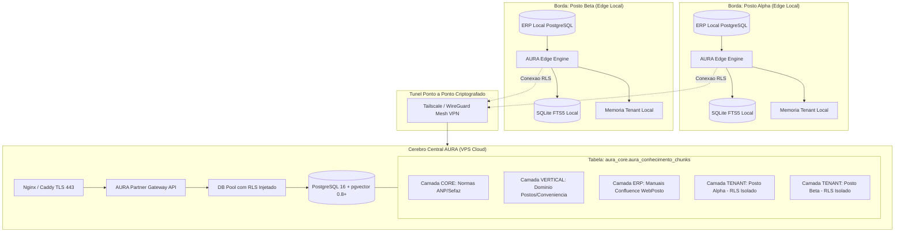

# GUIA DE ATIVACAO: CEREBRO CENTRAL NA VPS E MULTI-TENANCY RLS (FASE 8)

> **Status:** Guia Oficial de Infraestrutura e Ativacao do Modo Central  
> **Versao:** 1.0.0 (Pronto para Producao)  
> **Escopo:** Instrucoes passo a passo para implantar, configurar e ativar o cluster pgvector centralizado na VPS, habilitar o isolamento Row-Level Security (RLS) e conectar os postos locais de borda (Edge-First).  
> **Regra do Repositorio:** ZERO travessoes Unicode (U+2014 e U+2013) neste arquivo, nos scripts e nas configuracoes. Utilizar exclusivamente hifens comuns (`-`), dois pontos (`:`) ou barras (`/`).

---

## 1. VISAO GERAL E CONCEITO DO CEREBRO CENTRAL

A arquitetura da AURA adota o modelo **Edge-First com Cerebro Central Federado (VPS)**. Esse modelo combina a resiliencia e privacidade de um agente local rodando dentro do posto com o poder de escala, compartilhamento de inteligencia e atualizacao continua de uma nuvem central:



### O que o Cerebro Central centraliza:
1. **Acervo Canonico de Manuais do ERP (2.072+ artigos Confluence):** Indexados em chunks densos de 768 dimensoes (HNSW cosseno) e indices lexicais GIN em portugues.
2. **Memoria Compartilhada por Tenant (Camada `tenant`):** Regras do posto aprovadas pelo gestor sincronizadas com isolamento RLS matematico.
3. **Gateway de Integracao com Parceiros (Partner API):** Endpoints REST para ERPs em nuvem (`/api/v1/partner/raw-sync` e `/api/v1/partner/chat`).
4. **Telemetria e Observabilidade Global:** Painel executivo consolidado com scraping Prometheus em `/metrics`.

### Matriz de Responsabilidade e LGPD (O que sobe vs O que FICA na Borda):

| Categoria de Dados | Onde Fica | Sobe para a VPS? | Justificativa de Seguranca / LGPD |
| :--- | :--- | :---: | :--- |
| **Credenciais do ERP Local** | PC do Posto (`.env`) | **NUNCA** | Fica estritamente no hardware do cliente. Zero risco de vazamento central. |
| **Dados Fiscais Brutos (NFe/NFCe)** | PC do Posto (ERP) | **NUNCA** | Processados localmente por queries SQL analiticas do adaptador de borda. |
| **CPF/CNPJ e Nomes de Clientes** | PC do Posto | **NUNCA** | Anonimizados localmente via [`core/sanitizer.py`](file:///c:/Users/Marlon/Documents/Agent%20PC/ia-banco-local/core/sanitizer.py). |
| **Manuais e Guias do ERP** | VPS Central | **SIM** | Camada publica corporativa (`camada = 'erp'`). Compartilhada entre todos os postos. |
| **Normas Publicas ANP/INMETRO** | VPS Central | **SIM** | Camada publica regulatória (`camada = 'core'`). |
| **Regras Aprovadas do Posto** | VPS + SQLite | **SIM (com RLS)** | Regras duraveis (`camada = 'tenant'`). Visiveis apenas pelo proprio posto via RLS. |
| **Metricas de Consumo de Tokens** | SQLite + VPS | **SIM** | Ledger agregado de telemetria e orcamento (sem dados pessoais). |

---

## 2. REQUISITOS DE INFRAESTRUTURA NA VPS

### Hardware Minimo Recomendado:
- **vCPU:** 2 vCPUs dedicadas (recomendado: 4 vCPUs para alta taxa de busca vetorial simultanea).
- **Memoria RAM:** 4 GB (recomendado: 8 GB para acomodar o cache do shared_buffers e indice HNSW).
- **Armazenamento:** 40 GB SSD NVMe (espaco suficiente para o cluster PostgreSQL, SO e backups locais).
- **Sistema Operacional:** Ubuntu 22.04 LTS, Ubuntu 24.04 LTS ou Debian 12.

### Portas de Rede e Firewall:
- **Porta 443 / 80 (TCP):** Abertas na internet para HTTPS com certificado Let's Encrypt (Nginx/Caddy).
- **Porta 5432 / 5433 (PostgreSQL):** **NUNCA aberta na internet publica.** Acessivel apenas:
  - Localmente pela aplicacao na VPS (`localhost:5432`);
  - Atraves da interface virtual do Tailscale/WireGuard (`100.x.y.z:5432`), permitindo comunicacao direta e segura com os postos de borda.

---

## 3. PASSO A PASSO DE ATIVACAO DO CEREBRO CENTRAL

### PASSO 1: Instalacao do PostgreSQL 16 e pgvector 0.8+ na VPS

Execute no terminal SSH da VPS Linux:

```bash
# 1. Atualizar repositorios do sistema
sudo apt update && sudo apt upgrade -y
sudo apt install -y curl ca-certificates gnupg lsb-release git python3-pip python3-venv

# 2. Adicionar repositorio oficial do PostgreSQL
sudo install -d /etc/apt/keyrings
curl -fsSL https://www.postgresql.org/media/keys/ACCC4CF8.asc | sudo gpg --dearmor -o /etc/apt/keyrings/postgresql.gpg
echo "deb [signed-by=/etc/apt/keyrings/postgresql.gpg] http://apt.postgresql.org/pub/repos/apt $(lsb_release -cs)-pgdg main" | sudo tee /etc/apt/sources.list.d/pgdg.list

# 3. Instalar PostgreSQL 16 e extensao pgvector
sudo apt update
sudo apt install -y postgresql-16 postgresql-16-pgvector

# 4. Habilitar e iniciar servico PostgreSQL
sudo systemctl enable postgresql
sudo systemctl start postgresql
```

Valide a versao instalada conectando como postgres:
```bash
sudo -u postgres psql -c "SELECT version();"
sudo -u postgres psql -c "CREATE EXTENSION IF NOT EXISTS vector;"
sudo -u postgres psql -c "SELECT extversion FROM pg_extension WHERE extname = 'vector';"
```
> **Nota de Homologacao:** A versao retornada deve ser **0.8.0 ou superior**, necessaria para suportar `iterative_scan = 'relaxed_order'` no indice HNSW.

---

### PASSO 2: Criacao do Banco de Dados e Esquema Canônico

No terminal da VPS:

```bash
sudo -u postgres psql << 'EOF'
CREATE DATABASE aura_db WITH ENCODING 'UTF8';
\c aura_db
CREATE EXTENSION IF NOT EXISTS vector;
CREATE SCHEMA IF NOT EXISTS aura_core;
EOF
```

---

### PASSO 3: Execucao do Script DDL e Ativacao do RLS Multi-Tenant

Copie ou clone o repositorio para `/opt/aura-central` na VPS. Em seguida, aplique o script oficial de migracao e politicas de isolamento:

```bash
# Executa o script oficial de RLS contido em scripts/setup_pgvector_rls.sql
sudo -u postgres psql -d aura_db -f /opt/aura-central/scripts/setup_pgvector_rls.sql
```

O script [`scripts/setup_pgvector_rls.sql`](file:///c:/Users/Marlon/Documents/Agent%20PC/ia-banco-local/scripts/setup_pgvector_rls.sql) executa os seguintes passos essenciais:
1. `ALTER TABLE aura_core.aura_conhecimento_chunks ENABLE ROW LEVEL SECURITY;`
2. `ALTER TABLE aura_core.aura_conhecimento_chunks FORCE ROW LEVEL SECURITY;`
3. Cria a politica `escopo_leitura`:
   ```sql
   CREATE POLICY escopo_leitura ON aura_core.aura_conhecimento_chunks
       FOR SELECT USING (
           camada IN ('core', 'vertical', 'erp')
           OR tenant_id = current_setting('aura.tenant_id', true)
       );
   ```
4. Cria a politica `escopo_escrita_tenant`:
   ```sql
   CREATE POLICY escopo_escrita_tenant ON aura_core.aura_conhecimento_chunks
       FOR INSERT WITH CHECK (
           camada <> 'tenant' OR tenant_id = current_setting('aura.tenant_id', true)
       );
   ```
5. Cria a role de servico `aura_app_vps` com **`NOBYPASSRLS`** e concede permissoes restritas.

Defina a senha da role `aura_app_vps`:
```bash
sudo -u postgres psql -d aura_db -c "ALTER ROLE aura_app_vps WITH PASSWORD 'SUA_SENHA_FORTE_AURA_VPS';"
```

---

### PASSO 4: Ingestao Inicial do Acervo Confluence (Carga em Massa no pgvector)

Com o banco e as extensoes preparadas, configure o ambiente virtual Python na VPS e execute a carga inicial:

```bash
cd /opt/aura-central
python3 -m venv venv
source venv/bin/activate
pip install -r requirements.txt

# Configurar credenciais temporarias para carga em massa
export GEMINI_API_KEY="SUA_CHAVE_GEMINI_API"
export AURA_DB_HOST="localhost"
export AURA_DB_PORT="5432"
export AURA_DB_NAME="aura_db"
export AURA_DB_USER="postgres"
export AURA_DB_PASSWORD="SENHA_POSTGRES_LOCAL"

# Executar ingestao completa (--full) do Confluence
python scripts/ingest_confluence_pgvector.py --full
```

Apos o processamento em lotes, execute a otimizacao dos indices:
```bash
sudo -u postgres psql -d aura_db -c "ANALYZE aura_core.aura_conhecimento_chunks;"
```

---

### PASSO 5: Configuracao da Aplicacao Central (Ambiente e Servico Systemd)

Crie o arquivo de configuracao `/opt/aura-central/.env`:

```ini
# Modo de Implantacao
AURA_DEPLOY_MODE=vps_central
AURA_TENANT_ID=vps_central_hub
AURA_FILIAL_ID=1

# Conexao ao pgvector Central
AURA_DB_HOST=127.0.0.1
AURA_DB_PORT=5432
AURA_DB_NAME=aura_db
AURA_DB_USER=aura_app_vps
AURA_DB_PASSWORD=SUA_SENHA_FORTE_AURA_VPS

# Motor de Inteligencia
GEMINI_API_KEY=AIzaSy...
AURA_API_KEY=sk_aura_central_chave_mestra_64bits...

# Portas de Escuta
HOST=127.0.0.1
PORT=8000
```

Crie o servico do Systemd em `/etc/systemd/system/aura-central.service`:

```ini
[Unit]
Description=AURA Central Brain Headless API Gateway
After=network.target postgresql.service

[Service]
Type=simple
User=ubuntu
WorkingDirectory=/opt/aura-central
ExecStart=/opt/aura-central/venv/bin/uvicorn core.aura_api:app --host 127.0.0.1 --port 8000 --workers 4
Restart=always
RestartSec=3
EnvironmentFile=/opt/aura-central/.env
LimitNOFILE=65536

[Install]
WantedBy=multi-user.target
```

Ative e inicie o servico:
```bash
sudo systemctl daemon-reload
sudo systemctl enable aura-central
sudo systemctl start aura-central
sudo systemctl status aura-central
```

---

### PASSO 6: Configuracao de Rede e Tunel Seguro Tailscale

Para que as maquinas dos postos consigam enviar consultas e sincronizar memorias aprovadas sem expor o PostgreSQL na internet:

1. **Na VPS:**
   ```bash
   curl -fsSL https://tailscale.com/install.sh | sh
   sudo tailscale up --authkey=tskey-auth-...
   ```
   Anote o IP Tailscale da VPS (ex: `100.115.92.40`).

2. **Liberar o PostgreSQL apenas na interface Tailscale:**
   Edite `/etc/postgresql/16/main/postgresql.conf`:
   ```ini
   listen_addresses = 'localhost, 100.115.92.40'
   ```
   Edite `/etc/postgresql/16/main/pg_hba.conf`:
   ```ini
   # Permite conexoes dos postos atraves da rede mesh Tailscale
   host    aura_db    aura_app_vps    100.64.0.0/10    scram-sha-256
   ```
   Reinicie o PostgreSQL:
   ```bash
   sudo systemctl restart postgresql
   ```

---

### PASSO 7: Configuracao nos Postos Locais (Edge-First)

Em cada computador local do posto, edite o arquivo `.env`:

```ini
# Identificacao Exclusiva do Tenant / Posto
AURA_TENANT_ID=posto_rede_norte_01
AURA_FILIAL_ID=1

# Apontamento do Banco Vetorial Central via Tunel Seguro
AURA_VECTOR_DB_HOST=100.115.92.40
AURA_VECTOR_DB_PORT=5432
AURA_VECTOR_DB_NAME=aura_db
AURA_VECTOR_DB_USER=aura_app_vps
AURA_VECTOR_DB_PASSWORD=SUA_SENHA_FORTE_AURA_VPS

# Banco ERP Local do Posto (Continua 100% Local no Posto)
DB_ERP_HOST=localhost
DB_ERP_PORT=5432
DB_ERP_NAME=webposto_db
```

Quando o posto inicia:
- O pool gerenciado em [`core/db_pool.py`](file:///c:/Users/Marlon/Documents/Agent%20PC/ia-banco-local/core/db_pool.py) conecta na VPS e executa automaticamente:
  ```sql
  SET SESSION app.current_filial = '1';
  SET SESSION aura.tenant_id = 'posto_rede_norte_01';
  ```
- Quaisquer consultas procedurais ou memorias ativas serao filtradas pela regra RLS na VPS.
- Se a conexao com a VPS ou o tunel cair temporariamente, o posto continua respondendo instantaneamente atraves do fallback de contingencia local SQLite FTS5 (`data/webposto_knowledge.db`), garantindo **Zero Downtime**.

---

## 4. CHECKLIST DE HOMOLOGACAO E TESTES DE ISOLAMENTO

Apos concluir a ativacao, execute a suite automatizada de verificacao:

### 1. Testes Unitarios de Isolamento e RLS
No terminal do posto ou na VPS:
```bash
pytest tests/unit/test_tenant_isolation_rls.py -v
pytest tests/unit/test_tenant_memory.py -v
pytest tests/unit/test_multi_tenancy_rls.py -v
```
Todos os 24 testes devem passar com 100% de sucesso.

### 2. Teste Manual de Penetracao Cross-Tenant (SQL)
Conecte com a role restrita `aura_app_vps`:
```bash
psql -h localhost -U aura_app_vps -d aura_db
```

Simule a sessao do Posto A:
```sql
SET SESSION aura.tenant_id = 'posto_alpha';

-- 1. Inserir regra privada do Posto A
INSERT INTO aura_core.aura_conhecimento_chunks (
    camada, vertical, erp, tenant_id, status, fonte, doc_id, doc_titulo,
    chunk_idx, chunk_total, conteudo, conteudo_embed, hash_md5
) VALUES (
    'tenant', 'posto', 'memoria', 'posto_alpha', 'ativo', 'teste', 'TEST-01',
    'Segredo Posto Alpha', 1, 1, 'Regra Confidencial Alpha', 'Regra Confidencial Alpha', 'hash01'
);

-- 2. Deve retornar a regra do Posto Alpha + camadas publicas
SELECT id, camada, tenant_id, conteudo FROM aura_core.aura_conhecimento_chunks WHERE doc_id = 'TEST-01';
```

Agora troque a sessao para o Posto B e tente ler o mesmo chunk:
```sql
SET SESSION aura.tenant_id = 'posto_beta';

-- 3. A consulta deve retornar ZERO LINHAS (Isolamento RLS Matematico)
SELECT id, camada, tenant_id, conteudo FROM aura_core.aura_conhecimento_chunks WHERE doc_id = 'TEST-01';

-- 4. Tentativa de spoofing (Posto B tentando gravar como Posto Alpha)
-- Deve falhar imediatamente com erro: "new row violates row-level security policy for table"
INSERT INTO aura_core.aura_conhecimento_chunks (
    camada, vertical, erp, tenant_id, status, fonte, doc_id, doc_titulo,
    chunk_idx, chunk_total, conteudo, conteudo_embed, hash_md5
) VALUES (
    'tenant', 'posto', 'memoria', 'posto_alpha', 'ativo', 'teste', 'TEST-SPOOF',
    'Tentativa Spoofing', 1, 1, 'Injecao Ilegal', 'Injecao Ilegal', 'hash02'
);
```

### 3. Teste de Isolamento via API HTTP
Envie requisicoes HTTP com cabeçalhos distintos:
```bash
# Inserir pelo Posto A
curl -X POST http://localhost:8000/api/v1/aura/memory/tenant \
  -H "X-Tenant-ID: posto_alpha" \
  -H "Content-Type: application/json" \
  -d '{"categoria": "regra_posto", "chave": "fechamento", "conteudo": "Fecha as 22h", "status": "ativo"}'

# Consultar pelo Posto B (deve vir vazio)
curl -X GET http://localhost:8000/api/v1/aura/memory/tenant \
  -H "X-Tenant-ID: posto_beta"
```

---

## 5. ROTINAS DE OPERACAO, BACKUP E MONITORAMENTO

### 1. Rotina Diaria de Sincronizacao Incremental (Delta Confluence)
Configure uma tarefa no `crontab` da VPS para buscar atualizacoes de manuais todas as noites as 03h00:

```bash
sudo crontab -e
```
Adicione:
```cron
0 3 * * * /opt/aura-central/venv/bin/python /opt/aura-central/scripts/sync_confluence_delta.py >> /var/log/aura_confluence_sync.log 2>&1
15 3 * * * /opt/aura-central/venv/bin/python /opt/aura-central/scripts/ingest_confluence_pgvector.py --delta >> /var/log/aura_pgvector_ingest.log 2>&1
```

### 2. Rotina de Backup Criptografado do Banco Vetorial
Script de backup diario executado as 04h00:
```bash
#!/bin/bash
BACKUP_DIR="/var/backups/aura_db"
mkdir -p "$BACKUP_DIR"
DATE=$(date +%Y%m%d_%H%M%S)
sudo -u postgres pg_dump -Fc aura_db > "$BACKUP_DIR/aura_db_$DATE.dump"
# Retencao de 14 dias
find "$BACKUP_DIR" -type f -name "*.dump" -mtime +14 -delete
```

### 3. Monitoramento e Métricas SRE
O Prometheus ou Grafana Agent na VPS deve realizar o scrape a cada 15 segundos em:
- `http://127.0.0.1:8000/metrics`
Metricas monitoradas:
- `aura_ttft_latency_seconds`: latencia de resposta por intencao e tenant.
- `aura_tokens_total`: contagem de tokens in/out por tenant e filial.
- `aura_rls_security_violations_total`: alertas criticos de tentativas de acesso cross-tenant barradas.

---

## 6. REFERENCIAS DE CODIGO RELACIONADAS

- [`scripts/setup_pgvector_rls.sql`](file:///c:/Users/Marlon/Documents/Agent%20PC/ia-banco-local/scripts/setup_pgvector_rls.sql): DDL oficial de RLS e permissoes da role `aura_app_vps`.
- [`core/tenancy.py`](file:///c:/Users/Marlon/Documents/Agent%20PC/ia-banco-local/core/tenancy.py): Implementacao de `TenantContext`, `inject_rls_tenant_context` e validador `validate_tenant_id`.
- [`core/db_pool.py`](file:///c:/Users/Marlon/Documents/Agent%20PC/ia-banco-local/core/db_pool.py): Connection pool gerenciado com injecao automatica de tenant e filial RLS.
- [`core/tenant_memory.py`](file:///c:/Users/Marlon/Documents/Agent%20PC/ia-banco-local/core/tenant_memory.py): Gestao do ciclo de vida da memoria operacional da camada tenant.
- [`core/aura_api.py`](file:///c:/Users/Marlon/Documents/Agent%20PC/ia-banco-local/core/aura_api.py): Middleware HTTP de extracao de `X-Tenant-ID` e endpoints de administracao de memoria.
- [`tests/unit/test_tenant_isolation_rls.py`](file:///c:/Users/Marlon/Documents/Agent%20PC/ia-banco-local/tests/unit/test_tenant_isolation_rls.py): Suite de testes de isolamento matematico e penetracao.
