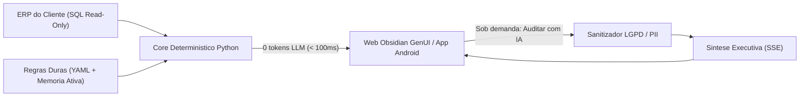

# Arquitetura, Zero-Token e Domain Packs

Este documento apresenta os pilares arquiteturais da plataforma **AURA** para clientes e parceiros integradores.

---

## 1. Modelo Hibrido: Motor Deterministico + Sintese Cognitiva sob Demanda

A AURA separa rigidamente **calculo e governanca** de **linguagem natural**:

- **Camada Deterministica (Zero-Token):** Executa simulacoes Monte Carlo, avaliacao binaria de regras de negocio, deteccao estatistica de desvios (Z-score / IQR) e backtesting de ROI em milissegundos, com `llm_calls = 0`.
- **Camada Cognitiva (Sob Demanda):** Acionada somente quando o gestor solicita diagnostico em linguagem natural ou clica explicitamente em **"Auditar este cenario com IA"**, sempre apos sanitizacao de dados pessoais (LGPD).

---

## 2. Multi-Dominio Estrito (Domain Packs)

A AURA e agnostica de vertical e opera por meio de **Domain Packs** identificados por `pack_id`. O roteamento de ferramentas, regras de negocio, perfis estatisticos e micro-widgets respeita estritamente o `pack_id` ativo:

| `pack_id` | Vertical de Negocio | Exemplos de Foco Operacional |
| :--- | :--- | :--- |
| `fuel_convenience` | Postos de Combustiveis e Conveniencia | Tanques, autonomia, LMC ANP, pista e loja de conveniencia |
| `pharmacy_health` | Farmacias e Saude | Ruptura Curva A, repasses PBM, validade de lotes e SNGPC |
| `retail_supermarket` | Supermercados e Varejo | Gondola, giro, quebras, cancelamentos PDV e cross-sell |
| `autocenter_parts` | Autocentro e Pecas | Giro de pecas/lubrificantes, rentabilidade por OS e revisoes |
| `wholesale_distribution` | Atacado e Distribuicao | Cobertura de lotes B2B, capital parado e descontos comerciais |

### Regra de Isolamento de Interface
- **Componentes universais** (como `WhatIfSimulatorCard`, `GovernanceHiCBanner` e `RealizedRoiScorecardCard`) funcionam de forma identica para qualquer `pack_id`.
- **Componentes de nicho** (como o medidor visual de tanques `TankTile`) sao renderizados exclusivamente quando o `pack_id` ativo e compativel (`fuel_convenience`), evitando ruido visual ou terminologia incorreta em outras verticais.

---

## 3. Isolamento Multi-Tenant e Multi-Dominio

Todas as tabelas analiticas de simulacao, memoria institucional e telemetria de intencao sao particionadas e filtradas pela chave composta `(tenant_id, pack_id)`:

- Regras aprovadas em um `tenant_id` ou `pack_id` nunca vazam para outro cliente ou vertical.
- Snapshots de simulacao e resultados de backtesting sao imutaveis (append-only) para preservar rastreabilidade de auditoria.

---

## 4. Protocolo Human-in-Command (HiC)

O protocolo HiC garante controle humano total sobre a evolucao da inteligencia operacional:

1. **Regras aprendidas ou extraidas** de correcoes do operador entram sempre com `status = "candidate"`.
2. Regras `candidate` ficam **bloqueadas** tanto nos calculos de simulacao quanto no contexto de prompts ate aprovacao explicita.
3. Propostas de **auto-calibracao** geradas pelo backtesting tambem nascem como `candidate` e so passam a influenciar simulacoes futuras apos aprovacao via endpoint de decisao HiC.
4. Acoes externas criticas exigem confirmacao explicita e rastreabilidade auditavel.
