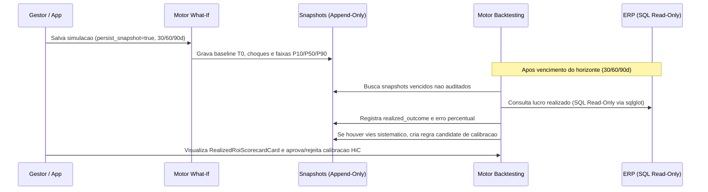

# Funcionalidades: What-If Zero-Token, Governanca HiC e Backtesting de ROI

Este guia descreve o funcionamento completo das capacidades de inteligencia deterministica, governanca humana e auditoria de retorno entregues nas Fases 1 a 4B (Core Python, Web SDK e App Android).

---

## 1. Simulador What-If Deterministico (Zero-Token)

Permite que o gestor teste alteracoes de preco, desconto, custo de fornecedor, repasse de custo e prazos financeiros antes de aplicar qualquer mudanca no ERP.

### Como funciona
1. O operador ajusta os sliders interativos no micro-widget **`WhatIfSimulatorCard`** (Web ou Android).
2. A interface aplica debounce (`~150ms` a `200ms`) e chama exclusivamente `POST /api/v1/simulate/recompute`.
3. O motor Python executa uma simulacao **Monte Carlo deterministica** (padrao `5.000` iteracoes com `seed` fixa para reprodutibilidade), retornando em milissegundos com `llm_calls = 0`:
   - **Faixas P10 / P50 / P90:** cenarios conservador, base (mediana) e otimista em R$, alem da probabilidade de resultado positivo (`prob_positive_pct`).
   - **Drivers de Sensibilidade:** quais parametros mais impactam o resultado financeiro.
   - **Validacao Binaria de Regras Duras (`violated_rules`):** verifica o cenario contra as regras do Domain Pack (YAML) e as regras `active` da Memoria Institucional.
   - **Proveniência (`provenance`):** identifica origem da base (`erp_historical`, `manual_baseline` ou `snapshot`), contagem de regras ativas (YAML + Memoria) e documentos citados.
4. **Auditoria com IA sob demanda:** somente quando o operador clica explicitamente em **"Auditar este cenario com IA"** o resumo estruturado do cenario e enviado ao chat cognitivo para parecer executivo e plano de acao.

### Cenarios suportados (`scenario_type`)
- `price_discount_change`: simulacao de reajuste de preco e descontos promocionais considerando elasticidade-preco.
- `cost_supplier_variation`: simulacao de aumento/reducao de custo de fornecedor e percentual de repasse ao preco final.
- `payment_term_cashflow`: simulacao de impacto no capital de giro por alteracao em dias de recebimento (`receivable_days_delta`) ou pagamento (`payable_days_delta`).

---

## 2. Memoria Institucional e Governanca HiC

Permite que a AURA aprenda restricoes especificas do negocio sem jamais alterar politicas de forma silenciosa.

### Fluxo de Regras Candidatas (`business_memory_rules`)
1. Quando o gestor expressa uma diretriz operacional no chat (por exemplo, *"nunca operar abaixo de 12% de margem"*), o `MemoryManager` extrai a metrica, operador (`>=`, `<=`, `between`, etc.) e limite, gravando a regra com **`status = "candidate"`**.
2. Enquanto estiver em `candidate`, a regra **nao participa** do motor What-If nem e injetada no contexto do LLM.
3. No card compacto **`GovernanceHiCBanner`** (Web e Android), o gestor visualiza as regras pendentes com botoes claros de **Aprovar** (`status = "active"`) ou **Rejeitar** (`status = "rejected"`).
4. A decisao e registrada via `POST /api/v1/memory/rules/{rule_id}/decision` com autor, motivo e carimbo temporal. Uma regra ja decidida nao pode ser sobrescrita silenciosamente (retorna HTTP `409 Conflict`).

### Sugestoes Proativas do Profiler (`operator_intent_signals`)
1. Consultas recorrentes do operador sao contabilizadas de forma sanitizada (zero PII) por topico e metrica.
2. Quando um topico atinge recorrencia minima na janela configurada (padrao `>= 3` ocorrencias em `7` dias), o endpoint `GET /api/v1/memory/suggestions` devolve um card de simulacao pronta (`SuggestedSimulationCard`).
3. Ao clicar em **"Simular"** no `GovernanceHiCBanner`, o `WhatIfSimulatorCard` abre pre-carregado com o cenario e choques sugeridos, mantendo **0 tokens LLM**.

> **Nota sobre estado inicial:** Quando nao ha regras `candidate` nem sugestoes pendentes para o `(tenant_id, pack_id)` ativo, o banner `GovernanceHiCBanner` permanece oculto para manter a interface limpa e nao intrusiva.

---

## 3. Backtesting de ROI: Previsto vs. Realizado (30 / 60 / 90 dias)

Fecha o ciclo de confianca da IA comparando o que foi simulado no passado com o resultado efetivamente realizado no ERP.

### Ciclo de vida completo

### O que o `RealizedRoiScorecardCard` exibe
- **Previsto vs. Realizado:** total projetado vs. total realizado auditado em R$ com seletor de janela `30d`, `60d` e `90d`.
- **Metricas de Acuracia:** Erro Medio Absoluto (`mean_abs_error_pct`), Taxa de Acerto dentro da faixa `P10-P90` (`hit_rate_pct`), multiplo de ROI (`roi_multiple`) e quantidade de acoes auditadas (`audited_actions_count`).
- **Comparativo por Cenario:** barra visual situando o resultado realizado em relacao a faixa `[P10 .. P50 .. P90]` e badge de erro percentual.
- **Painel de Calibracao HiC (`pending_calibration`):** quando o motor identifica vies recorrente, sugere ajuste no fator de elasticidade (`current_factor -> suggested_factor`) com botoes **Aprovar Fator** e **Rejeitar**.

> **Por que o card inicia zerado em uma instalacao nova?**  
> O scorecard exibe exclusivamente snapshots reais persistidos (`persist_snapshot=true`) e auditados contra o ERP via `POST /api/v1/simulate/backtest/run`. Em ambientes recem-provisionados, ele apresenta `R$ 0` e `0 Auditadas` ate que as primeiras simulacoes sejam salvas e auditadas.

---

## 4. Micro-Widgets Nativos (Web Obsidian GenUI e Android Obsidian Aurora)

Os micro-widgets foram construidos com paridade de contratos entre o SDK Web e o aplicativo Android nativo (Jetpack Compose):

| Componente | Papel | Consumo de LLM | Compatibilidade `pack_id` |
| :--- | :--- | :---: | :--- |
| `WhatIfSimulatorCard` | Sliders com debounce, faixas P10/P50/P90, badges de regras violadas, rodape de proveniencia e CTA de auditoria IA. | `0` ao arrastar (IA apenas no botao) | Todos os Domain Packs |
| `GovernanceHiCBanner` | Banner compacto expansivel com sugestoes proativas e aprovar/rejeitar regras `candidate`. | `0` | Todos os Domain Packs |
| `RealizedRoiScorecardCard` | Comparativo Previsto vs. Realizado (`30/60/90d`), erro percentual e controle HiC de calibracao. | `0` | Todos os Domain Packs |
| `TankTile` (Nicho) | Telemetria visual de tanques e autonomia em horas. | `0` | Somente `fuel_convenience` |
