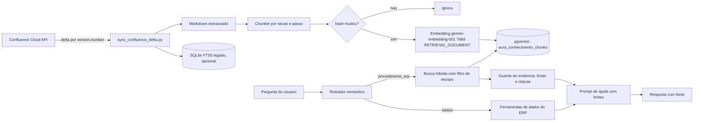

# Apendice: Conhecimento Multicamada e RAG do Confluence no pgvector

> Status: proposta para implementacao
> Escopo: tornar o acervo do Confluence (e o aprendizado futuro de cada posto) consultavel pela AURA de forma eficiente, segura contra alucinacao e pronta para o modo "cerebro central" (VPS).
> Regra do repositorio: zero travessoes Unicode (U+2014 e U+2013) neste arquivo, no codigo e nas mensagens de commit.

---

## 1. Diagnostico (estado atual verificado)

| Item | Situacao hoje |
|---|---|
| Acervo Confluence | 2.072 registros `confluence_procedimentos` em `data/webposto_knowledge.db` (SQLite FTS5, sem embeddings) |
| Chunking | Inexistente: 1 registro por pagina. 166 registros com mais de 4 mil caracteres, 44 com mais de 10 mil (maior: 108 mil). 478 com menos de 300 caracteres |
| pgvector (`aura_conhecimento_vetores`) | 26 registros (sementes ANP, INMETRO, cockpit). Nenhum do Confluence |
| Uso do acervo FTS5 | Somente no `except` de `rag_engine.search_hybrid_conhecimento` (fallback quando o pgvector falha). `tools.consultar_conhecimento_webposto` nao e chamada por nenhum fluxo |
| Roteamento | Nao existe intencao para "como faco X no sistema". O roteador vetorial classifica essas perguntas em intencoes de dados (`clientes_ranking`, `previsao_tanques`, `dados_filial`) |
| Consulta FTS | Termos unidos por `OR`, sem remocao de palavras vazias, sem filtro por camada |
| Embeddings | `gemini-embedding-001`, 768 dimensoes, `halfvec(768)`, HNSW `halfvec_cosine_ops` (m=24, ef_construction=128) |
| Multi-tenant | `TenantContext` e RLS por `filial_id` existem para o ERP; a tabela de vetores nao tem coluna de escopo e o RLS esta desligado nela |
| Observacao | A tabela existe em dois schemas (`public` e `aura_core`). Definir qual e a fonte unica (ver secao 5.1) |

Causa da resposta generica: a pergunta nao chega ao acervo (roteamento) e, mesmo que chegasse, o acervo nao esta no indice usado no fluxo normal.

---

## 2. Principios de projeto

1. **Uma tabela, varias camadas.** Conhecimento comum fica compartilhado; so a memoria do posto e por cliente.
2. **Escopo explicito em cada chunk** (`camada`, `vertical`, `erp`, `tenant_id`) e filtro obrigatorio na busca.
3. **Evidencia ou silencio.** A AURA responde procedimento apenas com trechos recuperados acima de um limiar e cita a fonte. Sem evidencia, diz que nao encontrou.
4. **Dado numerico vem do banco, nunca do RAG.** Procedimento nao substitui consulta ao ERP.
5. **Reindexacao incremental** por hash de conteudo, sem reprocessar o acervo inteiro.
6. **Mesmo modelo de embedding em todas as camadas** (trocar exige reindexar tudo).
7. **Local primeiro, central depois.** Hoje `tenant_id` tem valor fixo; na VPS basta ligar RLS e trocar o valor.

---

## 3. Modelo de conhecimento em camadas

| `camada` | Conteudo | Escopo | Exemplo |
|---|---|---|---|
| `core` | Normas e comportamento da AURA | Todos os clientes | ANP, INMETRO, SEFAZ, politicas de resposta |
| `vertical` | Conceitos do segmento | Todos de um domain pack | LMC, turno, sangria, quebra de caixa |
| `erp` | Procedimentos de um sistema | Todos que usam aquele ERP | Paginas do Confluence do webPosto |
| `tenant` | Memoria do posto | Um unico cliente | Apelidos de produto, rotinas, correcoes do gestor |

Regras de precedencia:
- Para preferencias e rotinas, a camada mais especifica vence (`tenant` sobre `erp` sobre `vertical`).
- Para norma legal e regra fiscal, `core` nunca e sobrescrita.
- Todo conhecimento `tenant` nasce com `status = 'pendente'` e so passa a `ativo` apos revisao (ver secao 9).

Consulta de escopo (aplicada em toda busca):

```sql
WHERE status = 'ativo'
  AND (
        camada = 'core'
     OR (camada = 'vertical' AND vertical = :vertical)
     OR (camada = 'erp'      AND erp      = :erp)
     OR (camada = 'tenant'   AND tenant_id = :tenant)
  )
```

---

## 4. Arquitetura alvo



---

## 5. Esquema de dados

### 5.1 Decisao de schema
- Fonte unica: `aura_core`. O schema `public` deve conter apenas views de compatibilidade ou ser removido apos migracao. Antes de aplicar, rodar `SELECT extversion FROM pg_extension WHERE extname = 'vector';` (necessario pgvector 0.8 ou superior para `iterative_scan`).
- Nova tabela `aura_core.aura_conhecimento_chunks` para o acervo. A tabela atual `aura_conhecimento_vetores` (26 sementes) recebe as colunas de escopo e continua valida para o fluxo existente; na fase 5 as duas passam a ser consultadas pela mesma funcao.

### 5.2 DDL proposto

```sql
CREATE TABLE IF NOT EXISTS aura_core.aura_conhecimento_chunks (
    id              BIGSERIAL PRIMARY KEY,
    camada          TEXT NOT NULL CHECK (camada IN ('core','vertical','erp','tenant')),
    vertical        TEXT,
    erp             TEXT,
    tenant_id       TEXT NOT NULL DEFAULT 'posto_local',
    status          TEXT NOT NULL DEFAULT 'ativo' CHECK (status IN ('ativo','pendente','obsoleto')),

    -- origem e rastreabilidade
    fonte           TEXT NOT NULL,          -- ex: confluence
    doc_id          TEXT NOT NULL,          -- ex: CONF-5865540
    doc_titulo      TEXT NOT NULL,
    doc_url         TEXT,
    doc_versao      INTEGER,
    breadcrumb      TEXT,                   -- ex: Retaguarda > Compras > Entradas (NFe e CTe)
    secao           TEXT,
    chunk_idx       INTEGER NOT NULL,
    chunk_total     INTEGER NOT NULL,

    -- conteudo
    conteudo        TEXT NOT NULL,          -- texto exibivel
    conteudo_embed  TEXT NOT NULL,          -- texto contextualizado usado no embedding
    n_tokens        INTEGER,
    hash_md5        TEXT NOT NULL,
    atualizado_em   TIMESTAMPTZ NOT NULL DEFAULT now(),

    embedding       halfvec(768),
    tsv             tsvector GENERATED ALWAYS AS (
                        setweight(to_tsvector('portuguese', coalesce(doc_titulo,'')), 'A') ||
                        setweight(to_tsvector('portuguese', coalesce(breadcrumb,'')), 'B') ||
                        setweight(to_tsvector('portuguese', coalesce(conteudo,'')),   'C')
                    ) STORED,

    UNIQUE (camada, erp, tenant_id, doc_id, chunk_idx)
);

-- vetor: HNSW com cosseno (mesmos parametros do indice atual)
CREATE INDEX IF NOT EXISTS idx_chunks_hnsw
    ON aura_core.aura_conhecimento_chunks
    USING hnsw (embedding halfvec_cosine_ops) WITH (m = 24, ef_construction = 128);

-- lexical
CREATE INDEX IF NOT EXISTS idx_chunks_tsv ON aura_core.aura_conhecimento_chunks USING gin (tsv);

-- filtros de escopo
CREATE INDEX IF NOT EXISTS idx_chunks_escopo
    ON aura_core.aura_conhecimento_chunks (camada, vertical, erp, tenant_id, status);
CREATE INDEX IF NOT EXISTS idx_chunks_doc
    ON aura_core.aura_conhecimento_chunks (doc_id, doc_versao);
```

### 5.3 Colunas de escopo na tabela atual (migracao reversivel)

```sql
ALTER TABLE aura_core.aura_conhecimento_vetores
    ADD COLUMN IF NOT EXISTS camada    TEXT NOT NULL DEFAULT 'core',
    ADD COLUMN IF NOT EXISTS vertical  TEXT,
    ADD COLUMN IF NOT EXISTS erp       TEXT,
    ADD COLUMN IF NOT EXISTS tenant_id TEXT NOT NULL DEFAULT 'posto_local',
    ADD COLUMN IF NOT EXISTS status    TEXT NOT NULL DEFAULT 'ativo';

-- classificar as 26 sementes existentes
UPDATE aura_core.aura_conhecimento_vetores SET camada = 'core'
 WHERE modulo IN ('compliance_anp','macroeconomia_bacen','metrologia_inmetro','tributario_combustiveis','fiscal','navegacao','console');
UPDATE aura_core.aura_conhecimento_vetores SET camada = 'vertical', vertical = 'posto'
 WHERE modulo IN ('cockpit','conciliacao','triggers','split','conveniencia');
```

Reversao: `ALTER TABLE ... DROP COLUMN` das cinco colunas (nenhum dado original e alterado).

### 5.4 RLS (preparado hoje, ligado na VPS)

```sql
ALTER TABLE aura_core.aura_conhecimento_chunks ENABLE ROW LEVEL SECURITY;

CREATE POLICY escopo_leitura ON aura_core.aura_conhecimento_chunks
    FOR SELECT USING (
        camada IN ('core','vertical','erp')
        OR tenant_id = current_setting('aura.tenant_id', true)
    );

CREATE POLICY escopo_escrita_tenant ON aura_core.aura_conhecimento_chunks
    FOR INSERT WITH CHECK (
        camada <> 'tenant' OR tenant_id = current_setting('aura.tenant_id', true)
    );
```

A conexao do vetor injeta `SET LOCAL aura.tenant_id = ...` reaproveitando `TenantContext` e `inject_rls_filial_context` de `core/db_pool.py`. No modo local, a policy pode permanecer criada porem a role de servico local nao e sujeita a ela (`BYPASSRLS`), e na VPS a role da aplicacao passa a ser sujeita.

---

## 6. Chunking (o ponto que mais afeta a qualidade)

### 6.1 Regras
1. **Unidade estrutural primeiro:** dividir o Markdown por cabecalhos (`#`, `##`, `###`). Cada secao e um candidato a chunk.
2. **Janela alvo:** 500 a 900 tokens por chunk; maximo rigido de 1.100. Secoes maiores sao divididas por passo numerado, lista ou paragrafo, nunca no meio de uma frase ou de uma tabela.
3. **Sobreposicao:** 10 a 15 por cento (cerca de 80 tokens) apenas quando a divisao ocorre dentro de uma mesma secao.
4. **Tabelas e listas de passos:** mantidas inteiras no mesmo chunk sempre que couberem; tabelas grandes sao divididas por grupo de linhas repetindo o cabecalho da tabela.
5. **Piso:** chunks abaixo de 120 tokens sao fundidos com o vizinho da mesma secao. Paginas inteiras abaixo de 300 caracteres e sem conteudo procedimental (indices, hubs `HUB-MODULO-*`) viram **metadado de navegacao** (alimentam o `breadcrumb`) e nao entram no indice vetorial.
6. **Paginas gigantes** (ex.: "Revenda / TEF" com 108 mil caracteres): processadas pela mesma regra; o resultado esperado sao dezenas de chunks coerentes.

### 6.2 Recuperacao contextual
O texto enviado ao modelo de embedding (`conteudo_embed`) e diferente do exibido (`conteudo`). Ele recebe um prefixo curto que devolve o contexto que o chunk perdeu ao ser separado da pagina:

```
[Retaguarda > Compras > Entradas (NFe e CTe)] [Secao: Receber nota de fornecedor]
Para registrar a entrada de uma NF-e de fornecedor, abra ...
```

O prefixo e montado deterministicamente (titulo, breadcrumb e secao). Opcionalmente, uma fase posterior pode gerar um resumo de uma linha por chunk com um modelo leve; so adotar se a avaliacao (secao 10) mostrar ganho.

### 6.3 Higienizacao antes de indexar
- Remover macros do Confluence sem valor (sumario, navegacao, rodape).
- Normalizar espacos, preservar blocos de codigo e nomes de campos.
- A sanitizacao de marca (`sanitize_erp_brand_names`) **nao** e aplicada na indexacao. Ela continua apenas na saida ao usuario, para que a busca por termos reais do ERP continue funcionando.
- Registrar `doc_versao` (`version.number` do Confluence) para o delta.

---

## 7. Pipeline de ingestao

Reaproveita `scripts/sync_confluence_delta.py` (ja baixa delta, converte para Markdown e mantem checkpoint). Novo script: `scripts/ingest_confluence_pgvector.py`.

1. Ler os Markdown do diretorio de fontes e o `confluence_checkpoint.json`.
2. Para cada pagina nova ou com `version.number` maior, gerar os chunks (secao 6).
3. Calcular `hash_md5` de cada `conteudo_embed`.
4. Comparar com os hashes ja gravados para o par (`doc_id`, `chunk_idx`):
   - igual: manter;
   - diferente ou novo: gerar embedding e fazer `INSERT ... ON CONFLICT (...) DO UPDATE`;
   - chunk que deixou de existir: marcar `status = 'obsoleto'`.
5. Embedding em lote: `gemini-embedding-001`, `output_dimensionality = 768`, `task_type = RETRIEVAL_DOCUMENT`, com lotes, retentativa com backoff e controle de taxa. A consulta usa `task_type = RETRIEVAL_QUERY` (assimetria recomendada pelo modelo).
6. Normalizar o vetor (norma L2) antes de gravar, ja que a dimensao reduzida nao vem normalizada.
7. Ao final do lote, `ANALYZE aura_core.aura_conhecimento_chunks;`. Reconstrucao do HNSW so se a carga inicial for muito grande (preferir criar o indice depois da carga em massa).
8. Relatorio de execucao: paginas processadas, chunks novos, atualizados, obsoletos, tokens e tempo.

Parametros de operacao: modo `--full` (primeira carga) e `--delta` (rotina diaria). A rotina diaria pode ser agendada no mesmo mecanismo que ja dispara o `sync_confluence_delta.py`.

---

## 8. Recuperacao hibrida

### 8.1 Consulta
1. **Normalizar a pergunta:** minusculas, remover palavras vazias do portugues ("como", "faco", "de", "uma"), manter termos de dominio (NF-e, TEF, sangria).
2. **Dois ramos em paralelo, ambos com o filtro de escopo (secao 3):**
   - **Vetorial:** `embedding <=> :query_vec` (cosseno), top 30.
   - **Lexical:** `tsv @@ websearch_to_tsquery('portuguese', :q)` ordenado por `ts_rank_cd`, top 30. Estrategia em camadas: tentar AND; se vier vazio, relaxar para OR.
3. **Fusao por RRF** (`k = 60`), que o `rag_engine` ja implementa.
4. Truncar nos 5 melhores e **expandir**: para cada chunk escolhido, trazer o anterior e o seguinte da mesma secao apenas se couberem no orcamento de contexto.
5. **Deduplicar** por `doc_id` (no maximo 2 chunks por pagina nos resultados finais).

### 8.2 Filtro com HNSW
Filtros por `camada`, `erp` e `tenant_id` podem reduzir demais o conjunto retornado pelo indice. Habilitar o varrimento iterativo (pgvector 0.8):

```sql
SET LOCAL hnsw.iterative_scan = relaxed_order;
SET LOCAL hnsw.ef_search = 100;
```

Se o volume por escopo ficar muito pequeno, o planejador pode preferir varredura sequencial, o que e aceitavel e rapido nesse tamanho.

### 8.3 Limiar e decisao
- Cada candidato recebe `score_rrf` e `cosine_similarity` do ramo vetorial.
- Definir **limiar minimo** (valor inicial sugerido: similaridade 0,55; calibrar com o conjunto de avaliacao).
- Se nenhum chunk passar do limiar, retornar `evidencia_insuficiente = true`.

### 8.4 Reordenacao opcional
Camada de rerank (modelo cross-encoder leve ou reranker por LLM) sobre os 20 candidatos. So implementar se a avaliacao mostrar que o acerto no top 3 fica abaixo da meta com a busca hibrida simples.

---

## 9. Integracao com roteador, prompt e memoria do posto

### 9.1 Nova intencao `procedimento_erp`
- Registrar em `semantic_router.py` com frases de treino do tipo: "como faco", "onde fica", "passo a passo", "como lancar", "como cancelar", "como configurar", "o que significa o campo".
- Adicionar regra deterministica de apoio (padroes lexicais) para pegar o caso antes da similaridade vetorial classificar como intencao de dados.
- Em `aura_engine._resolver_contexto_ferramenta`, a intencao chama a nova busca hibrida (e nao mais `consultar_conhecimento_aura` com 2 sementes).
- Manter `ajuda_sistema` para duvidas sobre a propria AURA.

### 9.2 Prompt com evidencia
- O prompt de ajuda recebe os chunks numerados `[1]`, `[2]` com titulo, breadcrumb e URL.
- Instrucoes: responder somente com base nos trechos; citar `[n]` ao lado de cada passo; se `evidencia_insuficiente`, responder que nao encontrou na documentacao e sugerir reformular, sem inventar.
- A resposta final cita a pagina de origem. A marca do ERP continua sanitizada na saida; a URL e o titulo exibidos ao usuario passam pelo mesmo sanitizador.

### 9.3 Memoria do posto (camada `tenant`)
- Fase posterior. Eventos aprendidos (apelido de produto, correcao do gestor, rotina) sao gravados com `camada = 'tenant'`, `status = 'pendente'`.
- Promocao a `ativo` exige confirmacao do gestor na interface ou regra objetiva (por exemplo, mesma correcao confirmada 3 vezes).
- Itens `tenant` nunca sao copiados para outras camadas nem para outros tenants.

---

## 10. Avaliacao (obrigatoria antes de considerar concluido)

Conjunto de teste em `tests/rag/golden_procedimentos.json` com 30 perguntas reais de operacao e a pagina esperada (`doc_id`) para cada uma. Casos obrigatorios:
- as duas perguntas que falharam em producao (registrar o texto exato);
- entrada de NF de fornecedor, sangria, cancelamento de cupom, TEF, abertura e fechamento de caixa, lancamento de despesa;
- perguntas fora do acervo (devem retornar `evidencia_insuficiente`);
- perguntas de dados do posto (devem continuar indo para as ferramentas do ERP e nao para o RAG);
- isolamento: um chunk `tenant` de um posto de teste nao pode aparecer para outro `tenant_id`.

Metricas e metas iniciais:

| Metrica | Meta |
|---|---|
| Acerto no top 3 (`doc_id` esperado) | maior ou igual a 85 por cento |
| Acerto no top 1 | maior ou igual a 65 por cento |
| Perguntas fora do acervo corretamente recusadas | maior ou igual a 90 por cento |
| Perguntas de dados roteadas para o ERP | 100 por cento |
| Vazamento entre tenants | 0 |
| Latencia da busca (p95, local) | menor que 300 ms sem rerank |

O teste roda no `pytest` e imprime a tabela de resultados por pergunta, para ajustar chunking, limiar e pesos com dados.

---

## 11. Fases de implementacao

| Fase | Entrega | Criterio de aceite |
|---|---|---|
| 0 | Verificar `extversion` do pgvector, definir schema fonte unico, backup do banco vetorial | Versao confirmada e backup restauravel |
| 1 | Migracao do esquema (secao 5.3), classificacao das 26 sementes, tabela de chunks (5.2) | Migracao reversivel testada; fluxo atual da AURA inalterado |
| 2 | Chunker e testes unitarios (distribuicao de tamanho, tabelas intactas, hubs fora do indice) | Nenhum chunk acima de 1.100 tokens; amostra revisada manualmente |
| 3 | Ingestao em lote com embeddings e hash incremental | `--full` conclui; `--delta` reprocessa so o alterado |
| 4 | Busca hibrida com filtro de escopo, limiar e RRF | Metricas da secao 10 medidas, sem roteamento ainda |
| 5 | Intencao `procedimento_erp`, prompt com citacao, guarda de evidencia | As duas perguntas que falharam passam a ser respondidas com fonte |
| 6 | Escopo por tenant no `db_pool` e policies de RLS preparadas | Teste de isolamento com dois `tenant_id` passa |
| 7 | (Futuro) Memoria `tenant` com revisao | Item aprendido so ativa apos confirmacao |
| 8 | (Futuro, VPS) Ligar RLS para a role da aplicacao, `tenant_id` por posto, autenticacao por tenant na API | Teste de penetracao basico sem vazamento |

Cada fase e um commit independente, com testes verdes e `web/` e `dist/AuraBackend/_internal/web/` sincronizados quando houver mudanca de front-end.

---

## 12. Riscos e mitigacoes

| Risco | Mitigacao |
|---|---|
| Chunks ruins degradam a busca | Avaliacao da secao 10 antes de ativar o roteamento; ajuste iterativo de tamanho e sobreposicao |
| Conteudo desatualizado do Confluence | `doc_versao` e `atualizado_em`; rotina `--delta` diaria; status `obsoleto` |
| Custo e limite de taxa do modelo de embedding | Hash incremental; lotes; cache; carga completa uma unica vez |
| Troca futura do modelo de embedding | Guardar `modelo_embedding` em metadado de execucao; reindexar tudo se mudar |
| Vazamento entre clientes na VPS | `tenant_id` em toda linha, RLS, testes de isolamento obrigatorios |
| Resposta com trecho fraco | Limiar, citacao `[n]`, modo "nao encontrei" |
| Dados pessoais ou comerciais do posto indo para a nuvem | Decidir o que sobe para a central (so memoria aprendida ou tambem dados operacionais); consentimento e LGPD antes da fase 8 |
| Duplicidade de schema (`public` e `aura_core`) | Resolver na fase 0 e documentar |

---

## 13. Decisoes pendentes

1. Confirmar a versao do pgvector instalada (define uso de `iterative_scan`).
2. Escolher a fonte unica de schema (`aura_core` recomendado).
3. Definir o que sobe para a central quando houver VPS (apenas camada `tenant` aprendida, ou tambem dados operacionais).
4. Decidir se a camada `tenant` ja grava aprendizado no inicio ou fica apenas preparada.
5. Fornecer o texto exato das duas perguntas que falharam, para entrarem como primeiros casos do conjunto de avaliacao.

---

## 14. Referencias internas

- `core/rag_engine.py` (busca hibrida, RRF, embeddings 768d)
- `core/webposto_rag.py` e `data/webposto_knowledge.db` (acervo FTS5 atual)
- `core/semantic_router.py` (intencoes, domain packs em `config/domain_packs`)
- `core/aura_engine.py` (`_resolver_contexto_ferramenta`, prompt de ajuda)
- `core/db_pool.py` (`TenantContext`, `inject_rls_filial_context`, `get_vector_connection`)
- `scripts/sync_confluence_delta.py` (delta do Confluence)
- `scripts/init_posto_database.py` (DDL de `aura_conhecimento_vetores`)
