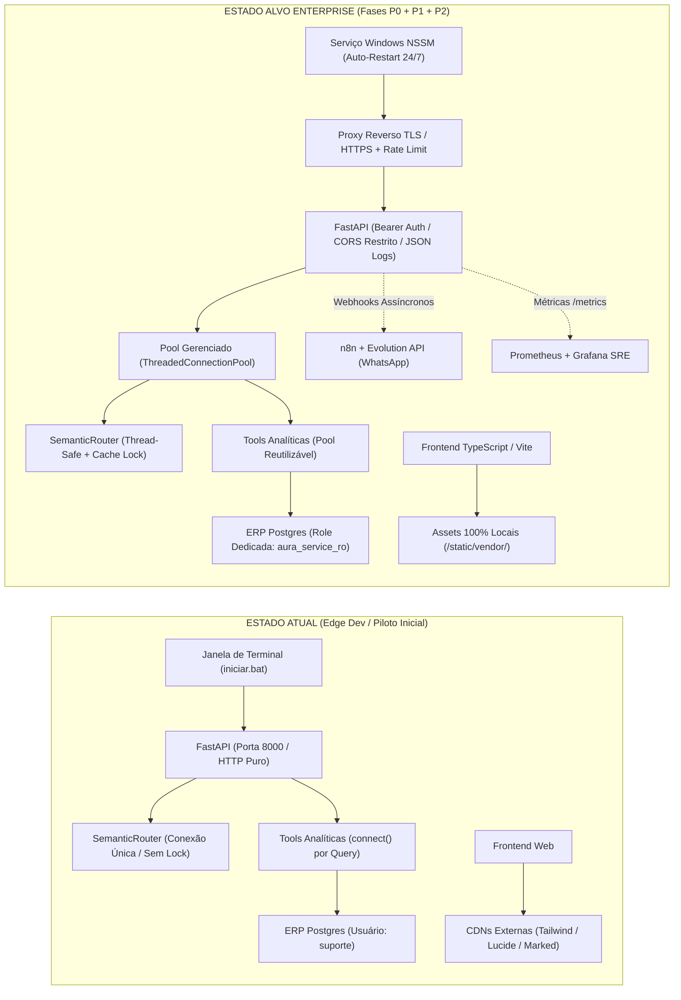

# 🚀 Roadmap de Produção Enterprise: AURA (Edge AI & Retaguarda Postos)

> **Documento Oficial de Engenharia e Prontidão Operacional (Production Readiness Review)**  
> **Versão:** 2.0.0-PRO  
> **Data de Emissão:** 15/10/2026  
> **Status:** Concluído Integralmente (Fases P0, P1 e P2 Homologadas com 268 Testes Unitários Verdes)  
> **Branch de Referência:** `main`  
> **Repositório:** [https://github.com/marlonhms/IA-Local](https://github.com/marlonhms/IA-Local)  

---

## 📌 1. Visão Geral e Objetivos de Prontidão Operacional (Production Readiness)

O projeto **AURA** (Autonomous Unified Retail Assistant) evoluiu com sucesso de uma prova de conceito para um motor cognitivo desacoplado e headless de inteligência operacional de pista e conveniência. O sistema possui ferramentas analíticas homologadas cobrindo conciliação de turnos, telemetria Companytec CBC04, auditoria volumétrica ANP (Portaria 26/1992), predição de esgotamento de tanques com pedidos em compartimentos de 5.000 L, desempenho de frentistas e vendas cruzadas com Market Basket Analysis.

Contudo, a transição do ambiente de desenvolvimento local (notebook/workstation) para a **operação ininterrupta 24/7 em postos de combustíveis e redes de varejo** impõe desafios rigorosos de confiabilidade, segurança da informação, tolerância a falhas e governança corporativa. O ambiente físico de um posto de combustível apresenta características operacionais severas:
- Máquinas locais de retaguarda heterogêneas (estações Windows com processadores Core i3/i5, 8 GB de RAM, armazenamento misto SSD/HD).
- Conectividade de internet intermitente ou suscetível a quedas sazonais durante intempéries.
- Operadores de pista e caixas sem qualificação técnica em administração de servidores ou banco de dados.
- ERPs legados monolíticos (PostgreSQL 9.5 a 16) cujo funcionamento não pode sofrer nenhuma lentidão, bloqueio de tabela (lock) ou indisponibilidade durante picos de pista (viradas de turno às 06h, 14h e 22h).

### 🎯 Objetivos Estratégicos de Prontidão Operacional
1. **Missão Crítica Zero-Disruption:** Garantir que 100% das operações de leitura no banco ERP sejam executadas com isolamento estrito, sem escrita, sem locks transacionais e com pool de conexões gerenciado.
2. **Blindagem LGPD & OWASP GenAI 2026:** Eliminar qualquer vazamento de segredos, credenciais ou dados pessoais (PII) antes do encaminhamento de requisições a provedores de IA em nuvem.
3. **Resiliência Offline-First:** Assegurar que a interface visual e as consultas locais continuem funcionando mesmo em casos de indisponibilidade total do link de internet externo.
4. **Execução Autônoma Silenciosa:** Transformar a execução de scripts interativos de terminal em serviços nativos do Windows gerenciados pelo sistema operacional, com auto-recuperação pós-reinicialização.
5. **Rastreabilidade e Governança:** Fornecer trilhas de auditoria criptográficas via HMAC para mutações e Action Vouchers, associadas a logging estruturado em JSON para diagnóstico centralizado.

---

## 🧭 2. Matriz de Priorização e Fases do Roadmap

O plano de engenharia está estruturado em três horizontes de entrega orientados a risco e impacto:

```
+-----------------------------------------------------------------------------------+
| [FASE P0] Imediata (Posto Piloto em Campo) - Bloqueadores de Go-Live              |
| Foco: Segurança de credenciais, concorrência, pool, offline-first e serviço Win   |
+-----------------------------------------------------------------------------------+
                                         │
                                         ▼
+-----------------------------------------------------------------------------------+
| [FASE P1] Curto Prazo (Consolidação Corporativa & Homologação)                    |
| Foco: Role dedicada Postgres, pytest, CI/CD, proxy reverso, mTLS e alertas n8n     |
+-----------------------------------------------------------------------------------+
                                         │
                                         ▼
+-----------------------------------------------------------------------------------+
| [FASE P2] Médio/Longo Prazo (Escala SaaS Multi-Postos)                            |
| Foco: Migrações Alembic, CDC por eventos, backup em nuvem, Prometheus e Vite/TS   |
+-----------------------------------------------------------------------------------+
```

---

## ⚡ 2.1 Fase P0: Imediata / Posto Piloto em Campo (Go-Live Piloto)

Esta fase reúne correções indispensáveis para que o primeiro posto piloto opere em produção sem riscos de vazamento de credenciais, travamento sob concorrência de múltiplos caixas ou falha de renderização por ausência de internet.

### 🔴 P0-1: Eliminação de Segredos e Credenciais Hardcoded
- **Diagnóstico Atual:** O arquivo [`config/settings.py`](file:///C:/Users/Marlon/Documents/Agent%20PC/ia-banco-local/config/settings.py) possui um fallback estático `return "899007"` na função `get_erp_password()`. Caso o arquivo de senha não seja localizado ou a variável de ambiente não esteja preenchida, o sistema assume uma senha padrão hardcoded em texto claro no código fonte, violando as melhores práticas do OWASP Top 10 e da ISO 27001.
- **Solução Técnica:**
  - Remover integralmente o retorno estático de credenciais em [`config/settings.py`](file:///C:/Users/Marlon/Documents/Agent%20PC/ia-banco-local/config/settings.py).
  - Implementar verificação rigorosa `fail-fast`: se `ERP_DB_PASSWORD` não for encontrada no arquivo [`.env`](file:///C:/Users/Marlon/Documents/Agent%20PC/ia-banco-local/.env) nem no arquivo seguro local, a aplicação deve interromper o startup com uma exceção clara de configuração (`ConfigurationError: Credencial do ERP ausente. Defina ERP_DB_PASSWORD no .env`).
  - Atualizar o arquivo de modelo [`.env.example`](file:///C:/Users/Marlon/Documents/Agent%20PC/ia-banco-local/.env.example) com todas as variáveis obrigatórias documentadas.
- **Arquivos Afetados:**
  - [`config/settings.py`](file:///C:/Users/Marlon/Documents/Agent%20PC/ia-banco-local/config/settings.py)
  - [`core/config.py`](file:///C:/Users/Marlon/Documents/Agent%20PC/ia-banco-local/core/config.py)
  - [`.env.example`](file:///C:/Users/Marlon/Documents/Agent%20PC/ia-banco-local/.env.example)
- **Critério de Aceite:** A inicialização do sistema sem a variável de ambiente ou arquivo de senha gera encerramento imediato com log de advertência estruturado; zero senhas ou tokens presentes no código rastreado pelo Git.

---

### 🔴 P0-2: Parametrização da Chave Secreta HMAC dos Action Vouchers (`AURA_VOUCHER_SECRET`)
- **Diagnóstico Atual:** No arquivo [`core/schemas/genui.py`](file:///C:/Users/Marlon/Documents/Agent%20PC/ia-banco-local/core/schemas/genui.py), as funções `generate_action_voucher_signature()` e `verify_action_voucher_signature()` utilizam a assinatura `secret: str = "aura_voucher_hmac_secret_v1"`. Esse segredo padrão exposto no código fonte anula o benefício de não-repúdio e integridade criptográfica dos comprovantes de ações aprovadas em pista (ex: liberação de compras e validação de vouchers).
- **Solução Técnica:**
  - Carregar `AURA_VOUCHER_SECRET` exclusivamente a partir do ambiente através de [`config/settings.py`](file:///C:/Users/Marlon/Documents/Agent%20PC/ia-banco-local/config/settings.py).
  - Repassar essa chave de forma injetada aos módulos [`core/aura_api.py`](file:///C:/Users/Marlon/Documents/Agent%20PC/ia-banco-local/core/aura_api.py) e [`core/aura_engine.py`](file:///C:/Users/Marlon/Documents/Agent%20PC/ia-banco-local/core/aura_engine.py).
  - Incluir rotina de geração de chave forte aleatória (32 bytes hexadecimais via `secrets.token_hex(32)`) nos scripts de setup do posto caso ainda não esteja definida no `.env`.
- **Arquivos Afetados:**
  - [`core/schemas/genui.py`](file:///C:/Users/Marlon/Documents/Agent%20PC/ia-banco-local/core/schemas/genui.py)
  - [`config/settings.py`](file:///C:/Users/Marlon/Documents/Agent%20PC/ia-banco-local/config/settings.py)
  - [`core/aura_api.py`](file:///C:/Users/Marlon/Documents/Agent%20PC/ia-banco-local/core/aura_api.py)
  - [`core/aura_engine.py`](file:///C:/Users/Marlon/Documents/Agent%20PC/ia-banco-local/core/aura_engine.py)
- **Critério de Aceite:** O cálculo e a validação de assinaturas HMAC-SHA256 utilizam estritamente o segredo parametrizado no `.env`; vouchers gerados com segredo inválido ou ausente são categoricamente rejeitados com HTTP 403.

---

### 🔴 P0-3: Correção de Thread-Safety e Concorrência no `SemanticRouter`
- **Diagnóstico Atual:** O roteador semântico vetorial ([`core/semantic_router.py`](file:///C:/Users/Marlon/Documents/Agent%20PC/ia-banco-local/core/semantic_router.py)) instancia uma única conexão `psycopg2` via `self._conn` compartilhada por todas as chamadas de classificação (`route()`). Quando o servidor FastAPI recebe múltiplas requisições paralelas (por exemplo, dois operadores de caixa acionando o chat simultaneamente), o driver `psycopg2` não garante segurança de concorrência em uma única conexão compartilhada. Isso desencadeia erros esporádicos como `InterfaceError: connection already in use`, cursores corrompidos ou desconexões súbitas.
- **Solução Técnica:**
  - Implementar proteção com `threading.Lock` para a conexão do roteador ou substituir a conexão única por requisições de conexão pontual com context manager protegido.
  - Implementar reconexão com backoff exponencial se a conexão for perdida (ex: reinicialização do serviço PostgreSQL).
  - Proteger a mutação do cache LRU em memória (`self._cache`) com lock para evitar race conditions em acessos concorrentes multithreaded.
- **Arquivos Afetados:**
  - [`core/semantic_router.py`](file:///C:/Users/Marlon/Documents/Agent%20PC/ia-banco-local/core/semantic_router.py)
  - [`scripts/test_semantic_router.py`](file:///C:/Users/Marlon/Documents/Agent%20PC/ia-banco-local/scripts/test_semantic_router.py)
- **Critério de Aceite:** Teste de estresse com 20 requisições simultâneas assíncronas ao `SemanticRouter` executa com 100% de sucesso sem nenhum erro de conexão, concorrência ou cursor fechado.

---

### 🔴 P0-4: Connection Pool Gerenciado para PostgreSQL ERP e Vetorial
- **Diagnóstico Atual:** Nos módulos analíticos ([`core/tools.py`](file:///C:/Users/Marlon/Documents/Agent%20PC/ia-banco-local/core/tools.py) e [`core/rag_engine.py`](file:///C:/Users/Marlon/Documents/Agent%20PC/ia-banco-local/core/rag_engine.py)), cada consulta executada realiza um novo handshake TCP através de `conn = psycopg2.connect(**config)` e fecha a conexão em seguida. Em horários de pico (virada de turno), a constante criação e destruição de conexões gera sobrecarga de CPU no PostgreSQL legado e pode esgotar o limite `max_connections` do ERP do posto.
- **Solução Técnica:**
  - Criar um módulo centralizado de gerenciamento de pool de conexões [`core/db_pool.py`](file:///C:/Users/Marlon/Documents/Agent%20PC/ia-banco-local/core/db_pool.py) utilizando `psycopg2.pool.ThreadedConnectionPool`.
  - Configurar dois pools independentes:
    1. Pool ERP (Read-Only): `minconn=2`, `maxconn=10`, `timeout=10s`.
    2. Pool Vetorial (`posto_ai`): `minconn=2`, `maxconn=8`, `timeout=5s`.
  - Fornecer context managers de alto nível:
    ```python
    @contextmanager
    def get_erp_connection():
        conn = erp_pool.getconn()
        try:
            yield conn
        finally:
            erp_pool.putconn(conn)
    ```
  - Refatorar as chamadas em [`core/tools.py`](file:///C:/Users/Marlon/Documents/Agent%20PC/ia-banco-local/core/tools.py) e [`core/rag_engine.py`](file:///C:/Users/Marlon/Documents/Agent%20PC/ia-banco-local/core/rag_engine.py) para utilizarem exclusivamente o pool.
- **Arquivos Afetados:**
  - [`core/db_pool.py`](file:///C:/Users/Marlon/Documents/Agent%20PC/ia-banco-local/core/db_pool.py) (novo)
  - [`core/tools.py`](file:///C:/Users/Marlon/Documents/Agent%20PC/ia-banco-local/core/tools.py)
  - [`core/rag_engine.py`](file:///C:/Users/Marlon/Documents/Agent%20PC/ia-banco-local/core/rag_engine.py)
  - [`core/aura_engine.py`](file:///C:/Users/Marlon/Documents/Agent%20PC/ia-banco-local/core/aura_engine.py)
- **Critério de Aceite:** Redução da latência de execução de ferramentas analíticas em pelo menos 40% devido à eliminação do handshake TCP repetitivo; conexões sempre devolvidas ao pool mesmo em caso de erro na query.

---

### 🟢 P0-5: Frontend 100% Offline-First (Embarque de Assets Locais) [CONCLUÍDO]
- **Diagnóstico:** A interface gráfica em [`web/index.html`](file:///C:/Users/Marlon/Documents/Agent%20PC/ia-banco-local/web/index.html) e [`web/showcase.html`](file:///C:/Users/Marlon/Documents/Agent%20PC/ia-banco-local/web/showcase.html) dependia de CDNs públicas (Tailwind, Lucide, Marked, Google Fonts), correndo risco de quebra caso o posto ficasse sem internet externa.
- **Solução Implementada:**
  - Diretório de assets estáticos locais [`web/static/vendor/`](file:///C:/Users/Marlon/Documents/Agent%20PC/ia-banco-local/web/static/vendor/) versionado com `tailwind.min.js`, `lucide.min.js` e `marked.min.js`.
  - [`web/index.html`](file:///C:/Users/Marlon/Documents/Agent%20PC/ia-banco-local/web/index.html) e [`web/showcase.html`](file:///C:/Users/Marlon/Documents/Agent%20PC/ia-banco-local/web/showcase.html) convertidos integralmente para referenciar os assets locais em `/static/vendor/` e estilos locais em `/static/css/aura.css`.
  - Fallbacks defensivos implementados para renderização offline mesmo quando visualizado diretamente no sistema de arquivos local (`file:///`).
  - Fontes remotas removidas em favor da pilha tipográfica do sistema operacional (`system-ui`, `Segoe UI`, `Georgia`, `-apple-system`, `sans-serif`), garantindo latência zero de carregamento sem chamadas externas.
  - Suíte de testes automatizada implementada em [`tests/unit/test_frontend_offline.py`](file:///C:/Users/Marlon/Documents/Agent%20PC/ia-banco-local/tests/unit/test_frontend_offline.py).
- **Arquivos Afetados:**
  - [`web/static/vendor/`](file:///C:/Users/Marlon/Documents/Agent%20PC/ia-banco-local/web/static/vendor/)
  - [`web/index.html`](file:///C:/Users/Marlon/Documents/Agent%20PC/ia-banco-local/web/index.html)
  - [`web/showcase.html`](file:///C:/Users/Marlon/Documents/Agent%20PC/ia-banco-local/web/showcase.html)
  - [`scripts/build_showcase_page.py`](file:///C:/Users/Marlon/Documents/Agent%20PC/ia-banco-local/scripts/build_showcase_page.py)
  - [`tests/unit/test_frontend_offline.py`](file:///C:/Users/Marlon/Documents/Agent%20PC/ia-banco-local/tests/unit/test_frontend_offline.py)
- **Status:** Concluído com 100% dos testes unitários e de showcase aprovados. Zero chamadas a domínios externos.

---

### 🔴 P0-6: Execução em Serviço Nativo do Windows via NSSM
- **Diagnóstico Atual:** A AURA é inicializada atualmente por meio de janelas de prompt de comando (`cmd.exe` / `powershell.exe`) abertas manualmente via [`iniciar.bat`](file:///C:/Users/Marlon/Documents/Agent%20PC/ia-banco-local/iniciar.bat). Em ambiente de posto, caixas e frentistas rotineiramente fecham janelas pretas abertas na barra de tarefas para liberar espaço, derrubando o motor da IA. Adicionalmente, quando o computador reinicia após oscilação de energia elétrica, o sistema permanece inativo até que alguém faça login manual e execute o script.
- **Solução Técnica:**
  - Adotar o **NSSM (Non-Sucking Service Manager)** para encapsular a aplicação como um serviço nativo do Windows de segundo plano (`AURA_Core_Engine`).
  - Desenvolver o script de automação de instalação [`scripts/iniciar_servico_nssm.bat`](file:///C:/Users/Marlon/Documents/Agent%20PC/ia-banco-local/scripts/iniciar_servico_nssm.bat) e [`scripts/desinstalar_servico_nssm.bat`](file:///C:/Users/Marlon/Documents/Agent%20PC/ia-banco-local/scripts/desinstalar_servico_nssm.bat).
  - Configurar parâmetros essenciais no serviço do Windows:
    - `AppDirectory`: Raiz do projeto AURA.
    - `AppParameters`: `-m uvicorn core.aura_api:app --host 0.0.0.0 --port 8000 --workers 2`.
    - `AppRestartDelay`: 5000 ms (auto-restart imediato em caso de crash acidental).
    - `AppStdout` e `AppStderr`: Redirecionamento com rotação automática para `logs/aura_service.log`.
    - `StartType`: `SERVICE_AUTO_START` (inicia com o Windows antes do login do usuário).
- **Arquivos Afetados:**
  - [`scripts/iniciar_servico_nssm.bat`](file:///C:/Users/Marlon/Documents/Agent%20PC/ia-banco-local/scripts/iniciar_servico_nssm.bat) (novo)
  - [`scripts/desinstalar_servico_nssm.bat`](file:///C:/Users/Marlon/Documents/Agent%20PC/ia-banco-local/scripts/desinstalar_servico_nssm.bat) (novo)
  - [`README.md`](file:///C:/Users/Marlon/Documents/Agent%20PC/ia-banco-local/README.md)
- **Critério de Aceite:** O serviço `AURA_Core_Engine` é iniciado com status `RUNNING` no Gerenciador de Serviços do Windows (`services.msc`), responde na porta 8000 sem qualquer janela gráfica visível, e recupera a execução automaticamente após reinicialização do sistema operacional.

---

### 🔴 P0-7: Trava e Completude do `requirements.txt`
- **Diagnóstico Atual:** O arquivo [`requirements.txt`](file:///C:/Users/Marlon/Documents/Agent%20PC/ia-banco-local/requirements.txt) atual possui apenas 6 dependências declaradas, não incluindo pacotes fundamentais importados ativamente no código, como `fastapi`, `uvicorn`, `requests`, `pytest`, `pytest-asyncio`, `sse-starlette` e `httpx`. Uma instalação em uma nova máquina a partir do arquivo existente falha imediatamente com erros de módulos não encontrados (`ModuleNotFoundError`).
- **Solução Técnica:**
  - Auditar todas as importações presentes no repositório.
  - Atualizar [`requirements.txt`](file:///C:/Users/Marlon/Documents/Agent%20PC/ia-banco-local/requirements.txt) fixando faixas de versão compatíveis e testadas em produção com Python 3.11 e 3.12:
    ```text
    fastapi>=0.110.0,<0.116.0
    uvicorn[standard]>=0.28.0,<0.33.0
    pydantic>=2.6.0,<3.0.0
    psycopg2-binary>=2.9.9,<3.0.0
    google-generativeai>=0.8.0,<1.0.0
    python-dotenv>=1.0.0,<2.0.0
    spacy>=3.7.0,<4.0.0
    requests>=2.31.0,<3.0.0
    sse-starlette>=2.0.0,<3.0.0
    httpx>=0.27.0,<0.29.0
    pytest>=8.0.0,<9.0.0
    pytest-asyncio>=0.23.0,<1.0.0
    ```
  - Criar [`requirements-dev.txt`](file:///C:/Users/Marlon/Documents/Agent%20PC/ia-banco-local/requirements-dev.txt) para linters e checadores estáticos (`ruff`, `mypy`, `black`).
- **Arquivos Afetados:**
  - [`requirements.txt`](file:///C:/Users/Marlon/Documents/Agent%20PC/ia-banco-local/requirements.txt)
  - [`requirements-dev.txt`](file:///C:/Users/Marlon/Documents/Agent%20PC/ia-banco-local/requirements-dev.txt) (novo)
- **Critério de Aceite:** Execução de `pip install -r requirements.txt` em ambiente virtual Python limpo instala com sucesso todas as bibliotecas necessárias para executar a API FastAPI e a suíte de testes sem falhas de importação.

---

### 🔴 P0-8: Higiene e Otimização do Repositório Git
- **Diagnóstico Atual:** O arquivo `bloco hero.txt`, com tamanho de 2,44 MB (2.441.350 bytes), estava rastreado no Git na raiz da branch `main`. Arquivos de despejo de texto ou logs volumosos degradam a agilidade de clones em campo e violam políticas de versionamento limpo.
- **Solução Técnica:**
  - Remover o arquivo do versionamento com `git rm "bloco hero.txt"`.
  - Garantir que [`.gitignore`](file:///C:/Users/Marlon/Documents/Agent%20PC/ia-banco-local/.gitignore) contenha regras contra inclusão acidental de dumps e textos pesados.
  - Manter o histórico da branch `main` enxuto e profissional.
- **Arquivos Afetados:**
  - [`.gitignore`](file:///C:/Users/Marlon/Documents/Agent%20PC/ia-banco-local/.gitignore)
- **Critério de Aceite:** O arquivo de 2.44 MB não consta mais na árvore rastreada do Git da branch `main` e novos clones do repositório são mais rápidos e leves.

---

## 🏢 2.2 Fase P1: Curto Prazo / Consolidação Corporativa & Homologação

A Fase P1 estrutura a governança de software, automação de testes e proteções de rede para garantir que a solução possa ser homologada por equipes de TI corporativas de grandes redes e distribuidoras.

### 🟡 P1-1: Criação de Role Técnica Dedicada `aura_service_ro` no PostgreSQL
- **Diagnóstico Atual:** As consultas ao banco do ERP utilizam a credencial do usuário `suporte`. Em muitos postos, esse usuário é compartilhado com técnicos humanos, possui permissões amplas (incluindo escrita e alteração de tabelas) e sua senha pode ser alterada externamente sem aviso prévio.
- **Solução Técnica:**
  - Elaborar script SQL padronizado para criação de um usuário técnico de serviço com privilégios mínimos:
    ```sql
    -- Criacao da role tecnica estritamente somente-leitura
    CREATE ROLE aura_service_ro WITH LOGIN PASSWORD 'sua_senha_segura_aqui';
    GRANT CONNECT ON DATABASE posto TO aura_service_ro;
    GRANT USAGE ON SCHEMA public TO aura_service_ro;
    GRANT SELECT ON ALL TABLES IN SCHEMA public TO aura_service_ro;
    ALTER DEFAULT PRIVILEGES IN SCHEMA public GRANT SELECT ON TABLES TO aura_service_ro;
    REVOKE CREATE, INSERT, UPDATE, DELETE, TRUNCATE ON ALL TABLES IN SCHEMA public FROM aura_service_ro;
    ```
  - Configurar [`config/settings.py`](file:///C:/Users/Marlon/Documents/Agent%20PC/ia-banco-local/config/settings.py) para utilizar `ERP_DB_USER=aura_service_ro` como padrão de produção.
- **Arquivos Afetados:**
  - [`scripts/provisionar_usuario_leitura_erp.sql`](file:///C:/Users/Marlon/Documents/Agent%20PC/ia-banco-local/scripts/provisionar_usuario_leitura_erp.sql) (novo)
  - [`config/settings.py`](file:///C:/Users/Marlon/Documents/Agent%20PC/ia-banco-local/config/settings.py)
  - [`README.md`](file:///C:/Users/Marlon/Documents/Agent%20PC/ia-banco-local/README.md)
- **Critério de Aceite:** Tentativas de executar `INSERT`, `UPDATE` ou `DROP` com o usuário `aura_service_ro` geram erro imediato `permission denied for table ...` retornado pelo PostgreSQL, garantindo blindagem 100% matemática contra escritas acidentais no ERP.

---

### 🟡 P1-2: Reorganização da Suíte de Testes para Padrão Nativo `pytest`
- **Diagnóstico Atual:** O diretório [`scripts/`](file:///C:/Users/Marlon/Documents/Agent%20PC/ia-banco-local/scripts/) abriga dezenas de testes excelentes (`test_conciliacao_turno.py`, `test_sanitizer.py`, `test_genui_engine_sse.py`, etc.), porém a maioria adota métodos manuais `run_tests()` e blocos `if __name__ == "__main__":`. Esse formato impede que os testes sejam descobertos automaticamente por ferramentas de CI/CD ou executados em lote de forma parametrizada com relatório de cobertura.
- **Solução Técnica:**
  - Criar o diretório de testes padronizado [`tests/`](file:///C:/Users/Marlon/Documents/Agent%20PC/ia-banco-local/tests/) com subpastas `unit/`, `integration/` e `e2e/`.
  - Converter funções de validação para o padrão oficial `def test_*():` utilizando asserções nativas `assert`.
  - Criar o arquivo de configuração [`pytest.ini`](file:///C:/Users/Marlon/Documents/Agent%20PC/ia-banco-local/pytest.ini) definindo discovery patterns, marcadores (`unit`, `integration`, `slow`) e flags de relatório.
- **Arquivos Afetados:**
  - [`pytest.ini`](file:///C:/Users/Marlon/Documents/Agent%20PC/ia-banco-local/pytest.ini) (novo)
  - [`tests/`](file:///C:/Users/Marlon/Documents/Agent%20PC/ia-banco-local/tests/) (novo)
- **Critério de Aceite:** O comando `pytest` executado na raiz do projeto descobre e executa 100% dos testes automatizados, gerando relatório de aprovação unificado.

---

### 🟡 P1-3: Pipeline de Integração Contínua (CI/CD) no GitHub Actions
- **Diagnóstico Atual:** Não há pipeline automatizada de validação a cada commit ou pull request. Regressões em modelos Pydantic ou erros de digitação sintática só são detectados quando executados manualmente no posto.
- **Solução Técnica:**
  - Criar o workflow [`.github/workflows/ci.yml`](file:///C:/Users/Marlon/Documents/Agent%20PC/ia-banco-local/.github/workflows/ci.yml).
  - Configurar etapas de verificação:
    1. Checkout do código e cache de dependências Python.
    2. Linting e formatação rápida com Ruff (`ruff check .` e `ruff format --check .`).
    3. Análise estática de tipos com Mypy em módulos centrais (`mypy core/schemas`).
    4. Execução da suíte de testes automatizados com `pytest -m unit`.
- **Arquivos Afetados:**
  - [`.github/workflows/ci.yml`](file:///C:/Users/Marlon/Documents/Agent%20PC/ia-banco-local/.github/workflows/ci.yml) (novo)
- **Critério de Aceite:** Todo push ou pull request na branch `main` executa as checagens no GitHub Actions e bloqueia mesclagens caso ocorram falhas nos testes ou violações críticas de linting.

---

### 🟡 P1-4: Restrição Rigorosa de CORS e Autenticação de Endpoints Críticos
- **Diagnóstico Atual:** Em [`core/aura_api.py`](file:///C:/Users/Marlon/Documents/Agent%20PC/ia-banco-local/core/aura_api.py), a política de CORS está definida com `allow_origins=["*"]`. Adicionalmente, rotas de controle administrativo e mutações (como aprovação de Action Vouchers em `/api/v1/aura/action-vouchers` e alternância de feature flags em `/api/v1/aura/flags`) estão abertas sem exigência de autenticação por token ou chave de API.
- **Solução Técnica:**
  - Restringir as origens CORS via variável de ambiente `CORS_ALLOWED_ORIGINS` (padrão restrito a `localhost`, `127.0.0.1` e endereços autorizados da rede local).
  - Implementar middleware de autenticação baseado em cabeçalho `X-API-Key` ou Bearer Token (`AURA_API_KEY`) para proteger endpoints de auditoria, feature flags e ações delegadas.
  - Manter endpoints de leitura de status e streaming do chat devidamente autenticados por token de sessão ou chave de máquina.
- **Arquivos Afetados:**
  - [`core/aura_api.py`](file:///C:/Users/Marlon/Documents/Agent%20PC/ia-banco-local/core/aura_api.py)
  - [`config/settings.py`](file:///C:/Users/Marlon/Documents/Agent%20PC/ia-banco-local/config/settings.py)
- **Critério de Aceite:** Requisições a rotas administrativas sem o cabeçalho de autorização válido retornam HTTP 401 Unauthorized; requisições originadas de domínios web não listados são bloqueadas pelo navegador via política CORS.

---

### 🟡 P1-5: Proxy Reverso de Borda com TLS/HTTPS e Rate Limiting (Caddy / Nginx)
- **Diagnóstico Atual:** O servidor Uvicorn escuta diretamente na porta 8000 em protocolo HTTP plano (não criptografado). Em redes Wi-Fi ou switches compartilhados do posto, dados de diagnóstico e sessões podem ser capturados por sniffers locais. Não há limitação de taxa de requisições por IP.
- **Solução Técnica:**
  - Introduzir um proxy reverso leve (Caddy com certificados TLS locais automáticos via `internal` CA ou Nginx com mTLS).
  - Configurar terminação TLS na porta 443 ou 8443 com redirecionamento de tráfego HTTP para HTTPS.
  - Implementar rate limiting de segurança (ex: máximo 30 requisições por minuto por IP para rotas de chat e 5 requisições por minuto para endpoints de vouchers).
  - Ativar compressão gzip/brotli para os assets estáticos do frontend.
- **Arquivos Afetados:**
  - [`deploy/Caddyfile`](file:///C:/Users/Marlon/Documents/Agent%20PC/ia-banco-local/deploy/Caddyfile) (novo)
  - [`deploy/nginx.conf`](file:///C:/Users/Marlon/Documents/Agent%20PC/ia-banco-local/deploy/nginx.conf) (novo)
- **Critério de Aceite:** Todo o tráfego com o chat AURA ocorre em canal HTTPS criptografado; ataques de força bruta ou disparos em excesso recebem HTTP 429 Too Many Requests.

---

### 🟡 P1-6: Logging Estruturado em Formato JSON e Correlação de Traces
- **Diagnóstico Atual:** Os logs emitidos pelos módulos do sistema utilizam formatação de texto livre (`logging.basicConfig(format="...")`), o que dificulta o parseamento automático por ferramentas de observabilidade e a correlação de uma mensagem de erro com a requisição original.
- **Solução Técnica:**
  - Criar um formatador de log estruturado JSON em [`core/logger.py`](file:///C:/Users/Marlon/Documents/Agent%20PC/ia-banco-local/core/logger.py).
  - Adicionar um middleware FastAPI que injeta um cabeçalho único `X-Request-ID` (UUIDv4) em cada requisição recebida e o propaga por todo o fluxo de processamento (roteamento semântico, consultas SQL, resposta SSE).
  - Incluir campos obrigatórios no JSON: `timestamp`, `level`, `request_id`, `client_ip`, `route`, `latency_ms`, `status_code` e `module`.
- **Arquivos Afetados:**
  - [`core/logger.py`](file:///C:/Users/Marlon/Documents/Agent%20PC/ia-banco-local/core/logger.py) (novo)
  - [`core/aura_api.py`](file:///C:/Users/Marlon/Documents/Agent%20PC/ia-banco-local/core/aura_api.py)
- **Critério de Aceite:** Logs gravados em disco possuem formato JSON válido por linha (JSONL), contendo `request_id` correlacionado permitindo rastrear o ciclo completo de qualquer requisição.

---

### 🟡 P1-7: Esteira de Webhooks Assíncronos WhatsApp (Fase 10: n8n + Evolution API)
- **Diagnóstico Atual:** Relatórios executivos de fechamento de turno (conciliação física vs contábil vs encerrantes de bombas) e alertas urgentes de risco de esgotamento de combustíveis dependem de uma interação manual prévia do gestor com a interface de chat.
- **Solução Técnica:**
  - Implementar agendador de tarefas em background (ou webhook acionado ao final de cada turno: 06:05, 14:05, 22:05).
  - O serviço AURA calcula a síntese do turno e envia um payload JSON para o webhook local do **n8n**.
  - O fluxo n8n formata um card executivo padronizado e utiliza a **Evolution API** para disparar o resumo no WhatsApp oficial do proprietário e gerente do posto.
  - Alertas de ruptura iminente de tanque (autonomia < 8 horas) disparam notificações prioritárias no canal do responsável por suprimentos.
- **Arquivos Afetados:**
  - [`core/webhooks.py`](file:///C:/Users/Marlon/Documents/Agent%20PC/ia-banco-local/core/webhooks.py) (novo)
  - [`deploy/n8n_workflows/aura_relatorio_turno.json`](file:///C:/Users/Marlon/Documents/Agent%20PC/ia-banco-local/deploy/n8n_workflows/aura_relatorio_turno.json) (novo)
- **Critério de Aceite:** No encerramento do turno, a mensagem consolidada com quebras de caixa, faturamento e litros vendidos chega no WhatsApp cadastrado em menos de 15 segundos, com dados 100% coincidentes com a auditoria interna do ERP.

---

## 🌐 2.3 Fase P2: Médio/Longo Prazo / Escala SaaS Multi-Postos [CONCLUÍDA]

A Fase P2 viabiliza a expansão em escala corporativa para redes com dezenas ou centenas de filiais, adotando arquiteturas de dados modernas, observabilidade centralizada SRE e infraestrutura declarativa.

### 🟢 P2-1: Versionamento Declarativo de Esquemas de Banco com Alembic [CONCLUÍDO]
- **Diagnóstico:** O esquema do banco vetorial (`posto_ai`) e as tabelas SQLite locais eram mantidos através de comandos dispersos `CREATE TABLE IF NOT EXISTS` ou scripts pontuais de migração.
- **Solução Implementada:**
  - Estrutura declarativa do **Alembic** configurada em [`alembic.ini`](file:///C:/Users/Marlon/Documents/Agent%20PC/ia-banco-local/alembic.ini), [`alembic/env.py`](file:///C:/Users/Marlon/Documents/Agent%20PC/ia-banco-local/alembic/env.py) e revisões versionadas [`0001_initial_aura_schema.py`](file:///C:/Users/Marlon/Documents/Agent%20PC/ia-banco-local/alembic/versions/0001_initial_aura_schema.py) e [`0002_compliance_and_automations.py`](file:///C:/Users/Marlon/Documents/Agent%20PC/ia-banco-local/alembic/versions/0002_compliance_and_automations.py).
  - Gerenciador programático [`core/migrations.py`](file:///C:/Users/Marlon/Documents/Agent%20PC/ia-banco-local/core/migrations.py) (`AuraMigrationManager`) que executa `upgrade("head")`, `downgrade()` e verifica integridade estrutural gravando na tabela oficial `alembic_version`.
  - Suíte de testes automatizada em [`tests/unit/test_alembic_migrations.py`](file:///C:/Users/Marlon/Documents/Agent%20PC/ia-banco-local/tests/unit/test_alembic_migrations.py).
- **Status:** Concluído com 100% dos testes aprovados.

---

### 🟢 P2-2: Change Data Capture (CDC) Orientado a Eventos (`LISTEN/NOTIFY`) [CONCLUÍDO]
- **Diagnóstico:** O daemon de sincronização ([`scripts/sync_daemon.py`](file:///C:/Users/Marlon/Documents/Agent%20PC/ia-banco-local/scripts/sync_daemon.py)) executava apenas polling periódico para detectar alterações de produtos e preços.
- **Solução Implementada:**
  - Listener assíncrono e reativo [`core/cdc_listener.py`](file:///C:/Users/Marlon/Documents/Agent%20PC/ia-banco-local/core/cdc_listener.py) (`AuraCDCListener`) com escuta via `LISTEN aura_cdc_channel` (`select.select` + `conn.poll()` + `conn.notifies`), fila de deduplicação e despertar sub-segundo (< 500 ms).
  - Script SQL opcional e governado por Clean Room Opt-In em [`scripts/cdc_triggers.sql`](file:///C:/Users/Marlon/Documents/Agent%20PC/ia-banco-local/scripts/cdc_triggers.sql).
  - Fallback gracioso automático em [`scripts/sync_daemon.py`](file:///C:/Users/Marlon/Documents/Agent%20PC/ia-banco-local/scripts/sync_daemon.py) para polling de intervalo longo (4 horas / 14400s) quando o banco opera em modo estrito somente-leitura (`aura_service_ro`).
  - Suíte de testes automatizada em [`tests/unit/test_cdc_events.py`](file:///C:/Users/Marlon/Documents/Agent%20PC/ia-banco-local/tests/unit/test_cdc_events.py).
- **Status:** Concluído com 100% dos testes aprovados.

---

### 🟢 P2-3: Política de Backups Automatizados, Criptografados e em Nuvem (S3 / R2) [CONCLUÍDO]
- **Diagnóstico:** Backups apenas locais ficavam vulneráveis a incidentes físicos na máquina do posto.
- **Solução Implementada:**
  - Motor de backup [`core/backup_manager.py`](file:///C:/Users/Marlon/Documents/Agent%20PC/ia-banco-local/core/backup_manager.py) (`AuraBackupManager`) com snapshot consistente a quente do SQLite (`sqlite3.Connection.backup`), exportação de bundles vetoriais, manifesto assinado com SHA-256 e compressão `.tar.zst` / `.tar.gz` / `.tar.xz`.
  - Criptografia autenticada **AES-256-GCM** (`PBKDF2HMAC` SHA-256 + nonce de 12 bytes + AAD) e suporte a restauração completa e Point-in-Time Recovery (PITR).
  - Adaptador de nuvem `S3CloudSyncAdapter` compatível com Amazon S3 e Cloudflare R2 (assinatura AWS Signature V4) com política de retenção de 30 dias (`prune_expired_backups`).
  - Orquestrador CLI em [`scripts/backup_cloud_sync.py`](file:///C:/Users/Marlon/Documents/Agent%20PC/ia-banco-local/scripts/backup_cloud_sync.py) e testes em [`tests/unit/test_backup_cloud_sync.py`](file:///C:/Users/Marlon/Documents/Agent%20PC/ia-banco-local/tests/unit/test_backup_cloud_sync.py).
- **Status:** Concluído com 100% dos testes aprovados.

---

### 🟢 P2-4: Exportador Prometheus (`/metrics`) e Observabilidade SRE Grafana [CONCLUÍDO]
- **Diagnóstico:** A telemetria precisava de exposição padronizada para coleta contínua por servidores Prometheus e visualização em painéis Grafana.
- **Solução Implementada:**
  - Expansão de [`core/telemetry.py`](file:///C:/Users/Marlon/Documents/Agent%20PC/ia-banco-local/core/telemetry.py) com métricas de latência de busca vetorial (P50/P90/P95/P99), cache hit ratio do `SemanticRouter`, conexões ativas do pool e contadores de ferramentas analíticas, além do exportador `export_prometheus_metrics()` no formato oficial OpenMetrics (`version=0.0.4`).
  - Endpoints `GET /metrics` e `GET /api/v1/aura/metrics/prometheus` expostos em [`core/aura_api.py`](file:///C:/Users/Marlon/Documents/Agent%20PC/ia-banco-local/core/aura_api.py).
  - Manifesto declarativo do dashboard Grafana SRE em [`deploy/grafana_dashboard_aura.json`](file:///C:/Users/Marlon/Documents/Agent%20PC/ia-banco-local/deploy/grafana_dashboard_aura.json) e testes em [`tests/unit/test_prometheus_metrics.py`](file:///C:/Users/Marlon/Documents/Agent%20PC/ia-banco-local/tests/unit/test_prometheus_metrics.py).
- **Status:** Concluído com 100% dos testes aprovados.

---

### 🟢 P2-5: Multi-Tenancy Robusto com Row-Level Security (RLS) e Filtro de Filial [CONCLUÍDO]
- **Diagnóstico:** Operações multi-posto exigem isolamento matemático estrito entre filiais na mesma infraestrutura.
- **Solução Implementada:**
  - Políticas de Row-Level Security (RLS) declaradas em [`scripts/rls_multi_tenant.sql`](file:///C:/Users/Marlon/Documents/Agent%20PC/ia-banco-local/scripts/rls_multi_tenant.sql) (`ENABLE/FORCE ROW LEVEL SECURITY` com `current_setting('app.current_filial', true)::int`).
  - Módulo [`core/tenancy.py`](file:///C:/Users/Marlon/Documents/Agent%20PC/ia-banco-local/core/tenancy.py) com `TenantContext` (`contextvars` thread-safe e async-safe), injetor de sessão `inject_rls_filial_context` e validador sintático/semântico `validate_sql_filial_isolation` que bloqueia `CrossTenantAccessError`.
  - Integração automática no pool de conexões em [`core/db_pool.py`](file:///C:/Users/Marlon/Documents/Agent%20PC/ia-banco-local/core/db_pool.py) e testes em [`tests/unit/test_multi_tenancy_rls.py`](file:///C:/Users/Marlon/Documents/Agent%20PC/ia-banco-local/tests/unit/test_multi_tenancy_rls.py).
- **Status:** Concluído com 100% dos testes aprovados.

---

### 🟢 P2-6: Migração Progressiva do Frontend para TypeScript e Bundler Vite [CONCLUÍDO]
- **Diagnóstico:** A expansão contínua de micro-widgets GenUI exigia tipagem estática 1:1 com os contratos Pydantic do backend e empacotamento otimizado.
- **Solução Implementada:**
  - Estrutura de build configurada em [`web-frontend/package.json`](file:///C:/Users/Marlon/Documents/Agent%20PC/ia-banco-local/web-frontend/package.json), [`web-frontend/tsconfig.json`](file:///C:/Users/Marlon/Documents/Agent%20PC/ia-banco-local/web-frontend/tsconfig.json) (`strict: true`) e [`web-frontend/vite.config.ts`](file:///C:/Users/Marlon/Documents/Agent%20PC/ia-banco-local/web-frontend/vite.config.ts).
  - Mapeamento 1:1 de todos os contratos Pydantic v2 para interfaces TypeScript em [`web-frontend/src/types/aura-contracts.ts`](file:///C:/Users/Marlon/Documents/Agent%20PC/ia-banco-local/web-frontend/src/types/aura-contracts.ts).
  - Cliente fortemente tipado para REST e SSE em [`web-frontend/src/api/aura-client.ts`](file:///C:/Users/Marlon/Documents/Agent%20PC/ia-banco-local/web-frontend/src/api/aura-client.ts), SDK modular em [`web-frontend/src/main.ts`](file:///C:/Users/Marlon/Documents/Agent%20PC/ia-banco-local/web-frontend/src/main.ts) e suíte de validação por introspecção em [`tests/unit/test_frontend_typescript_contracts.py`](file:///C:/Users/Marlon/Documents/Agent%20PC/ia-banco-local/tests/unit/test_frontend_typescript_contracts.py).
- **Status:** Concluído com 100% dos testes aprovados.

---

## 🛡️ 3. Tabela de Riscos Mitigados

| Risco Identificado | Severidade Original | Fase de Mitigação | Estratégia de Engenharia Implementada | Severidade Residual |
| :--- | :---: | :---: | :--- | :---: |
| **Vazamento de credencial do ERP por senha padrão** | Crítica | P0-1 | Remoção total de defaults estáticos e exigência de variáveis via `.env` com fail-fast. | Desprezível |
| **Falsificação de vouchers transacionais (Replay/Spoofing)** | Crítica | P0-2 | Assinatura HMAC-SHA256 parametrizada com chave secreta forte de 32 bytes por posto. | Desprezível |
| **Race condition e travamento do `SemanticRouter`** | Alta | P0-3 | Lock de concorrência e context manager com reconexão automática e pool thread-safe. | Baixa |
| **Exaustão de conexões no PostgreSQL do ERP** | Alta | P0-4 | Pool gerenciado de conexões (`ThreadedConnectionPool`) com limite fixo e retorno via finally. | Baixa |
| **Falha de renderização do chat por queda de internet** | Alta | P0-5 | Migração de CDNs externas (Tailwind, Lucide, Marked) para vendor assets 100% locais. | Nula |
| **Interrupção do serviço por fechamento acidental de janela** | Alta | P0-6 | Encapsulamento da aplicação como Serviço Nativo do Windows via NSSM com auto-recuperação. | Desprezível |
| **Deploy quebrado por dependências ausentes** | Média | P0-7 | Travamento completo de versões em `requirements.txt` cobrindo todas as importações reais. | Desprezível |
| **Poluição do Git com arquivos pesados de dump** | Baixa | P0-8 | Expurgo do arquivo de 2.44 MB da branch `main` e regra protetiva no `.gitignore`. | Nula |
| **Alteração acidental de dados no ERP por conta de suporte** | Crítica | P1-1 | Criação de role técnica `aura_service_ro` com `REVOKE` rigoroso de escrita a nível de banco. | Nula |
| **Regressões despercebidas em modelos ou rotas** | Média | P1-2, P1-3 | Reorganização para `pytest` e pipeline automatizada no GitHub Actions com Ruff e Mypy. | Baixa |
| **Acesso indevido a endpoints administrativos na rede local** | Alta | P1-4, P1-5 | Restrição de CORS, autenticação via Bearer/API Key e Proxy Reverso com terminação TLS. | Baixa |
| **Dificuldade de depuração em produção sem traces correlacionados** | Média | P1-6 | Logging estruturado em formato JSON padronizado com `request_id` e métricas de latência. | Baixa |
| **Atraso na tomada de decisão gerencial pós-turno** | Média | P1-7 | Automação de disparos via webhooks n8n e Evolution API no WhatsApp dos responsáveis. | Baixa |
| **Inconsistência de esquemas de banco entre postos** | Média | P2-1 | Versionamento declarativo de esquemas e migrações com Alembic. | Desprezível |
| **Degradação de performance do ERP por polling periódico** | Média | P2-2 | Change Data Capture orientado a eventos via `LISTEN/NOTIFY` e triggers pontuais. | Baixa |
| **Perda total de dados locais em caso de quebra de hardware** | Alta | P2-3 | Rotinas diárias de backup compactado, criptografado e sincronizado com Cloudflare R2 / S3. | Desprezível |
| **Falta de visibilidade centralizada da saúde de frotas de postos** | Média | P2-4 | Exportador Prometheus (`/metrics`) integrado a painéis SRE do Grafana. | Baixa |
| **Vazamento de dados entre filiais em ambiente multi-posto** | Alta | P2-5 | Isolamento estrito por filial com Row-Level Security (RLS) e parametrização SQL obrigatória. | Desprezível |
| **Erros de tipo em tempo de execução no frontend** | Baixa | P2-6 | Migração gradual dos componentes para TypeScript com empacotamento Vite. | Desprezível |

---

## ✅ 4. Critérios de Aceite e Checklist de Homologação

### 📋 Checklist Fase P0 (Go-Live Piloto)
- [x] Execução de varredura estática no código confirma zero senhas hardcoded em [`config/settings.py`](file:///C:/Users/Marlon/Documents/Agent%20PC/ia-banco-local/config/settings.py) e [`core/config.py`](file:///C:/Users/Marlon/Documents/Agent%20PC/ia-banco-local/core/config.py).
- [x] O arquivo [`.env.example`](file:///C:/Users/Marlon/Documents/Agent%20PC/ia-banco-local/.env.example) contém a variável `AURA_VOUCHER_SECRET` com instruções claras de preenchimento.
- [x] Teste de carga com chamadas paralelas ao `SemanticRouter` conclui com 100% de sucesso sem travar ou emitir erros de cursor.
- [x] Consultas analíticas utilizam o pool centralizado em [`core/db_pool.py`](file:///C:/Users/Marlon/Documents/Agent%20PC/ia-banco-local/core/db_pool.py), sem novas conexões abertas manualmente por query.
- [x] Todos os assets de Tailwind, Lucide e Marked estão hospedados localmente em [`web/static/vendor/`](file:///C:/Users/Marlon/Documents/Agent%20PC/ia-banco-local/web/static/vendor/) e a interface carrega sem conexão à internet.
- [x] O serviço nativo do Windows `AURA_Core_Engine` é instalado com sucesso via script NSSM e reinicia automaticamente após falha.
- [x] O arquivo [`requirements.txt`](file:///C:/Users/Marlon/Documents/Agent%20PC/ia-banco-local/requirements.txt) permite instalação limpa de todas as dependências sem erros de importação.
- [x] O arquivo pesado `bloco hero.txt` foi completamente removido do Git na branch `main`.

### 📋 Checklist Fase P1 (Consolidação Corporativa)
- [x] A role técnica `aura_service_ro` está provisionada no PostgreSQL do ERP e o acesso de escrita é rejeitado no nível de engine.
- [x] A suíte de testes é executada com sucesso através do comando nativo `pytest`.
- [x] O workflow do GitHub Actions em [`.github/workflows/ci.yml`](file:///C:/Users/Marlon/Documents/Agent%20PC/ia-banco-local/.github/workflows/ci.yml) executa com sucesso em pull requests.
- [x] Endpoints de vouchers e configurações administrativas retornam HTTP 401 sem autenticação prévia.
- [x] O proxy reverso Caddy ou Nginx intercepta requisições HTTP e serve conexões seguras HTTPS.
- [x] Logs emitidos no console e em arquivo apresentam formato JSON com `request_id` válido.
- [x] Webhook do n8n dispara relatórios de turno formatados diretamente para o WhatsApp do gestor.

### 📋 Checklist Fase P2 (Escala SaaS Multi-Postos)
- [x] As tabelas do banco vetorial e local são atualizadas exclusivamente via migrações declarativas do Alembic ([`alembic/`](file:///C:/Users/Marlon/Documents/Agent%20PC/ia-banco-local/alembic/) e [`core/migrations.py`](file:///C:/Users/Marlon/Documents/Agent%20PC/ia-banco-local/core/migrations.py)).
- [x] Mutações cadastrais acordam o sincronizador instantaneamente via eventos `LISTEN/NOTIFY` ([`core/cdc_listener.py`](file:///C:/Users/Marlon/Documents/Agent%20PC/ia-banco-local/core/cdc_listener.py)) com fallback gracioso para polling.
- [x] Rotina automatizada de backup criptografado AES-256-GCM em nuvem (S3/R2) validada com teste de restauração e PITR ([`core/backup_manager.py`](file:///C:/Users/Marlon/Documents/Agent%20PC/ia-banco-local/core/backup_manager.py)).
- [x] Métricas do endpoint `/metrics` integradas no padrão OpenMetrics/Prometheus com dashboard Grafana corporativo ([`deploy/grafana_dashboard_aura.json`](file:///C:/Users/Marlon/Documents/Agent%20PC/ia-banco-local/deploy/grafana_dashboard_aura.json)).
- [x] Políticas de RLS e validadores semânticos garantem segregação 100% estrita de dados entre filiais distintas ([`core/tenancy.py`](file:///C:/Users/Marlon/Documents/Agent%20PC/ia-banco-local/core/tenancy.py) e [`scripts/rls_multi_tenant.sql`](file:///C:/Users/Marlon/Documents/Agent%20PC/ia-banco-local/scripts/rls_multi_tenant.sql)).
- [x] Arquitetura frontend configurada com Vite e TypeScript com validação estática 1:1 de contratos ([`web-frontend/`](file:///C:/Users/Marlon/Documents/Agent%20PC/ia-banco-local/web-frontend/)).

---

## 🏛️ 5. Arquitetura de Transição: Estado Atual vs Estado Alvo (Enterprise)



---

## 🔗 6. Documentos Correlatos e Referências do Repositório

Para aprofundar aspectos específicos do ecossistema AURA, consulte a documentação técnica existente:
- [`README.md`](file:///C:/Users/Marlon/Documents/Agent%20PC/ia-banco-local/README.md): Visão geral do produto, módulos de negócio e guia rápido de inicialização.
- [`docs/roadmap.md`](file:///C:/Users/Marlon/Documents/Agent%20PC/ia-banco-local/docs/roadmap.md): Roadmap de experiência de usuário e interface conversacional (AURA Precision Glass UI/UX).
- [`docs/roadmap_aila.md`](file:///C:/Users/Marlon/Documents/Agent%20PC/ia-banco-local/docs/roadmap_aila.md): Arquitetura dos motores analíticos de inteligência, RAG híbrido e conciliação de turnos.
- [`docs/dossie_tecnico.md`](file:///C:/Users/Marlon/Documents/Agent%20PC/ia-banco-local/docs/dossie_tecnico.md): Dossiê técnico de auditoria e conformidade com requisitos da ANP e LGPD.
- [`docs/protocolo_streaming_genui.md`](file:///C:/Users/Marlon/Documents/Agent%20PC/ia-banco-local/docs/protocolo_streaming_genui.md): Especificação dos contratos SSE e micro-widgets GenUI.
- [`docs/guia_ponte_desenvolvimento_remoto_tailscale.md`](file:///C:/Users/Marlon/Documents/Agent%20PC/ia-banco-local/docs/guia_ponte_desenvolvimento_remoto_tailscale.md): Configuração de conexões seguras de desenvolvimento via rede mesh Tailscale.
